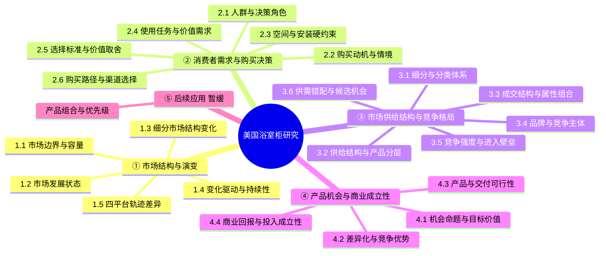
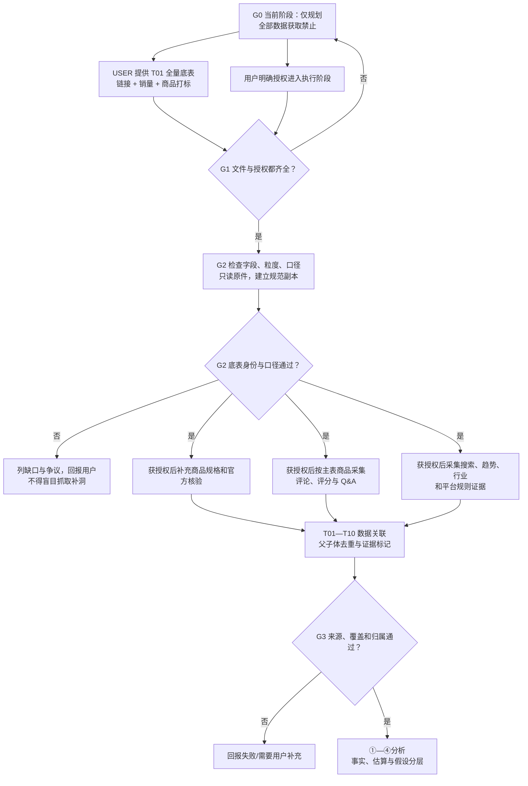

# 美国浴室柜四平台市场研究｜Agent 可读框架与数据计划 v1.0

> **最高优先级规则 / READ FIRST**：本文件是**计划和交接文档**，不是执行任务单。当前状态 `PLANNING_ONLY`。**禁止任何形式的数据收集**（包括网络搜索、打开商品页面、SellerSprite/KeywordTool MCP 查询、评论与 Q&A 抓取、行业报告下载）、SKU 分析、市场结论生成，以及对外部系统的写入。读取和讨论本文件本身不算数据收集。只有用户明确改变任务状态、提供基础全量表并完成验收后，才可按授权范围执行。

## 0. 任务定义与职责

**Purpose**：以美国 Amazon、Home Depot（HDP）、Lowe's、Wayfair 四个平台为并重研究对象，识别未来 **6–12 个月**值得布局的浴室柜产品机会，为后续品类组合与投入优先级决策提供可追溯证据。

**核心问题**：未来 6–12 个月，四个平台分别有哪些值得布局的浴室柜产品机会？如何确定整体产品组合与投入优先级？

**范围约束**：本文件重点规定已定稿框架 **①—④** 的数据来源与收集方案；⑤「品类布局与优先级」为后续应用模块，不在本阶段执行。**四平台研究权重并重，不预设资源投入均等。**

### 分工（已确认）

| 责任主体 | 负责范围 | 重要边界 |
|---|---|---|
| **USER** | 提供四平台商品链接、市场销量数据、商品属性与类型打标、完整的商品基础全量表；后续如需商业测算，提供企业内部成本/能力资料 | 用户提供的表是商品及销量研究的**主数据**，不是待被第三方工具替换的参考样本 |
| **AGENT** | 在执行授权后，检查并标准化用户底表；补齐评论、Q&A、消费者社区、关键词及趋势、行业报告、官方规格/安装资料、平台规则及外部可行性证据；跨源关联与分析 | **在收到并验收用户底表之前，不进行任何具体 SKU/规格的补充采集或聚合分析** |
| **SellerSprite MCP** | 授权后辅助 Amazon 评论、关键词、关键词趋势、相关类目和商品证据；Q&A 以届时实际可调用接口验证为准 | 不得假定它能提供四平台真实销量；不得把估算指标误标为实际成交数据 |
| **KeywordTool MCP** | 授权后辅助 Google/Bing 等关键词数据（实际覆盖范围及权限以工具返回为准） | 不得假定它等价于 Google Keyword Planner、Google Trends 或 Amazon 内部购买数据 |

**历史工作处理**：此前会话曾发生试采，但**不是本计划授权的正式采集结果**。新接手 Agent 不得据此直接开始研究、把试采结果当作已审核底表，或宣称已有完整市场结论。

---

## 1. 已定稿研究框架：一级 → 二级 → 三级证据问题



> ①研究**随时间的变化**；②研究**购买者及其决策**；③研究**当前及历史可比的产品供给/成交/竞争结构**；④研究**机会能否成立**。③ 的具体产品尺寸、价格带、材质、盆型、风格、SKU/SPU、成交组合和品牌层级是核心任务，不能从竞争研究中删掉。

### 1.1 三级证据任务映射（① 市场结构与演变）

| 二级节点 | 三级证据任务（待执行） | 核心数据维度 ID | 预期产物 |
|---|---|---|---|
| **1.1 市场边界与容量** | 1.1.1 定义浴室柜与邻近品类边界；1.1.2 定义四平台覆盖范围及成交口径；1.1.3 标注不可比与缺失 | D01,D02,D06,D15,D17 | 市场边界与口径文档 |
| **1.2 市场发展状态** | 1.2.1 对照可比时间的市场销量/销额；1.2.2 对照关键词热度；1.2.3 参考新建/翻新环境 | D06,D10,D15,D17 | 市场发展状态及证据限制 |
| **1.3 细分市场结构变化** | 1.3.1 尺寸和价格带变化；1.3.2 安装形式/盆型/材质变化；1.3.3 风格与功能元素变化 | D02,D03,D04,D05,D06,D10 | 细分结构历史对比 |
| **1.4 市场变化驱动与持续性** | 1.4.1 房屋新建/翻新驱动；1.4.2 消费者需求/风格驱动；1.4.3 成本、利率、平台及供应侧因素和反证 | D10,D14,D15,D17 | 驱动假设、反证与持续性评估 |
| **1.5 四平台发展轨迹差异** | 1.5.1 各平台相同口径的结构变化；1.5.2 平台独有的变化信号；1.5.3 无法比较的指标隔离 | D01,D05,D06,D10,D11,D17 | 四平台历史轨迹对照 |

### 1.2 三级证据任务映射（② 消费者需求与购买决策）

| 二级节点 | 三级证据任务（待执行） | 核心数据维度 ID | 预期产物 |
|---|---|---|---|
| **2.1 消费者人群与决策角色** | 2.1.1 购买者/付款者/使用者/安装者；2.1.2 住房及装修情境；2.1.3 具有决策差异的人群划分 | D08,D09,D14,D15 | 人群和角色地图 |
| **2.2 购买动机与情境** | 2.2.1 新装/翻新/替换触发；2.2.2 预算和时间制约；2.2.3 购买事件与关键词意图对应 | D08,D09,D10,D14,D15 | 购买情境结构 |
| **2.3 空间与安装硬约束** | 2.3.1 宽深高及动线；2.3.2 管线/下水/墙体/安装方式；2.3.3 进门、搬运、组装、兼容性风险 | D03,D08,D09,D13,D14 | 空间与安装约束清单 |
| **2.4 使用任务与价值需求** | 2.4.1 收纳、清洁、耐用与日常使用；2.4.2 装修审美和空间效率；2.4.3 交付和售后痛点 | D04,D08,D09,D14 | 用户任务与痛点地图 |
| **2.5 产品选择与价值取舍** | 2.5.1 价格×配置；2.5.2 材质×审美×功能；2.5.3 正负评价与放弃购买原因 | D03,D04,D05,D07,D08,D09,D14 | 选择因素与取舍矩阵 |
| **2.6 购买路径与渠道选择** | 2.6.1 发现/搜索；2.6.2 比较与信任；2.6.3 物流、安装、退货影响渠道选择 | D08,D09,D10,D12,D13,D14 | 消费者侧购买路径图 |

### 1.3 三级证据任务映射（③ 市场供给结构与竞争格局）

| 二级节点 | 三级证据任务（待执行） | 核心数据维度 ID | 预期产物 |
|---|---|---|---|
| **3.1 市场细分与产品分类体系** | 3.1.1 分类范围与形态；3.1.2 尺寸、价格、安装、材料、盆型、设计元素字典；3.1.3 跨平台属性映射 | D01,D02,D03,D04,D05,D17 | 统一分类和字段字典 |
| **3.2 产品供给结构与产品分层** | 3.2.1 各类型/尺寸的 SKU、SPU 供给；3.2.2 配置和材质层级；3.2.3 价格与定位层级 | D01,D02,D03,D04,D05,D11,D12 | 产品层级与供给结构表 |
| **3.3 市场成交结构与细分组合** | 3.3.1 SKU/SPU 数量与成交；3.3.2 销量/销额/份额；3.3.3 尺寸×价格、材料×安装、盆型×尺寸等交叉表 | D01,D02,D03,D04,D05,D06,D17 | 交叉结构与成交矩阵 |
| **3.4 品牌与竞争主体格局** | 3.4.1 品牌定位层级；3.4.2 细分覆盖和头部商品；3.4.3 集中度及平台差异 | D01,D05,D06,D07,D11,D12 | 品牌与竞品地图 |
| **3.5 竞争强度与进入壁垒** | 3.5.1 供给密度及同质化；3.5.2 定价、口碑及排名竞争；3.5.3 平台服务、履约与渠道壁垒 | D05,D06,D07,D10,D11,D12,D13 | 进入壁垒矩阵 |
| **3.6 供需错配与候选市场机会** | 3.6.1 将②的需求编码与③供给/成交关联；3.6.2 识别待验证缺口；3.6.3 查找替代解释和反证 | D02,D03,D04,D05,D06,D08,D09,D10,D11,D14,D17 | 带证据链的候选机会池 |

### 1.4 三级证据任务映射（④ 产品机会与商业成立性）

| 二级节点 | 三级证据任务（待执行） | 核心数据维度 ID | 预期产物 |
|---|---|---|---|
| **4.1 机会命题与目标价值** | 4.1.1 人群及任务；4.1.2 被证实/待证实的市场缺口；4.1.3 适用平台与产品形态 | D03,D04,D06,D08,D09,D10,D14,D15 | 可验证的机会命题 |
| **4.2 差异化价值与竞争优势** | 4.2.1 竞品替代方案；4.2.2 选择理由和付费意愿证据；4.2.3 负面案例与反例 | D04,D05,D07,D08,D09,D11,D12,D14 | 差异化证据矩阵 |
| **4.3 产品与交付可行性** | 4.3.1 材质/结构/品质；4.3.2 包装、物流、安装与兼容；4.3.3 规范、召回及供应链风险 | D03,D04,D08,D09,D13,D16 | 交付可行性与风险清单 |
| **4.4 商业回报与投入成立性** | 4.4.1 单位经济；4.4.2 可实现销量情景；4.4.3 开发投入、库存和资金占用 | D05,D06,D11,D13,D16,D17 | 商业成立性模型与敏感性分析 |

**贯穿④的横向质量门**：对每个机会标注事实、估算、解释性假设、证据强度、关键不确定性、验证任务和否决条件。**不是另立一个与 4.1—4.4 并列的二级节点。**

---

## 2. 数据维度字典（D01—D17）：完整待收集字段

| ID | 维度 | 必要字段 / 信息 | 主要责任 | 关联节点 |
|---|---|---|---|---|
| **D01** | 商品基础信息 | `platform`, `product_id`, `product_url`, `asin`, `parent_asin`, `child_asin`, `brand`, `spu`, `sku`, `model`, `snapshot_at` | USER 主表；AGENT 后续核验 | 1,3,4 |
| **D02** | 类目与产品结构 | `category_path`, `category_id`, `product_type`, `mount_type`, `single_double_sink`, `cabinet_form`, `bundle_scope`, `classification_confidence` | USER 原标签；AGENT 后续标准化 | 1,3,4 |
| **D03** | 尺寸与规格 | `width_in`, `depth_in`, `height_in`, `sink_type`, `basin_count`, `doors`, `drawers`, `plumbing_cutout`, `installation_type`, `variant_attributes` | USER 原标签；AGENT 后续核验 | 2,3,4 |
| **D04** | 材料与设计 | `cabinet_material`, `finish`, `countertop_material`, `basin_material`, `color`, `style`, `fluted`, `storage_features`, `hardware`, `design_elements` | USER 原标签；AGENT 后续补全 | 2,3,4 |
| **D05** | 商品价格 | `list_price`, `sale_price`, `coupon`, `effective_visible_price`, `price_currency`, `price_at`, `price_history_source`, `price_tier` | USER 主表；AGENT 后续补证 | 1,2,3,4 |
| **D06** | 销量与成交 | `units`, `revenue`, `sales_period_start/end`, `grain`, `platform`, `entity_id`, `observed_or_estimated`, `coverage`, `data_source` | **USER 主数据** | 1,3,4 |
| **D07** | 评分与评论规模 | `rating`, `rating_count`, `star_distribution`, `review_count`, `review_date`, `review_growth`, `parent_scope` | USER 已有部分；AGENT 后续补证 | 2,3,4 |
| **D08** | 评论正文与痛点 | `review_text`, `review_title`, `star`, `review_date`, `verified`, `variant_sku_text`, `issue_tags`, `severity`, `source_product_url`, `attribution_level` | **AGENT；须底表验收后** | 2,3.6,4 |
| **D09** | Q&A | `question_text`, `answer_text`, `question_date`, `answer_source`, `theme`, `linked_product`, `variant_mentioned`, `attribution_level` | **AGENT；须底表验收后** | 2,3.6,4 |
| **D10** | 搜索、流量与关键词 | `source_engine`, `keyword`, `country`, `language`, `search_volume`, `purchases`, `rate_definition`, `trend_index`, `trend_window`, `rank`, `competition`, `ppc_bid`, `query_at` | AGENT；仅执行授权后 | 1,2,3,4 |
| **D11** | 品牌与竞品竞争 | `brand_tier`, `brand_coverage`, `sku_count`, `sales_share`, `product_concentration`, `new_entry`, `competitive_density`, `competition_metric_scope` | USER 成交底表 + AGENT | 3,4 |
| **D12** | 商品内容与销售配置 | `title`, `main_image`, `video`, `a_plus_or_equivalent`, `feature_claims`, `variation_listing_structure`, `promotion_badges`, `after_sales_promise` | AGENT；底表后 | 2,3,4 |
| **D13** | 配送、履约与安装 | `package_dimensions`, `shipping_weight`, `fulfillment`, `delivery_fee`, `delivery_time`, `assembly`, `installation`, `return_policy`, `damage_signal`, `applicability` | USER 可提供基础项；AGENT 后续查规则 | 2,3,4 |
| **D14** | 用户场景与需求 | `buyer_role`, `purchase_trigger`, `home_context`, `renovation_context`, `jtbd`, `pain_point`, `choice_driver`, `channel_choice`, `evidence_scope` | AGENT；评论/行业/社区交叉 | 2,3.6,4 |
| **D15** | 外部行业及趋势 | `report_title`, `publisher`, `publication_date`, `survey_fieldwork`, `sample_size`, `population_scope`, `indicator`, `geography`, `time_window`, `forecast_status` | AGENT；执行授权后 | 1,2,4 |
| **D16** | 商业与合规 | `bom`, `supplier_quote`, `moq`, `packaging_cost`, `freight`, `fulfillment_fee`, `ad_cost`, `return_cost`, `margin`, `fixed_investment`, `standard_ref`, `risk` | USER 经营/成本 + AGENT 公开规则 | 4；后续5 |
| **D17** | 数据质量及溯源 | `source_id`, `url`, `retrieved_at`, `published_at`, `data_period`, `source_class`, `metric_definition`, `coverage`, `join_method`, `missing_reason`, `confidence`, `version` | **AGENT 全程维护** | 贯穿1—4 |

**重要注释**：字段清单是目标字段而非所有平台均可获取的保证；缺失用 `null` + `missing_reason`，**绝不用 0、推测值或另一平台的指标顶替**。

---

## 3. 候选数据源及具体获取方法（均未获本阶段采集授权）

| 来源代码 | 数据源 / 具体入口 | 计划获取方法（未来执行时） | 提取维度 | 交叉用途 | 前提 / 限制 |
|---|---|---|---|---|---|
| **SRC-U01** | USER：四平台基础全量表、销售表、链接与打标 | 用户主动提供文件；保留只读原件并建标准化副本 | D01–D07,D11,D13,D17 | ①③④，②评论关联 | **必须先到位并验收**；不得重复采集替代 |
| **SRC-U02** | USER：企业 BOM、报价、经营与供应链数据（后续） | 用户按许可提供，保留币种、期间、SKU 与成本口径 | D13,D16,D17 | ④及后续⑤ | 未提供前不得编造成本或利润 |
| **SRC-P01** | [Amazon US 商品及分类页](https://www.amazon.com/) | 仅在用户底表有缺失或冲突时，按 ASIN/URL 定向核验；不重复拉全量属性 | D01–D05,D07,D12,D13 | ②③④ | 数据会随变体及时间变化 |
| **SRC-P02** | [Home Depot](https://www.homedepot.com/) | 按用户商品 URL 核验规格、配送、评论与公开服务 | D02–D05,D07–D09,D12,D13 | ②③④ | 部分评论/Q&A结构可能动态加载 |
| **SRC-P03** | [Lowe's](https://www.lowes.com/) | 按用户商品 URL 核验同类字段 | D02–D05,D07–D09,D12,D13 | ②③④ | 规格和变体必须精确匹配 |
| **SRC-P04** | [Wayfair](https://www.wayfair.com/) | 按用户商品 URL 核验系列、尺寸、配置、评论和配送 | D02–D05,D07–D09,D12,D13 | ②③④ | 系列/尺寸变体不可混为单 SKU |
| **SRC-REV01** | SellerSprite MCP `review` | 用户底表验收、授权后：`marketplace=US` + ASIN 分页获取标题、正文、星级、时间、SKU 标签等 | D07,D08,D14,D17 | ②③.6④ | 父体共评、重复返回、缺少单条评论 ID/URL 的情况须处理 |
| **SRC-QA01** | Amazon Q&A（SellerSprite 或商品问答页） | 用户底表验收、授权后：**先验证可调用的 Q&A 正文接口和字段**；无可用接口则按许可访问公开问答区 | D09,D14,D17 | ②③.6④ | 用户认为 MCP 可用，但不同 Agent 环境需重新验收；不得假称已取到正文 |
| **SRC-REV02** | HDP / Lowe's / Wayfair 评论及问答 | 用户底表验收后，根据各商品 URL、可访问页面/API、站点使用规范取样，保留归属和来源 | D07–D09,D14,D17 | ②③.6④ | 采集覆盖、分页和开放性须按平台验证 |
| **SRC-COM01** | [Reddit](https://www.reddit.com/)；[Houzz 社区](https://www.houzz.com/) | 授权后按装修/收纳/安装/价格/耐用等主题检索公开讨论，标注样本偏差与反例 | D14,D17 | ②③.6④ | 定性讨论**不能**直接计算总体购买占比 |
| **SRC-KW01** | SellerSprite MCP `keyword_miner`, `keyword_research_trends`, `aba_research_trend` 等 | 授权后设 `marketplace=US`、词簇、完整月份（初始建议最近12个月，趋势视可用历史延长） | D10,D17 | ①②③④ | Amazon 数据/模型值；必须统一购买率单位和同义词重叠 |
| **SRC-KW02** | [KeywordTool](https://keywordtool.io/mcp) | 若 Agent 环境能调用相应 MCP，再按 US、语言/搜索引擎、最近完整12个月获取建议词与可用搜索量 | D10,D17 | ①②③.6 | 账号套餐、引擎支持与历史范围须实际验收 |
| **SRC-KW03** | [Google Trends](https://trends.google.com/trends/explore) / SellerSprite `google_trend` | 授权后取美国、可比搜索词、五年历史和近12个月变化；保留查询配置 | D10,D15,D17 | ①②③.6 | 0–100 为标准化相对热度，不是绝对搜索量；不同独立请求不直接比较指数 |
| **SRC-KW04** | [Google Keyword Planner](https://ads.google.com/home/tools/keyword-planner/) | 如有账号权限，授权用户导出 Top 词的月度搜索量区间及竞价等 | D10,D17 | ①②③.6 | 需要 Google Ads 权限，没权限不可假称能导出 |
| **SRC-BA01** | [Amazon Brand Analytics](https://sell.amazon.com/tools/amazon-brand-analytics) | 如用户有权限，提供 Seller Central 导出的搜索/品牌漏斗报告；Agent 只消费合法提供的导出 | D10,D17 | ①②③④ | 公开说明页**不等于**后台报告；不代表全平台完整商品销量 |
| **SRC-RPT01** | [Houzz U.S. Bathroom Trends](https://www.houzz.com/magazine/) | 授权后优先 2026 年版，视需要比较 2025/2024；记录调查时间、样本、完整 PDF 与页码 | D14,D15,D17 | ①②④ | 调查业主样本不等于所有线上柜类消费者 |
| **SRC-RPT02** | [NKBA Research](https://nkba.org/research/) | 授权后优先 2026 Bath Trends、2026 Kitchen & Bath Outlook；可用公开摘要，全文付费需另经授权 | D14,D15,D17 | ①②③④ | 行业级趋势，非浴室柜电商销量 |
| **SRC-RPT03** | [Harvard JCHS LIRA](https://www.jchs.harvard.edu/research-areas/remodeling/lira) | 授权后查看最新发布及历史改造支出趋势，记录预测与观察值区别 | D15,D17 | ①②④ | 住宅翻新周期代理，不是浴室柜专属销量 |
| **SRC-RPT04** | [U.S. Census AHS](https://www.census.gov/programs-surveys/ahs/data.html)；[NRC](https://www.census.gov/construction/nrc/data.html) | 授权后取可获得的近年调查期/近五年月度新建数据，保留年度及调查口径 | D14,D15,D17 | ①②④ | 新建/住房信息不能直接转化为柜类销售 |
| **SRC-BRD01** | 品牌官网、产品目录、规格/安装 PDF | 底表后按精确品牌+型号核实尺寸、材料、盆型、安装条件和保修 | D02–D04,D12,D13,D17 | ②③④ | 优先官方文件，记录版本及适用型号 |
| **SRC-POL01** | 四平台官方费率、履约、退货、卖家规则 | 授权后以官方规则和用户专属合同为准，注明生效日期和条件 | D13,D16,D17 | ③.5④ | 公共规则不能代替企业合同价 |
| **SRC-STD01** | CPSC / 适用安装、无障碍及管道规范 | 授权后按产品形态和目标销售场景查询适用法规、标准、召回及案例 | D03,D09,D13,D16,D17 | ②.3④.3 | 不擅自认定某个规范全国或所有场景都适用 |
| **SRC-SOC01** | Pinterest Trends / TikTok 公开趋势（可选） | 仅当设计趋势证据缺口存在且获授权时，按美国地区及时间窗口取相关公开信号 | D04,D14,D15,D17 | ①②③ | 内容热度不等于销量，非首批必采 |

**来源使用原则**：优先使用**已提供的用户主表**和官方可核验来源；第三方估算、消费者评论、行业调查、宏观统计按证据性质分层保存，不跨口径硬相加。链接是计划入口，**并不声明本轮已重新打开、下载或采集**。

---

## 4. 数据资产定义（T01—T10）与关联粒度

| 数据表 | 粒度（建议主键 / 关键关联键） | 核心内容 | 状态 / 责任 |
|---|---|---|---|
| **T01 商品基础全量表** | `platform + platform_product_id + variant_id + snapshot_at`；原表实际粒度以用户数据为准 | 链接、打标、商品主信息、商品/变体标识；可包含用户销量字段 | **USER 提供；只读原件** |
| **T02 商品规格与属性表** | `platform + product/variant_id + version_at` | 类型、尺寸、结构、材料、盆型、风格、安装、属性字典 | USER 原标签 + AGENT 授权后标准化 |
| **T03 销量与价格分析表** | 销量：`platform + entity_id + period`；价格：`platform + variant_id + price_at` | 销量/销售额、统计周期、价格历史、币种、口径和估算标签 | USER 主销量 + AGENT 授权后整合 |
| **T04 评论与评分明细表** | `source + parent_id + review_id`（若无 review_id，使用受控指纹；保留去重置信度） | 原文、星级、时间、Verified、评论 SKU 标签、归属级别、产品 URL | AGENT；**须过执行 Gate** |
| **T05 Q&A 明细表** | `source + product_or_parent_id + qa_id`（没有则受控指纹） | 问题、回答、可见时间、变体归属、商品 URL | AGENT；**须过执行 Gate** |
| **T06 用户问题与需求标签表** | `evidence_record_id + taxonomy_version + tag_id` | 评论/Q&A/社区多标签、主题、严重性、证据类型、反例 | AGENT；源数据后建立 |
| **T07 关键词与趋势表** | `engine/source + country + keyword + period + query_configuration` | 搜索量、购买信号、相对热度、竞争、PPC、工具和指标定义 | AGENT；**执行授权后** |
| **T08 四平台市场对比表** | `platform + segment_id + period + metric_definition` | 品类/尺寸/价格/材料/品牌/交易表现对比、不可比项说明 | AGENT；T01–T07 完成后 |
| **T09 商业可行性表** | `opportunity_id + platform + scenario + model_version` | 产品和交付限制、平台费用、成本、情景利润/风险、假设 | USER 成本 + AGENT 外部规则；后续 |
| **T10 来源与证据登记表** | `source_record_id` | URL、文档标题、作者、日期、采集任务、字段定义、估算/观察、权限和覆盖 | AGENT；随合法采集同步建立 |

### 4.1 核心关联键及必守规则

1. **身份链**：`platform → platform_product_id → parent_product_id → child/variant_id → normalized_SPU/SKU`。其中 `SPU` 拼写请实际落地统一为 `spu`；跨平台相似外观不自动认定为同一 SKU，需有型号、规格或可靠证据。
2. **销售时间链**：`sales_period_start / sales_period_end` 与 `price_at`、`snapshot_at` 分开管理。月销、累计销量、模拟销量、实际销量不可互加。
3. **评论归属链**：评论 API 如果按多个子 ASIN 返回同一父体的评论，**先在父体级去重**。有可验证 SKU/尺寸标签才分配到该变体；没有的保留 `attribution_level=parent`，不得复制到每个子体。
4. **Q&A 归属链**：按来源和具体问答所在父体/子体建立映射。提问中提及某尺寸，只有可靠证据时才归到该规格，否则为 `parent` 或 `unknown`。
5. **价格关联链**：评论发生时价格未知，则只能关联**采集时价格**或可核验的历史快照，并标注 `price_relation=current_snapshot`，不能当作评论发生日成交价。
6. **评论去重**：优先平台提供的评论 ID；否则采用父体范围内的正文+标题+时间等受控指纹，记录冲突和置信度。去重前后计数分别保存。
7. **关键词链**：关键词是独立于 SKU 的需求信号。将关键词簇映射至产品类型/尺寸/风格时需显示映射规则；包含近义词的总搜索量**不可直接相加**视作独立消费者总量。
8. **因果限制**：任何 `产品特征 × 销量/评分/评论` 的相关性仅用于提出验证假设，不当成已证明的因果关系。
9. **来源完整性**：所有补充记录必须关联 `source_record_id`（T10）；不存在来源的结论不得进入正式交付。

### 4.2 评论与 SKU 规格的正确示例

```text
父体 P
├── 子体 V1：24 in / 白色 / $X
├── 子体 V2：30 in / 木色 / $Y
└── 子体 V3：36 in / 黑色 / $Z
    ├── 评论 R1：SKU标签明确对应 V2 → 仅计入 V2
    ├── 评论 R2：仅能确定父体 P      → 仅计入 P，不均分至 V1/V2/V3
    └── Q&A Q1：仅在父体下公开     → 先计入 P；如有确切规格信息再归属
```

**统计口径**：父体总体评论频次 ≠ 子体评论频次之和（存在未知变体评论）；不能为填补缺口而按销售比例摊派。

---

## 5. 数据源复用矩阵：一份原始数据支撑多个节点

| 数据族 | ①市场变化 | ②需求决策 | ③供给竞争 | ④商业机会 | 不可替代之处 |
|---|:---:|:---:|:---:|:---:|---|
| **USER 商品/销量主表** | ✓ | 部分 | ✓ | ✓ | 唯一主商品/销量口径，不被其他平台估算替换 |
| **评论、评分、Q&A** | 部分 | ✓ | ✓ | ✓ | 解释具体需求和缺陷；没有销量代表性 |
| **SellerSprite Amazon 关键词** | ✓ | ✓ | ✓ | ✓ | Amazon 搜索/购买信号，非四平台合计需求 |
| **KeywordTool / Google Trends / Planner** | ✓ | ✓ | 部分 | 部分 | Google/Bing 搜索与 Amazon 行为分属不同体系 |
| **Houzz / NKBA / Harvard / Census** | ✓ | ✓ | 部分 | ✓ | 行业/住房/业主趋势，非 SKU 销量 |
| **品牌官网 / 规格 / 安装资料** | — | ✓ | ✓ | ✓ | 官方技术配置和安装限制的核验证据 |
| **四平台规则 / 法规 / 召回** | — | 部分 | ✓ | ✓ | 履约、进入和合规门槛，保留生效条件 |
| **企业 BOM / 成本 / 经营表现** | — | — | 部分 | ✓ | 财务模型和商业成立性所需真实内部约束 |

---

## 6. 工作流及 Gate（硬性控制）



### Gate 明细

| Gate | 进入条件 | 可以做 | 不可以做 |
|---|---|---|---|
| **G0 当前** | 未明确授权执行；或尚未有合格主表 | 讨论框架、修改本计划、制定字段字典 | **任何网络/MCP/后台查询，任何评论/Q&A/行业报告采集，任何 SKU 或市场分析** |
| **G1 资料到位** | 用户给出主表**且明确下达执行授权** | 读取用户提供的文件、盘点实际字段 | 不得跳过权限边界或自行扩大范围 |
| **G2 底表验收** | 身份、父子体、销量周期、平台口径、属性打标均可识别，争议已标记 | 在授权范围内补充商品级数据、评论、Q&A及外部资料 | 不得凭模糊商品名把评论分配到错误 SKU |
| **G3 证据质量** | 来源可追溯，重复项/估算项分离，关键匹配与覆盖问题透明 | 进入①—④分析及机会假设 | 不得把缺失填 0，或把相关性当因果 |
| **G4 后续⑤** | ①—④完成，且用户提供能力/产品组合约束并授权 | 品类布局与优先级决策 | 不得提前替用户决定具体开发 SKU |

**现在的 Gate = G0。不得自动升级。**

### 最小可行试点（仅是计划，不立即执行）

未来获得 G2 许可后，可以先选择覆盖关键产品类型/尺寸/价格层的样本，而不是直接全量下载；先验证三件事：
- 评论/Q&A 是否可以准确归属父体/子体、是否有重复及关键字段缺失；
- 四平台商品属性、价格和销售表现是否在相同分类和时间口径下可比；
- 搜索、行业和消费者数据与商品特征之间能否形成有依据的证据链。

**试点数量和采样规则**需结合 T01 的实际总体、层级分布及接口限制确定；此处不预先把某个固定样本数当作最终覆盖目标。

---

## 7. 输出质量要求与停止条件

### 每条分析结论必须具备

- `claim`：具体结论或待验证假设；
- `supporting_data_ids`：关联 T01—T10 的记录标识；
- `source_urls`：可核验来源；
- `metric_definition`：单位、平台、时间、商品/变体统计口径；
- `evidence_type`：`direct_observation | user_provided | third_party_estimate | survey | qualitative | inference`；
- `confidence`：`high | medium | low | insufficient`，并写明原因；
- `counter_evidence` / `open_questions`：反证和限制；
- `affected_nodes`：1.x / 2.x / 3.x / 4.x。

### 任一条件发生时应停止相关分析并回报

1. 基础全量表尚未交付或用户未明确授权开始采集；
2. 父子体、SKU、型号或评论关联无法确认，却需要做细分定量结论；
3. 四平台销量统计期间或“实际/估算”性质不一致，且尚无可比处理方式；
4. 关键外部来源需要登录、会员/付费、权限或存在获取限制；
5. 重要维度缺失导致结论无法验证；
6. 任何请求要求违反页面许可、平台使用限制或未经授权进入账号后台。

---

## 8. 下一次 Agent 接手指令（复制即用）

> 你接手的是「美国浴室柜四平台研究①—④数据计划」，文件状态为 **PLANNING_ONLY**。**不要访问互联网、运行 MCP、获取报告、抓取评论或 Q&A、分析 SKU、输出市场判断。** 请先阅读本文中的框架、D01—D17 字段表、T01—T10 数据资产、数据源复用关系与 G0—G4 Gate。用户负责提供四平台商品链接、销售数据、商品打标和基础全量表；只有在用户提供该表、验收通过且明确授权执行后，你才可按限定范围进行补充数据采集。任何评论或 Q&A 必须关联到商品身份、产品类型、尺寸/属性和价格层；父体共享评论不能重复当作多个子体的独立反馈。回答问题时区分用户原始数据、直接观测、第三方估算、定性研究和推断，说明数据口径和来源。若用户本次仅要求修改计划，**只修改文档，不执行收集**。

## 9. 计划版本与当前状态

| 项目 | 当前状态 |
|---|---|
| ①—④二级框架 | 已定稿 |
| 三级证据任务及 D01—D17 数据维度 | 已规划 |
| T01—T10 数据资产和关联口径 | 已规划，待底表到位后验收 |
| 数据源目录和获取方法 | 已规划，不代表已采集 |
| USER 提供四平台基础全量表 | **待提供** |
| 评论 / Q&A / 关键词 / 行业资料采集 | **未授权、暂停** |
| ①—④市场研究与 SKU 聚合分析 | **未授权、暂停** |
| ⑤组合与投入优先级 | 后续阶段 |

**文档结束。**
