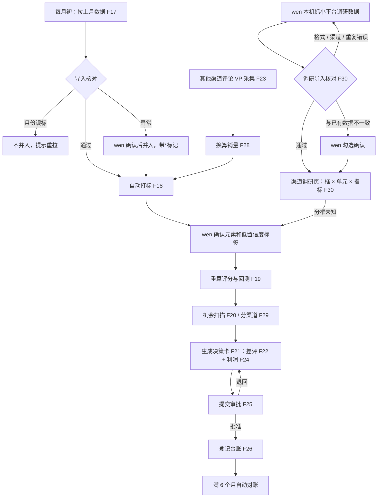
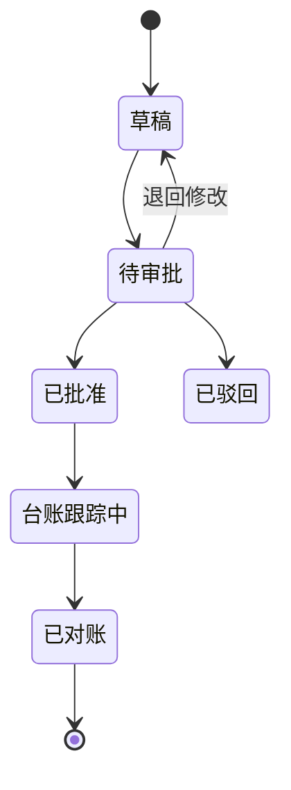

# 品类机会判定台 · PRD

**版本**: v10（第二轮，需求契约 revision 10：决策卡改版、页面白话、扫描需求范围、分框调整；wen 2026-11-05 确认）
**状态**: 初版，待完善
**作者**: PRD 大师协作产出（wen 拍板）
**日期**: 2026-11-05
**品类**: B 端内部工具（网页系统）

> **上游**：
> - `解题方案书.md`（第二轮，2026-11-03；§10 小平台回测增量 2026-11-03；§11 小平台"单元 × 指标"观察增量 2026-11-04）；
> - `../scene-anchor.md`（第二轮 V1，wen 已确认）。
>
> **第一轮**：PRD v5（F01–F14）于 2026-10-27 被判定未达预期，全部 retired，原文见 git 历史。本版 ID 从 F15 起编。
>
> **行为细则**：以 `requirements.md` 为准，本文只摘要并引用。

---

## 0. 阶段路线图与 MVP 定义

| 阶段 | 已确认目标 | 功能模块 | 交付物（做完用户拿到什么） |
| :--- | :--- | :--- | :--- |
| 第一版 | wen 每月不靠 AI 会话，就能完成：拉数据 → 打标确认 → 机会扫描 → 决策卡 → 老板审批 → 台账对账；Amazon、Home Depot、Lowe's、Wayfair 分渠道扫描、决策卡并排；利润测算、评论 VP 追踪在同一系统里；小平台导入本机抓好的数据后按框看"单元 × 指标"（v9） | F15–F30（REQ-F30-05 除外） | 在 wen 电脑上运行、局域网共享的网页系统，只开浴室柜 |
| 第二版（planned，未启动） | 小平台调研数据由系统自己抓：关键词 + 类目节点、先估算费用再确认、每月续更 | REQ-F30-05 | 渠道调研页的"抓取"入口；启动时再核实采集方式与费用 |

> **本次范围与完成定义**：
> - **范围**：scope = 第一版，F15–F30 交付（REQ-F30-05 属第二版）。F15–F27 为 wen 2026-11-03 确认"第一版全做"；F28、F29 为同日 wen 要求加入其他渠道；F30 为 wen 2026-11-04 确认的小平台调研"导入 + 展示"，系统内抓取记第二版。
> - **品类**：只有浴室柜；分框和打标规则可配置（F27）。
> - **端**：浏览器网页一端；局域网访问，不开放公网。
> - **渠道**：Amazon（卖家精灵月度数据）；Home Depot、Lowe's、Wayfair（评论 VP 月度数据换算销量）。
- **外部接口**：卖家精灵、Bright Data、Apify、大模型（多家可选）。
> - **完成定义**：`requirements.md` 中第一版 REQ（F15–F30，REQ-F30-05 除外）的全部 AC 和 NFR-007～014 通过。

---

## 1. 项目背景与收益

### 1.1 需求简介（一句话）

浴室柜立项要提前约 8 个月判断，做错一次损失 30–40 万元以上。这个系统把第二轮验证过的方法固化成每月可重复跑的流程：
- 分框扫描机会；
- 决策卡写清"在赌什么、看到什么就停"，并附具体 SKU 实证；
- 老板在系统里审批，立项后登记台账，6 个月后对账。

### 1.2 收益预估

#### 用户收益

- wen 每月从拉数据到出机会扫描，不需要 AI 会话介入；人工只确认元素和低置信度标签。—— 依据：C —— 来源：场景锚点（wen 2026-11-03）
- 决策卡数字都来自系统计算、可追溯，避开第二轮出现过的口径错误（不分形态、误用 9 月数据）。—— 依据：B —— 来源：`solution-v2/机会判定卡/决策卡_竖棱.md` 第 3 版；`solution-v2/数据准备/卖家精灵导出_2025-03至12_核对.md`

#### 业务收益

- 立项判断有台账可对账，用来检验方案书的有效标准（市场层 D 档之后变大 ≤ 30%；新品层前 20% 做到率 ≥ 平均 2 倍）。
  - 回测现状：市场层已达标（19%–25%）；新品层未达标（1.1–2.1 倍）。
  - 依据：B。来源：`solution-v2/开发建议/回归预测_回测_第九版.md`
- 每次立项都有决策卡和审批记录。目标是下一次立项评审会起全部使用。依据：C。来源：方案书第 7 节

#### 不做风险

- 方法停在 AI 会话和 Markdown 文件里，每月要人工重跑，口径容易出错，结论也没法回看是否说对。

---

## 2. 用户画像

### 2.1 角色与权限矩阵（B 端必须）

| 角色 | 典型职位 | 公司规模 | 行业 | 决策权 | 使用频次 | 关键场景 |
|------|---------|---------|------|--------|---------|---------|
| 操作者 | wen（产品开发） | 一年 10–十几款立项 | 亚马逊美国浴室柜 | 生成和编辑决策卡、提交审批、配置系统 | 每月数据更新 + 每次评审前 | 拉数据、确认标签、扫描、写卡、利润测算、评论采集 |
| 审批者 | 老板 | 同上 | 同上 | 批准 / 驳回立项与策略库"已验证" | 每次评审 | 看卡、审批、留意见 |
| 只读 | 运营、采购、研发 | 同上 | 同上 | 无 | 评审会前后 | 看扫描、渠道调研、决策卡、台账 |

角色权限：操作者全部可做；审批者只看、审批、留意见，不改内容；只读只能看。未登录看不到任何数据（AC-F15-01～03）。渠道调研页三类角色都能看，只有操作者能导入和确认分框（AC-F30-09）。

### 2.2 明确不是谁

- ❌ 外部客户或公网用户：系统只在局域网内使用。
- ❌ 自动立项、自动下单：系统只给建议，拍板在人。

### 2.3 用户故事

- **US-F15-01**: 作为 操作者，我希望建账号并按角色控制权限，以便老板审批留痕、未登录者看不到数据。
- **US-F16-01**: 作为 操作者，我希望在设置页配置密钥、选大模型、设预算，以便花钱前有数，到上限自动停。
- **US-F17-01**: 作为 操作者，我希望系统每月用卖家精灵接口拉数据并自动核对，以便不用手动导出，也不会误用月份。
- **US-F18-01**: 作为 操作者，我希望系统自动打标，我只确认元素和低置信度标签，以便人工只看少数产品。
- **US-F19-01**: 作为 操作者，我希望新数据进来后重算评分并看到回测是否有效，以便知道本月评分能不能信。
- **US-F20-01**: 作为 操作者，我希望在"尺寸 × 拆装 × 形态"框里看到四类机会，以便先找到机会再做卡。
- **US-F21-01**: 作为 操作者，我希望对选中的机会生成决策卡并编辑叙述，以便评审会直接拍板、能展开看实证。
- **US-F22-01**: 作为 操作者，我希望对卡里的 SKU 拉差评并归类，以便知道问题能不能改。
- **US-F23-01**: 作为 操作者，我希望在同一系统里做评论 VP 月度追踪，以便不用另开工具。
- **US-F24-01**: 作为 操作者，我希望在同一系统里做利润测算并回写决策卡，以便"钱"一节有毛利。
- **US-F25-01**: 作为 审批者，我希望在系统里审批立项和策略库条目，以便拍板有记录、状态清楚。
- **US-F26-01**: 作为 操作者，我希望立项时登记预测、6 个月后自动对账，以便知道说得准不准。
- **US-F27-01**: 作为 操作者，我希望分框和打标规则可配置，以便以后加品类只改配置。
- **US-F28-01**: 作为 操作者，我希望把 Home Depot / Lowe's / Wayfair 的月度评论数据换算成可比较的销量估算，以便其他渠道也能分框看份额和趋势。
- **US-F29-01**: 作为 操作者，我希望每个渠道单独扫机会、决策卡并排显示各渠道方向，以便得出"只上 Wayfair"这类结论，并用多渠道信号互相印证。
- **US-F30-01**: 作为 操作者，我希望导入本机抓好的小平台商品与逐月评论数据，按渠道 × 框看"单元 × 指标"，以便小平台还不能回测时也能按同框观察，并知道哪些框的数据够下结论。

---

## 3. 功能需求

### 3.1 功能清单

| ID | 功能 | 所属阶段 | 优先级 | 一句话说明 | 实现 US |
|----|------|---------|--------|----------|---------|
| F15 | 账号与角色 | 第一版 | 必做 | 三类角色，局域网登录 | US-F15-01 |
| F16 | 设置：密钥、预算与费用 | 第一版 | 必做 | 设置页管理密钥，先评估再确认，月度上限，记账 | US-F16-01 |
| F17 | Amazon 月度数据拉取与导入核对 | 第一版 | 必做 | 卖家精灵接口按月拉，检测月份误标、来源切换、覆盖率 | US-F17-01 |
| F18 | 自动打标与人工确认 | 第一版 | 必做 | 规则 + 看图打标，元素和低置信度进确认队列；其他渠道优先按商品页规格打标（v8） | US-F18-01 |
| F19 | 模型更新与回测 | 第一版 | 必做 | 重算第九版市场评分、新品打分，滚动回测与告警；其他渠道分渠道建模回测，达标为"经回测（打折）"（v8） | US-F19-01 |
| F20 | 机会扫描 | 第一版 | 必做 | 分框四类机会，勾选筛选，一键做卡 | US-F20-01 |
| F21 | 决策卡 | 第一版 | 必做 | 十项内容 + SKU 和趋势展开，AI 叙述草稿 | US-F21-01 |
| F22 | 差评拉取与归类 | 第一版 | 必做 | 1–3 星评论拉取，按原因归类 | US-F22-01 |
| F23 | 评论月度 VP 追踪（并入） | 第一版 | 必做 | 原工具功能保留，共用设置与记账；历史回补：前 N 个商品页的全部历史评论与规格（v8） | US-F23-01 |
| F24 | 利润测算（并入） | 第一版 | 必做 | 原工具功能保留，方案存服务端，回写决策卡 | US-F24-01 |
| F25 | 审批：立项与策略库 | 第一版 | 必做 | 立项审批锁定版本；策略库三状态与版本 | US-F25-01 |
| F26 | 预测台账与对账 | 第一版 | 必做 | 批准即登记，满 6 个月自动对账，汇总准确率 | US-F26-01 |
| F27 | 品类配置 | 第一版 | 必做 | 分框维度、属性、打标规则、渠道换算系数和成功线可配置；只开浴室柜 | US-F27-01 |
| F28 | 其他渠道数据与销量估算 | 第一版 | 必做 | 评论 VP 数据并入；评论换算法（VP × 50、非 VP × 20）与榜单排名平滑法；同系列去重；按评论日期重建 2024 年以来月度历史、评论家族合并、覆盖与换手（v8） | US-F28-01 |
| F29 | 分渠道机会与跨渠道印证 | 第一版 | 必做 | 四个渠道各自分框扫描；决策卡并排、给出分渠道结论；多渠道印证或分歧；Amazon 侧供给丰富度作为小平台评分信号（v8） | US-F29-01 |
| F30 | 渠道调研（单元 × 指标观察） | 第一版（系统内抓取：第二版） | 必做 | 导入 wen 本机抓好的商品表与月销表并核对；新页面按渠道 × 框看单元 × 指标、可读性标记、Amazon 同框对照；分框判断不了的进打标确认；证据等级"历史观察"，不并入机会扫描（v9） | US-F30-01 |

### 3.2 详细功能说明（共享层）

#### 3.2.1 通用约定

- **时区**：北京时间显示；"月份"指数据所属的自然月。
- **分框**：一切比较都在"尺寸段 × 拆装 × 形态"框内进行（方案书第 3 节教训 2；纪要硬规则）。
- **统一叫法**（wen 2026-11-04）：框 = 尺寸段 × 拆装 × 形态；属性 = 台面材质 / 元素 / 主色 / 柜体材质；取值 = 属性的值；单元（表的一行）= 框 × 属性取值；指标（表的一列）= 观察的数据维度；模式 = 指标组合成的信号。"维度"只作指标的口语，不再指属性。
- **标记**：来源切换或核对异常的月份，在所有图表和卡片中带 * 标记（AC-F17-05）。
- **证据等级**：经回测 / 经回测（打折）/ 历史观察 / 未验证。渠道调研（F30）的结果一律"历史观察"；同一单元若在机会扫描里有"经回测（打折）"，两者分开标、不合并（AC-F30-25）。
- **数据权限**：按角色控制；不按品类或行做隔离（第一版只有一个品类）。

### 3.3 详细功能说明（模块层）

#### 3.3.1 账号与角色（F15）

**位置**：登录页；账号页（仅操作者可见）。
**目标**：三类角色各做各的事，审批可追溯。
**业务过程与结果**：操作者建账号并指定角色；登录后按角色显示可用操作。
**关键边界与失败结果**：停用的账号在下一次请求时失效。
**规则细则**：REQ-F15-01、REQ-F15-02；AC-F15-01～05。

#### 3.3.2 设置：密钥、预算与费用（F16）

**位置**：设置页（仅操作者）。
**目标**：四类外部服务的密钥由 wen 自助配置；花钱前先评估再确认，并有月度上限。
**业务过程与结果**：
- 填写、测试、更换、删除密钥，页面只显示后 4 位；
- 大模型可选多家；
- 每个按量计费的服务设月度上限；
- 每个会花钱的任务都先显示预计费用和耗时，wen 确认后才开始；
- 所有调用都记账。

**关键边界与失败结果**：
- 达到上限即停，已采数据保留；
- 密钥失效时，相关功能显示"未连接"，不发起调用。

**规则细则**：REQ-F16-01、REQ-F16-02；AC-F16-01～08；NFR-008。

#### 3.3.3 Amazon 月度数据拉取与导入核对（F17）

**位置**：数据页。
**目标**：每月拉上月浴室柜类目全量数据，自动核对后并入。
**业务过程与结果**：选月份 → 看评估费用并确认 → 拉取（可断点续拉）→ 核对 → 通过或经 wen 确认后并入。
**关键边界与失败结果**：
- "上月购买标"日期不对，或与上月小类排名重合超过 10%，判为疑似月份错误，不并入。依据：2026-10 导出两次都是 9 月数据。
- 品类总量、家族键一致性、标签覆盖率异常时，需要 wen 确认才能并入，并入后带 * 标记。
- 卖家精灵拉取失败时，可手动上传同格式文件，核对照常进行。

**规则细则**：REQ-F17-01、REQ-F17-02；AC-F17-01～05；NFR-011、NFR-012。

#### 3.3.4 自动打标与人工确认（F18）

**位置**：打标确认页。
**目标**：规则打全部标签；元素靠看图打；wen 只确认元素和低置信度标签。
**业务过程与结果**：
- 新数据自动打标，每个标签带置信度；
- 元素和置信度低于阈值的标签进入确认队列，主图相同的商品分成一组，选一次即应用到整组；
- 确认后的标签在下一次扫描中生效；
- 标为"看不出 / 不是本品类"的商品，不进入分析。

以上沿用第二轮复核页和合并脚本的做法。
**关键边界与失败结果**：未配置大模型时，元素全部进入人工确认。其他渠道的商品走同一套规则和同一个确认队列，并标明渠道。
**规则细则**：REQ-F18-01～03；AC-F18-01～07。

#### 3.3.5 模型更新与回测（F19）

**位置**：模型页；首页的有效性提示。
**目标**：新数据并入后，按第九版规则重算并检验。
**业务过程与结果**：
- 市场层：为每个分框单元重算把握、A / B / C / D 分级、立项后 6–10 个月份额预测和 80% 区间；
- 新品层：重训做到概率模型并做校准，显示模型偏差；
- 滚动回测，和上一版并排比较。

规则见 `识别方法_预登记.md` 第六至九版补记，以及 `trial/回归预测.py`、`回归预测_第九版.py`。
**关键边界与失败结果**：有效性检验不通过时，首页和每张决策卡顶部都显示告警。
**规则细则**：REQ-F19-01、REQ-F19-02；AC-F19-01～04。

#### 3.3.6 机会扫描（F20）

**位置**：机会扫描页。
**目标**：在近 6 个月月销 ≥ 200 件的框里，列出每个属性取值的四类机会：增长型、评分缺口型、价格缺口型、坑。
**业务过程与结果**：
- 扫描结果的口径同 `机会扫描_202610.md`；
- 可勾选关注的变量、框和机会类型；
- 点"做决策卡"进入 F21。

**关键边界与失败结果**：
- 只在框内比较；
- 每条机会显示证据等级。

**规则细则**：REQ-F20-01、REQ-F20-02；AC-F20-01～05；NFR-009。

#### 3.3.7 决策卡（F21）

**位置**：决策卡页。
**目标**：每个机会一张卡，包含十项内容和展开项。样板见 `solution-v2/机会判定卡/决策卡_树脂.md` 等 4 张。
**业务过程与结果**：
- 生成卡片：数字由系统计算，wen 只编辑叙述文字；
- SKU 展开：链接、主图、逐月价格 / 价比 / 评分 / 月销 / 排名；
- 趋势展开：份额、新品占比、溢价率、价格带；
- 可用大模型起草"为消费者解决了什么问题"，标为"AI 草稿"。

**关键边界与失败结果**：
- 新品做到概率同时显示原值和扣偏差后的值；
- 数字可追溯到框、月份和样本数。

**规则细则**：REQ-F21-01～03；AC-F21-01～06；NFR-010。

#### 3.3.8 差评拉取与归类（F22）

**位置**：决策卡的"差评"一节。
**目标**：知道低评分是可改的问题（装配、运输、部件），还是材料本身的问题。依据：第二轮共归类 108 条差评。
**业务过程与结果**：
- Amazon 评论用卖家精灵拉 1–3 星，每个 SKU 最多 30 条；
- 其他平台的评论取 F23 已采集的明细；
- 用大模型按六类原因归类并统计占比；
- wen 可以改判，占比随之重算。

**关键边界与失败结果**：没配置大模型时，只显示原文。
**规则细则**：REQ-F22-01、REQ-F22-02；AC-F22-01～04。

#### 3.3.9 评论月度 VP 追踪（F23）

**位置**：评论 VP 页。
**目标**：保留原工具的全部功能：四步流程、断点续跑、Wayfair 只有"Verified Purchase"计 VP；共用设置页的密钥、上限和记账。原工具见 `tools/评论月度VP追踪器/`。
**规则细则**：REQ-F23-01；AC-F23-01～02。

#### 3.3.10 利润测算（F24）

**位置**：利润测算页。
**目标**：保留原利润测算台的全部功能；方案存在服务端，局域网内共享；能从决策卡带入尺寸和售价，结果回写卡片的"钱"一节。原工具见 `tools/利润测算台/index.html`。
**规则细则**：REQ-F24-01、REQ-F24-02；AC-F24-01～04。

#### 3.3.11 审批：立项与策略库（F25）

**位置**：审批页；决策卡的"提交审批"按钮。
**目标**：
- 立项审批有三种结论：批准 / 驳回 / 退回修改，批准后锁定版本，并自动登记台账；
- 策略库条目分三种状态，每次修改出新版本；改为"已验证"必须经老板批准。

**规则细则**：REQ-F25-01、REQ-F25-02；AC-F25-01～05。

#### 3.3.12 预测台账与对账（F26）

**位置**：台账页。
**目标**：
- 登记预测，内容见 AC-F26-01；
- 满 6 个月后自动判定是否做到、是否触发停止条件；
- 汇总准确率，并标出是否达到方案书的有效标准。

**关键边界与失败结果**：
- 超过预计上架 3 个月仍没关联到自家 ASIN 的，标为"待关联"；
- 其他渠道按各自的成功线判定，结果分渠道显示，不合并成一个结论。

**其他渠道成功线**（第一版默认，AI 按 2026 年 1–10 月数据提议，wen 授权先定一版，可在品类配置里改）：上架 6 个月内任一月满足以下任一条即为做到：

| 渠道 | 进入类目榜 | 或估算月销 | 依据（估算月销 = VP × 50 + 非 VP × 20） |
| :--- | :--- | ---: | :--- |
| Home Depot | 类目 Top Sellers 前 50 | ≥ 250 件 | 带台面类目第 50 名附近约 244 件 |
| Lowe's | Best Sellers 榜前 50 | ≥ 150 件 | 带台面榜前 50 名中位 148 件；以整装为主 |
| Wayfair | 主类目前 50 | ≥ 120 件 | 主类目前 50 名中位 120 件 |

**规则细则**：REQ-F26-01～03；AC-F26-01～06。

#### 3.3.13 品类配置（F27）

**位置**：品类配置页（仅操作者）。
**目标**：分框维度、扫描属性、打标规则、低置信度阈值都可配置；第一版只开浴室柜。
**规则细则**：REQ-F27-01、REQ-F27-02；AC-F27-01～03。

#### 3.3.14 其他渠道数据与销量估算（F28）

**位置**：数据页的"其他渠道"分页。
**目标**：把 Home Depot / Lowe's / Wayfair 的月度评论数据变成可比较的月度销量估算。
**业务过程与结果**：
- 评论 VP 追踪（F23）采完一个月后并入分析库；也可以上传追踪器导出的 Excel。
- 默认用评论换算法：VP 条数 × 50 + 非 VP 条数 × 20（wen 2026-11-03 给定，可改）。
- 可切换为榜单排名平滑法：用排名和销量的平滑曲线换算（wen 提出的第二种方法），两种方法可以对照。

**关键边界与失败结果**：
- 同系列商品共享评论，合计时按评论 ID 去重；
- 未完整月份不计入；
- Wayfair 的 VP 口径不同，只在渠道内比较。

**规则细则**：REQ-F28-01、REQ-F28-02；AC-F28-01～05。

#### 3.3.15 分渠道机会与跨渠道印证（F29）

**位置**：机会扫描页的渠道切换；决策卡的"分框决策"一节。
**目标**：其他渠道的方向可能和 Amazon 截然不同（wen 2026-11-03），所以每个渠道单独判断。
**业务过程与结果**：
- 四个渠道各自按"尺寸 × 拆装 × 形态"框扫描；
- 决策卡并排显示同一机会在各渠道的份额、趋势、分级和样本量，并给出每个渠道"上 / 不上 / 观察"；
- 方向一致的标"多渠道印证"，方向相反的标"渠道分歧"。

**规则细则**：REQ-F29-01、REQ-F29-02；AC-F29-01～04。

---

#### 3.3.16 v8 增量：小平台用回测思路找机会（F18 / F19 / F20 / F23 / F27 / F28 / F29）

**来源**：方案书 §10（wen 2026-11-03："更需要你用新的方法来做，也采用回测的思路，和亚马逊的方法是一样的"）；wen 拍板：三个渠道都补历史、新增"经回测（打折）"等级、跨渠道检验供给丰富度差距。

**业务过程与结果**：
1. **历史回补（F23）**：wen 为某渠道发起回补（默认从 2024-01、前 300 个商品页），确认费用后采集每个商品页的全部历史评论和规格。Home Depot 直连免费；Lowe's / Wayfair 经 Bright Data / Apify，受月度上限约束。评论超过站点翻页上限时按星级、VP 分片补采。
2. **历史重建（F28）**：按评论日期逐月换算估算月销（VP × 50 + 非 VP × 20），首条评论月当上架月；共享评论的同系列商品页合并成评论家族；页面显示覆盖、换手与幸存者偏差说明。
3. **规格打标（F18）**：其他渠道优先用商品页规格给尺寸、装、形态、台面、柜体、颜色打标；没有依据时"装"标未知进确认队列，不默认拆装（第一版标题打标曾把 Home Depot 全部误标为拆装）。
4. **分渠道回测（F19）**：历史 ≥ 20 个月的渠道单独重算、单独滚动回测，信号为份额斜率、新品占比、Amazon 侧丰富度；同时显示打折后的读法。达标（把握分档单调、D 档之后变大 ≤ 30%）的渠道证据等级为"经回测（打折）"，否则"未验证"。
5. **扫描与决策卡（F20 / F29）**：其他渠道机会带渠道证据等级；同时显示 Amazon 同尺寸段 × 形态 × 属性（不分拆装）的家族数、价位段数、份额走势与该渠道对应数、差距值；该渠道前 N 里没有的单元标"样本外，仅参考"。
6. **参数（F27）**：回补起始月、N、打折规则可改，页面注明参数版本。

**依据（小试）**：
- 偏差模拟：Amazon 上只保留今天前 200 个家族重做回测，排序仍有效、概率需打折（`solution-v2/开发建议/幸存者偏差模拟_小平台回测可行性.md`）；
- Home Depot 真实回测：两类目各前 300 个商品页、2024-01 起 14,397 条评论，框 × 属性把握四档之后变大 36 / 43 / 53 / 61%，D 档 22%（`solution-v2/开发建议/小平台_HD回测小试.md`）；
- 供给丰富度：Amazon 侧家族数显著（p < 0.001），"HD 少所以会涨"不成立（`solution-v2/开发建议/跨渠道供给差_HD检验.md`）。

**规则细则**：REQ-F18-04、REQ-F19-03、REQ-F20-01（revision 2）、REQ-F23-02、REQ-F28-03、REQ-F29-03、AC-F27-04、NFR-013。

#### 3.3.17 v9 渠道调研：小平台"单元 × 指标"观察（F30）

**来源**：方案书 §11（wen 2026-11-04："小平台就先用 Amazon 第一次分析的大框来做，重要属性观察各种数据维度""至少能看到 1–10 月的趋势数据"）；纪要决策"小平台单元×指标进系统（revision 9 范围）"。
**位置**：新页面"渠道调研"（三类角色可看）；导入只有操作者能做，入口在渠道调研页，导入流程放在哪个页面由设计决定；分框待确认复用"打标确认"页。
**目标**：小平台按月快照要从现在开始攒、回测在 Lowe's / Wayfair 还没有足够历史，先用已有数据按同框观察，给立项提供"历史观察"级别的证据，并明确告诉用户哪些框的数据够下结论。

**为什么不并入机会扫描**：调研的商品范围（两词自然位前 300 + 类目节点）和销量来源（逐月评论，含 Wayfair 只有评论总数的估算）与机会扫描用的评论 VP 并入数据不同，混在一起会让两种口径被混读（wen 2026-11-04）。所以导入不写入分析库，机会扫描、回测、决策卡、台账都不变（AC-F30-08）。

**业务过程与结果**：
1. **wen 本机抓数据**：用 `solution-v2/trial/大词抓取_三平台整理.py` 产出 `三平台_商品表.csv`、`三平台_月销表.csv`（每个渠道 = 两个大词各自然位前 300 并集 + 类目节点商品，合并去重；2026-01 至 10 月逐月评论）。
2. **导入与核对（REQ-F30-01）**：在渠道调研页上传两张表 → 系统检查格式、渠道、重复与对不上、月份 → 显示按渠道的核对摘要 → wen 确认后生效。
   - 某渠道同月已有评论 VP 并入数据时，比较"类目节点 / 两者"商品的评论条数，相差 > 5% 标"与已有数据不一致"，逐月列出两边数字，wen 勾选确认才导入该渠道。
   - 按渠道替换，上一版本保留可查。
3. **按框看单元 × 指标（REQ-F30-02）**：选渠道 → 框列表（月均、渠道内份额、可读性标记、待确认数）→ 点框看单元表。门槛：框月均 ≥ 200 件、单元 ≥ 20 件。指标如下：

| 指标组 | 内容 |
| :--- | :--- |
| 体量 | 月均（窗口销量 ÷ 完整月数） |
| 份额 | 单元销量 ÷ 整框销量（分母含该属性未知），框另给渠道内份额 |
| 趋势 | 逐月份额；近 3 月对前 3 月（百分点与"抢份额 / 丢份额 / 随框 / 新出现"）；斜率；新家族进入月份；波动（变异系数） |
| 供给 | 家族数、价位段数（7 段绝对价位）、单款 ÷ 同框 |
| 价格 | 销量加权 P25–P75、溢价（单元中位价 ÷ 同框中位价） |
| 评分 | 按页面评论数加权，与同框差（各渠道评分口径不同，只在渠道内比） |
| 新品 | 新家族数、卖起来个数、新家族销量占比（同框对照） |
| Amazon 同框对照 | Amazon 同尺寸段 × 形态 × 取值（不分拆装）近 6 个完整月的家族数、价位段数、份额前 3 → 近 3 月 |

4. **可读性（REQ-F30-03）**：按框算分框覆盖（期望）。
   - ≥ 95% 且有月度销量 ≥ 60%：可读，全部指标显示；
   - ≥ 95% 但有月度 < 60%：标"趋势不下结论"，趋势与新品显示"—"；
   - < 95%：标"不下结论"，只显示体量与份额；
   - 渠道没有任何框达门槛：整渠道显示"数据不足"及原因构成；没导入：显示"尚未导入"。
5. **估算标注**：只有页面评论数、没有逐月评论的商品（本期主要是 Wayfair 两词独有 listing），按同来源、同评论数档换算中估计与低估计；体量、份额、供给、价格、评分用中估计，趋势与新品只用有月度的销量；含估算的数字标"估算"并给低估计。
6. **分框待确认（REQ-F30-04）**：尺寸段、装、形态任一判断不了（含多尺寸未拆）的商品进打标确认队列，原因"分框未知（渠道调研）"，可按渠道筛选；确认后该渠道调研结果重算。Wayfair "Partially Assembled" 算拆装（wen 2026-11-04，与 AC-F18-08 规格规则一致）。
7. **证据等级**：调研结果一律"历史观察"，不给把握、分级或"上 / 不上"；同一单元在 Home Depot 等已回测渠道的扫描结果单列为"回测"标记，两者不合并。观察结论进预测台账后按渠道成功线对账（F26，已有），攒到可回测的历史再升级。
8. **第二版（planned）**：系统内抓取——关键词 + 类目节点、先估算费用再确认、每月续更（REQ-F30-05）。

**关键边界与失败结果**：
- 导入失败（缺列、渠道值不认识、重复、对不上、月份格式错）整次拒绝，列出原因，已生效数据不变；
- 未完整月份不计入；
- Lowe's 评论页补数完成前，Lowe's 多尺寸父体销量拆不到尺寸段（小试能落框约 1%），导入后显示"数据不足"，其他渠道照常；
- 一切比较只在同渠道、同框内；不提供跨渠道绝对销量比较。

**依据（小试，`solution-v2/开发建议/小平台调研_单元×指标_HD_Lowes_Wayfair.md`、`大词抓取_三平台.md`）**：
- Home Depot：218 个家族，分框覆盖 99.3%，15 / 25 框达门槛、216 个单元，全部可读；
- Wayfair：633 个 listing，分框覆盖 88.1%，23 / 28 框达门槛，可读框只有 30″、72″+ 拆装落地；约 41% 销量为评论总数估算；待人工确认 83 个、占销量 11.9%；
- Lowe's：98% 销量在多尺寸父体上，补数进行中。

**规则细则**：REQ-F30-01～04（第一版）、REQ-F30-05（第二版）；AC-F30-01～32；NFR-014。

#### 3.3.18 v10 决策卡改版、页面白话、需求范围与分框调整（F18 / F19 / F20 / F21 / F26 / F27 / F29 / F30）

**来源**：wen 2026-11-05 看决策卡时多处看不懂（"扣偏差""框内历史做到率""拟定价位实测成交"、各表头），明确"不要用任何难以理解的名词和自己创造的词"；同日确认决策卡改版、扫描"需求范围"列、模型页白话与分框调整（纪要决策"决策卡改版（revision 10）""页面与沟通用语规则""扫描'需求范围'列与模型页白话""分框调整（revision 10）"）。

**目标**：wen 不靠问 AI 就能读懂每个数字"说明什么"；停止线、渠道对照、代表产品能直接用于评审；分框口径与打标一致，开放层板柜不再混进落地式。

**业务过程与结果**：
1. **白话用语（NFR-015）**：给 wen 看的表头、指标名、提示里凡有术语或自造词（b6、x5、AUC、p 值、扣偏差、k、T0、家族等），一律加白话悬停说明，必要时另加白话列或结论句；术语保留在说明里。页面上"家族"改称"款"（同一款不同颜色尺寸算一个）。
2. **决策卡"我们在赌什么"（REQ-F21-04）**：新品做到概率读成"照这个方向开发新品，估计每 10 个约有 3 个能做到成功线（模型原始算出 4.2，它过去在同类新品上平均多估 1.4，扣掉后是 2.8）"；框内历史做到率写结论（样本太少 / 差别明显 / 差别不明显），p 值只放悬停；"拟定价位实测成交"改名"打算定的价位，实际卖得怎么样"并写结论。
3. **月销停止线按整款（REQ-F21-05、REQ-F26-02 r2）**：原来按"该价位单个子体月销中位 × 1.6"，量级是单个链接、偏小（常为十几件）。改为参照同框过去做成的新品：上架第 2–3 个月整款月销（两月平均）从低到高排、最低一成处（第 10 百分位）为停止线；同框不足 10 款退到同尺寸段，再不足用起量线 60 件兜底，并注明。台账对账同步按自家整款第 2–3 个月月销平均判定。
4. **表格说明与好绿差红（REQ-F21-06）**：每个表头悬停说明、表下白话注释；重点数字比同框好 / 在涨 / 高于门槛标绿，比同框差 / 在跌 / 低于停止线标红，持平不标，颜色旁必有文字或箭头。
5. **四个渠道段（REQ-F21-07、REQ-F29-02 r2）**：趋势改按月柱状图（空月留空不画 0）；Lowe's、Wayfair 改用渠道调研（F30）同框同属性数据，证据等级"历史观察"，与 Home Depot"经回测（打折）"分开，未导入或不可读如实写原因，不写进 F28 分析库；每个渠道列前 5 款代表产品（主图、标题、品牌、价格、评分、评论数、月销、上架时间、链接，每款逐月柱状图），近 6 个月新品单列并标是否卖起来。
6. **模型与回测白话（REQ-F19-04）**：系数表加"白话"列；偏差卡解释"每 10 个"并给结论；校准方式说明是什么、为什么选中，误差列名"平均每 10 个差多少个"；回测时点表表头悬停与表下白话，AUC 改名"能不能分出好坏"，比瞎猜还差的标红；把握分档 / 分级加用途句、表头说明，相关性改白话结论。
7. **机会扫描"需求范围"（REQ-F20-03）**：每个单元列尺寸段、拆装、形态、取值，再看同装 × 同形态的其他尺寸段：在涨或份额不低于平均 → "可拓展到 24″、36″…"；否则"细分需求"；悬停给各尺寸段份额与走势。"在榜家族"改名"在卖的款数"。
8. **调研商品主图（REQ-F18-06、REQ-F30-06）**：渠道调研导入接受可选列"主图"（图片网址，缺失不报错）；打标确认卡片有主图就显示（点开放大）、商品链接新窗口打开；无图提示"没有主图，点商品链接去商品页看"；决策卡代表产品同样用它。
9. **分框调整（REQ-F18-05、REQ-F27-01 r2）**：尺寸段与打标一致为 18″、24″、28″、30″、36″、42″、48″、60″、72″+，28″ 单独成档（[26, 29) 英寸；30″ 改为 [29, 33)）；形态改为落地式 / 悬浮式 / 开放式三种，开放式 = 不带门的开放层板（原"柜体结构：开放式"），从落地式分出单独成框，取代 2026-10-29"开放式属于站立式"的归类。规则变更后系统重打分框标签（已人工确认的不动）、重扫描，模型与回测按新框重算，结果如实显示；Amazon 与三个小平台同口径。

10. **小平台调研框门槛（REQ-F30-07、REQ-F30-02 / 03 r2）**：Amazon 机会扫描框门槛仍为月均 ≥ 200 件；Home Depot / Lowe's / Wayfair 渠道调研框门槛降到月均 ≥ 100 件（品类配置分渠道可改）。月均 100–200 件的框照样显示全部数据，可读性一栏统一标"样本少，只作参考"，不写结论；≥ 200 件的框沿用原可读性规则（分框覆盖 ≥ 95%、趋势要有月度 ≥ 60%）；决策卡渠道段同样适用（wen 2026-11-05）。

**关键边界与失败结果**：
- 停止线样本不足时一定写明用的是同框、同尺寸段还是兜底值，不静默用默认值；
- 渠道调研不可用（未导入、框未达门槛、不下结论、趋势不下结论、取值月均不到 20 件）时写原因，不显示不该显示的数字；
- 价格带的销量是"单个链接（子体）× 月"，读法里写明是单个链接，不冒充整款；
- 规则变更重打标只改未确认的尺寸段、形态，不改其他标签和任何人工确认；
- 系统里只有标题、SKU 属性和商品页规格（没有五点描述），开放层板识别可能少于本机打标脚本，规则同口径。
- 开放式误判风险："open storage space" 这类泛指词可能说的是柜内空间（例 Lowe's 5017604281 带门柜被数据侧判成开放式）；只靠这类词判出的开放式置信度低，进打标确认队列由 wen 确认。

**规则细则**：REQ-F18-05～06、REQ-F19-04、REQ-F20-03、REQ-F21-04～07、REQ-F30-06～07（新增）；REQ-F21-01、REQ-F26-02、REQ-F27-01、REQ-F29-02、REQ-F30-02、REQ-F30-03（revision 2）；NFR-015。

## 4. 流程与状态图表

### 4.1 核心用户旅程（Mermaid）



### 4.2 关键状态机（如有）



---

## 5. 边界与异常场景

### 5.1 数据边界

- **空数据**：某框近 6 个月月销 < 200 件时不扫描，扫描页说明原因。
- **超大数据**：24 个月约 5 万行子体 × 月，扫描 10 秒内出结果（NFR-009）。
- **异常数据**：月份误标不并入（AC-F17-03）；来源切换的月份带 * 标记（AC-F17-05）；评分数缺失时只用星级。
- **渠道调研**：导入文件缺列、渠道值不认识、重复或对不上时整次拒绝（AC-F30-01～03）；未完整月份只作参考（AC-F30-04）；框分框覆盖 < 95% 不下结论、有月度 < 60% 趋势不下结论（AC-F30-20、AC-F30-21）；没有框达门槛的渠道显示"数据不足"（AC-F30-23）；没有价格或评分显示"无"，不按 0 计算（AC-F30-15）。

### 5.2 并发与冲突

- **同一资源多人编辑**：只有操作者能编辑，第一版只有 wen 一个操作者；审批与编辑冲突时，以审批时锁定的版本为准（AC-F25-01）。
- **异步操作冲突**：同一月份的拉取任务同时只能运行一个；重跑不重复计费（NFR-011）。
- **渠道调研导入**：核对摘要未确认时再次上传，后一次替换前一次；已生效的调研数据只在确认导入时替换（AC-F30-05、AC-F30-07）。

### 5.3 第三方依赖失败

- **卖家精灵**：失败时可手动上传同格式文件。
- **Bright Data / Apify**：失败时只采 Home Depot。
- **大模型**：失败时元素进入人工确认、差评只显示原文、不起草叙述。
- **其他渠道评论采集失败**：该渠道当月数据缺失，扫描和决策卡标"该渠道本月无数据"，其他渠道照常。
- **达到预算上限**：自动停，保留已采数据。
- **小平台调研数据未补齐**：本期不调用外部服务；某渠道数据不全时只影响该渠道调研页（"尚未导入"或"数据不足"），机会扫描等不受影响。

---

## 6. 成功度量

### 6.1 北极星指标

| 指标 / 可观察结果 | 当前基线 | 已确认目标 | 时间窗（如适用） | 来源 |
|------|---------|---------|----------|------|
| 每次立项评审都有系统生成、经审批的决策卡，并登记台账 | 0（现在是 Markdown 文件） | 100% | 下一次评审会起 | 方案书第 7 节 |

### 6.2 关键指标矩阵

| 指标 | 类型 | 基线 | 目标 | 时间窗 | 数据来源 |
|------|------|------|------|--------|---------|
| 市场层 D 档之后份额变大的比例 | 方法有效性 | 19%–25%（回测） | ≤ 30% | 每月滚动 | F19 回测 |
| 新品层打分前 20% 做到率 ÷ 平均 | 方法有效性 | 1.1–2.1 倍（回测） | ≥ 2 倍 | 台账对账 | F26 |
| 每月从拉数据到出扫描是否需要 AI 会话介入 | 用户 | 需要 | 不需要 | 第一版上线后 | wen 使用记录 |

---

## 7. 风险与依赖

### 7.1 技术风险

- 卖家精灵接口能否每月稳定拿到全量小类数据（影响：高）。缓解：断点续拉，失败时手动上传。
- 看图打元素的准确率（影响：中）。缓解：低置信度进入人工确认，同图分组一次确认。
- 第七至九版的方法是看过 2026 年数据后选的（影响：中）。缓解：F19 每月样本外检验并告警。
- 渠道调研的销量是评论换算，Wayfair 约 41% 是只有评论总数的估算（影响：中）。缓解：标"估算"、给低估计，趋势只用有月度销量，可读性规则不达标就不下结论（AC-F30-18～21）。
- 渠道调研只含今天仍在搜索前 300 / 类目节点的商品（幸存者偏差，影响：中）：早月份偏低，"份额在涨""新家族卖起来"偏乐观。缓解：证据等级只给"历史观察"，页面注明偏差（AC-F30-24）。
- 开放式按文字判（影响：中）："open storage space" 等泛指词可能指柜内空间，把带门柜误判为开放式（例 Lowe's 5017604281）。缓解：只靠泛指词判出的开放式置信度低于阈值，进打标确认队列（AC-F18-10）；已人工确认的标签不被重打标覆盖（AC-F18-11）。
- 停止线、需求范围按历史样本算（影响：中）：同框做成的新品款数少时停止线不稳。缓解：少于 10 款退同尺寸段、再兜底 60 件并注明（AC-F21-11）。

### 7.2 商业风险

- 新品层前瞻区分力弱（8 个月口径 AUC 0.45–0.60）。缓解：决策卡写明"在赌什么"和停止条件，靠台账校正。

### 7.3 外部依赖

- 卖家精灵、Bright Data、Apify、大模型。账号都由 wen 提供并在设置页配置，见 `requirements.md` 的外部能力表。
- 运行机是 wen 的电脑，关机时其他人无法访问。

---

## 8. 验收标准（5 维必须覆盖）

### 8.1 主流程

| 用户场景 | 前置条件 | 操作 | 产品可观察结果 |
|---------|---------|------|----------------|
| 每月更新 | 密钥已配置 | 拉上月数据 → 确认标签 → 重算 | 扫描和评分更新为新月份（AC-F17-01、AC-F18-05、AC-F19-01） |
| 立项评审 | 已有扫描 | 选机会 → 生成卡 → 审批 | 卡片十项齐全；批准后锁定并登记台账（AC-F21-01、AC-F25-01、AC-F25-03） |
| 小平台调研 | wen 本机已产出商品表与月销表 | 上传 → 看核对摘要 → 确认导入 → 选渠道 → 点框 | 框列表带可读性标记，框内单元 × 指标显示，证据等级"历史观察"（AC-F30-05、AC-F30-11、AC-F30-24） |

### 8.2 异常分支

| 场景 | 前置 | 操作 | 期望 |
|------|------|------|------|
| 月份误标 | 拉到的是上月数据 | 导入 | 不并入，并提示（AC-F17-03） |
| 达到预算上限 | 当月花费到上限 | 继续采集 | 停止，已采数据保留（AC-F16-06） |
| 回测不通过 | D 档变大比例 > 30% | 重算 | 首页和卡片顶部告警（AC-F19-04） |
| 调研导入缺列 | 商品表少了"装"列 | 上传 | 整次拒绝，列出缺少的列，已有调研数据不变（AC-F30-01） |
| 调研与已有数据不一致 | Home Depot 某月类目节点评论数与已并入相差 > 5% | 上传 | 标"与已有数据不一致"，逐月列出差异，勾选确认才导入（AC-F30-06） |
| Lowe's 未补齐 | Lowe's 没有任何框达门槛 | 打开渠道调研选 Lowe's | 显示"数据不足"与原因构成，不显示框列表（AC-F30-23） |
| 分框判断不了 | Wayfair 商品形态未知 | 导入后去打标确认 | 按渠道筛到该商品，确认后渠道调研重算（AC-F30-26、AC-F30-29） |

### 8.3 权限与角色

| 场景 | 角色 | 操作 | 期望 |
|------|------|------|------|
| 未登录 | 任何人 | 打开页面 | 跳到登录页（AC-F15-01） |
| 只读改卡 | 只读 | 编辑 | 拒绝（AC-F15-02） |
| 审批者改正文 | 审批者 | 编辑 | 拒绝，只能审批（AC-F15-03） |
| 只读看渠道调研 | 只读 / 审批者 | 打开渠道调研、尝试导入 | 能看结果；导入与确认入口不显示，直接调用被拒绝（AC-F30-09） |

### 8.4 兼容性

| 平台/浏览器 | 期望 |
|-----------|------|
| 局域网内最新版 Chrome / Edge / Safari | 全部功能可用（NFR-007） |

### 8.5 不变行为

| 已有功能 | 本次变更后的预期保持 |
|---------|----------------------|
| 评论月度 VP 追踪器 | 设置项、四步流程、导出口径不变（AC-F23-01） |
| 利润测算台 | 计算公式、参数、导出不变（AC-F24-01） |
| 机会扫描、模型回测、决策卡、台账 | 渠道调研导入后数字不变（AC-F30-08） |

---

## 9. 依据清单

### 9.1 用户依据

- wen 2026-11-03 拍板（对话记录，`state.json.open_questions` 中的 OQ-R2-01～14）：
  - 三角色、网页形态、第一版全做；
  - 卖家精灵自动拉数据；
  - 两个工具并入；
  - 在 wen 电脑上运行、局域网共享；
  - 打标确认；
  - 密钥设置页、多家大模型、只做浴室柜；
  - 账号密码登录、先评估再确认并设上限。
- 第二轮回测、全链路验证、机会扫描、决策卡样板、差评归类：见 `solution-v2/开发建议/`、`solution-v2/机会判定卡/`、`solution-v2/evidence/`。
- wen 2026-11-04 拍板（`../doc/项目纪要-wen.md` 决策记录；方案书 §11.8）：
  - 小平台先做"单元 × 指标"观察，系统做"导入 + 展示"，系统内抓取记第二版；
  - 新页面"渠道调研"，不并入机会扫描；
  - 分框判断不了的进现有打标确认（按渠道筛选），确认后重算；
  - 证据等级"历史观察"，与"经回测（打折）"分开标；Wayfair "Partially Assembled" 算拆装；
  - 统一叫法（框、属性、取值、单元、指标、模式）。
  - 门槛（框月均 ≥ 200、单元 ≥ 20）与可读性规则（分框覆盖 ≥ 95%、有月度 ≥ 60%）为 AI 2026-11-04 提出，wen 已在方案书 §11.4 / §11.8 范围内采用。

### 9.2 竞品依据

- 见方案书第 3 节（Amazon Product Opportunity Explorer、Jungle Scout 等）。本阶段未新做竞品研究。

### 9.3 行业 Benchmark

- 未做。

### 9.4 内部假设

- 见方案书第 8 节 H1～H6，以及 `../assumptions.md`。

---

## 10. 附录

### 10.1 术语表

| 术语 | 含义 |
|------|------|
| 框 | 尺寸段（18″、24″、28″、30″、36″、42″、48″、60″、72″+）× 拆装 × 形态（落地式 / 悬浮式 / 开放式），所有比较的范围 |
| 款 | 同一款式的全部颜色、尺寸变体（系统内部叫"家族"）；页面上统一叫"款" |
| 停止线 | 决策卡"看到什么就停"里的月销线：同框做成的新品上架第 2–3 个月整款月销的第 10 百分位 |
| 属性 / 取值 | 属性 = 台面材质、元素、主色、柜体材质；取值 = 属性的值（如台面材质：石英石） |
| 单元 | 框 × 属性取值，渠道调研单元表的一行 |
| 指标 | 观察的数据维度，单元表的一列（体量、份额、趋势、供给、价格、评分、新品、Amazon 对照） |
| 模式 | 指标组合成的信号（如"抢份额 + 新家族进入"） |
| 分框覆盖（期望） | 本框已落框销量占"本框已落框 + 按比例可能落到本框的待确认销量"的比例；≥ 95% 才在框内下结论 |
| 做到 | 上架 6 个月内任一月小类 BSR ≤ 50，或 SPU 月销售额 ≥ $10 万 |
| 把握 | 市场层模型给出的"之后份额变大"的概率 |
| 新品占比 | 近 6 个月里上架 ≤ 6 个月的家族的销量占比，减去同框整体水平 |
| 决策卡 | 一个机会的立项建议，包含十项内容和展开项 |

### 10.2 关联资料

- 解题方案书：`解题方案书.md`
- 场景锚点：`../scene-anchor.md`
- 决策卡样板：`../solution-v2/机会判定卡/`
- 外部工具：`../tools/`
- 辩论记录：`../debate-log.md`
- 业务确认来源：`../state.json`（stage_confirmations、open_questions）

### 10.3 关键决策

| 类型 | 决策 | 未选方案 | 为什么 | 主要代价 |
|------|------|---------|--------|---------|
| 产品 | 在 wen 电脑上运行、局域网共享 | 云服务器 | wen 2026-11-03 选择 | wen 关机时其他人无法访问 |
| 产品 | 两个外部工具并入同一系统 | 保持独立、只导文件 | wen 2026-11-03 选择，决策卡要回写利润、取评论 | 并入工作量大；要保证原功能不变 |
| 架构 | Amazon 数据由系统用卖家精灵接口自动拉 | 每月手动导出上传 | wen 2026-11-03 选择 | 依赖接口稳定；保留手动上传作后备 |
| 产品 | 第一版加入 Home Depot / Lowe's / Wayfair，分渠道扫描、决策卡并排 | 只作为 Amazon 决策卡的旁证 | wen 2026-11-03：其他渠道方向和 Amazon 截然不同 | 其他渠道没有真实销量，只能用评论换算估算，误差未知 |
| 产品 | 小平台调研单独成页（渠道调研），不并入机会扫描 | 并入机会扫描的渠道视图 | wen 2026-11-04：商品范围与销量口径不同，并入会混读 | 用户要在两个页面之间对照同一单元；调研结论不进决策卡分渠道表 |
| 产品 | 第一版只做导入 + 展示，系统内抓取放第二版 | 第一版就在系统内抓（关键词 + 类目节点、费用闸门、每月） | wen 2026-11-04：先用本机已抓数据看结果，不等抓取功能 | 每次更新要 wen 本机跑脚本再上传；Wayfair 逐月评论采集方式未定 |
| 产品 | 决策卡月销停止线按整款、参照同框做成的新品第 2–3 个月月销的第 10 百分位 | 该价位单个子体月销中位 × 1.6 | wen 2026-11-05：原线是单个链接量级、偏小，不是"看到就该停"的整款水平 | 同框做成的新品少时要退档或兜底 |
| 产品 | 形态加开放式单独成框、28″ 单独成档 | 开放式并入落地式（2026-10-29 口径）、28″ 并入 24″ / 30″ | wen 2026-11-05：开放层板柜价位与款式和带门落地柜不同，混在一起拉偏份额 | 重打标、重扫描、重回测，数值与之前版本不可直接比 |

---

## 11. 一致性自检（自动生成，校验通过才算定稿）

```
2026-11-05 实际运行（prd-master validators，需求契约 revision 10）
check_evidence.py 证据合规检查全部通过
check_format.py 格式检查全部通过
check_consistency.py 全部 PASS — PRD 一致性 OK（提示：未识别到 User Goals 章节，与 v9 相同，不阻断）
check_requirements_contract.py 需求契约结构校验通过：feature，稳定对象 221 个
```
