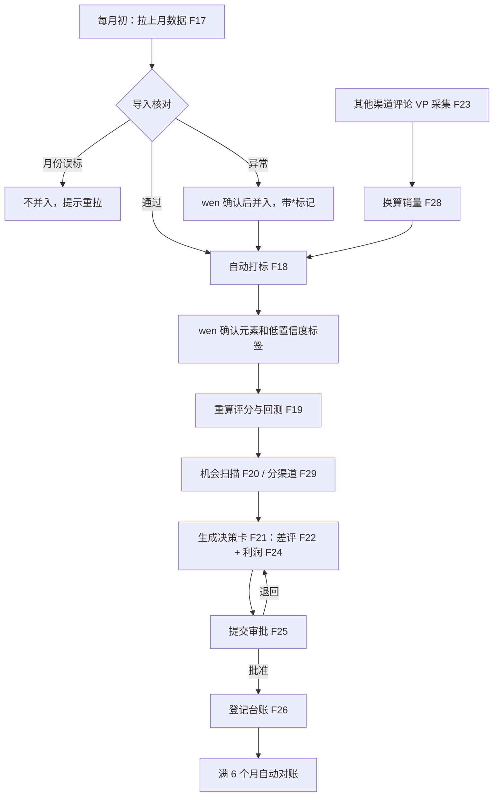
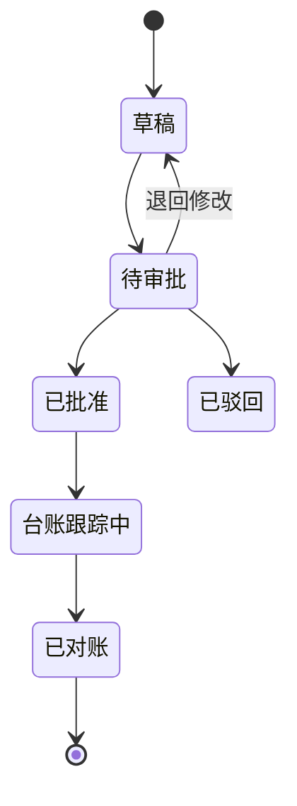

# 品类机会判定台 · PRD

**版本**: v7（第二轮，需求契约 revision 7：加入 Home Depot / Lowe's / Wayfair）
**状态**: 初版，待完善
**作者**: PRD 大师协作产出（wen 拍板）
**日期**: 2026-11-03
**品类**: B 端内部工具（网页系统）

> **上游**：
> - `解题方案书.md`（第二轮，2026-11-03）；
> - `../scene-anchor.md`（第二轮 V1，wen 已确认）。
>
> **第一轮**：PRD v5（F01–F14）于 2026-10-27 被判定未达预期，全部 retired，原文见 git 历史。本版 ID 从 F15 起编。
>
> **行为细则**：以 `requirements.md` 为准，本文只摘要并引用。

---

## 0. 阶段路线图与 MVP 定义

| 阶段 | 已确认目标 | 功能模块 | 交付物（做完用户拿到什么） |
| :--- | :--- | :--- | :--- |
| 第一版 | wen 每月不靠 AI 会话，就能完成：拉数据 → 打标确认 → 机会扫描 → 决策卡 → 老板审批 → 台账对账；Amazon、Home Depot、Lowe's、Wayfair 分渠道扫描、决策卡并排；利润测算、评论 VP 追踪在同一系统里 | F15–F29（全部） | 在 wen 电脑上运行、局域网共享的网页系统，只开浴室柜 |

> **本次范围与完成定义**：
> - **范围**：scope = 第一版，F15–F29 全部交付。F15–F27 为 wen 2026-11-03 确认"第一版全做"；F28、F29 为同日 wen 要求加入其他渠道。
> - **品类**：只有浴室柜；分框和打标规则可配置（F27）。
> - **端**：浏览器网页一端；局域网访问，不开放公网。
> - **渠道**：Amazon（卖家精灵月度数据）；Home Depot、Lowe's、Wayfair（评论 VP 月度数据换算销量）。
- **外部接口**：卖家精灵、Bright Data、Apify、大模型（多家可选）。
> - **完成定义**：`requirements.md` 中 F15–F29 的全部 AC 和 NFR-007～012 通过。

---

## 1. 项目背景与收益

### 1.1 需求简介（一句话）

浴室柜立项要提前约 8 个月判断，做错一次损失 30–40 万元以上。这个系统把第二轮验证过的方法固化成每月可重复跑的流程：
- 分框扫描机会；
- 决策卡写清"在赌什么、看到什么就停"，并附具体 SKU 实证；
- 老板在系统里审批，立项后登记台账，6 个月后对账。

### 1.2 收益预估

#### 用户收益

- wen 每月从拉数据到出机会扫描，不需要 AI 会话介入；人工只确认元素和低置信度标签。—— 依据：C —— 来源：场景锚点（wen 2026-11-03）
- 决策卡数字都来自系统计算、可追溯，避开第二轮出现过的口径错误（不分形态、误用 9 月数据）。—— 依据：B —— 来源：`solution-v2/机会判定卡/决策卡_竖棱.md` 第 3 版；`solution-v2/数据准备/卖家精灵导出_2025-03至12_核对.md`

#### 业务收益

- 立项判断有台账可对账，用来检验方案书的有效标准（市场层 D 档之后变大 ≤ 30%；新品层前 20% 做到率 ≥ 平均 2 倍）。
  - 回测现状：市场层已达标（19%–25%）；新品层未达标（1.1–2.1 倍）。
  - 依据：B。来源：`solution-v2/开发建议/回归预测_回测_第九版.md`
- 每次立项都有决策卡和审批记录。目标是下一次立项评审会起全部使用。依据：C。来源：方案书第 7 节

#### 不做风险

- 方法停在 AI 会话和 Markdown 文件里，每月要人工重跑，口径容易出错，结论也没法回看是否说对。

---

## 2. 用户画像

### 2.1 角色与权限矩阵（B 端必须）

| 角色 | 典型职位 | 公司规模 | 行业 | 决策权 | 使用频次 | 关键场景 |
|------|---------|---------|------|--------|---------|---------|
| 操作者 | wen（产品开发） | 一年 10–十几款立项 | 亚马逊美国浴室柜 | 生成和编辑决策卡、提交审批、配置系统 | 每月数据更新 + 每次评审前 | 拉数据、确认标签、扫描、写卡、利润测算、评论采集 |
| 审批者 | 老板 | 同上 | 同上 | 批准 / 驳回立项与策略库"已验证" | 每次评审 | 看卡、审批、留意见 |
| 只读 | 运营、采购、研发 | 同上 | 同上 | 无 | 评审会前后 | 看扫描、决策卡、台账 |

角色权限：操作者全部可做；审批者只看、审批、留意见，不改内容；只读只能看。未登录看不到任何数据（AC-F15-01～03）。

### 2.2 明确不是谁

- ❌ 外部客户或公网用户：系统只在局域网内使用。
- ❌ 自动立项、自动下单：系统只给建议，拍板在人。

### 2.3 用户故事

- **US-F15-01**: 作为 操作者，我希望建账号并按角色控制权限，以便老板审批留痕、未登录者看不到数据。
- **US-F16-01**: 作为 操作者，我希望在设置页配置密钥、选大模型、设预算，以便花钱前有数，到上限自动停。
- **US-F17-01**: 作为 操作者，我希望系统每月用卖家精灵接口拉数据并自动核对，以便不用手动导出，也不会误用月份。
- **US-F18-01**: 作为 操作者，我希望系统自动打标，我只确认元素和低置信度标签，以便人工只看少数产品。
- **US-F19-01**: 作为 操作者，我希望新数据进来后重算评分并看到回测是否有效，以便知道本月评分能不能信。
- **US-F20-01**: 作为 操作者，我希望在"尺寸 × 拆装 × 形态"框里看到四类机会，以便先找到机会再做卡。
- **US-F21-01**: 作为 操作者，我希望对选中的机会生成决策卡并编辑叙述，以便评审会直接拍板、能展开看实证。
- **US-F22-01**: 作为 操作者，我希望对卡里的 SKU 拉差评并归类，以便知道问题能不能改。
- **US-F23-01**: 作为 操作者，我希望在同一系统里做评论 VP 月度追踪，以便不用另开工具。
- **US-F24-01**: 作为 操作者，我希望在同一系统里做利润测算并回写决策卡，以便"钱"一节有毛利。
- **US-F25-01**: 作为 审批者，我希望在系统里审批立项和策略库条目，以便拍板有记录、状态清楚。
- **US-F26-01**: 作为 操作者，我希望立项时登记预测、6 个月后自动对账，以便知道说得准不准。
- **US-F27-01**: 作为 操作者，我希望分框和打标规则可配置，以便以后加品类只改配置。
- **US-F28-01**: 作为 操作者，我希望把 Home Depot / Lowe's / Wayfair 的月度评论数据换算成可比较的销量估算，以便其他渠道也能分框看份额和趋势。
- **US-F29-01**: 作为 操作者，我希望每个渠道单独扫机会、决策卡并排显示各渠道方向，以便得出"只上 Wayfair"这类结论，并用多渠道信号互相印证。

---

## 3. 功能需求

### 3.1 功能清单

| ID | 功能 | 所属阶段 | 优先级 | 一句话说明 | 实现 US |
|----|------|---------|--------|----------|---------|
| F15 | 账号与角色 | 第一版 | 必做 | 三类角色，局域网登录 | US-F15-01 |
| F16 | 设置：密钥、预算与费用 | 第一版 | 必做 | 设置页管理密钥，先评估再确认，月度上限，记账 | US-F16-01 |
| F17 | Amazon 月度数据拉取与导入核对 | 第一版 | 必做 | 卖家精灵接口按月拉，检测月份误标、来源切换、覆盖率 | US-F17-01 |
| F18 | 自动打标与人工确认 | 第一版 | 必做 | 规则 + 看图打标，元素和低置信度进确认队列 | US-F18-01 |
| F19 | 模型更新与回测 | 第一版 | 必做 | 重算第九版市场评分、新品打分，滚动回测与告警 | US-F19-01 |
| F20 | 机会扫描 | 第一版 | 必做 | 分框四类机会，勾选筛选，一键做卡 | US-F20-01 |
| F21 | 决策卡 | 第一版 | 必做 | 十项内容 + SKU 和趋势展开，AI 叙述草稿 | US-F21-01 |
| F22 | 差评拉取与归类 | 第一版 | 必做 | 1–3 星评论拉取，按原因归类 | US-F22-01 |
| F23 | 评论月度 VP 追踪（并入） | 第一版 | 必做 | 原工具功能保留，共用设置与记账 | US-F23-01 |
| F24 | 利润测算（并入） | 第一版 | 必做 | 原工具功能保留，方案存服务端，回写决策卡 | US-F24-01 |
| F25 | 审批：立项与策略库 | 第一版 | 必做 | 立项审批锁定版本；策略库三状态与版本 | US-F25-01 |
| F26 | 预测台账与对账 | 第一版 | 必做 | 批准即登记，满 6 个月自动对账，汇总准确率 | US-F26-01 |
| F27 | 品类配置 | 第一版 | 必做 | 分框维度、属性、打标规则、渠道换算系数和成功线可配置；只开浴室柜 | US-F27-01 |
| F28 | 其他渠道数据与销量估算 | 第一版 | 必做 | 评论 VP 数据并入；评论换算法（VP × 50、非 VP × 20）与榜单排名平滑法；同系列去重 | US-F28-01 |
| F29 | 分渠道机会与跨渠道印证 | 第一版 | 必做 | 四个渠道各自分框扫描；决策卡并排、给出分渠道结论；多渠道印证或分歧 | US-F29-01 |

### 3.2 详细功能说明（共享层）

#### 3.2.1 通用约定

- **时区**：北京时间显示；"月份"指数据所属的自然月。
- **分框**：一切比较都在"尺寸段 × 拆装 × 形态"框内进行（方案书第 3 节教训 2；纪要硬规则）。
- **标记**：来源切换或核对异常的月份，在所有图表和卡片中带 * 标记（AC-F17-05）。
- **证据等级**：经回测 / 历史观察 / 未验证。
- **数据权限**：按角色控制；不按品类或行做隔离（第一版只有一个品类）。

### 3.3 详细功能说明（模块层）

#### 3.3.1 账号与角色（F15）

**位置**：登录页；账号页（仅操作者可见）。
**目标**：三类角色各做各的事，审批可追溯。
**业务过程与结果**：操作者建账号并指定角色；登录后按角色显示可用操作。
**关键边界与失败结果**：停用的账号在下一次请求时失效。
**规则细则**：REQ-F15-01、REQ-F15-02；AC-F15-01～05。

#### 3.3.2 设置：密钥、预算与费用（F16）

**位置**：设置页（仅操作者）。
**目标**：四类外部服务的密钥由 wen 自助配置；花钱前先评估再确认，并有月度上限。
**业务过程与结果**：
- 填写、测试、更换、删除密钥，页面只显示后 4 位；
- 大模型可选多家；
- 每个按量计费的服务设月度上限；
- 每个会花钱的任务都先显示预计费用和耗时，wen 确认后才开始；
- 所有调用都记账。

**关键边界与失败结果**：
- 达到上限即停，已采数据保留；
- 密钥失效时，相关功能显示"未连接"，不发起调用。

**规则细则**：REQ-F16-01、REQ-F16-02；AC-F16-01～08；NFR-008。

#### 3.3.3 Amazon 月度数据拉取与导入核对（F17）

**位置**：数据页。
**目标**：每月拉上月浴室柜类目全量数据，自动核对后并入。
**业务过程与结果**：选月份 → 看评估费用并确认 → 拉取（可断点续拉）→ 核对 → 通过或经 wen 确认后并入。
**关键边界与失败结果**：
- "上月购买标"日期不对，或与上月小类排名重合超过 10%，判为疑似月份错误，不并入。依据：2026-10 导出两次都是 9 月数据。
- 品类总量、家族键一致性、标签覆盖率异常时，需要 wen 确认才能并入，并入后带 * 标记。
- 卖家精灵拉取失败时，可手动上传同格式文件，核对照常进行。

**规则细则**：REQ-F17-01、REQ-F17-02；AC-F17-01～05；NFR-011、NFR-012。

#### 3.3.4 自动打标与人工确认（F18）

**位置**：打标确认页。
**目标**：规则打全部标签；元素靠看图打；wen 只确认元素和低置信度标签。
**业务过程与结果**：
- 新数据自动打标，每个标签带置信度；
- 元素和置信度低于阈值的标签进入确认队列，主图相同的商品分成一组，选一次即应用到整组；
- 确认后的标签在下一次扫描中生效；
- 标为"看不出 / 不是本品类"的商品，不进入分析。

以上沿用第二轮复核页和合并脚本的做法。
**关键边界与失败结果**：未配置大模型时，元素全部进入人工确认。其他渠道的商品走同一套规则和同一个确认队列，并标明渠道。
**规则细则**：REQ-F18-01～03；AC-F18-01～07。

#### 3.3.5 模型更新与回测（F19）

**位置**：模型页；首页的有效性提示。
**目标**：新数据并入后，按第九版规则重算并检验。
**业务过程与结果**：
- 市场层：为每个分框单元重算把握、A / B / C / D 分级、立项后 6–10 个月份额预测和 80% 区间；
- 新品层：重训做到概率模型并做校准，显示模型偏差；
- 滚动回测，和上一版并排比较。

规则见 `识别方法_预登记.md` 第六至九版补记，以及 `trial/回归预测.py`、`回归预测_第九版.py`。
**关键边界与失败结果**：有效性检验不通过时，首页和每张决策卡顶部都显示告警。
**规则细则**：REQ-F19-01、REQ-F19-02；AC-F19-01～04。

#### 3.3.6 机会扫描（F20）

**位置**：机会扫描页。
**目标**：在近 6 个月月销 ≥ 200 件的框里，列出每个属性取值的四类机会：增长型、评分缺口型、价格缺口型、坑。
**业务过程与结果**：
- 扫描结果的口径同 `机会扫描_202610.md`；
- 可勾选关注的变量、框和机会类型；
- 点"做决策卡"进入 F21。

**关键边界与失败结果**：
- 只在框内比较；
- 每条机会显示证据等级。

**规则细则**：REQ-F20-01、REQ-F20-02；AC-F20-01～05；NFR-009。

#### 3.3.7 决策卡（F21）

**位置**：决策卡页。
**目标**：每个机会一张卡，包含十项内容和展开项。样板见 `solution-v2/机会判定卡/决策卡_树脂.md` 等 4 张。
**业务过程与结果**：
- 生成卡片：数字由系统计算，wen 只编辑叙述文字；
- SKU 展开：链接、主图、逐月价格 / 价比 / 评分 / 月销 / 排名；
- 趋势展开：份额、新品占比、溢价率、价格带；
- 可用大模型起草"为消费者解决了什么问题"，标为"AI 草稿"。

**关键边界与失败结果**：
- 新品做到概率同时显示原值和扣偏差后的值；
- 数字可追溯到框、月份和样本数。

**规则细则**：REQ-F21-01～03；AC-F21-01～06；NFR-010。

#### 3.3.8 差评拉取与归类（F22）

**位置**：决策卡的"差评"一节。
**目标**：知道低评分是可改的问题（装配、运输、部件），还是材料本身的问题。依据：第二轮共归类 108 条差评。
**业务过程与结果**：
- Amazon 评论用卖家精灵拉 1–3 星，每个 SKU 最多 30 条；
- 其他平台的评论取 F23 已采集的明细；
- 用大模型按六类原因归类并统计占比；
- wen 可以改判，占比随之重算。

**关键边界与失败结果**：没配置大模型时，只显示原文。
**规则细则**：REQ-F22-01、REQ-F22-02；AC-F22-01～04。

#### 3.3.9 评论月度 VP 追踪（F23）

**位置**：评论 VP 页。
**目标**：保留原工具的全部功能：四步流程、断点续跑、Wayfair 只有"Verified Purchase"计 VP；共用设置页的密钥、上限和记账。原工具见 `tools/评论月度VP追踪器/`。
**规则细则**：REQ-F23-01；AC-F23-01～02。

#### 3.3.10 利润测算（F24）

**位置**：利润测算页。
**目标**：保留原利润测算台的全部功能；方案存在服务端，局域网内共享；能从决策卡带入尺寸和售价，结果回写卡片的"钱"一节。原工具见 `tools/利润测算台/index.html`。
**规则细则**：REQ-F24-01、REQ-F24-02；AC-F24-01～04。

#### 3.3.11 审批：立项与策略库（F25）

**位置**：审批页；决策卡的"提交审批"按钮。
**目标**：
- 立项审批有三种结论：批准 / 驳回 / 退回修改，批准后锁定版本，并自动登记台账；
- 策略库条目分三种状态，每次修改出新版本；改为"已验证"必须经老板批准。

**规则细则**：REQ-F25-01、REQ-F25-02；AC-F25-01～05。

#### 3.3.12 预测台账与对账（F26）

**位置**：台账页。
**目标**：
- 登记预测，内容见 AC-F26-01；
- 满 6 个月后自动判定是否做到、是否触发停止条件；
- 汇总准确率，并标出是否达到方案书的有效标准。

**关键边界与失败结果**：
- 超过预计上架 3 个月仍没关联到自家 ASIN 的，标为"待关联"；
- 其他渠道按各自的成功线判定，结果分渠道显示，不合并成一个结论。

**其他渠道成功线**（第一版默认，AI 按 2026 年 1–10 月数据提议，wen 授权先定一版，可在品类配置里改）：上架 6 个月内任一月满足以下任一条即为做到：

| 渠道 | 进入类目榜 | 或估算月销 | 依据（估算月销 = VP × 50 + 非 VP × 20） |
| :--- | :--- | ---: | :--- |
| Home Depot | 类目 Top Sellers 前 50 | ≥ 250 件 | 带台面类目第 50 名附近约 244 件 |
| Lowe's | Best Sellers 榜前 50 | ≥ 150 件 | 带台面榜前 50 名中位 148 件；以整装为主 |
| Wayfair | 主类目前 50 | ≥ 120 件 | 主类目前 50 名中位 120 件 |

**规则细则**：REQ-F26-01～03；AC-F26-01～06。

#### 3.3.13 品类配置（F27）

**位置**：品类配置页（仅操作者）。
**目标**：分框维度、扫描属性、打标规则、低置信度阈值都可配置；第一版只开浴室柜。
**规则细则**：REQ-F27-01、REQ-F27-02；AC-F27-01～03。

#### 3.3.14 其他渠道数据与销量估算（F28）

**位置**：数据页的"其他渠道"分页。
**目标**：把 Home Depot / Lowe's / Wayfair 的月度评论数据变成可比较的月度销量估算。
**业务过程与结果**：
- 评论 VP 追踪（F23）采完一个月后并入分析库；也可以上传追踪器导出的 Excel。
- 默认用评论换算法：VP 条数 × 50 + 非 VP 条数 × 20（wen 2026-11-03 给定，可改）。
- 可切换为榜单排名平滑法：用排名和销量的平滑曲线换算（wen 提出的第二种方法），两种方法可以对照。

**关键边界与失败结果**：
- 同系列商品共享评论，合计时按评论 ID 去重；
- 未完整月份不计入；
- Wayfair 的 VP 口径不同，只在渠道内比较。

**规则细则**：REQ-F28-01、REQ-F28-02；AC-F28-01～05。

#### 3.3.15 分渠道机会与跨渠道印证（F29）

**位置**：机会扫描页的渠道切换；决策卡的"分框决策"一节。
**目标**：其他渠道的方向可能和 Amazon 截然不同（wen 2026-11-03），所以每个渠道单独判断。
**业务过程与结果**：
- 四个渠道各自按"尺寸 × 拆装 × 形态"框扫描；
- 决策卡并排显示同一机会在各渠道的份额、趋势、分级和样本量，并给出每个渠道"上 / 不上 / 观察"；
- 方向一致的标"多渠道印证"，方向相反的标"渠道分歧"。

**规则细则**：REQ-F29-01、REQ-F29-02；AC-F29-01～04。

---

## 4. 流程与状态图表

### 4.1 核心用户旅程（Mermaid）



### 4.2 关键状态机（如有）



---

## 5. 边界与异常场景

### 5.1 数据边界

- **空数据**：某框近 6 个月月销 < 200 件时不扫描，扫描页说明原因。
- **超大数据**：24 个月约 5 万行子体 × 月，扫描 10 秒内出结果（NFR-009）。
- **异常数据**：月份误标不并入（AC-F17-03）；来源切换的月份带 * 标记（AC-F17-05）；评分数缺失时只用星级。

### 5.2 并发与冲突

- **同一资源多人编辑**：只有操作者能编辑，第一版只有 wen 一个操作者；审批与编辑冲突时，以审批时锁定的版本为准（AC-F25-01）。
- **异步操作冲突**：同一月份的拉取任务同时只能运行一个；重跑不重复计费（NFR-011）。

### 5.3 第三方依赖失败

- **卖家精灵**：失败时可手动上传同格式文件。
- **Bright Data / Apify**：失败时只采 Home Depot。
- **大模型**：失败时元素进入人工确认、差评只显示原文、不起草叙述。
- **其他渠道评论采集失败**：该渠道当月数据缺失，扫描和决策卡标"该渠道本月无数据"，其他渠道照常。
- **达到预算上限**：自动停，保留已采数据。

---

## 6. 成功度量

### 6.1 北极星指标

| 指标 / 可观察结果 | 当前基线 | 已确认目标 | 时间窗（如适用） | 来源 |
|------|---------|---------|----------|------|
| 每次立项评审都有系统生成、经审批的决策卡，并登记台账 | 0（现在是 Markdown 文件） | 100% | 下一次评审会起 | 方案书第 7 节 |

### 6.2 关键指标矩阵

| 指标 | 类型 | 基线 | 目标 | 时间窗 | 数据来源 |
|------|------|------|------|--------|---------|
| 市场层 D 档之后份额变大的比例 | 方法有效性 | 19%–25%（回测） | ≤ 30% | 每月滚动 | F19 回测 |
| 新品层打分前 20% 做到率 ÷ 平均 | 方法有效性 | 1.1–2.1 倍（回测） | ≥ 2 倍 | 台账对账 | F26 |
| 每月从拉数据到出扫描是否需要 AI 会话介入 | 用户 | 需要 | 不需要 | 第一版上线后 | wen 使用记录 |

---

## 7. 风险与依赖

### 7.1 技术风险

- 卖家精灵接口能否每月稳定拿到全量小类数据（影响：高）。缓解：断点续拉，失败时手动上传。
- 看图打元素的准确率（影响：中）。缓解：低置信度进入人工确认，同图分组一次确认。
- 第七至九版的方法是看过 2026 年数据后选的（影响：中）。缓解：F19 每月样本外检验并告警。

### 7.2 商业风险

- 新品层前瞻区分力弱（8 个月口径 AUC 0.45–0.60）。缓解：决策卡写明"在赌什么"和停止条件，靠台账校正。

### 7.3 外部依赖

- 卖家精灵、Bright Data、Apify、大模型。账号都由 wen 提供并在设置页配置，见 `requirements.md` 的外部能力表。
- 运行机是 wen 的电脑，关机时其他人无法访问。

---

## 8. 验收标准（5 维必须覆盖）

### 8.1 主流程

| 用户场景 | 前置条件 | 操作 | 产品可观察结果 |
|---------|---------|------|----------------|
| 每月更新 | 密钥已配置 | 拉上月数据 → 确认标签 → 重算 | 扫描和评分更新为新月份（AC-F17-01、AC-F18-05、AC-F19-01） |
| 立项评审 | 已有扫描 | 选机会 → 生成卡 → 审批 | 卡片十项齐全；批准后锁定并登记台账（AC-F21-01、AC-F25-01、AC-F25-03） |

### 8.2 异常分支

| 场景 | 前置 | 操作 | 期望 |
|------|------|------|------|
| 月份误标 | 拉到的是上月数据 | 导入 | 不并入，并提示（AC-F17-03） |
| 达到预算上限 | 当月花费到上限 | 继续采集 | 停止，已采数据保留（AC-F16-06） |
| 回测不通过 | D 档变大比例 > 30% | 重算 | 首页和卡片顶部告警（AC-F19-04） |

### 8.3 权限与角色

| 场景 | 角色 | 操作 | 期望 |
|------|------|------|------|
| 未登录 | 任何人 | 打开页面 | 跳到登录页（AC-F15-01） |
| 只读改卡 | 只读 | 编辑 | 拒绝（AC-F15-02） |
| 审批者改正文 | 审批者 | 编辑 | 拒绝，只能审批（AC-F15-03） |

### 8.4 兼容性

| 平台/浏览器 | 期望 |
|-----------|------|
| 局域网内最新版 Chrome / Edge / Safari | 全部功能可用（NFR-007） |

### 8.5 不变行为

| 已有功能 | 本次变更后的预期保持 |
|---------|----------------------|
| 评论月度 VP 追踪器 | 设置项、四步流程、导出口径不变（AC-F23-01） |
| 利润测算台 | 计算公式、参数、导出不变（AC-F24-01） |

---

## 9. 依据清单

### 9.1 用户依据

- wen 2026-11-03 拍板（对话记录，`state.json.open_questions` 中的 OQ-R2-01～14）：
  - 三角色、网页形态、第一版全做；
  - 卖家精灵自动拉数据；
  - 两个工具并入；
  - 在 wen 电脑上运行、局域网共享；
  - 打标确认；
  - 密钥设置页、多家大模型、只做浴室柜；
  - 账号密码登录、先评估再确认并设上限。
- 第二轮回测、全链路验证、机会扫描、决策卡样板、差评归类：见 `solution-v2/开发建议/`、`solution-v2/机会判定卡/`、`solution-v2/evidence/`。

### 9.2 竞品依据

- 见方案书第 3 节（Amazon Product Opportunity Explorer、Jungle Scout 等）。本阶段未新做竞品研究。

### 9.3 行业 Benchmark

- 未做。

### 9.4 内部假设

- 见方案书第 8 节 H1～H6，以及 `../assumptions.md`。

---

## 10. 附录

### 10.1 术语表

| 术语 | 含义 |
|------|------|
| 框 | 尺寸段 × 拆装 × 形态，所有比较的范围 |
| 做到 | 上架 6 个月内任一月小类 BSR ≤ 50，或 SPU 月销售额 ≥ $10 万 |
| 把握 | 市场层模型给出的"之后份额变大"的概率 |
| 新品占比 | 近 6 个月里上架 ≤ 6 个月的家族的销量占比，减去同框整体水平 |
| 决策卡 | 一个机会的立项建议，包含十项内容和展开项 |

### 10.2 关联资料

- 解题方案书：`解题方案书.md`
- 场景锚点：`../scene-anchor.md`
- 决策卡样板：`../solution-v2/机会判定卡/`
- 外部工具：`../tools/`
- 辩论记录：`../debate-log.md`
- 业务确认来源：`../state.json`（stage_confirmations、open_questions）

### 10.3 关键决策

| 类型 | 决策 | 未选方案 | 为什么 | 主要代价 |
|------|------|---------|--------|---------|
| 产品 | 在 wen 电脑上运行、局域网共享 | 云服务器 | wen 2026-11-03 选择 | wen 关机时其他人无法访问 |
| 产品 | 两个外部工具并入同一系统 | 保持独立、只导文件 | wen 2026-11-03 选择，决策卡要回写利润、取评论 | 并入工作量大；要保证原功能不变 |
| 架构 | Amazon 数据由系统用卖家精灵接口自动拉 | 每月手动导出上传 | wen 2026-11-03 选择 | 依赖接口稳定；保留手动上传作后备 |
| 产品 | 第一版加入 Home Depot / Lowe's / Wayfair，分渠道扫描、决策卡并排 | 只作为 Amazon 决策卡的旁证 | wen 2026-11-03：其他渠道方向和 Amazon 截然不同 | 其他渠道没有真实销量，只能用评论换算估算，误差未知 |

---

## 11. 一致性自检（自动生成，校验通过才算定稿）

```
2026-11-03 实际运行（prd-master validators，需求契约 revision 7）
check_evidence.py 证据合规检查全部通过
check_format.py 格式检查全部通过
check_consistency.py US 与 F 映射 15/15 PASS，角色 15/15 PASS
check_requirements_contract.py 需求契约结构校验通过，稳定对象 126 个
```
