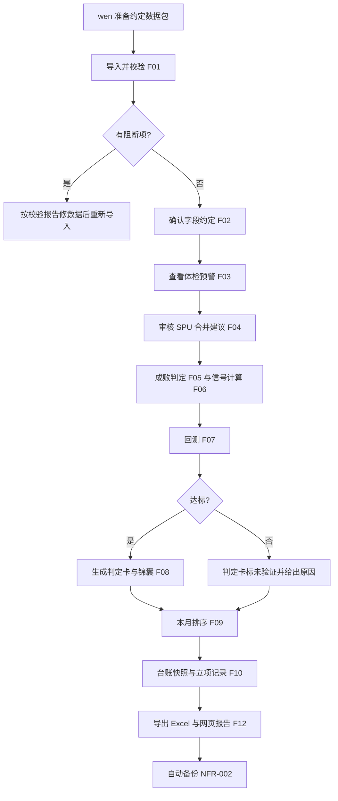
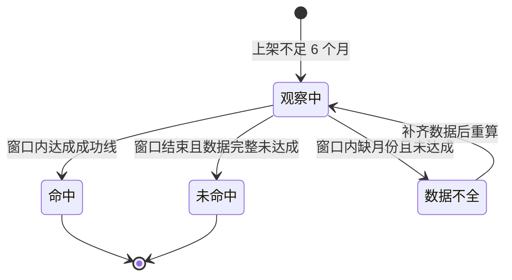
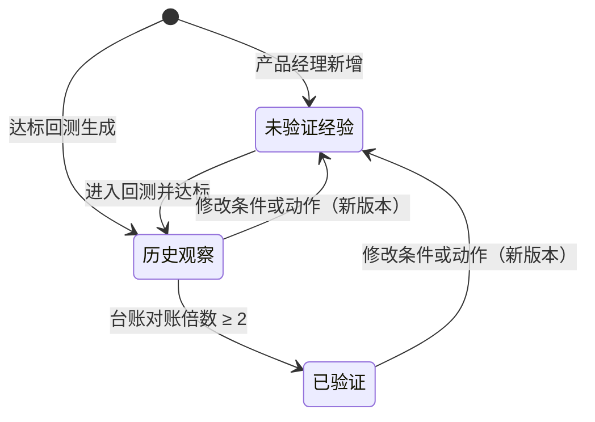

# 品类机会判定台 · PRD

**版本**: v2（新增截面模式，需求契约 revision 2）
**状态**: 已定稿（PRD 核心完成）
**作者**: PRD 大师协作产出
**日期**: 2026-10-26
**品类**: 内部数据决策工具（按 B 端 SaaS 模板）

> 上游：`output/解题方案书.md`（用户已确认）；场景与范围：`scene-anchor.md`、`proposal-v1.md`（用户已确认）；行为细则以 `output/requirements.md`（revision 2）为准，本文引用其稳定 ID。v2 变更：新增截面模式（D-23，用户确认），用最近几个月数据加同期全部新品、控制上架月龄先出第一版模型。

---

## 0. 阶段路线图与 MVP 定义

| 阶段 | 已确认目标 | 功能模块 | 交付物（做完用户拿到什么） |
| :--- | :--- | :--- | :--- |
| 第一期（本次交付） | 在亚马逊美国 · 浴室柜上跑通"竞品新品回测 → 机会判定卡 → 台账"全流程 | F01–F14 | wen 电脑上的本机小网页：导入约定数据包后，得到校验报告、字段约定、体检结果、新 SPU 与成败、细分信号、回测报告、判定卡与锦囊、当月排序、台账快照、Excel 与单文件网页报告 |
| 第二期 | 迁到服务器，多人共用与按品类权限，接第二个品类验证复用 | 不在本契约 | 服务器上的共享网页工作台 |
| 第三期 | 接 HDP、Lowe's、Wayfair | 不在本契约 | 多平台机会判定 |

> **本次范围与完成定义**：scope = 第一期（D-8），功能 F01–F14。只有一个操作端：wen 电脑上仅本机可访问的网页（D-16）。数据入口只有"导入符合数据接口约定 v1 的数据包"（§10.4），对外输出只有 Excel 与单文件网页报告。第一期不拉取数据、不调用任何外部服务（D-18、D-19）。
>
> 两种模式（D-23）：**历史模式**用完整 6 个月窗口回测（约定 v1）；**截面模式**用最近几个月数据加同期全部新品、控制上架月龄建模（约定 v1.1），结论标"截面口径，待历史回测确认"。
>
> 完成定义：
> 1. 用符合约定的浴室柜数据包（历史或截面），能在本机从导入一直跑到导出报告；
> 2. 同一输入运行两次，结果完全一致（NFR-001）；
> 3. 备份后能恢复（NFR-002）；
> 4. 系统内用时有记录（F14）。
>
> 回测是否达到 2 倍属于对方法的业务验证，不是软件完成条件，系统只负责如实算出并展示。

---

## 1. 项目背景与收益

### 1.1 需求简介（一句话）

产品经理立项前不知道哪些指标真的能预示新品成败，一次品类研究约 20 天且结果不稳定。本产品把竞品新品当作"历史立项"做回测，给出经过检验的细分排序、区间和立项锦囊，并用台账持续对账，让立项判断有据可查、可复用到其他品类。

### 1.2 收益预估

#### 用户收益（用户目标）

- 产品经理的品类研究：新品类首次跑通（从导入到首次回测结果）≤ 5 个工作日，之后每月更新的系统内人工 ≤ 半天，基线为一次研究约 20 天 —— 依据：D 级（用户给出的基线与已确认目标）—— 来源：用户原话与 D-14、D-20
- 结果可复现：同一输入两次运行结果一致，替代"每次 Agent 跑 skill 都不一样" —— 依据：D 级 —— 来源：用户原话，`solution/evidence/前身项目诊断.md`
- 字段约定确认覆盖：参与计算的字段都先确认含义、粒度、时点、性质，再计算 —— 依据：用户确认的最大风险（D-14 事前验尸）—— 来源：`output/解题方案书.md` §6

#### 业务收益（业务目标）

- 立项命中率（上架 6 个月内小类 BSR 前 50，或 SPU 任一月销售额 ≥ $20 万）是主结果指标。当前没有自家基线：已上架 1 款，尚无数据（来源：用户原话）。验证计划：在回测检验组中，判定卡排前 20% 的细分新品命中率达到全类目平均的 2 倍以上，且优于任一现有单指标，才交付使用；之后按月记台账、6 个月对账。依据：方案书 §6（用户确认），假设值待验证。
涉及的投入规模：每品类每年约 20 个立项，每个从开发到首单约 30–40 万元（来源：用户估算）。

#### 不做风险

- 继续凭未经检验的指标立项：每个错误立项在开发和做货周期后才暴露，单个代价约 30–40 万元（来源：用户估算）。
- 研究流程仍然不稳定、难以复用到 5–8 个品类（来源：用户原话）。

---

## 2. 用户画像

### 2.1 角色与权限矩阵（B 端必须）

| 角色 | 典型职位 | 公司规模 | 行业 | 决策权 | 使用频次 | 关键场景 |
|------|---------|---------|------|--------|---------|---------|
| 产品经理 | 品类产品经理；第一期只有 wen（浴室柜） | 跨境电商公司，5–8 个品类各有产品经理 | 跨境电商家居（产品驱动、强设计结构能力） | 决定立项；维护本品类字段约定、品类配置和策略库 | 新品类首跑一次；之后每月一次更新；每次立项评审前查看 | 导入数据、确认字段、审核 SPU、运行回测、看排序与锦囊、记录立项决定、导出报告 |
| 结果接收方 | 老板、开发、采购、运营 | 同上 | 同上 | 只读，不操作系统 | 每月收到报告时 | 打开 wen 导出的 Excel 或网页报告，查看结论、依据和台账 |
| 管理员 | 第二期指定 | 同上 | 同上 | 第二期管理账号、权限、密钥 | 第二期起 | 第一期不存在 |

第一期只有一个直接操作者（产品经理 wen），因为系统只在本机运行（D-15、D-16）；结果接收方只通过导出文件使用。第二期起产品经理只能改自己负责的品类、可看全部品类，结果接收方只读（D-12），不在本次范围。

### 2.2 明确不是谁

- ❌ 数据采集人员：拉取卖家精灵数据、估算销量、打标、提取评论痛点属于单独的数据项目（D-19）。
- ❌ 亚马逊卖家的通用选品工具使用者：本产品服务公司内部立项决策，不对外。
- ❌ 自动立项：系统只给排序和建议，立项由产品经理拍板。

### 2.3 用户故事

- **US-F01-01**: 作为 产品经理, 我希望 导入按约定准备的数据包并立刻知道哪里不合格, 以便 不合格的数据不会悄悄进入计算（F01）
- **US-F02-01**: 作为 产品经理, 我希望 逐个确认每个字段的含义和用法, 以便 计算口径正确且每次一致（F02）
- **US-F03-01**: 作为 产品经理, 我希望 每次导入后看到固定的数据体检结果, 以便 及早发现父子体口径混用、重新上架等问题（F03）
- **US-F04-01**: 作为 产品经理, 我希望 把子体正确归并成 SPU 并区分新品、新变体和疑似重新上架, 以便 命中率不被老爆款的新变体抬高（F04）
- **US-F05-01**: 作为 产品经理, 我希望 按公司成功线判定每个新 SPU 的成败, 以便 竞品新品和自家立项用同一把尺子衡量（F05）
- **US-F06-01**: 作为 产品经理, 我希望 看到每个细分在每个月"当时"的三类信号和现用指标, 以便 回测结果可信（F06）
- **US-F07-01**: 作为 产品经理, 我希望 用历史批次检验信号和规则, 以便 只用经过检验的判定卡指导立项（F07）
- **US-F08-01**: 作为 产品经理, 我希望 得到"什么条件下立项、观察或放弃"的规则及依据, 以便 指标、阈值和动作被固定下来（F08）
- **US-F09-01**: 作为 产品经理, 我希望 每月看到全部细分的排序、区间和锦囊, 以便 立项评审时有统一标准的候选清单（F09）
- **US-F10-01**: 作为 产品经理, 我希望 保存每月排序和自己的立项决定并到期对账, 以便 逐步积累自家结果（F10）
- **US-F11-01**: 作为 产品经理, 我希望 规则有版本、有验证状态, 以便 经验和结论沉淀下来、可复用（F11）
- **US-F12-01**: 作为 产品经理, 我希望 一键导出当月结果, 以便 没有服务器也能发给老板和下游（F12）
- **US-F12-02**: 作为 结果接收方, 我希望 不装系统也能打开报告, 以便 直接看到结论和依据（F12）
- **US-F13-01**: 作为 产品经理, 我希望 用配置描述一个品类, 以便 第二期接新品类时直接复用（F13）
- **US-F14-01**: 作为 产品经理, 我希望 看到首跑和月更的系统内用时, 以便 检验效率目标（F14）

---

## 3. 功能需求

### 3.1 功能清单

| ID | 功能 | 所属阶段 | 优先级 | 一句话说明 | 实现 US |
|----|------|---------|--------|----------|---------|
| F01 | 数据导入与约定校验 | 第一期 | 必做 | 按约定 v1 校验数据包，阻断项不进入计算 | US-F01-01 |
| F02 | 字段约定确认 | 第一期 | 必做 | 逐字段确认含义与用法，形成带版本的约定 | US-F02-01 |
| F03 | 自动体检与异常提示 | 第一期 | 必做 | 固定体检项，只提示不改数据 | US-F03-01 |
| F04 | 新品判定与 SPU 归并 | 第一期 | 必做 | SPU 编号或规则建议加人工确认；新品、新变体、疑似重新上架 | US-F04-01 |
| F05 | 6 个月成败判定 | 第一期 | 必做 | 按成功线判命中、未命中、观察中、数据不全 | US-F05-01 |
| F06 | 信号计算 | 第一期 | 必做 | 三类信号 + 四个现用指标，严格按时点截断 | US-F06-01 |
| F07 | 时间切分回测 | 第一期 | 必做 | 前 2/3 批次定规则、后 1/3 检验，控制干扰因素 | US-F07-01 |
| F08 | 判定卡与立项锦囊 | 第一期 | 必做 | 达标出判定卡与锦囊，未达标标"未验证" | US-F08-01 |
| F09 | 细分排序与区间 | 第一期 | 必做 | 每月全部细分排序，附区间与锦囊 | US-F09-01 |
| F10 | 预测台账与对账 | 第一期 | 必做 | 月度快照、立项决定、6 个月对账 | US-F10-01 |
| F11 | 策略库 | 第一期 | 必做 | 规则版本与三种验证状态 | US-F11-01 |
| F12 | 报告导出 | 第一期 | 必做 | Excel + 单文件网页报告 | US-F12-01, US-F12-02 |
| F13 | 品类配置 | 第一期 | 必做 | 品类参数化，浴室柜为模板 | US-F13-01 |
| F14 | 运行记录与用时统计 | 第一期 | 必做 | 步骤用时与首跑、月更汇总 | US-F14-01 |

### 3.2 详细功能说明（共享层）

#### 3.2.1 通用约定

- **时间**：业务月份按数据包中的"月份"字段（YYYYMM）计，与卖家精灵月度数据一致；操作时间记录为本机时间。判定窗口、信号窗口一律按自然月。
- **货币**：金额统一为美元，来自数据包的月销售额字段，不使用当前快照价格换算历史金额。
- **数据权限**：第一期单用户、仅本机访问（NFR-006），不设登录；所有记录带操作人与时间，为第二期权限做准备（NFR-004）。
- **口径纪律**：估算值与实测值分开标注；缺失留空，不以 0 填充；相关性不写成因果；每个统计值都附样本量。
- **可复现**：所有计算由代码完成，大模型不参与计算或打分（NFR-001）。
- **版本**：数据包、字段约定、品类配置、判定卡、规则均有版本号；结果记录所用版本（NFR-003）。

### 3.3 详细功能说明（模块层）

#### 3.3.1 数据导入与约定校验（F01）

**位置**：首页"导入数据包"
**目标**：只让合格的数据进入计算。

**业务过程与结果**：wen 选择一个文件夹或 zip。系统按 §10.4 约定逐文件、逐字段校验，生成校验报告（通过、警告、阻断及受影响行数）。无阻断项时，保存只读副本和指纹并生成数据包版本号；有阻断项时禁止计算，并给出示例行号。同一数据包重复导入时，提示已有版本。

**关键边界与失败结果**：无法解析的行占该文件 1% 及以下时为警告，这些行在计算中排除；超过 1% 时为阻断。这是 AI 默认阈值，避免少量坏行挡住整批数据。

**数据包类型**：数据包根目录的清单文件声明是历史数据包还是截面数据包，系统按对应约定校验（REQ-F01-03）。

**规则细则**：REQ-F01-01 至 REQ-F01-03；AC-F01-01 至 AC-F01-06。

#### 3.3.2 字段约定确认（F02）

**位置**：导入成功后自动进入"字段约定"页
**目标**：把"每个字段代表什么、怎么用"变成确认过的、带版本的规则。

**业务过程与结果**：系统为每个字段给出草稿，包括含义、粒度、时点、性质、建议用法和本数据包的体检证据。wen 可以逐项确认或修改，也可以按建议批量确认（重点只看"按规则用"的字段）。保存后生成约定版本。以后导入新数据包时，只需确认发生变化的字段。

**关键边界与失败结果**：未确认的字段不参与任何计算，结果页列出被排除的字段。标为"快照"的字段（如当前价格、当前评分）一律不进入回测。已知需确认的口径包括：
- 上架日期取卖家精灵"最早时间"口径（[卖家精灵说明](https://www.sellersprite.com/cn/help/date-first-available-of-listing)）；
- 首次评分日期可能是父体共享口径（小试④：21% 的子体首评早于上架）。

**规则细则**：REQ-F02-01 至 REQ-F02-03；AC-F02-01 至 AC-F02-07（约定变更后，依赖结果标"需重算"）。

#### 3.3.3 自动体检与异常提示（F03）

**位置**：导入后自动运行，结果显示在"体检"页和首页预警区
**目标**：提前暴露口径问题。

**业务过程与结果**：每次导入后运行固定体检项（REQ-F03-01），每项给出数值、分母和样例。超过品类配置预警阈值的项目在首页持续提示，直到 wen 标为"已知晓"并写说明。

**关键边界与失败结果**：体检只提示，不修改任何源数据（AC-F03-03）。

**截面数据包的失败样本检查**：新品清单里如果没有任何低于头部门槛的商品，说明只导了卖起来的，截面回测会被阻断并提示补导（REQ-F03-02，小试⑥）。

**规则细则**：REQ-F03-01、REQ-F03-02；AC-F03-01 至 AC-F03-04。

#### 3.3.4 新品判定与 SPU 归并（F04）

**位置**："新品与 SPU"页，含"待审合并建议"清单
**目标**：命中率按真正的新 SPU 计算。

**业务过程与结果**：
- **SPU 归并**：数据包有确认过的 SPU 编号时直接用；没有时，系统按"同品牌 + 同款式"生成合并建议并附依据，wen 逐条或按依据筛选后批量确认。
- **SPU 上架日**：取子体中最早的上架日期。
- **新变体**：上架晚于所属 SPU 的子体，不算新品。
- **疑似重新上架**：首评早于上架超过 7 天的 SPU。
- **批次**：新 SPU 按上架日所在月份划入批次。

**关键边界与失败结果**：
- 未确认的合并建议不生效，涉及的子体按各自父体单独计。
- 修改已生效的归并后，受影响的成败、信号、回测标为"需重算"。
- SPU 口径为"同一设计含各尺寸各颜色"（D-5）。

**规则细则**：REQ-F04-01、REQ-F04-02；AC-F04-01 至 AC-F04-09。

#### 3.3.5 6 个月成败判定（F05）

**位置**："新品与 SPU"页的成败列；"成败明细"页
**目标**：用公司成功线给每个新 SPU 打上结果。

**业务过程与结果**：判定窗口为上架当月起连续 6 个自然月，以下两条满足其一即为命中（D-2）：
- 任一子 ASIN 在窗口内任一月的小类 BSR ≤ 50；
- SPU 在窗口内任一月的销售额 ≥ $20 万（用户更正为月度口径，D-24）。

结果分为命中、未命中、观察中（不满 6 个月）、数据不全（缺月份）。后两类不计入命中率分母。

**关键边界与失败结果**：成功线的标定依据为小试③——小类 BSR 31–50 的父体月 GMV 中位约 $4.3 万（来源：`solution/evidence/数据可得性.md`）。阈值与窗口在品类配置中可改（F13）。

**截面口径**：只上传最近几个月（如 6–9 月）也能分析。系统用上架日期算出每个新品在每个观察月"上架第几个月"，只看它在新品期（第 1–6 个月）里的表现。例如 4 月上架的新品，6–9 月正好是它的第 3–6 个月。新品期内任一观察月达到下面任一条件，就判为"截面命中"：
- 小类 BSR ≤ 50；
- SPU 当月销售额 ≥ $20 万。

另外三种情况：
- 新品期已经结束、一直没达到：判"截面未命中"；
- 新品期还没结束：判"观察中"；
- 观察月全部超出新品期的商品：算"老品"。

结果统一标注"截面口径（近似成功线）"（REQ-F05-02）。

**规则细则**：REQ-F05-01、REQ-F05-02；AC-F05-01 至 AC-F05-08。

#### 3.3.6 信号计算（F06）

**位置**："信号"页（细分 × 月份）
**目标**：每个细分每个月一张"当时"的信号表。

**业务过程与结果**：细分按品类配置的维度与分档划分（浴室柜默认：宽度档 × 形态 × 柜体材质 × 风格元素 × 价格带，分档可改）。三类信号和四个候选指标如下：

| 类别 | 信号 | 口径 | 依据 |
|---|---|---|---|
| 需求在涨 | 关键词同比动量 | 第 T−4 至 T−1 月搜索量合计对上年同期的同比变化 | 小试①：月均搜索量 ≥500 的词 n=181，前后期同比相关 0.52 |
| 新品进得去 | 细分新品命中率 | 此前已完成判定的新 SPU 中命中的比例 | 方案书 §5 |
| 现有产品没做好 | 结构类痛点占比 | 上架月之前的评论中，结构类痛点评论的占比 | 方案书 §5 |
| 现有产品没做好 | 高销低评销量占比 | 细分内销量前 25%、且此前评论均分 < 4.0 的商品的销量占比 | 方案书 §5 |
| 候选（产品经理现用） | 单位 ASIN 贡献、属性溢价、属性趋势、低分高销 | 见 REQ-F06-06 | 用户原话 |

**关键边界与失败结果**：
- 第 T 月的信号只用早于第 T 月的数据（AC-F06-03）。
- "未知"属性的子体单独成档，不丢弃。
- 类型属性（形态、安装方式、元素、台面形态、各部件材质）缺子体值时，用父体候选值并标"父体回填"；颜色、尺寸、盆数不回填（REQ-F06-07，D-10）。使用了回填值的细分显示回填占比。
- 父体级评论只计入该父体销量最大的子体所在细分，不重复计入。
- 所需月份的数据缺失时，信号显示"无数据"，不当作 0。

**截面模式**：
- 不计算"新品进得去"，因为新品结果和信号在同一观察期，会互相影响；
- 四个现用指标只用"老品"（观察月全部超出新品期的商品）计算，避免用新品自己的结果去预测它自己（REQ-F06-08）。

**规则细则**：REQ-F06-01 至 REQ-F06-08；AC-F06-01 至 AC-F06-12。

#### 3.3.7 时间切分回测（F07）

**位置**："回测"页，生成回测报告
**目标**：用历史批次检验信号能否挑出更易成功的细分。

**业务过程与结果**：已判定的批次按月份排序，前 2/3 定规则，后 1/3 检验。对每个信号和组合规则，计算检验组中排名前 20% 细分的命中率、全类目平均、倍数、样本量和 90% 区间。达到 2 倍、且优于任一现有单指标，即为"达标"（D-4）；否则为"未达标"，并按"数据不足 / 细分样本不足 / 信号无区分度"说明原因。

**关键边界与失败结果**：
- 已判定的批次少于 3 个时不切分，直接给出"未达标：数据不足"（AC-F07-08）。
- 检验组新 SPU 少于 20 的细分标"样本不足"，不参与评估，并提示合并相邻分档。
- "现有单指标"指 REQ-F06-06 的四个候选指标。区间用 Wilson 方法和固定随机种子的重抽样，保证可复现。
- 同时控制六项干扰因素：品牌已有爆款、上架月份、价格位置、变体数、配送方式、疑似重新上架（D-21）。
- 广告投入、站外引流列为局限。

**截面模式回测**：
- **怎么分组**：按上架月份排序，早上架的 2/3 批次建模，晚上架的 1/3 批次检验。
- **统一新品周期**：所有比较都以 SPU 为单位，按"上架第几个月"（SPU 内最早上架的子体为准，后加的新变体不重置）对齐，而不是按日历月。系统给出"细分 × 月龄 1–6"的达标率表，每格附样本量（AC-F07-13）。
- **模型输入**：每个新品在新品期内的每个观察月算一行（"新品-月"），看这个月是否达到成功线水平；模型纳入上架月龄、细分属性和六项干扰因素，再合成"上架 6 个月内命中概率"。这样 3 月上架的（观察到第 4–6 个月）和 7 月上架的（观察到第 1–3 个月）可以放在一起公平比较。
- **怎么评估**：按"上架满 6 个月时的命中概率"给细分排序，同样用"前 20% 细分命中率达到平均 2 倍以上"来评估；对照基线是只用老品算出的四个现用指标。
- **结论标注**：达标时标"达标（截面）"，所有相关页面和导出物都显示"截面口径，待历史回测确认"。
- **两种结论并存时**：以历史模式为准（REQ-F07-03）。

**规则细则**：REQ-F07-01 至 REQ-F07-03；AC-F07-01 至 AC-F07-13。

#### 3.3.8 判定卡与立项锦囊（F08）

**位置**："判定卡"页、"锦囊"页
**目标**：把指标、阈值和动作固定下来。

**业务过程与结果**：回测达标后，生成判定卡新版本（入选信号、阈值、权重、回测依据）。每条锦囊包含：触发条件、建议动作（立项候选 / 观察 / 放弃）、预期命中率区间、依据批次、样本量和状态。

**关键边界与失败结果**：未达标时判定卡标"未验证"，所有相关页面和导出物都显示"未验证，不可作为立项结论"。

**规则细则**：REQ-F08-01；AC-F08-01 至 AC-F08-03。

#### 3.3.9 细分排序与区间（F09）

**位置**："本月排序"页
**目标**：立项评审前的一份统一候选清单。

**业务过程与结果**：每月更新后，按当前判定卡对全部细分排序，显示排名、得分、预期命中率区间、样本量和适用的锦囊。

**关键边界与失败结果**：样本不足的细分排在全部有效细分之后，并单独标记。得分相同时先按样本量、再按细分名称排序，保证结果一致。

**规则细则**：REQ-F09-01；AC-F09-01、AC-F09-02。

#### 3.3.10 预测台账与对账（F10）

**位置**："台账"页
**目标**：从现在起积累自家结果。

**业务过程与结果**：
- **月度快照**：每月排序生成时自动保存快照（排序、锦囊、判定卡版本），快照保存后不可修改。
- **立项记录**：wen 记录立项决定（立项或不立项、关联细分、理由），也可以补录在研立项。
- **竞品新品对账**：某个快照对应批次的 6 个月判定全部完成后，自动生成对账结果。
- **自家立项对账**：录入自家立项上架后的数据后，按成功线判定是否命中。

**关键边界与失败结果**：第一期台账只存在本机。每次导出后自动备份到指定目录；备份失败时提示原因，不动已有备份；可以从任一备份恢复（REQ-F10-04，NFR-002）。

**规则细则**：REQ-F10-01 至 REQ-F10-04；AC-F10-01 至 AC-F10-08。

#### 3.3.11 策略库（F11）

**位置**："策略库"页
**目标**：规则可沉淀、可追溯、可复用。

**业务过程与结果**：规则分三种状态：
- **未验证经验**：wen 手动新增，需写明条件、动作、理由；
- **历史观察**：由达标的回测生成；
- **已验证**：台账对账中命中率倍数 ≥ 2。

每次修改都生成新版本，并保留历史版本。改了条件或动作的新版本，状态回到"未验证经验"。

**关键边界与失败结果**：第一期只有 wen 维护（D-12 的第一期形态）。

**规则细则**：REQ-F11-01；AC-F11-01 至 AC-F11-05。

#### 3.3.12 报告导出（F12）

**位置**："本月排序"页的"导出"按钮
**目标**：没有服务器时也能把结论发出去。

**业务过程与结果**：导出两种文件：
- **Excel**：包含排序、锦囊、判定卡版本、回测摘要、台账和各类版本号；
- **网页报告**：单个 HTML 文件，结果接收方在没装本系统、没有网络的电脑上也能打开。

**关键边界与失败结果**：判定卡未验证时，导出文件首页标明"未验证，不可作为立项结论"。

**规则细则**：REQ-F12-01、REQ-F12-02；AC-F12-01 至 AC-F12-03。

#### 3.3.13 品类配置（F13）

**位置**："品类配置"页
**目标**：换品类只改配置。

**业务过程与结果**：配置项包括站点、类目节点、细分维度与分档、成功线参数、关键词映射规则、信号窗口与回看期、回测切分比例、体检预警阈值。浴室柜配置作为模板。修改配置会生成新版本，依赖旧版本的结果标为"需重算"。

**关键边界与失败结果**：第二期接第二个品类时验证复用（D-8）。

**规则细则**：REQ-F13-01；AC-F13-01、AC-F13-02。

#### 3.3.14 运行记录与用时统计（F14）

**位置**："运行记录"页
**目标**：检验效率目标（D-14、D-20）。

**业务过程与结果**：记录每个步骤的起止时间与操作人，并汇总两个数：
- **首跑**：首次导入到首次回测报告之间的工作日数；
- **月更**：当月导入到导出之间的时长。

**关键边界与失败结果**：只统计系统内时间，数据准备由数据项目另计（D-20）。

**规则细则**：REQ-F14-01；AC-F14-01、AC-F14-02。

---

## 4. 流程与状态图表

### 4.1 核心用户旅程（Mermaid）



### 4.2 关键状态机

新 SPU 成败状态：



策略库规则状态：



---

## 5. 边界与异常场景

### 5.1 数据边界

- **空数据**：某细分没有新 SPU 或没有评论时，该信号显示"无数据"，不显示 0（口径纪律）。
- **超大数据**：浴室柜规模（24 个月月度数据、12 个新品批次、对应评论）的全流程计算 ≤ 30 分钟（NFR-005）。超出后的表现由设计阶段定义。
- **异常数据**：
  - 坏行 ≤ 1% 时警告并排除，> 1% 时阻断（F01）；
  - 口径疑点由体检提示（F03）；
  - 快照字段不进回测（F02）。

### 5.2 并发与冲突

- 第一期单用户、单机：同一时间只允许一个计算任务运行；计算进行中再次发起时提示等待（设计阶段细化交互）。
- 修改字段约定、SPU 归并或品类配置后，依赖结果标为"需重算"，不静默覆盖旧结果（AC-F04-05、AC-F13-02）。

### 5.3 第三方依赖失败

- 第一期不调用外部服务（D-18、D-19）。
- 数据包缺少评论痛点表时，校验报告标出缺口，回测先用另两类信号进行，并在报告中写明缺少痛点信号（前置能力回退方案，见 `requirements.md`）。

---

## 6. 成功度量

| 目标 | 对应指标 | 详见 |
|---|---|---|
| 立项命中率（业务目标） | 立项命中率：回测检验组前 20% 细分命中率达到全类目平均的 2 倍以上；台账对账倍数 | 6.1 |
| 新品类首次跑通（用户目标） | 新品类首次跑通用时（系统内）≤ 5 个工作日 | 6.2 |
| 每月更新（用户目标） | 月更系统内用时 ≤ 4 小时 | 6.2 |
| 结果可复现（用户目标） | 结果可复现率 100% | 6.2 |
| 字段约定确认覆盖（用户目标） | 字段约定确认覆盖率 100% | 6.2 |

### 6.1 北极星指标

| 指标 / 可观察结果 | 当前基线 | 已确认目标 | 时间窗（如适用） | 来源 |
|------|---------|---------|----------|------|
| 立项命中率（上架 6 个月内 BSR 前 50 或 SPU 任一月销售额 ≥ $20 万） | 未知（已上架 1 款，无数据） | 回测检验组前 20% 细分命中率 ≥ 全类目平均的 2 倍且优于任一现有单指标；之后台账对账 | 每次对账为快照后 6 个月 | 方案书 §6（用户确认），依据：假设值待验证 |

### 6.2 关键指标矩阵

| 指标 | 类型 | 基线 | 目标 | 时间窗 | 数据来源 |
|------|------|------|------|--------|---------|
| 新品类首次跑通用时（系统内） | 效率 | 一次研究约 20 天（来源：用户原话） | ≤ 5 个工作日 | 每个新品类首次 | F14 运行记录 |
| 月更系统内用时 | 效率 | 未知 | ≤ 半天（4 小时） | 每月 | F14 运行记录 |
| 结果可复现率 | 质量 | 现有 skill 每次运行不稳定（来源：用户原话） | 100% 一致 | 每次运行 | NFR-001 |
| 字段约定确认覆盖率 | 质量 | 无 | 参与计算的字段 100% 已确认 | 每次导入 | F02 |

---

## 7. 风险与依赖

### 7.1 技术风险

- **回测时点泄漏**（影响：高）：信号若误用未来数据，会让回测虚高。缓解：AC-F06-03 按时点截断；AC-F02-05 禁止快照字段进入回测。
- **样本量不足**（影响：中）：单品类 12 个批次时细分样本可能偏少（小试②：两段各 ≥20 个子 ASIN 的细分仅 19 个）。缓解：AC-F07-05 与 AC-F09-02 的样本不足规则，以及品类配置可放粗分档。
- **SPU 规则误并**（影响：中）：没有大模型时按规则归并。缓解：未确认的合并建议不生效（AC-F04-03），确认过程留痕。

### 7.2 商业风险

- 竞品新品的成败未必代表自家立项的成败（方案书 A1）。缓解：台账对账，自家立项单独标记（AC-F10-05）。
- 卖家精灵估算有误差，可能判错成败（方案书 A2）。缓解：体检中的购买标签越界比例（REQ-F03-01）。

### 7.3 外部依赖

- **第一期真实数据包**：由 wen 提供，承诺下周交付（截止 2026-11-06，用户原话）。在此之前，先用已提供的 2026.06–09 数据转换成约定格式跑通流程（用户确认）。这份样例数据没有新品 6 个月轨迹和评论痛点，回测会如实给出"未达标：数据不足"（AC-F07-08）。
- **数据项目**：后续按约定 v1 输出数据包，不在本次范围（D-19）。

---

## 8. 验收标准（5 维必须覆盖）

### 8.1 主流程

| 用户场景 | 前置条件 | 操作 | 产品可观察结果 |
|---------|---------|------|----------------|
| 首次跑通浴室柜 | 符合约定 v1 的数据包 | 导入 → 确认字段 → 审核 SPU → 运行 → 回测 → 导出 | 依次得到校验报告、字段约定版本、体检结果、新 SPU 与成败、信号表、回测报告、判定卡或"未验证"标记、排序、台账快照、Excel 与网页报告（AC-F01-01、AC-F02-02、AC-F03-01、AC-F04-09、AC-F05-01、AC-F06-04、AC-F07-02、AC-F08-01、AC-F09-01、AC-F10-01、AC-F12-01） |
| 每月更新 | 已有字段约定与判定卡 | 导入新月份数据 → 运行 → 导出 | 只需确认变化字段（AC-F02-06），生成新快照（AC-F10-01） |
| 到期对账 | 快照已满 6 个月 | 打开台账 | 显示实际命中率与回测预期对比（AC-F10-04） |

### 8.2 异常分支

| 场景 | 前置 | 操作 | 期望 |
|------|------|------|------|
| 数据包缺必需字段 | 导入 | 查看校验报告 | 阻断并禁止计算（AC-F01-02） |
| 存在未确认字段 | 运行计算 | 查看结果 | 未确认字段被排除并列出（AC-F02-04） |
| 回测未达标 | 运行回测 | 查看判定卡与导出物 | 标"未验证，不可作为立项结论"（AC-F08-03、AC-F12-02） |
| 细分样本不足 | 回测或排序 | 查看结果 | 标"样本不足"并排在最后（AC-F07-05、AC-F09-02） |

### 8.3 权限与角色

| 场景 | 角色 | 操作 | 期望 |
|------|------|------|------|
| 局域网其他电脑访问 | 任意 | 打开本机地址 | 无法访问（NFR-006） |
| 查看报告 | 结果接收方 | 离线打开网页报告 | 正常显示（AC-F12-03） |

### 8.4 兼容性

| 平台/浏览器 | 期望 |
|-----------|------|
| wen 的 Windows 电脑 | 本机小网页可运行（前置能力 ready） |
| Windows / macOS 上的 Chrome、Edge、Safari | 网页报告离线可读（AC-F12-03） |

### 8.5 不变行为

| 已有功能 | 本次变更后的预期保持 |
|---------|----------------------|
| 旧技能包（`input/predecessor`）与已有数据文件 | 本系统只读导入，不修改原文件（AC-F01-04、AC-F03-03） |

---

## 9. 依据清单

### 9.1 用户依据

- 解题阶段确认的决定与小试：`output/解题方案书.md`、`solution/trial/小试结论.md`（来源：用户上传的 SKU 表与关键词表）。
- PRD 阶段用户决定 D-8 至 D-21：`state.json`、`scene-anchor.md`、`proposal-v1.md`。
- 前身项目诊断：`solution/evidence/前身项目诊断.md`（来源：用户上传的技能包）。

### 9.2 竞品依据

- 先例与方法：`solution/evidence/先例.md`，包括 Amazon Product Opportunity Explorer、Jungle Scout、ODI、Timoshenko & Hauser 2019 等，均附 URL。

### 9.3 行业 Benchmark

- 无行业基准；本产品的基线来自用户原话和小试数据。

### 9.4 内部假设

- 见 `assumptions.md`（A-001 至 A-004）与方案书 §8（A1–A10）。

---

## 10. 附录

### 10.1 术语表

| 术语 | 含义 |
|------|------|
| SPU | 同一设计，包含各尺寸、各颜色（D-5） |
| 新 SPU | SPU 上架日落在回测窗口内的 SPU；上架日取子体最早上架日 |
| 新变体 | 上架日期晚于所属 SPU 上架日的子体，不计为新品 |
| 批次 | 按 SPU 上架日所在自然月划分的新 SPU 组 |
| 命中 | 上架当月起 6 个自然月内，小类 BSR ≤ 50，或 SPU 任一月销售额 ≥ $20 万 |
| 细分 | 按品类配置的维度与分档组合出的商品组 |
| 判定卡 | 经回测得出的信号、阈值与权重组合，带版本 |
| 锦囊 | 条件 → 动作（立项候选 / 观察 / 放弃）+ 预期区间 + 依据 + 样本量 + 状态 |
| 台账 | 每月排序快照、立项决定与对账结果 |
| 快照字段 | 采集时点的值（如当前价格、当前评分），不代表历史月份 |

### 10.2 关联资料

- 解题方案书：`output/解题方案书.md`
- 场景锚点：`scene-anchor.md`；方案：`proposal-v0.md`、`proposal-v1.md`
- 假设清单：`assumptions.md`
- 检查记录：`debate-log.md`
- 额度与托管查证：`evidence/额度测算.md`
- 业务确认来源：`state.json` 的 `key_decisions_made` 与 `stage_confirmations`

### 10.3 关键决策

| 类型 | 决策 | 未选方案 | 为什么 | 主要代价 |
|------|------|---------|--------|---------|
| 产品/架构 | 竞品新品回测 → 机会判定卡（D-3） | 经验打分卡 + 台账；小步验证 | 没有自家立项历史时，唯一能检验指标的路线 | 结论基于卖家精灵估算；竞品成败 ≠ 自家成败 |
| 产品/架构 | 拆分数据项目，本项目只做机会判定（D-19） | 小网页直接调卖家精灵取数 | 数据层问题集中，单独做稳；本项目输入清楚可检验 | 月更从一步变两步；要维护数据接口约定 |
| 产品/架构 | 第一期本机小网页，第二期再上服务器（D-15、D-16、D-17） | 新开云服务器做网页工作台；推送到协作工具 | 公司没有服务器，先在一个品类上验证方法 | 第一期只有 wen 能操作，靠导出与备份 |
| 产品/架构 | 第一期加入截面模式（D-23） | 只用历史模式；截面分析只做一次不进系统 | 6–9 月数据里有 347 个新上架父体，按上架时间分批即可先建模；换品类时也不必先回填 24 个月历史 | 需求与数据约定各升一版；截面结论证据较弱，标"待历史回测确认"，必须补齐失败样本 |
| 产品 | 类型属性缺失时按父体回填（D-10） | 只在家族内明确值一致时回填；不回填 | 用户判断同一链接产品类型相同 | 部分家族的柜体材质等回填有误（小试⑤约 35% 不一致） |

### 10.4 数据接口约定 v1

**适用对象**：wen 提供的第一期数据包；后续数据项目按此输出。

**通用要求**：
- 一个数据包为一个文件夹或 zip，内含下列文件（CSV UTF-8 或 Excel）；
- 日期格式 YYYY-MM-DD，月份格式 YYYYMM，金额单位美元；
- 缺失留空，不填 0；估算值与实测值分列，或在字段约定中注明；
- 每个文件的主键唯一。

| 文件 | 必需 | 粒度与主键 | 覆盖范围 | 必需字段 | 可选字段 |
|---|---|---|---|---|---|
| C1 月度类目商品 | 是 | 站点 × 子 ASIN × 月份 | 第一个回测批次前 6 个月至最新月（浴室柜：2024-10 起）；每月至少包含父体月销量达到品类配置门槛（浴室柜默认 60 件）的商品，能导出全量更好 | 月份、子 ASIN、当月父 ASIN、品牌、卖家、标题、上架日期、子体月销量、子体月销售额、父体月销量、小类 BSR（注明当月取法）、类目节点、配送方式、变体数 | 首次评分日期（注明子体或父体口径）、SPU 编号、"过去一个月购买"标签值、当月价格、当月评分 |
| C2 新品清单 | 是 | 子 ASIN | 上架日期在回测窗口内（浴室柜：2025-04-01 至 2026-03-31）及其前 12 个月（2024-04-01 起，用于计算"新品进得去"）的该类目全部新品，不设销量下限 | 子 ASIN、父 ASIN、品牌、标题、上架日期（注明取数口径）、配送方式、变体数 | 首次评分日期、SPU 编号 |
| C3 新品月度轨迹 | 是 | 子 ASIN × 月份 | C2 每个新品上架当月起至少 6 个自然月，或至数据最新月 | 月份、子 ASIN、子体月销量、子体月销售额、小类 BSR（取法同 C1） | 父体月销量 |
| C4 属性标签 | 是 | 子 ASIN | C1 与 C2 中出现的全部子 ASIN | 子 ASIN、品类配置中各细分维度的标签值、每个标签的证据状态（子体确认 / 父体回填 / 父体候选 / 信息不足 / 冲突） | 证据原文 |
| C5 关键词月度 | 是 | 关键词 × 月份 | 第一个回测批次前 16 个月至最新月（浴室柜：2023-12 起，用于同比）；取不到更早月份时，早期批次的"需求在涨"显示"无数据" | 关键词、月份、月搜索量、用于映射到细分的关键词属性标签 | 月购买量 |
| C6 评论痛点 | 是 | 评论 | C1 与 C2 商品的评论，至最新月 | 评论 ID 或内容指纹、子 ASIN 或父 ASIN、归属级别（子体 / 父体）、评论日期、星级、痛点事件代码、是否结构类痛点、标注版本 | 评论原文 |
| C7 自家立项 | 否 | 立项 | 在研与已上架立项 | 立项名称、立项日期、关联细分或属性 | 上架日期、对应 ASIN / SPU、上架后月度销量、销售额与 BSR |

**截面数据包（约定 v1.1）**：用于截面模式。最近几个月的数据，加上同期上架的全部新品。

| 文件 | 必需 | 粒度与主键 | 覆盖范围 | 必需字段 | 可选字段 |
|---|---|---|---|---|---|
| S1 观察期月度类目商品 | 是 | 站点 × 子 ASIN × 月份 | 观察月份（浴室柜样例：2026-06 至 2026-09），口径同 C1 | 同 C1 | 同 C1 |
| S2 新品期新品全量 | 是 | 子 ASIN | 在观察月份里处于新品期的全部新品，即观察期首月往前 5 个月起、至观察期末上架的该类目全部新品（浴室柜样例：2026-01 至 2026-09 上架）；**不设销量下限，必须包含没卖起来的** | 同 C2 | 同 C2 |
| S3 新品观察期月度数据 | 是 | 子 ASIN × 月份 | S2 每个新品在每个观察月的数据，销量低或为 0 也要保留 | 月份、子 ASIN、子体月销量、子体月销售额、小类 BSR | 父体月销量 |

截面数据包还需要 C4 属性标签（覆盖 S1、S2 全部子 ASIN）。C5 关键词、C6 评论痛点、C7 自家立项为可选；提供 C5、C6 时，批次上架月之前的部分可用于"需求在涨"和"现有产品没做好"。已有的 2026.06–09 SKU 表可作为 S1 与 C4，但缺 S2、S3 中没卖起来的新品。

**清单文件**：每个数据包根目录放一个清单文件，写明数据包类型（历史 / 截面）、品类、站点、覆盖月份和文件列表（REQ-F01-03）。

**口径提示**（在 F02 中逐项确认）：
- **上架日期**：卖家精灵取多个时间中的最早值（[说明](https://www.sellersprite.com/cn/help/date-first-available-of-listing)）。
- **首次评分日期**：可能为父体共享口径。
- **子体月销量**：为第三方估算（父体预测按流量词数分摊，见 `input/data_v2` 的 analysis.json）。
- **价格、评分**：若为采集时快照，标为"快照"，不进入回测。

---

## 11. 一致性自检（自动生成，校验通过才算定稿）

由 `check_consistency.py` 实际运行后填入，不能照抄示例为通过结论：

```
Consistency check（2026-10-26 实际运行 check_consistency.py）:
- User Stories → FR mapping: 15/15 PASS
  - US-F01-01→F01, US-F02-01→F02, US-F03-01→F03, US-F04-01→F04, US-F05-01→F05,
    US-F06-01→F06, US-F07-01→F07, US-F08-01→F08, US-F09-01→F09, US-F10-01→F10,
    US-F11-01→F11, US-F12-01→F12, US-F12-02→F12, US-F13-01→F13, US-F14-01→F14
- Business Goals → Metrics: 1/1 PASS（立项命中率）
- User Goals → Metrics: 3/3 PASS（新品类首次跑通、结果可复现、字段约定确认覆盖）
- Persona / Goal / US alignment: 15 个 US 的角色均在 §2.1 角色矩阵中声明（产品经理、结果接收方）
```
