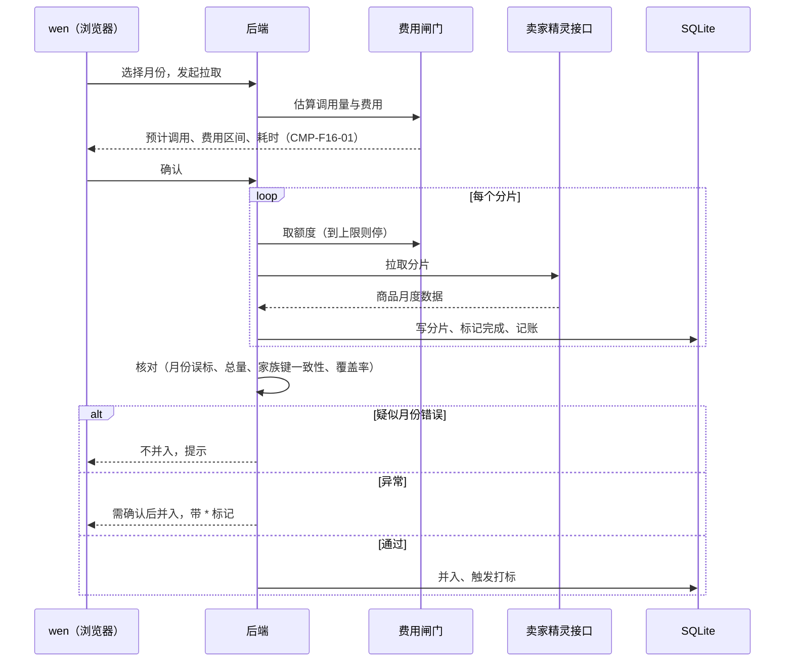
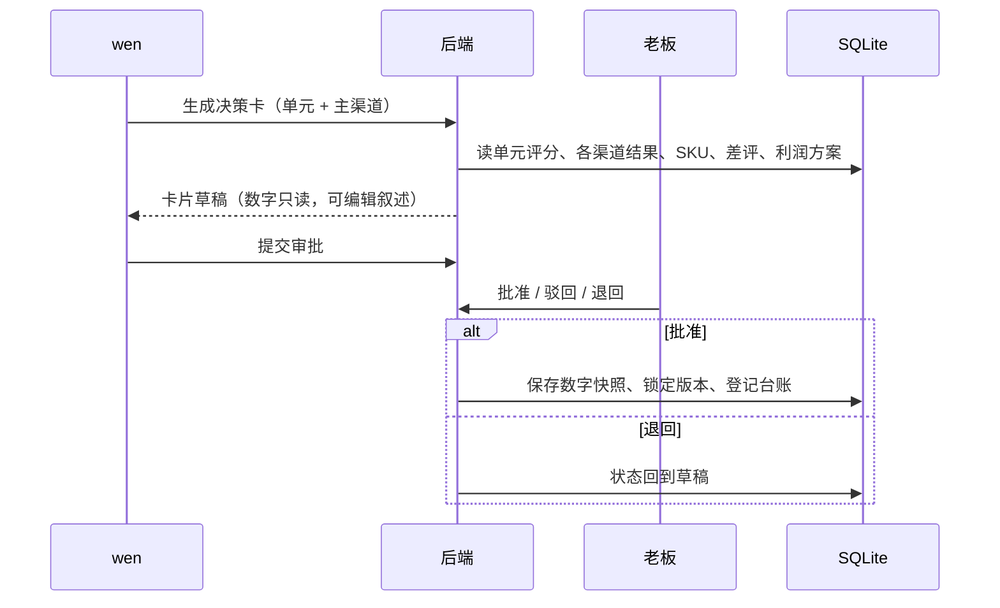

# 品类机会判定台 技术方案（第二轮）

> 输入：
> - `PRD详细版.md` v7；
> - `requirements.md` revision 7（scope = 第一版，F15–F29）；
> - `设计决策蓝图.md`（wen 2026-11-03 确认）。
>
> 第一轮技术方案（revision 5，单机单用户）作废，见 `change-impact.md`。
>
> 版本核实：2026-11-03 在本环境用 `python3 -m pip index versions <包>` 查询 PyPI；本环境的 Python 是 3.13.17。

## 1. 产品技术画像

### 1.1 产品形态

- 桌面浏览器网页，局域网内多人访问，三类角色（操作者 / 审批者 / 只读）。
- 运行在 wen 电脑上（Windows 或 Mac），双击启动。
- 并入两个已有工具：
  - 评论月度 VP 追踪器：Python，`reviewkit`；
  - 利润测算台：单页 HTML，计算逻辑在前端。

### 1.2 核心技术约束

| 约束 | 来源 | 对技术的影响 |
| :--- | :--- | :--- |
| 局域网共享、只在 wen 电脑运行 | KD-R2-01；NFR-007 | 单进程单实例；监听局域网地址，不暴露公网 |
| 账号密码、三类角色、停用即失效 | REQ-F15-01、REQ-F15-02 | 服务端会话；每次请求都校验账号状态 |
| 密钥本机加密存储、只显示后 4 位 | REQ-F16-01；NFR-008 | 本机密钥文件加密；日志和导出脱敏 |
| 花钱前先评估、月度上限、记账 | REQ-F16-02 | 所有外部调用都经过统一的"费用闸门"模块 |
| 卖家精灵按月拉、断点续拉、不重复计费 | REQ-F17-01；NFR-011 | 任务分片、记录完成状态，幂等重跑 |
| 月份误标 / 来源切换核对 | REQ-F17-02 | 并入前跑核对规则，异常需人工确认 |
| 打标 + 看图 + 确认队列 | REQ-F18-01～03 | 规则引擎沿用第二轮打标技能；大模型多家可选 |
| 第九版评分、回测 | REQ-F19-01、REQ-F19-02 | 复用 `solution-v2/trial/` 的 pandas / scikit-learn / statsmodels 计算 |
| 分渠道扫描、评论换算销量、同系列去重 | REQ-F28、REQ-F29 | 数据模型带"渠道"字段；评论按评论 ID 去重 |
| 决策卡批准后快照 | AC-F25-02 | 卡片数字以快照形式存储 |
| 扫描 10 秒内出结果、决策卡 30 秒内生成 | NFR-009、NFR-010 | 每月并入后预算并缓存单元级结果 |
| 数据保留 36 个月 | NFR-012 | SQLite 单文件；按月版本化 |

### 1.3 团队与规模画像

- 实现由 AI / Coding Agent 负责；用户约 5–10 人，同时在线 ≤ 5 人；第一版只有一个品类。
- 数据量：24 个月约 5 万行子体 × 月（Amazon），加上其他渠道 650 个商品、1.5 万条评论 / 10 个月；每年新增约数万行。

### 1.4 非功能性需求

- NFR-007：局域网访问。
- NFR-008：密钥只在本机。
- NFR-009：扫描 ≤ 10 秒。
- NFR-010：决策卡 ≤ 30 秒。
- NFR-011：断点续跑不重复计费。
- NFR-012：保留 36 个月。

**外部服务说明**：卖家精灵、Bright Data、Apify、大模型（Claude / OpenAI 等）都是用户在 PRD 和蓝图 §7 中确认的业务依赖，不是本方案新增的推荐。其中 Bright Data、Apify、Anthropic、OpenAI 是海外服务，可达性取决于 wen 的网络环境。现有评论 VP 追踪器已在使用 Bright Data、Apify。大模型接入兼容 OpenAI 协议，可以填自定义地址，因此也能接国内兼容服务，作为可达性后备。

## 2. 技术栈总览（一张图）

```text
┌ 浏览器（局域网内各角色）─────────────────────────────────────────┐
│ 服务端渲染页面（Jinja2）+ 原生 JS；共享样式 app.css / tokens.css   │
│ 利润测算页：保留原利润测算台的前端计算逻辑，存取改走后端接口        │
└───────────────────────────────▲───────────────────────────────┘
                                │ HTTP（局域网，会话 Cookie）
┌ 后端（wen 电脑，单进程）───────┴───────────────────────────────┐
│ Python 3.12+ · FastAPI 0.162.0 · Uvicorn 0.54.0                 │
│ 模块：auth｜settings（密钥 / 预算 / 费用闸门）｜ingest（卖家精灵 / 上传 / 核对）│
│       tagging（规则 + 看图）｜model（第九版评分、回测）｜scan｜cards │
│       reviews（差评拉取 / 归类）｜vp（reviewkit 并入）｜profit｜approval｜ledger │
│ 计算：pandas 3.1.0 · scikit-learn 1.9.1 · statsmodels 0.15.0 · openpyxl 3.1.5 │
│ 后台任务：进程内任务队列（单 worker）+ 分片断点记录              │
└───────────────────────────────▲───────────────────────────────┘
┌ 数据层 ───────────────────────┴───────────────────────────────┐
│ SQLite（WAL）· SQLAlchemy 2.1.6 · Alembic 1.20.1；本地文件目录（原始拉取、导出、图片缓存） │
│ 密钥：cryptography 50.0.2（Fernet）加密文件；密码：argon2-cffi 25.1.0 │
└───────────────────────────────────────────────────────────────┘
外部：卖家精灵接口｜Bright Data｜Apify｜大模型（anthropic 2.4.0 / openai 3.42.1 SDK）
```

## 3. 前端技术选型

### 3.1 候选方案对比

| 候选 | 适配本期 | AI 生成稳定性 | 与现有原型 / 工具的复用 | 复杂度 | 加权 |
| :--- | :---: | :---: | :---: | :---: | :---: |
| 服务端渲染（Jinja2 3.1.6）+ 原生 JS | 5 | 5 | 5（原型就是静态 HTML + app.css；利润测算台本身是原生 JS） | 5 | **5.0** |
| React 单页应用 + 构建流程 | 3 | 4 | 2（要重写原型和利润测算台） | 2 | 2.8 |

### 3.2 推荐：服务端渲染（Jinja2）+ 原生 JS

- **理由**：
  - 页面以表格、表单为主，原型可以直接改成模板；
  - 不需要前端构建，wen 双击即可运行；
  - 利润测算台原样嵌入，只把 localStorage 换成后端接口（AC-F24-02）。
- **交互**：
  - 长任务进度用轮询，每 2 秒一次，不引入 WebSocket；
  - 图表用内联 SVG 生成，不新增图表库；
  - 利润测算台原有的 xlsx.full.min.js 0.18.5 改为本地文件。
- **代价**：交互复杂度上限较低。**升级触发**：页面出现需要大量客户端状态的交互，例如多人实时协作编辑。

### 3.3 风险与缓解

- 利润测算台并入时出现计算回归。缓解：并入前用原工具导出若干方案作为基准，逐项比对（AC-F24-01 的不变行为）。

## 4. 后端技术选型

- **推荐（直接默认，沿用第一轮与蓝图 §8）**：Python 3.12+、FastAPI 0.162.0、Uvicorn 0.54.0，单进程运行，监听局域网地址。
  - 证据：第二轮全部计算脚本（`solution-v2/trial/`）和评论 VP 追踪器都是 Python，可以直接并入为模块。
  - 代价：单进程同时只能跑一个重任务。
  - 升级触发：要迁到服务器或多用户并发重任务。
- **模块边界**：业务计算放在 `core/`，不引用 Web 框架，便于 TDD 单测；Web 层只负责路由、模板、权限和任务调度。
- **费用闸门（核心组件）**：
  - 所有外部调用（卖家精灵、Bright Data、Apify、大模型）都走同一个闸门；
  - 闸门流程：先估算，wen 确认后取得当月额度，执行时逐笔记账，到上限即停（AC-F16-06～08）；
  - 评论 VP 追踪器原有的分平台预算和 `ledger.json` 改接到这个闸门。
- **后台任务**：
  - 进程内单 worker 队列；任务状态存在 SQLite；
  - 分片完成即落库，重跑时跳过已完成分片（NFR-011）；
  - 同一月份的同类任务互斥。
- **关键时序**：





## 5. 数据层选型

### 5.1 主数据库

- **推荐（直接默认）**：SQLite 单文件（WAL 模式），SQLAlchemy 2.1.6 + Alembic 1.20.1 管理表结构。
  - 理由：单机单实例、≤ 5 人同时在线、数据量为几十万行级；备份就是复制文件。
  - 代价：不适合多实例。升级触发：迁服务器或多实例时换 PostgreSQL。由于用 SQLAlchemy，迁移成本可控。
- **核心实体**（DATA-F15-01 起编，全部带"品类"和"渠道"字段，这是不可逆约束）：
  - 账号与会话；
  - 密钥（只存加密后的值）；
  - 预算与费用记录；
  - 拉取任务与分片；
  - 月度数据批次（核对结果、* 标记）；
  - 商品（子体 / 家族 / 系列）；
  - 月度快照；
  - 标签与确认记录（来源：规则 / 看图 / 人工）；
  - 单元评分（版本化）；
  - 回测结果；
  - 机会；
  - 决策卡、卡片版本与快照；
  - 评论与归类；
  - 利润方案；
  - 审批；
  - 策略库条目与版本；
  - 台账；
  - 品类配置（分框、属性、打标规则、渠道系数、成功线，版本化）；
  - 审计日志。
- **状态机**（决策卡，F21 / F25 / F26）：
  - 合法迁移：草稿 → 待审批 → 已批准 / 已驳回 / 退回草稿；已批准 → 跟踪中 → 已对账。
  - 非法迁移：已批准后再编辑数字。只能"另存为新草稿"（AC-F25-02）。
  - 并发：审批与编辑同时发生时，以审批时间点锁定的版本为准。

### 5.2 缓存层（如激活）

- 不引入独立缓存。每月并入后，预算好单元级评分和扫描结果并存表，满足 NFR-009。

### 5.3 搜索引擎（如激活）

- 不激活。列表筛选直接用 SQLite 查询。

### 文件存储

- 单实例、本机持久化磁盘：原始拉取文件、上传文件、导出文件、商品图片缓存都放在 `data/` 目录下，约几 GB 级。不引入对象存储。
- **备份**（蓝图 §9）：每次并入数据、每次审批后，用 SQLite 在线备份生成带时间戳的副本，保留最近 30 份。RPO 等于上次并入或审批的时刻，RTO 为分钟级（换回备份文件即可）。

## 6. AI 能力选型

### 6.1 LLM 选型

- **用在哪**：看图打元素（多模态）、差评归类、决策卡叙述草稿。全部是单轮调用，不打分（方案书原则）。
- **推荐**：
  - 设置页可选提供方（AC-F16-04），用官方 SDK（anthropic 2.4.0、openai 3.42.1）；
  - OpenAI 协议支持自定义地址，可接其他兼容服务；
  - 默认推荐 Claude：第二轮的看图补标和差评归类都是用 Claude 做的，口径一致。具体型号在设置页选择，不写死。
- **输出**：要求结构化输出（JSON），带置信度；解析失败或低于阈值的进入人工确认（AC-F18-03）。
- **费用**：每次调用前估算 token 量，走费用闸门。

### 6.2 检索方案（如需 RAG）

- 不适用。

### 6.3 Agent / 编排框架（如需多步推理）

- 不需要。三类用途都是单轮调用，加上代码里的确定性流程；不引入 Agent 框架。

### 6.4 Embedding 模型

- 不适用。

## 7. 基础设施选型

### 7.1 部署与托管

- wen 电脑本机运行。
- 提供"启动.bat / 启动.command"，沿用两个工具的做法：首次运行自动建虚拟环境、安装依赖；启动后打开浏览器，并显示局域网访问地址。
- 只监听局域网网卡，不做公网映射。

### 7.2 认证与授权

- 账号密码，argon2 哈希；会话 Cookie（HttpOnly、SameSite=Lax），有效期 7 天。
- 每次请求都检查账号是否停用（AC-F15-05）。
- 角色权限在服务端统一校验（AC-F15-02、03）；界面上没有权限的入口直接隐藏。
- 局域网内为 HTTP，接受这个代价。如果以后要跨网访问，再加 HTTPS。

### 7.3 可观测性

- 运行日志写本地文件，按天滚动；密钥、密码脱敏。
- 审计日志表记录登录、审批、密钥变更、花钱任务，在账号页可查看。

### 7.4 CI/CD

- 第一版不做 CI。交付形式为仓库代码加启动脚本，TDD 验收用本地测试命令。

### 7.5 条件能力（按需激活）

- **定时任务**：不激活（RA-101：所有花钱任务由 wen 发起）。
- **导出**：Excel 用 openpyxl。
- **图片**：商品主图按需下载并缓存到本地，供看图打标和 SKU 展开使用。

## 8. 实施建议与风险全景

### 8.1 推荐技术栈一览（最终决断）

| 层 | 选型 |
| :--- | :--- |
| 运行环境 | Python 3.12+（本环境 3.13.17 已验证可用），wen 电脑，局域网 |
| Web | FastAPI 0.162.0 + Uvicorn 0.54.0 + Jinja2 3.1.6 + 原生 JS |
| 数据 | SQLite（WAL）+ SQLAlchemy 2.1.6 + Alembic 1.20.1；本地 data/ 目录 |
| 计算 | pandas 3.1.0、scikit-learn 1.9.1、statsmodels 0.15.0、openpyxl 3.1.5 |
| 安全 | argon2-cffi 25.1.0、cryptography 50.0.2 |
| AI | anthropic 2.4.0、openai 3.42.1（兼容自定义地址） |
| 并入 | reviewkit（评论 VP 追踪器）作为模块；利润测算台前端原样嵌入 |

### 8.2 本期实施起步建议

1. 先建骨架：登录与角色、设置页（密钥、费用闸门）、SQLite 表结构。
2. 并入两个工具，先保证原功能不变：
   - 用原工具输出做基准比对；
   - reviewkit 的预算改接费用闸门。
3. 数据链路：卖家精灵拉取 → 核对 → 打标 → 确认队列；其他渠道评论并入 → 销量估算。
4. 分析：把 `solution-v2/trial/回归预测.py`、`回归预测_第九版.py`、`机会扫描.py`、`决策卡.py` 的计算移入 `core/`，用第二轮的结果做回归基准。
5. 决策卡、差评、利润回写、审批、台账。

### 8.3 后续阶段扩展预留

- 加品类、加渠道：数据表已带品类和渠道字段，配置版本化（F27）。
- 迁服务器：SQLAlchemy 换 PostgreSQL，加 HTTPS；业务模块不变。
- 定时自动拉取：费用闸门已有"上限内自动执行"的接入点，只是第一版不开启。

### 8.4 全局风险与缓解

| 风险 | 影响 | 缓解 |
| :--- | :--- | :--- |
| 卖家精灵接口不能稳定拉全量 | 高 | 断点续拉；手动上传后备；核对能发现缺失 |
| 海外服务（Bright Data、Apify、大模型）在本机网络下不稳定 | 中 | 设置页"测试"及时暴露；大模型可换兼容地址；失败只影响对应功能 |
| 第二轮计算脚本移入产品时口径漂移 | 高 | 以第二轮结果文件为基准，做数值回归测试 |
| 利润测算台并入后计算变化 | 中 | 原工具导出方案作为基准比对 |
| wen 电脑关机时其他人访问不到 | 低 | 已接受（PRD 关键决策） |

### 8.5 技术负责人的最终结论

#### 是否可以立即开工

可以。全部依赖已确认，版本已核实，没有需要新增的外部服务。

#### 最大的技术不确定性

卖家精灵接口能否稳定拉取浴室柜类目的全量月度数据，以及看图打元素的准确率。

#### 现在最不应该做的事

- 引入前端构建、独立缓存、Agent 框架或定时任务；
- 在分框规则之外"优化"第二轮已验证的口径。

## 附录：设计对象编号（供追溯矩阵与 TDD 引用）

> 编号发布后不重编、不复用。路径为服务端路由，页面表单走 POST 后重定向，任务进度走 JSON。所有路由先过登录与角色校验（API-F15-01 的会话中间件），只读角色只能用 GET。

### A.1 接口

| ID | 路由 | 作用 | 角色 | Source |
| :--- | :--- | :--- | :--- | :--- |
| API-F15-01 | `POST /login`、`POST /logout`；会话中间件 | 登录、登出；每次请求检查会话与账号是否停用 | 全部 | REQ-F15-01, AC-F15-01～03, AC-F15-05 |
| API-F15-02 | `GET/POST /accounts`、`POST /accounts/{id}/reset`、`POST /accounts/{id}/disable` | 建账号、指定角色、重置密码、停用 | 操作者 | REQ-F15-02, AC-F15-04, AC-F15-05 |
| API-F15-03 | `GET /audit` | 审计日志 | 操作者 | AC-F15-04 |
| API-F15-04 | `GET /` | 工作台聚合（按角色） | 全部 | DEC-101 |
| API-F16-01 | `POST /settings/keys/{service}`、`POST .../test`、`POST .../delete`、`POST /settings/llm` | 密钥填写 / 测试 / 更换 / 删除，只回传后 4 位；选择大模型提供方 | 操作者 | REQ-F16-01, AC-F16-01～05, NFR-008 |
| API-F16-02 | `GET/POST /settings/budget` | 各服务月度上限 | 操作者 | REQ-F16-02, AC-F16-08 |
| API-F16-03 | `POST /jobs/estimate`、`POST /jobs/{id}/confirm`、`GET /jobs/{id}`、`POST /jobs/{id}/resume` | 费用闸门：估算、确认、进度、断点续跑；到上限即停 | 操作者 | REQ-F16-02, AC-F16-06～08, NFR-011 |
| API-F16-04 | `GET /settings/ledger` | 费用记录（按月汇总、明细） | 操作者 | AC-F16-07 |
| API-F17-01 | `POST /data/amazon/pull` | 按月份发起卖家精灵拉取（经 API-F16-03） | 操作者 | REQ-F17-01, AC-F17-01, AC-F17-02 |
| API-F17-02 | `POST /data/amazon/upload` | 手动上传导出文件（后备） | 操作者 | REQ-F17-02, AC-F17-02 |
| API-F17-03 | `GET /data/batches`、`POST /data/batches/{id}/merge`、`POST /data/batches/{id}/reject` | 核对结果、确认并入（异常带 *）、不并入 | 操作者 | REQ-F17-02, AC-F17-03～05, NFR-012 |
| API-F18-01 | `POST /tagging/run` | 规则打标 + 看图打元素（经 API-F16-03） | 操作者 | REQ-F18-01, AC-F18-01, AC-F18-02 |
| API-F18-02 | `GET /tagging/queue`、`POST /tagging/groups/{id}/confirm`、`POST /tagging/items/{id}` | 确认队列；同图分组确认、组内单改、看不出 / 非本品类 | 操作者 | REQ-F18-02, REQ-F18-03, AC-F18-03～07 |
| API-F19-01 | `POST /models/rescore`、`POST /models/backtest`、`GET /models/runs/{id}` | 重算评分、滚动回测、与上一版并排 | 操作者（只读可看结果） | REQ-F19-01, REQ-F19-02, AC-F19-01～04 |
| API-F20-01 | `GET /scan?channel=&frame=&type=&vars=` | 机会扫描（读预计算表） | 全部 | REQ-F20-01, REQ-F20-02, AC-F20-01～05, NFR-009 |
| API-F21-01 | `GET /cards`、`POST /cards`（单元 + 主渠道） | 列表、生成卡片 | 列表全部；生成为操作者 | REQ-F21-01, AC-F21-01, NFR-010 |
| API-F21-02 | `GET /cards/{id}`、`POST /cards/{id}/narrative`、`POST /cards/{id}/draft`（AI 起草）、`POST /cards/{id}/save-as-new` | 详情、编辑叙述、AI 起草、另存新草稿 | 详情全部；其余操作者 | REQ-F21-02, REQ-F21-03, AC-F21-02～06, AC-F25-02 |
| API-F22-01 | `POST /cards/{id}/reviews/pull`、`POST /reviews/{id}/category` | 差评拉取与归类（经 API-F16-03）、改判 | 操作者 | REQ-F22-01, REQ-F22-02, AC-F22-01～04 |
| API-F23-01 | `/tools/vp/*`（项目设置、采集列表、评估费用、采集评论、导出 Excel） | 评论 VP 追踪器并入，预算改走 API-F16-03 | 操作者 | REQ-F23-01, AC-F23-01, AC-F23-02 |
| API-F24-01 | `/tools/profit/*`（方案增删改、导入 .json、历史库） | 利润测算台并入，方案存服务端 | 操作者 | REQ-F24-01, AC-F24-01, AC-F24-02 |
| API-F24-02 | `POST /tools/profit/{plan}/link/{card}` | 从卡片带入尺寸售价；关联并回写"钱"一节 | 操作者 | REQ-F24-02, AC-F24-03, AC-F24-04 |
| API-F25-01 | `POST /cards/{id}/submit`、`GET /approvals`、`POST /approvals/{id}/decide` | 提交审批；批准 / 驳回 / 退回；批准时快照并登记台账 | 提交为操作者；决定为审批者 | REQ-F25-01, AC-F25-01～03 |
| API-F25-02 | `GET/POST /strategies`、`POST /strategies/{id}/apply-verified` | 策略库条目、版本、申请"已验证" | 编辑为操作者；审批走 API-F25-01 | REQ-F25-02, AC-F25-04, AC-F25-05 |
| API-F26-01 | `GET /ledger`、`POST /ledger/{id}/link-asin` | 台账列表、对账结果、准确率；关联自家 ASIN | 列表全部；关联为操作者 | REQ-F26-01～03, AC-F26-01～06 |
| API-F27-01 | `GET/POST /settings/category` | 品类配置（版本化保存） | 操作者 | REQ-F27-01, REQ-F27-02, AC-F27-01～03 |
| API-F28-01 | `POST /data/channels/import`、`GET /data/channels/estimate?method=` | 其他渠道评论月度并入（按评论 ID 去重）；两种估算方法对照 | 操作者（只读可看） | REQ-F28-01, REQ-F28-02, AC-F28-01～05 |
| API-F29-01 | `GET /cards/{id}/channels` | 卡片分渠道并排与多渠道印证 / 分歧 | 全部 | REQ-F29-01, REQ-F29-02, AC-F29-01～04 |

### A.2 数据实体

所有业务表都带"品类""渠道"字段（不可逆约束，见 §5.1）。

| ID | 实体 | Source |
| :--- | :--- | :--- |
| DATA-F15-01 | 账号、会话（角色、停用标记、argon2 哈希） | REQ-F15-01, REQ-F15-02 |
| DATA-F15-02 | 审计日志 | AC-F15-04 |
| DATA-F16-01 | 密钥（加密值、后 4 位、测试状态） | REQ-F16-01, NFR-008 |
| DATA-F16-02 | 预算上限、费用记录（任务、服务、调用数、金额） | REQ-F16-02 |
| DATA-F16-03 | 任务与分片（状态、已完成分片，唯一键：类型 + 月份 + 分片） | NFR-011 |
| DATA-F17-01 | 月度批次（来源、核对结果、* 标记、并入版本） | REQ-F17-01, REQ-F17-02, NFR-012 |
| DATA-F17-02 | 商品（子体 / 家族 / 系列）、月度快照 | REQ-F17-01 |
| DATA-F18-01 | 标签与确认记录（来源：规则 / 看图 / 人工；置信度） | REQ-F18-01～03 |
| DATA-F19-01 | 单元评分、模型版本、回测结果 | REQ-F19-01, REQ-F19-02 |
| DATA-F20-01 | 机会（渠道、框、属性值、类型、证据等级） | REQ-F20-01, REQ-F20-02 |
| DATA-F21-01 | 决策卡、卡片版本、数字快照、状态 | REQ-F21-01～03, REQ-F25-01 |
| DATA-F22-01 | 评论与归类（自动 / 改判） | REQ-F22-01, REQ-F22-02 |
| DATA-F24-01 | 利润方案及与决策卡的关联 | REQ-F24-01, REQ-F24-02 |
| DATA-F25-01 | 审批记录（对象、决定、意见） | REQ-F25-01 |
| DATA-F25-02 | 策略库条目与版本 | REQ-F25-02 |
| DATA-F26-01 | 预测台账（登记内容、到期、对账结果、关联 ASIN） | REQ-F26-01～03 |
| DATA-F27-01 | 品类配置（版本化：分框、属性、打标规则、阈值、渠道系数、估算方法、成功线） | REQ-F27-01, REQ-F27-02 |
| DATA-F28-01 | 其他渠道评论月度、销量估算结果（方法 + 参数版本） | REQ-F28-01, REQ-F28-02 |

### A.3 时序与状态

| ID | 内容 | 位置 |
| :--- | :--- | :--- |
| SEQ-F17-01 | 月度拉取 → 费用闸门 → 分片 → 核对 → 并入 / 不并入 / 带 * 并入 | §4 第一张时序图 |
| SEQ-F25-01 | 生成决策卡 → 提交 → 批准（快照、台账）/ 驳回 / 退回 | §4 第二张时序图 |
| SEQ-F26-01 | 对账：任一月份并入后，检查到期台账（登记满 6 个月），按 Amazon 与各渠道成功线分别判定；无关联 ASIN 的标"待关联" | 本附录（文字流程） |
| SEQ-F21-01 | 决策卡状态机：草稿 → 待审批 → 已批准 / 已驳回 / 退回草稿；已批准 → 跟踪中 → 已对账；已批准后改数字为非法迁移，只能另存新草稿 | §5.1 状态机 |

### A.4 非功能测量点

| NFR | 测量点 |
| :--- | :--- |
| NFR-007 | 启动日志打印监听地址；检查只绑定局域网网卡地址，不绑定 0.0.0.0 以外的公网映射 |
| NFR-008 | 扫描仓库、`data/` 导出文件、运行日志中的完整密钥出现次数 = 0；接口响应只含后 4 位 |
| NFR-009 | 用 24 个月、约 5 万行子体 × 月的数据，计时 `GET /scan` 到页面渲染完成 ≤ 10 秒 |
| NFR-010 | 不含外部调用时，计时 `POST /cards` 到详情可打开 ≤ 30 秒 |
| NFR-011 | 拉取中途终止后重跑：已完成分片的外部调用数与新增费用记录均为 0 |
| NFR-012 | 批次与原始文件保留 36 个月；任选历史月份能重放扫描与评分 |
