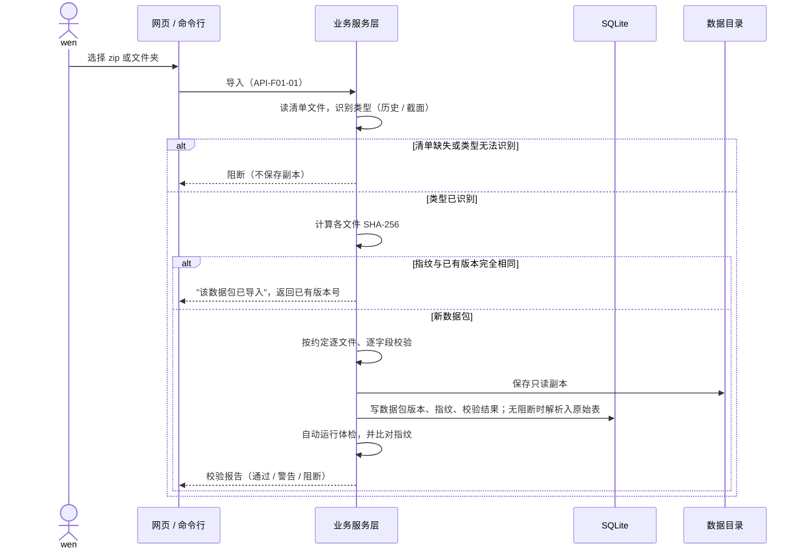
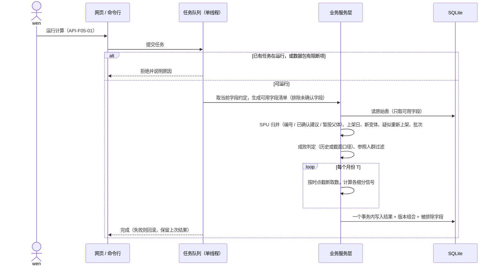
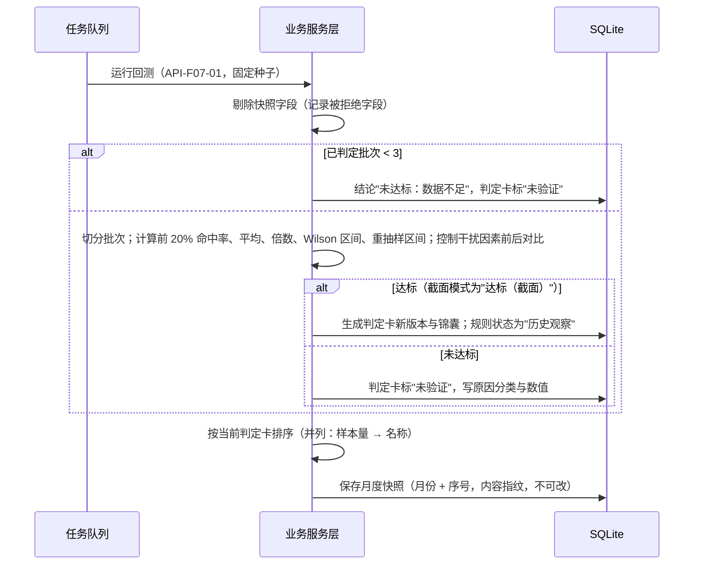
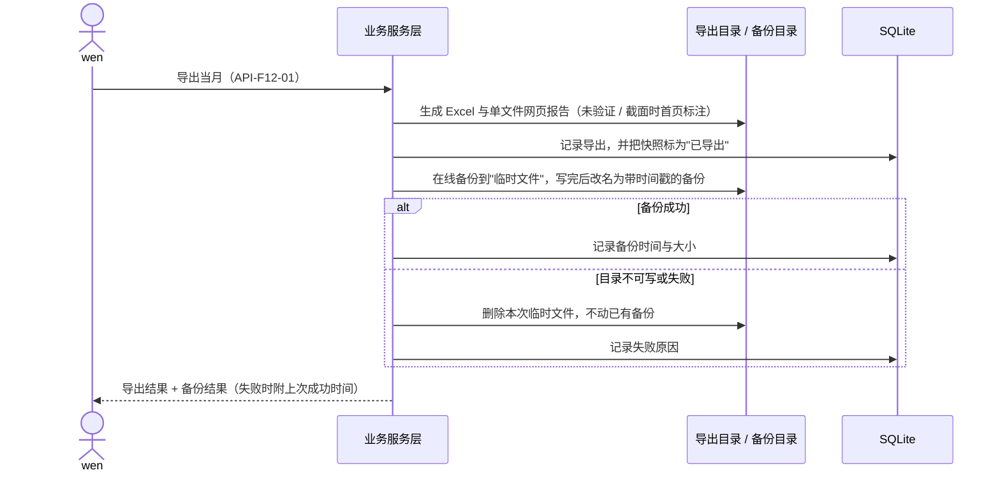
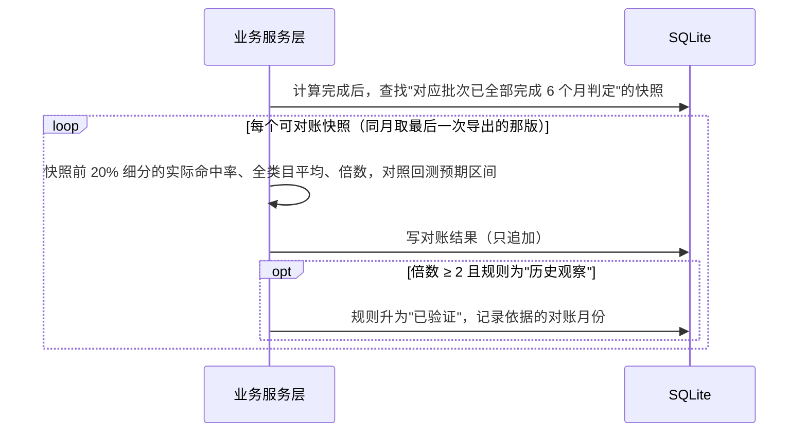
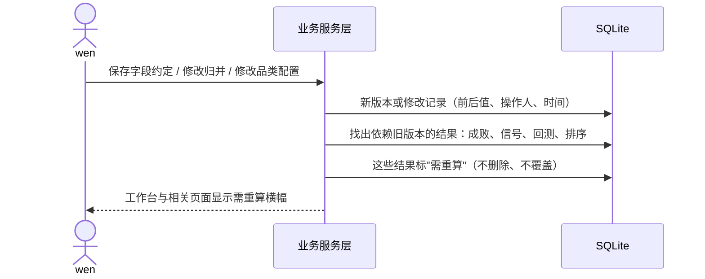

# 品类机会判定台 技术方案

> 生成时间：2026-10-26
> 基于 PRD：`output/PRD详细版.md`（v4）、`output/requirements.md`（revision 4）、`output/设计决策蓝图.md`（已确认）
> 技术方案版本：v1.0
> 范围：第一期（亚马逊美国 · 浴室柜，wen 电脑上的本机小网页）。第二、三期只写扩展预留，不提前建设。

## 1. 产品技术画像

品类机会判定台是一个单用户、离线运行的数据分析应用。数据入口只有"导入数据包"，出口只有 Excel 和单文件网页报告；核心是一条确定性的计算链路：校验 → 字段约定 → 体检 → SPU 与成败 → 信号 → 回测 → 判定卡与排序 → 台账。技术上的难点不在并发或规模，而在三件事：
- 计算可复现；
- 时点不泄漏；
- 每个结论都能追溯到版本和来源记录。

### 1.1 产品形态
- 产品类型：本机 Web 应用（浏览器访问 `http://127.0.0.1:端口`），外加命令行入口。
- 主要入口：wen 电脑上的 Chrome / Edge；导出的网页报告在 Windows / macOS 的 Chrome、Edge、Safari 中离线打开。
- 端的数量：单端。

### 1.2 核心技术约束

| 约束 | 来源 | 技术含义 |
| :--- | :--- | :--- |
| 只在本机访问；第一期不调用任何外部服务，数据不离开本机 | NFR-006；D-18、D-19 | 服务只监听 127.0.0.1；运行时零网络请求；前端脚本、样式、图标全部随程序本地提供；校验 Host 头，防止 DNS 重绑定与跨站请求 |
| 同一输入两次运行结果 100% 一致 | NFR-001 | 计算不含大模型；重抽样固定随机种子；所有排序用稳定排序并有完整的并列规则；依赖版本锁定；结果记录所用版本 |
| 每个结论可追溯 | NFR-003 | 结果表都存数据包、字段约定、品类配置版本与来源记录主键 |
| 命令行与网页结果一致；记录带操作人与时间 | NFR-004 | 业务计算放在不依赖网页的服务层，网页和命令行调用同一套函数；所有写入记录带操作人与时间 |
| 8 GB 内存的 Windows 上，从计算到回测报告 ≤ 30 分钟 | NFR-005 | 只加载需要的列；类别列用分类型；计算在后台任务中执行并上报进度；单任务排队 |
| 第 T 月的信号只用早于 T 月的数据 | REQ-F06-02、AC-F06-03 | 统一的"按时点截断"数据访问函数，所有信号必须经过它；用泄漏陷阱测试守住 |
| 快照字段不进回测；未确认字段不参与计算 | AC-F02-04、AC-F02-05 | 计算前按当前字段约定生成"可用字段清单"，回测入口再剔除快照字段，被排除和被拒绝的字段写入结果 |
| 数据包只读保存，指纹可核对 | REQ-F01-02、AC-F03-03 | 导入时复制到本机数据目录、设只读属性、计算 SHA-256；体检后重新比对指纹 |
| 快照保存后不可修改；立项记录不可改、只能追加更正 | AC-F10-01；DEC-007 | 只追加的表；数据库触发器拒绝修改和删除；快照存内容指纹 |
| 导出后自动备份，失败不动旧备份，可恢复 | REQ-F10-04、NFR-002；DEC-008 | 用 SQLite 在线备份生成带时间戳的新文件，写完再改名；恢复前先自动备份当前状态 |
| 字段约定、归并或配置变化后，依赖结果标"需重算" | AC-F02-07、AC-F04-05、AC-F13-02 | 结果记录其依赖的版本组合；版本变化时比对并标记，不自动覆盖 |
| 交付给非开发者，在 Windows 上双击使用 | DEC-015 | 离线安装包：自带嵌入式 Python 与预装依赖，不依赖电脑上已有的 Python |
| 第二期迁服务器、多人共用 | D-17、NFR-004 | 数据库访问经 ORM 和迁移脚本，可换 PostgreSQL；商品身份带平台字段；数据带品类编号 |

### 1.3 团队与规模画像
- 团队规模假设：1–2 名开发者，使用 AI 辅助开发（`/goal`）。
- 技术栈偏好：Python。已有的小试脚本和旧技能包都是 Python + pandas + openpyxl。
- 用户规模预期：第一期 1 个操作者（wen）；第二期 5–8 名产品经理，加上只读的结果接收方，约数十人。
- 数据规模（浴室柜，24 个月）：
  - C1 月度类目商品约 41 万行；
  - C2 新品约 2,200 个子体；
  - C6 评论约 18 万条；
  - 每月新增一个数据包，单个约 100–300 MB。
- 上线时间压力：中。真实数据包 2026-11-06 到位；首跑目标 ≤ 5 个工作日。

### 1.4 非功能性需求
- **性能**：
  - 全流程计算到回测报告 ≤ 30 分钟（NFR-005）。
  - 页面操作响应在 1 秒内，长任务走后台。
- **可用性**：单机单用户；程序崩溃不损坏数据库（SQLite WAL 模式 + 事务）。
- **安全**：只监听本机；校验 Host 与来源；写操作带随机令牌；不保存任何外部密钥。
- **可审计**：确认、修改、批量操作、立项记录、恢复都写操作记录（操作人、时间、前后值）。
- **可复现**：见 1.2。

## 2. 技术栈总览（一张图）

```text
┌──────────────────────────────────────────────────────────────────────┐
│ 前端层  │ Jinja2 服务端模板 + HTMX 2.0.11（本地文件）                  │
│         │ 复用原型的 tokens.css / app.css / app.js / 图标；图表由服务端 │
│         │ 生成 SVG                                                     │
├──────────────────────────────────────────────────────────────────────┤
│ 后端层  │ Python 3.14 + FastAPI 0.162 + Uvicorn 0.54（只监听 127.0.0.1）│
│         │ 业务服务层 oppo.core（不依赖网页）+ 命令行 oppo（argparse）   │
│         │ 后台任务：进程内单线程任务队列 + 任务表                       │
├──────────────────────────────────────────────────────────────────────┤
│ 计算层  │ pandas 3.0.6 + numpy 2.5.4 + scipy 1.18.1 + statsmodels 0.15.0│
├──────────────────────────────────────────────────────────────────────┤
│ 数据层  │ SQLite（单文件，WAL）+ SQLAlchemy 2.1.6 + Alembic 1.20.1      │
│         │ 本机数据目录：只读数据包副本、导出、日志；备份写到指定目录    │
├──────────────────────────────────────────────────────────────────────┤
│ 导入导出│ openpyxl 3.1.5（读写 xlsx）；单文件网页报告（模板内联样式与  │
│         │ SVG）                                                        │
├──────────────────────────────────────────────────────────────────────┤
│ 基础设施│ Windows 离线安装包：嵌入式 Python 3.14.10 + 预装依赖 +        │
│         │ 启动.bat；无登录；按天滚动的本地日志                          │
└──────────────────────────────────────────────────────────────────────┘
```

AI / LLM 层不适用（见 §6）。

## 3. 前端技术选型

**直接默认**（继承设计决策蓝图 §8，用户已确认）。

### 3.1 推荐：Jinja2 服务端模板 + HTMX 2.0.11 + 原型共享资源

**决策证据**：
1. **单用户本机工具**：没有首屏性能、SEO 或复杂前端状态的需求，服务端渲染就能满足全部 26 个页面。
2. **原型可直接转成模板**：原型已用纯 HTML/CSS/少量原生 JS 实现，结构可直接移植为 Jinja2 模板。`tokens.css`、`app.css`、`app.js`、`icons.js` 原样作为静态文件。
3. **局部刷新**：HTMX 补足"不刷新整页"的交互，包括批量确认后刷新表格、任务进度轮询、筛选结果局部替换。
4. **不需要 Node 构建链**：wen 的电脑上不需要安装任何前端工具。

**核心配置建议**：
- **路由**：每个页面一个服务端路由，路由与页面清单 1:1 对应（`/` 对应 PAGE-F03-01，`/spu` 对应 PAGE-F04-01……）。抽屉和弹窗用 HTMX 加载片段，同时保留可直接访问的地址。
- **状态**：页面状态以服务端为准；筛选条件放在查询参数里，刷新后保持。
- **样式**：只用 `DESIGN.md` 的类与 Token，模板里不写颜色值。
- **图表**：区间条、折线、条形、热力表由服务端 Python 函数生成 SVG，与原型的坐标规则一致（例如区间条横轴 0–60%）。同一套函数供网页报告复用，保证离线报告与页面显示一致（AC-F12-03）。
- **HTMX 版本**：使用 2.0.11（npm `latest`，2026-10 核实）；`4.0.0` 为 `next` 标签的预发布版，不采用。文件放进静态目录，不走 CDN。

**当前代价**：交互复杂度受限于服务端渲染，例如无法在前端即时重排大表。对单用户、表格为主的工具可以接受。

**升级触发条件**：第二期出现多人同时在线编辑同一对象、需要即时协作时，再评估前端框架。

### 3.2 风险与缓解
- **风险**：原型的 `app.js` 与 HTMX 同时绑定事件，可能冲突。→ **缓解**：HTMX 替换片段后触发 `htmx:afterSwap`，在其中重新绑定 `app.js` 的行为；只用 HTMX 做片段替换和轮询，其余交互沿用 `app.js`。
- **风险**：网页报告与页面显示不一致。→ **缓解**：报告用同一套模板片段和 SVG 函数生成，测试中对同一快照比对两者的关键数字。

## 4. 后端技术选型

**直接默认**（继承蓝图 §8：Python + FastAPI；本节写落地约束）。

### 4.1 推荐：Python 3.14 + FastAPI 0.162.0 + Uvicorn 0.54.0

**决策证据**：
1. **语言**：计算核心是 pandas / statsmodels，Python 是唯一自然的选择。已有小试脚本（`solution/trial/*.py`）可直接复用。
2. **Web 框架**：FastAPI 的路由、表单、文件上传（配合 python-multipart 0.0.32）、模板渲染满足第一期全部需求；第二期迁服务器时，同一框架能直接对外提供接口。
3. **Python 版本**：
   - 选 3.14 系列（2025-10 首发，当前补丁 3.14.10 于 2026-10-25 发布）。pandas、numpy、scipy、statsmodels、SQLAlchemy 都提供 Windows 64 位 cp314 安装包（2026-10-26 在 PyPI 核实）。
   - 3.15.0 于 2026-10-09 才发布，不采用。

**核心配置建议**：
- **代码结构**（业务与网页分离，满足 NFR-004）：
  - `oppo/core/`：纯业务，不引用 FastAPI。按功能分模块：
    - 数据导入：导入与校验、字段约定、体检；
    - 新品与成败：SPU 与新品、成败判定（历史 / 截面）；
    - 分析：细分与回填、信号、回测、判定卡与锦囊、排序；
    - 沉淀与输出：台账、策略库、导出、备份恢复、运行记录。
  - `oppo/web/`：FastAPI 路由、Jinja2 模板、静态文件。
  - `oppo/cli.py`：命令行（标准库 argparse，不新增依赖）。子命令覆盖导入、确认字段、体检、审核合并、计算、回测、生成排序、导出、备份、恢复。
- **后台任务**：
  - 进程内一个工作线程，加一张任务表（状态、步骤、进度、错误）。
  - 同时只运行一个任务；再次发起时返回"x 正在运行"（DEC-010）。
  - 页面用 HTMX 每 2 秒轮询任务状态。
  - 任务失败时，结果表不写入半成品，保留上一次成功的结果。
- **可复现的实现规则**：
  - 随机数统一用 `numpy.random.Generator(PCG64(种子))`，种子写进回测记录（例：20261106）。
  - 所有排序用稳定排序，并给出完整的并列规则。例如排序是"得分降序 → 样本量降序 → 细分名称升序"（REQ-F09-01）。
  - 浮点结果只在展示时四舍五入，存储保留原值。
  - 同一组版本（数据包、约定、配置）与同一种子重跑，结果写入前做逐列比对测试（NFR-001）。
- **统计方法落点**（具体口径以验收契约为准）：
  - **命中率区间**：用 Wilson 90% 区间（statsmodels `proportion_confint`，方法 `wilson`，alpha 0.10）。
  - **倍数区间**：对细分有放回重抽样 1000 次，取 5% 和 95% 分位数。
  - **控制干扰因素**：做逻辑回归，比较加入六项干扰因素前后每个信号的优势比（AC-F07-06）。
  - **截面模式**：以"新品-月"为行做逻辑回归，自变量为上架月龄（虚拟变量）、细分属性和干扰因素。按同一月龄结构，把第 1–6 个月的月度达成概率合成为"上架 6 个月内命中概率"：1 − Π(1 − pₐ)。报告中注明这是近似。
- **按时点截断**：
  - 所有信号函数都通过一个入口取数，输入为月份 T。该入口只返回月份早于 T 的月度数据、评论日期早于 T 月 1 日的评论，以及统计月份早于 T 的关键词数据。
  - 测试中放入"未来数据陷阱"，例如 T 月之后的极端值，确认信号不变（AC-F06-03）。
- **安全**：
  - 用 Starlette 的 `TrustedHostMiddleware` 只接受 `127.0.0.1` 和 `localhost`。
  - 所有写操作校验同源，并带每次启动随机生成的令牌，防止其他网站诱导浏览器向本机服务提交请求。

**当前代价**：单进程单线程任务。计算期间若 CPU 占满，页面响应可能变慢。

**升级触发条件**：回测期间页面操作明显卡顿（单次响应 > 2 秒）时，把任务改为独立子进程；第二期多人使用时，改为独立的任务进程。

### 4.2 风险与缓解
- **风险**：统计方法实现有误，结论看似合理但错误。
  - → **缓解**：每种方法都用"已知答案"的小数据集做单元测试（手算 Wilson、手算前 20% 命中率）；截面合成概率用模拟数据检验能否还原设定的命中率。
- **风险**：pandas 3 的行为变化（默认写时复制、新的字符串类型）与小试脚本不兼容。
  - → **缓解**：锁定 pandas 3.0.6（2026-09-17 发布，3.0 系列的成熟补丁）；3.1.0 于 2026-10-22 刚发布，等它出第一个补丁版后再评估升级。

### 4.3 接口与命令行清单（API）

网页与命令行调用同一个服务函数（NFR-004）。下表是第一期的全部写操作，以及关键读操作。接口只在本机监听，写操作需带启动令牌。

| ID | 能力 | 网页接口 | 命令行 | 关键失败结果 |
| :--- | :--- | :--- | :--- | :--- |
| API-F01-01 | 导入数据包（zip 或文件夹） | `POST /packages` | `oppo import <路径>` | 清单缺失或类型无法识别 → 阻断；全部文件指纹与已有版本相同 → "该数据包已导入"，返回已有版本号，不建新版本 |
| API-F01-02 | 查看校验报告 | `GET /packages/{版本}/report` | `oppo report <版本>` | — |
| API-F02-01 | 读取字段约定（当前版本 + 新数据包的变化字段草稿） | `GET /contract` | `oppo contract show` | — |
| API-F02-02 | 保存字段约定新版本（逐项 / 按建议批量确认、修改） | `POST /contract/versions` | `oppo contract confirm [--suggested] [--fields …]` | 无变动 → 不建版本；保存后依赖旧版本的结果标"需重算" |
| API-F03-01 | 体检结果；把预警标为已知晓 | `GET /health`；`POST /health/{项}/ack` | `oppo health [--ack 项 --note 说明]` | 说明为空 → 拒绝 |
| API-F04-01 | 合并建议：单条或批量确认、拒绝 | `GET /merges`；`POST /merges/decisions` | `oppo merge confirm --basis <依据> / --ids …` | 建议已被处理 → 冲突提示，不重复写入 |
| API-F04-02 | 拆分或修改已生效的归并 | `POST /merges/{编号}/revise` | `oppo merge revise <编号> …` | 写入前后值，受影响结果标"需重算" |
| API-F05-01 | 运行计算（成败判定 + 信号） | `POST /jobs/compute` | `oppo compute` | 有阻断项 → 拒绝；已有任务运行 → "x 正在运行" |
| API-F05-02 | 全部重算 | `POST /jobs/recompute` | `oppo recompute` | 无需重算项 → 拒绝；已有任务运行 → 拒绝 |
| API-F07-01 | 运行回测（历史 / 截面），完成后生成判定卡、锦囊、排序与快照 | `POST /jobs/backtest` | `oppo backtest [--mode history 或 cross]` | 已判定批次 < 3 → 结论"未达标：数据不足"（不报错） |
| API-F07-02 | 当前任务状态 | `GET /jobs/current` | 命令行直接输出进度 | 任务失败 → 返回原因，保留上次结果 |
| API-F09-01 | 读取排序（某月、某快照） | `GET /ranking?month=` | `oppo ranking --month` | — |
| API-F10-01 | 记录立项决定 / 补录 / 更正 | `POST /decisions`；`POST /decisions/{编号}/corrections` | `oppo decision add …` / `oppo decision correct …` | 理由为空 → 拒绝；不提供修改与删除 |
| API-F10-02 | 自家上架数据：手工录入或从 C7 导入 | `POST /decisions/{编号}/launch-data`；`POST /decisions/import-c7` | `oppo launch-data …` | 非数字 → 拒绝；空值存为缺失，不存 0 |
| API-F10-03 | 设置备份目录、检测可写；从备份恢复 | `POST /backup/dir`；`POST /backup/restore` | `oppo backup-dir <路径>`；`oppo restore <备份>` | 目录不可写 → 返回原因；恢复前先备份当前状态，失败则不恢复 |
| API-F11-01 | 新增经验规则；修改规则生成新版本 | `POST /rules`；`POST /rules/{编号}/versions` | `oppo rule add …` / `oppo rule edit …` | 条件、动作或理由为空 → 拒绝 |
| API-F12-01 | 导出当月 Excel 与网页报告，随后自动备份 | `POST /exports` | `oppo export --month <月份>` | 备份失败 → 导出仍成功，返回失败原因与上次成功时间，不动旧备份 |
| API-F13-01 | 新建品类配置（复制模板）；修改生成新版本 | `POST /categories`；`POST /categories/{编号}/versions` | `oppo category …` | 缺必填项 → 拒绝；保存后依赖结果标"需重算" |
| API-F14-01 | 运行记录与用时汇总 | `GET /runs` | `oppo runs` | — |
| API-F03-02 | 工作台汇总 | `GET /` | `oppo status` | — |

### 4.4 关键时序（SEQ）

**SEQ-F01-01 导入与校验**



**SEQ-F05-01 运行计算（成败与信号）**



**SEQ-F07-01 回测 → 判定卡 → 排序 → 快照**



**SEQ-F12-01 导出与自动备份**



**SEQ-F10-01 到期对账与规则升级**



**SEQ-F02-01 版本变更与"需重算"传播**



### 4.5 状态机

| 实体 | 合法迁移 | 非法迁移（拒绝） | 并发与冲突 |
| :--- | :--- | :--- | :--- |
| 新 SPU 成败（历史口径） | 观察中 → 命中；观察中 → 未命中（窗口结束且数据完整）；观察中 → 数据不全（缺月份且未命中）；数据不全 → 观察中（补齐数据后重算） | 命中 → 其他状态（只会因重算整体重新生成，不会单条改动） | 每次计算整体重新生成，并绑定版本组合 |
| 新 SPU 成败（截面口径） | 观察中 → 截面命中；观察中 → 截面未命中（新品期结束）；老品不判定 | 老品 → 任何截面状态 | 同上 |
| 判定卡 | （无）→ 已达标 / 达标（截面）/ 未验证；新回测生成新版本 | 修改已有版本 | 同一品类同时有两种口径时，以历史口径决定状态（AC-F07-12） |
| 规则 | 新增 → 未验证经验；达标回测生成 → 历史观察；历史观察 → 已验证（对账倍数 ≥ 2）；改条件或动作 → 新版本为未验证经验 | 未验证经验直接 → 已验证；修改旧版本 | 修改前检查读取时的版本号，不一致则提示有更新的版本 |
| 合并建议 | 待审 → 已确认 / 已拒绝；已确认 → 已修改或拆分（新记录） | 已拒绝直接 → 已确认（需重新生成建议） | 批量确认时跳过已被处理的建议，并返回数量 |
| 结果有效性 | 有效 → 需重算（依赖版本变化）→ 重算中 → 有效 | — | 同一时间只运行一个任务（DEC-010） |
| 任务 | 排队 → 运行 → 成功 / 失败 | 同时两个运行中 | 失败不写半成品，保留上次结果 |
| 月度快照 | 生成 → 已导出 | 任何修改或删除（触发器拒绝） | 同月多次生成时序号递增（DEC-006） |
| 立项记录 | 有效 → 已更正（追加一条更正记录） | 修改或删除 | — |
| 体检预警 | 预警 → 已知晓（必须写说明） | 无说明直接标已知晓 | — |

## 5. 数据层选型

### 5.1 主数据库

**直接默认**（继承蓝图 §8：SQLite + SQLAlchemy + Alembic）。

**推荐**：SQLite（随 Python 自带，WAL 模式），通过 SQLAlchemy 2.1.6 访问，结构由 Alembic 1.20.1 迁移管理。

**决策证据**：
- 单用户、单机，数据量在百万行以内（C1 约 41 万行），SQLite 足够，不需要安装数据库服务。
- pandas 可经 SQLAlchemy 直接读写，计算时按列、按月份读取。
- 第二期迁服务器时，同一套模型和迁移脚本可指向 PostgreSQL（NFR-004）。

**落地约束**：
- **原始数据**：导入通过校验后，按文件类型（C1–C7、S1–S3）解析到对应的原始表，每行带数据包版本与来源行号。原文件另存只读副本，用于指纹核对与追溯。
- **业务表**：数据包、字段约定、品类配置、SPU 与合并建议、成败、信号、回测、判定卡与锦囊、排序与快照、立项记录与更正、自家上架数据、对账、规则与规则版本、体检与已知晓、任务、运行步骤、备份、导出、操作记录。
- **共同字段**：所有业务表都带 `category_id`、`created_by`、`created_at`。商品相关表用"平台 + 站点 + 商品编号"三列标识（本期为 amazon、US、ASIN）。
- **结果表**：都记录依赖的版本组合（数据包、约定、配置、判定卡），用于"需重算"判定（DEC-016）与追溯（NFR-003）。
- **只追加的表**：快照、立项记录、各类版本表。用数据库触发器拒绝修改和删除；快照另存内容的 SHA-256。
- **兼容性**：不用只有 SQLite 才有的语法；迁移脚本在 SQLite 上跑通，第二期加 PostgreSQL 测试。

**当前代价**：单文件数据库不支持多人同时写入。第一期只有一人，不受影响。

**升级触发条件**：
- 第二期上服务器，换 PostgreSQL；
- 或单品类原始数据超过 500 万行、计算超过 30 分钟时，再评估分析型存储（如 Parquet 文件）。

### 5.2 缓存层
不激活：单用户、本机读取，数据库即可满足。

### 5.3 搜索引擎
不激活：页面搜索（SPU 编号、ASIN、品牌、标题）在数千到数万行内，用数据库 `LIKE` 即可。

### 5.4 文件存储（条件维度：已激活）

**激活原因**：要保存导入的数据包副本、导出文件、备份和日志。

**推荐**：本机数据目录，不引入对象存储。

**目录约定**：
- `数据目录\packages\{数据包版本}\`：只读副本；
- `数据目录\导出\{月份}\`：Excel 与网页报告；
- `数据目录\logs\`：日志；
- 备份写到 wen 指定的备份目录。

**决策依据**：
- 单实例，本机磁盘持久保存。
- 每月新增一个 100–300 MB 的数据包，一年数 GB。
- 不需要直传或 CDN。
- **备份目标**：
  - 恢复点：每次导出后一个备份，并在恢复前额外备份当前状态；
  - 恢复时间：几分钟内从备份恢复数据库，数据包原件可重新导入，导入时按指纹自动识别。

**当前代价**：数据包副本会持续占用磁盘。

**升级触发条件**：数据目录超过 50 GB 时，增加"清理旧数据包副本"的功能（需另立需求，因为会影响追溯）。

### 5.5 Excel 读取

**推荐**：openpyxl 3.1.5。小试脚本已在用；它是 pandas 读取 xlsx 的默认引擎，同时能写导出用的 Excel。

**当前代价**：大文件读取较慢，41 万行的 xlsx 预计需要数分钟。每个数据包只在导入时解析一次。

**维护状态**：最新正式版为 2024-06 发布的 3.1.5，另有 3.2.0b1 预发布。

**升级触发条件**：单次导入解析超过 10 分钟，或 openpyxl 停止维护时，改用 python-calamine 0.9.0（2026-10-16 发布，有 cp314 Windows 安装包）读取，openpyxl 只保留写入。

### 5.6 数据实体（DATA）

所有实体都带品类编号、操作人与时间（写入类）。商品类实体用"平台 + 站点 + 商品编号"标识。

| ID | 实体 | 关键字段 | 来源需求 |
| :--- | :--- | :--- | :--- |
| DATA-F01-01 | 数据包版本与文件 | 版本号、类型（历史 / 截面）、覆盖月份、文件清单、各文件 SHA-256、只读副本路径、导入时间 | REQ-F01-02、REQ-F01-03 |
| DATA-F01-02 | 校验结果 | 文件、字段、检查项、结果（通过 / 警告 / 阻断）、受影响行数、示例行号、被排除行号 | REQ-F01-01 |
| DATA-F01-03 | 原始数据表（C1–C7、S1–S3） | 按约定字段解析的行，带数据包版本与来源行号 | REQ-F01-01、NFR-003 |
| DATA-F02-01 | 字段约定版本与字段项 | 版本号、字段、含义、粒度、时点、性质、建议用法、体检证据、确认状态与来源（逐项 / 批量） | REQ-F02-01、REQ-F02-02、REQ-F02-03 |
| DATA-F03-01 | 体检结果与已知晓记录 | 体检项、数值、分母、阈值、状态、样例、已知晓说明、指纹比对结果 | REQ-F03-01 |
| DATA-F04-01 | SPU 与成员 | SPU 编号、子体、上架日及来源子 ASIN、新变体、疑似重新上架、批次、归并来源 | REQ-F04-01、REQ-F04-02 |
| DATA-F04-02 | 合并建议与归并修改记录 | 建议编号、涉及父体与子体、依据、状态、确认来源（逐条 / 批量）、修改前后 | REQ-F04-01 |
| DATA-F05-01 | 成败判定 | 口径、状态、命中方式（BSR / 销售额）、首次达成月份 / 月龄 / 子 ASIN / 金额、缺失月份、未观察月龄、是否起量、版本组合 | REQ-F05-01、REQ-F05-02 |
| DATA-F06-01 | 细分与归属 | 细分定义（来自配置版本）、子体归属、各属性回填标记 | REQ-F06-01、REQ-F06-07 |
| DATA-F06-02 | 信号值 | 月份 T、细分、信号、值、分子、分母、参与数量、标记（无数据 / 截面不适用 / 候选 / 老品数）、被排除字段、版本组合 | REQ-F06-02 至 REQ-F06-08 |
| DATA-F07-01 | 回测运行与结果 | 口径、种子、版本组合、切分（批次范围、行数）、各信号与规则指标、区间、控制前后对比、样本不足细分、被拒绝字段、结论与原因、月龄达标率表 | REQ-F07-01 至 REQ-F07-03 |
| DATA-F08-01 | 判定卡版本与锦囊 | 版本、状态、入选信号、阈值、权重、回测依据；锦囊的条件、动作、区间、依据批次、样本量、状态 | REQ-F08-01 |
| DATA-F09-01 | 排序与排序行 | 月份、判定卡版本、细分、排名、得分、区间、样本量、锦囊、样本不足标记 | REQ-F09-01 |
| DATA-F10-01 | 月度快照（只追加） | 月份、序号、排序 / 锦囊 / 判定卡版本内容、内容指纹、是否导出、对账状态 | REQ-F10-01 |
| DATA-F10-02 | 立项记录与更正（只追加） | 编号、决定、关联细分、理由、对应快照、来源（记录 / 补录 / 更正）、立项日期、被更正编号 | REQ-F10-02 |
| DATA-F10-03 | 自家上架数据与对账结果 | 月龄 1–6 的销量、销售额、BSR（空为缺失）；快照对账的实际命中率、平均、倍数、预期区间 | REQ-F10-03 |
| DATA-F10-04 | 备份记录与备份目录设置 | 目录、时间、大小、内容范围、结果、失败原因 | REQ-F10-04 |
| DATA-F11-01 | 规则与规则版本 | 规则编号、版本、条件（结构化）、动作、理由、状态、依据（回测 / 对账月份） | REQ-F11-01 |
| DATA-F12-01 | 导出记录 | 月份、快照、文件路径、生成时间、对应备份 | REQ-F12-01 |
| DATA-F13-01 | 品类配置版本 | 站点、节点、细分维度与分档、类型属性、成功线、起量门槛、关键词映射、信号窗口、切分比例、体检阈值、负责人 | REQ-F13-01 |
| DATA-F14-01 | 任务与步骤运行记录 | 步骤、开始、结束、操作人、结果；首跑与月更的汇总口径 | REQ-F14-01 |
| DATA-F14-02 | 操作记录 | 对象、动作、前值、后值、操作人、时间 | NFR-003、NFR-004 |

## 6. AI 能力选型

不适用：本期无 AI 能力。打标与评论痛点提取由数据项目或对话中的 Codex / Claude Code 完成，系统内不调用大模型（D-18、D-19）；计算全部由代码完成，以保证可复现（NFR-001）。

## 7. 基础设施选型

### 7.1 部署与托管

形态已确认为"离线安装包"（DEC-015）。打包方式有真实权衡，下面做对比。

| 候选 | DX | Perf | Eco | AI | Scale | Learn | TCO | 加权总分 |
| :--- | :---: | :---: | :---: | :---: | :---: | :---: | :---: | :---: |
| 嵌入式 Python + 预装依赖目录 | 4 | 4 | 4 | 4 | 3 | 4 | 5 | 4.20 |
| PyInstaller 打包成 exe | 3 | 3 | 5 | 4 | 3 | 3 | 4 | 3.65 |
| conda-pack 打包 conda 环境 | 3 | 4 | 4 | 3 | 3 | 3 | 3 | 3.25 |

权重：DX 0.20、Perf 0.10、Eco 0.15、AI 0.10、Scale 0.05、Learn 0.15、TCO 0.25。交付给非开发者且长期月更，所以偏重总成本与可维护性。

**推荐：嵌入式 Python + 预装依赖目录**

**推荐理由**：
1. **官方现成发行物**：python.org 为 3.14.10 提供 `python-3.14.10-embed-amd64.zip`（2026-10-26 核实可下载），目录透明、无需安装、不写注册表，不受 wen 电脑上已有 Python 版本影响。
2. **构建可在开发机完成**：
   - 用 pip 的 `--platform win_amd64 --python-version 3.14 --only-binary=:all: --target` 把锁定版本的依赖装进 `site-packages\`；
   - 修改嵌入式包的 `._pth` 文件，加入 `site-packages` 与程序目录；
   - 整体压缩成 zip。
3. **升级简单**：更新时只替换程序目录，数据目录不动。

**目录结构**：
- `机会判定台\python\`：嵌入式 Python；
- `机会判定台\site-packages\`：预装依赖；
- `机会判定台\app\`：程序；
- `机会判定台\data\`：数据目录，升级时保留；
- `机会判定台\启动.bat`：启动本机服务，端口默认 8765 可配置，并自动打开浏览器；重复启动时只打开浏览器。
- `机会判定台\命令行.bat`。

**次选**：PyInstaller——只有在要求"单个 exe 文件"时才选。它对 scipy / statsmodels 需要逐个处理隐藏导入，单文件模式启动时要解压，Windows 杀毒软件误报也较常见。

**不推荐**：conda-pack——环境体积大（数百 MB 以上），还要额外维护 conda 渠道与国内镜像，对单机工具没有收益。

**国内可达**：
- 运行时不访问网络。
- 构建时只用到 PyPI（可用阿里云 PyPI 镜像，2026-10-26 核实可访问）与 python.org。嵌入式包也可从 npmmirror 的 Python 镜像下载（该地址返回跳转，核实可用）。
- 安装包通过 GitHub Release 或任意文件传输交给 wen；GitHub 访问不稳定时，用网盘或 U 盘拷贝。

**风险与缓解**：
- **风险**：嵌入式 Python 缺少 VC 运行库或个别 DLL。→ **缓解**：嵌入式包自带 vcruntime；首次交付前在一台干净的 Windows 10/11 上冒烟测试（导入样例包、跑完回测、导出）。
- **风险**：端口被占用。→ **缓解**：启动时检测，并提示改用其他端口的方法。

### 7.2 认证与授权

**直接默认**。

**推荐**：第一期不设登录（NFR-006）。只监听 127.0.0.1，校验 Host 头与同源，写操作带启动令牌。操作人名取自本机配置（默认 wen），写入所有记录（NFR-004）。

**决策证据**：单用户、本机访问；PRD §2.1 明确第一期没有管理员与多角色。

**当前代价**：任何能使用 wen 电脑的人都能操作系统。

**升级触发条件**：第二期上服务器时，按第二期需求确定认证方式，并启用 D-12 的角色权限：产品经理只能改本品类，其他人只读，另设管理员。

### 7.3 可观测性

**直接默认**。

**推荐**：Python 标准库 logging 写本地文件，按天滚动、保留 90 天；任务与步骤记录写数据库，即运行记录页（F14）。出错页面显示原因与日志编号，便于对照日志。

**决策证据**：单机离线，不能也不需要外部监控服务（NFR-006）。

**当前代价**：没有主动告警；只有 wen 打开系统时才能看到问题。

**升级触发条件**：第二期上服务器后，引入国内可达的自托管监控（如 Prometheus + Grafana）与集中日志。

### 7.4 CI/CD

**直接默认**。

**推荐**：
- 本地运行测试（pytest 9.1.1；页面端到端用 Playwright 1.64.1 for Python）与打包脚本；
- 打包脚本输出带版本号的 zip，并附依赖锁定清单；
- 第一期不启用托管 CI。

**当前代价**：依赖开发者手动执行测试。

**升级触发条件**：出现第二名开发者，或第二期上服务器时，再启用托管 CI。

### 7.5 条件能力
- **文件 / 富媒体**：已激活，见 §5.4（本机目录）。
- **实时通信**：不激活。任务进度用 2 秒轮询即可。
- **支付 / 计费**：不激活。
- **多端 / 跨平台**：不激活。网页报告是静态文件，不算一个端。

## 8. 实施建议与风险全景

### 8.1 推荐技术栈一览（最终决断）

| 层级 | 推荐技术 | 版本 / 备注 |
| :--- | :--- | :--- |
| 运行时 | Python（Windows 嵌入式发行版） | 3.14.10（2026-10-25）；构建时取 3.14 系列最新补丁 |
| 后端框架 | FastAPI + Uvicorn | 0.162.0 / 0.54.0；文件上传用 python-multipart 0.0.32 |
| 模板与前端 | Jinja2 + HTMX + 原型共享资源 | 3.1.6 / 2.0.11（本地文件） |
| 计算 | pandas、numpy、scipy、statsmodels | 3.0.6 / 2.5.4 / 1.18.1 / 0.15.0 |
| 数据库 | SQLite（WAL）+ SQLAlchemy + Alembic | Python 自带 / 2.1.6 / 1.20.1 |
| Excel | openpyxl | 3.1.5（读取慢时改用 python-calamine 0.9.0 读取） |
| 命令行 | argparse（标准库） | — |
| 测试 | pytest + Playwright for Python | 9.1.1 / 1.64.1 |
| 打包 | 嵌入式 Python + 预装依赖目录 + 启动.bat | 离线 zip |
| 认证 | 无登录（只监听本机 + Host 校验 + 写操作令牌） | 第二期再定 |
| 日志 | 标准库 logging，按天滚动 | 本机保留 90 天 |

版本均于 2026-10-26 从 PyPI、npm 与 python.org 核实；正式开发时以锁定文件为准。

### 8.2 本期实施起步建议

1. 在 `opportunity-research/` 下建程序目录，分为 `oppo/core`、`oppo/web`、`oppo/cli.py` 与测试目录；锁定 §8.1 的依赖版本。
2. 先做数据模型与迁移：
   - 共同字段：品类编号、操作人、时间、平台 + 站点 + 商品编号；
   - 版本表；
   - 只追加表的触发器。
3. 写一个一次性的转换工具（放在工具目录，不属于产品功能），把 `input/data_v2` 的 2026.06–09 表转换成截面数据包（S1–S3 + C4 + 清单文件），用于在真实数据包到位前跑通流程（D-22）。
4. 按主流程顺序实现并测试：
   - 导入与校验 → 字段约定 → 体检；
   - SPU 与成败（先截面，后历史）→ 信号（含时点截断）→ 回测；
   - 判定卡与排序 → 台账 → 导出与备份。
   
   每步先写验收测试（按 TDD 验收契约）。
5. 把原型页面迁移为 Jinja2 模板，接入真实数据；最后做打包，并在干净的 Windows 机器上冒烟测试。

> 以上步骤仅覆盖第一期。第二、三期的搭建在对应阶段启动时再补充。

### 8.3 后续阶段扩展预留

| 扩展点 | 为哪个阶段/能力预留 | 预留方式 |
| :--- | :--- | :--- |
| 数据库连接 | 第二期：上服务器、多人共用 | 连接串可配置；迁移脚本不依赖 SQLite 专有语法；第二期改为 PostgreSQL |
| 操作人与负责人 | 第二期：账号与品类权限（D-12） | 所有记录已带操作人；品类配置已带负责人；第二期加用户表、角色与登录，不改业务表 |
| 品类编号 | 第二期：第二个品类 | 全部业务数据带品类编号；顶栏已留品类切换位置 |
| 商品身份 | 第三期：HDP、Lowe's、Wayfair | 商品标识为"平台 + 站点 + 商品编号"；数据接口约定按平台加版本 |
| 服务层接口 | 第二期：服务器部署 | 业务计算不依赖网页；第二期可直接加接口或独立任务进程 |
| 部署位置 | 第二期 | 国内云主机需备案，香港服务器不需要（见 `evidence/额度测算.md`）；届时按第二期需求确认 |

### 8.4 全局风险与缓解

| 风险 | 影响 | 缓解措施 |
| :--- | :--- | :--- |
| 时点泄漏使回测虚高 | 方法结论不可信，可能错误立项 | 统一的时点截断入口；泄漏陷阱测试；快照字段在回测入口二次剔除 |
| 细分样本量不足，回测常为"未达标" | 判定卡长期未验证，系统看似"没有结论" | 页面如实显示样本不足与可合并分档；品类配置可放粗分档；属业务验证结果，不当作软件缺陷 |
| 统计实现错误 | 数字看似合理但错误 | 已知答案的小样本单测；与 statsmodels、scipy 的结果交叉核对；截面合成概率用模拟数据检验 |
| 嵌入式打包在目标机上缺组件 | wen 无法启动 | 首次交付前在干净的 Windows 上冒烟测试；保留在线安装依赖作为应急方式 |
| 本机服务被其他网页诱导请求 | 数据被篡改 | Host 校验、同源校验、写操作令牌 |
| 数据库损坏或误恢复 | 台账、规则丢失 | WAL 与事务；导出后自动备份；恢复前先备份当前状态；备份失败不动旧备份 |
| Excel 读取慢 | 导入耗时长，影响月更 4 小时目标 | 只解析一次后入库；超过 10 分钟改用 python-calamine 读取 |

### 8.5 技术负责人的最终结论

#### 是否可以立即开工
- 明确选择：**可以开工**。真实数据包（2026-11-06）到位前，用 2026.06–09 样例包转换出的截面数据包开发和验证全流程。

#### 最大的技术不确定性
> 截面模式的"新品-月"建模与概率合成，是本期唯一没有现成实现可抄的统计环节。合成公式假设各月达成相互独立，是近似，必须用模拟数据验证它能还原已知命中率，并在报告中注明"近似"。其余部分都是成熟技术的常规组合。

#### 现在最不应该做的事
> 提前做服务器部署、登录、多用户权限或接入卖家精灵接口。这些都属于第二期或数据项目；现在做会拖慢首跑，还会让本机工具承担不必要的安全和运维负担。
