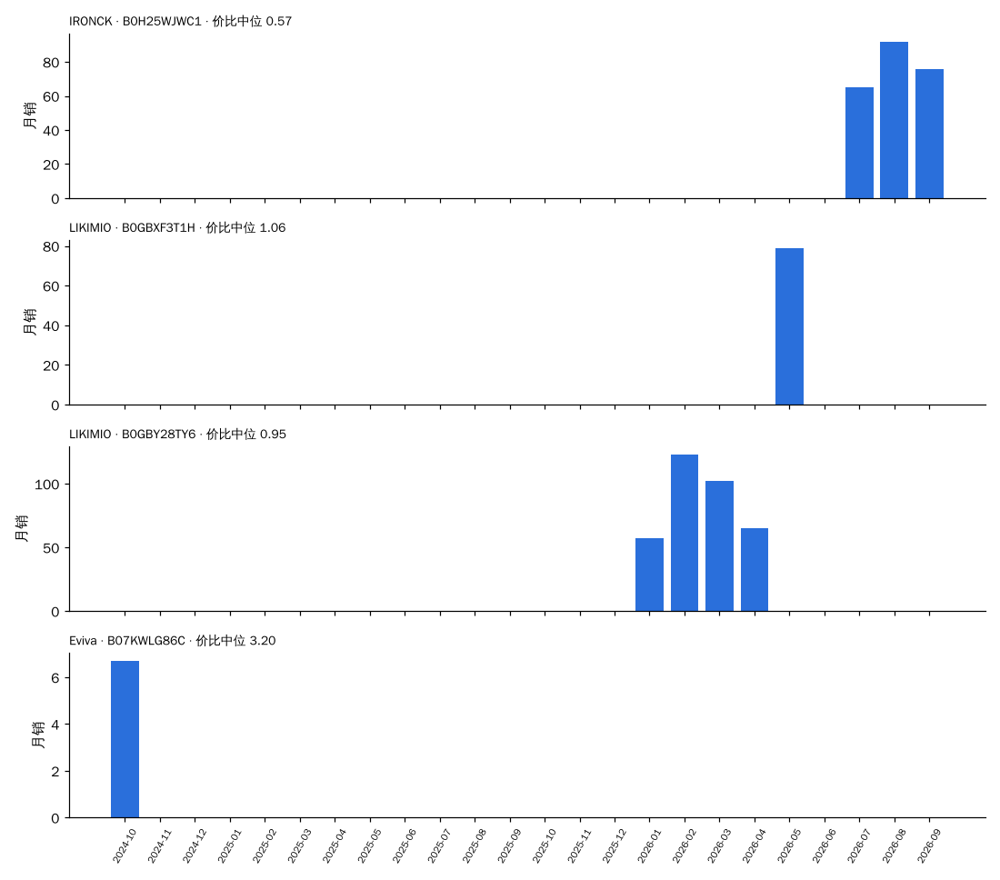
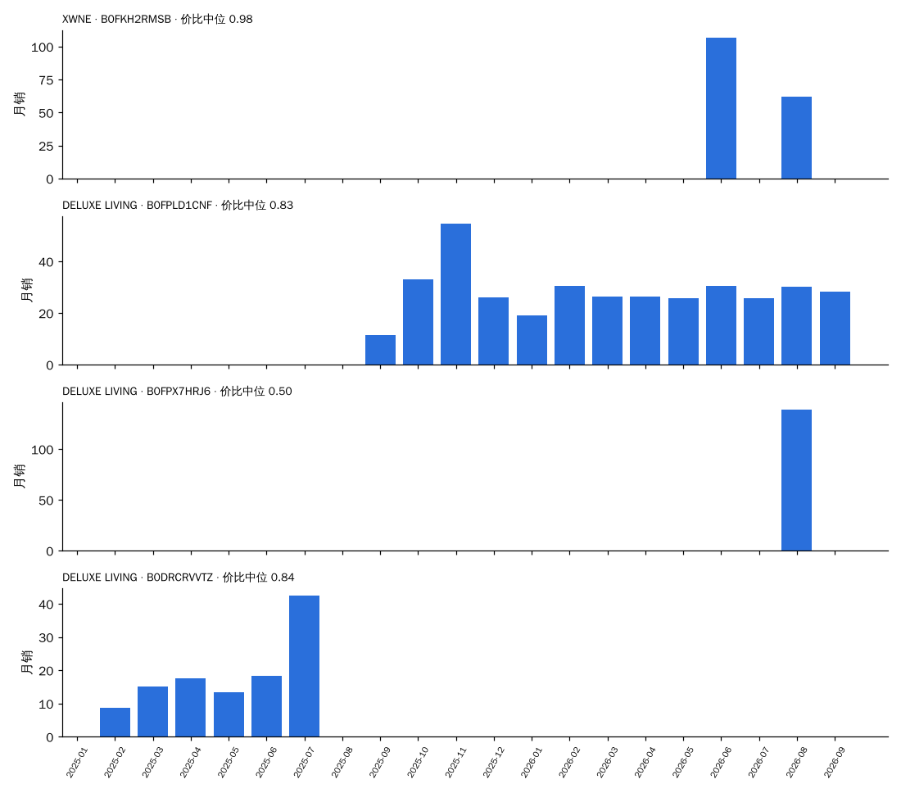

# 决策卡数据：岗石（按"同尺寸段 × 同拆装 × 同形态"分框）

> 由 `trial/决策卡.py`（CARD=岗石）生成，数据 2024-10 至 2026-09。每一项都只和**同一个框（尺寸段 × 拆装 × 形态）里的其他台面材质**比：份额 = 岗石销量 ÷ 框内台面材质已知的销量；溢价 = 价格 ÷ 同月同框中位价；新品 = 上架 ≤ 6 个月。
> 早期 = 2024-10 至 2025-03；近期 = 2026-04 至 2026-09。"相对预测"= 0.824 × 份额斜率 + 0.857 × 新品占比差（系数来自 全链路验证 2.2 的同框回归），减去同框其他台面材质的加权平均：> 0 表示预计在这个框里份额比别的台面材质涨得多。

## 1. 所有出现过的框

| 框 | 框月销（近期） | 岗石月销 早期 → 近期 | 框内份额 早期 → 近期 | 近期在榜家族 | 岗石中位价 / 框中位价 | 溢价 | 评分 岗石 / 框 | 新品占比 岗石 / 框 | 相对预测 | 新家族（含岗石）做到 / 家族 | 框内其他新家族 做到 / 家族 |
| :--- | ---: | :--- | :--- | ---: | :--- | ---: | :--- | :--- | ---: | :--- | :--- |
| 48″ · 整装 · 落地式 | 347 | 61 → 234 | 25.7% → 67.3% | 11 | $1,030 / $1,043 | 0.91 | 4.51 / 4.56 | 6% / 4% | -0.02 | 1 / 1 | — |
| 60″ · 整装 · 落地式 | 332 | 4 → 150 | 1.8% → 45.0% | 13 | $1,220 / $1,358 | 0.85 | 4.55 / 4.56 | 20% / 14% | -0.00 | 1 / 1 | — |
| 36″ · 整装 · 落地式 | 206 | 60 → 73 | 42.6% → 35.4% | 9 | $800 / $998 | 0.83 | 4.45 / 4.67 | 9% / 3% | -0.15 | — | — |
| 24″ · 整装 · 落地式 | 156 | 9 → 70 | 4.2% → 44.8% | 2 | $593 / $522 | 0.98 | 4.52 / 4.50 | 0% / 4% | +0.04 | — | — |
| 30″ · 拆装 · 落地式 | 4,752 | 31 → 64 | 1.2% → 1.4% | 4 | $200 / $249 | 0.69 | 4.39 / 4.27 | 98% / 33% | +0.59 | 1 / 6 | 29 / 59 |
| 30″ · 整装 · 落地式 | 144 | 7 → 63 | 8.1% → 43.7% | 7 | $630 / $650 | 0.82 | 4.30 / 4.46 | 0% / 2% | +0.07 | — | — |
| 42″ · 整装 · 落地式 | 183 | 0 → 52 | 0.0% → 28.3% | 8 | $1,000 / $1,235 | 1.01 | 4.41 / 4.61 | 33% / 9% | -0.03 | 1 / 1 | — |
| 72″+ · 整装 · 落地式 | 170 | 0 → 45 | 0.0% → 26.4% | 4 | $1,662 / $1,700 | 1.03 | 4.57 / 4.66 | 24% / 6% | -0.20 | 1 / 1 | — |
| 30″ · 整装 · 悬浮式 | 189 | 43 → 41 | 62.5% → 21.6% | 3 | $637 / $637 | 0.94 | 4.70 / 4.45 | 0% / 18% | -0.54 | 1 / 1 | 1 / 1 |
| 36″ · 整装 · 悬浮式 | 148 | 39 → 37 | 67.4% → 25.3% | 3 | $740 / $740 | 1.00 | 4.70 / 4.16 | 0% / 17% | -0.41 | 1 / 1 | — |
| 48″ · 整装 · 悬浮式 | 117 | 0 → 29 | 0.0% → 25.0% | 2 | $950 / $960 | 0.99 | 4.71 / 4.56 | 0% / 32% | -0.41 | — | — |
| 24″ · 整装 · 悬浮式 | 228 | 50 → 29 | 46.5% → 12.8% | 3 | $584 / $268 | 1.00 | 4.68 / 4.35 | 0% / 22% | -0.53 | — | 2 / 3 |
| 60″ · 整装 · 悬浮式 | 32 | 0 → 29 | 0.0% → 88.9% | 2 | $1,500 / $1,500 | 1.00 | 4.71 / 4.72 | 0% / 0% | -0.12 | — | — |
| 18″ · 整装 · 落地式 | 119 | 0 → 26 | 0.0% → 21.9% | 2 | $462 / $210 | 1.07 | 4.30 / 4.36 | 0% / 0% | +0.02 | — | — |
| 60″ · 拆装 · 落地式 | 940 | 11 → 24 | 7.1% → 2.6% | 2 | $950 / $530 | 1.53 | 4.63 / 3.99 | 41% / 24% | +0.12 | — | 2 / 3 |
| 48″ · 拆装 · 落地式 | 1,197 | 33 → 20 | 4.1% → 1.7% | 4 | $640 / $490 | 1.28 | 4.32 / 4.11 | 13% / 24% | -0.15 | — | 2 / 5 |
| 36″ · 拆装 · 落地式 | 2,908 | 24 → 18 | 2.2% → 0.6% | 3 | $270 / $320 | 0.84 | 4.54 / 4.22 | 73% / 38% | +0.60 | — | 19 / 33 |
| 24″ · 拆装 · 落地式 | 2,731 | 5 → 11 | 0.2% → 0.4% | 1 | $252 / $215 | 1.05 | 4.20 / 4.28 | 0% / 14% | -0.28 | 1 / 2 | 9 / 32 |
| 72″+ · 拆装 · 落地式 | 56 | 2 → 6 | 10.4% → 10.8% | 1 | $1,175 / $700 | 1.19 | 4.74 / 4.41 | 0% / 0% | -1.11 | — | — |
| 36″ · 拆装 · 悬浮式 | 534 | 0 → 0 | 0.0% → 0.0% | 0 | $— / $270 | — | — / 4.23 | — / 12% | +— | 0 / 1 | 1 / 8 |
| 30″ · 拆装 · 悬浮式 | 1,164 | 0 → 0 | 0.0% → 0.0% | 0 | $— / $230 | — | — / 4.21 | — / 16% | +— | 0 / 1 | 4 / 16 |
| 18″ · 拆装 · 落地式 | 556 | 1 → 0 | 0.1% → 0.0% | 0 | $— / $230 | — | — / 4.13 | — / 5% | +— | — | 1 / 3 |
| 42″ · 拆装 · 落地式 | 99 | 10 → 0 | 12.0% → 0.0% | 0 | $— / $420 | — | — / 4.28 | — / 7% | +— | — | 2 / 5 |
| 42″ · 拆装 · 悬浮式 | 72 | 40 → 0 | 23.0% → 0.0% | 0 | $— / $260 | — | — / 3.85 | — / 0% | +— | — | 1 / 2 |
| 60″ · 拆装 · 悬浮式 | 73 | 0 → 0 | 0.0% → 0.0% | 0 | $— / $450 | — | — / 4.39 | — / 56% | +— | — | 0 / 1 |
| 72″+ · 拆装 · 悬浮式 | 4 | 0 → 0 | 0.0% → 0.0% | 0 | $— / $999 | — | — / 5.00 | — / 0% | +— | 0 / 1 | — |
| 72″+ · 整装 · 悬浮式 | 0 | 0 → 0 | 0.0% → 0.0% | 0 | $— / $— | — | — / — | — / — | +— | — | — |

## 2. 框：30″ · 拆装 · 落地式

### 2.1 近期（2026-04 至 2026-09）框内各台面材质对比

| 台面材质 | 月销 | 份额 | 在榜家族 | 中位价 | 溢价 | 评分 | 新品占比 |
| :--- | ---: | ---: | ---: | ---: | ---: | ---: | ---: |
| 陶瓷 | 3,409 | 71.7% | 152 | $240 | 0.83 | 4.29 | 35% |
| 木板 | 703 | 14.8% | 54 | $290 | 1.01 | 4.29 | 8% |
| 树脂 | 549 | 11.5% | 37 | $250 | 0.86 | 4.09 | 43% |
| **岗石** | 64 | 1.4% | 4 | $200 | 0.69 | 4.39 | 98% |
| 岩板 | 18 | 0.4% | 3 | $350 | 1.22 | 4.46 | 0% |
| 卡拉拉大理石 | 8 | 0.2% | 2 | $400 | 1.40 | 4.57 | 0% |

### 2.2 按季度：岗石在这个框里怎么走过来

| 季度 | 岗石月销 | 框内份额 | 岗石中位价 | 溢价 | 评分 岗石 / 框 | 新品占比 岗石 / 框 | 在榜家族 |
| :--- | ---: | ---: | ---: | ---: | :--- | :--- | ---: |
| 2024Q4 | 42 | 1.2% | $870 | 3.48 | 4.44 / 4.14 | 54% / 4% | 4 |
| 2025Q1 | 20 | 1.2% | $396 | 1.65 | 3.83 / 4.17 | 0% / 44% | 2 |
| 2025Q2 | 175 | 8.4% | $240 | 0.96 | 3.26 / 4.18 | 85% / 42% | 5 |
| 2025Q3 | 164 | 5.9% | $250 | 1.02 | 4.10 / 4.26 | 79% / 31% | 7 |
| 2025Q4 | 66 | 2.7% | $250 | 1.04 | 3.82 / 4.26 | 0% / 13% | 3 |
| 2026Q1 | 179 | 5.0% | $245 | 0.97 | 4.42 / 4.28 | 77% / 40% | 4 |
| 2026Q2 | 48 | 1.1% | $297 | 1.06 | 4.53 / 4.23 | 100% / 36% | 2 |
| 2026Q3 | 81 | 1.6% | $162 | 0.57 | 4.30 / 4.30 | 96% / 30% | 2 |

### 2.3 代表产品（30″ · 拆装 · 落地式，近期销量前 3 + 最早在榜的 1 个）

**IRONCK · B0H25WJWC1**    [商品链接](https://www.amazon.com/dp/B0H25WJWC1)  
30″ · 拆装 · 落地式 · 台面 石材台面（岗石）· 元素 农场风装饰饰条 · 主色 未知 · 上架 2026-05-22 · 首次在榜 2026-07

| 月 | 月销 | 价格 | 价比（÷ 同框中位） | 评分 | 小类排名 | 在榜子体 |
| :--- | ---: | ---: | ---: | ---: | ---: | ---: |
| 2026-07 | 65 | $162 | 0.57 | 5.0 | 86 | 1 |
| 2026-08 | 92 | $162 | 0.56 | 3.9 | 90 | 1 |
| 2026-09 | 76 | $200 | 0.69 | 4.2 | 196 | 1 |

**LIKIMIO · B0GBXF3T1H**    [商品链接](https://www.amazon.com/dp/B0GBXF3T1H)  
30″ · 拆装 · 落地式 · 台面 石材台面（岗石）· 元素 夏克式 · 主色 白 · 上架 2026-01-01 · 首次在榜 2026-05

| 月 | 月销 | 价格 | 价比（÷ 同框中位） | 评分 | 小类排名 | 在榜子体 |
| :--- | ---: | ---: | ---: | ---: | ---: | ---: |
| 2026-05 | 79 | $297 | 1.06 | 4.8 | 233 | 1 |

**LIKIMIO · B0GBY28TY6**    [商品链接](https://www.amazon.com/dp/B0GBY28TY6)  
30″ · 拆装 · 落地式 · 台面 石材台面（岗石）· 元素 夏克式+复古立柱 · 主色 白 · 上架 2026-01-09 · 首次在榜 2026-01

| 月 | 月销 | 价格 | 价比（÷ 同框中位） | 评分 | 小类排名 | 在榜子体 |
| :--- | ---: | ---: | ---: | ---: | ---: | ---: |
| 2026-01 | 57 | $243 | 0.97 | 5.0 | 75 | 1 |
| 2026-02 | 123 | $270 | 1.00 | 5.0 | 62 | 1 |
| 2026-03 | 102 | $245 | 0.91 | 4.0 | 197 | 1 |
| 2026-04 | 65 | $270 | 0.93 | 4.2 | 142 | 1 |

**Eviva · B07KWLG86C**    [商品链接](https://www.amazon.com/dp/B076ZPKPK9)  
30″ · 拆装 · 落地式 · 台面 石材台面（岗石）· 元素 夏克式 · 主色 深木 · 上架 2017-10-29 · 首次在榜 2024-10

| 月 | 月销 | 价格 | 价比（÷ 同框中位） | 评分 | 小类排名 | 在榜子体 |
| :--- | ---: | ---: | ---: | ---: | ---: | ---: |
| 2024-10 | 7 | $799 | 3.20 | 5.0 | 152 | 1 |

### 2.4 新品方案打分（30″ · 拆装 · 落地式，首月 ≥ 2 色 ≥ 4 子体；模型偏高约每 10 个 1 个）

前 4：中档 · 石材台面 · 主色原木 5.4；中档 · 石材台面 · 主色白 5.2；高档 · 石材台面 · 主色原木 4.9；中档 · 石材台面 · 主色深木 4.8。最低 2：低档 · 石材台面 · 主色灰 3.7；低档 · 石材台面 · 主色黑 3.3。

## 2. 框：48″ · 整装 · 落地式

### 2.1 近期（2026-04 至 2026-09）框内各台面材质对比

| 台面材质 | 月销 | 份额 | 在榜家族 | 中位价 | 溢价 | 评分 | 新品占比 |
| :--- | ---: | ---: | ---: | ---: | ---: | ---: | ---: |
| **岗石** | 234 | 67.3% | 11 | $1,030 | 0.91 | 4.51 | 6% |
| 石英石 | 81 | 23.4% | 16 | $1,090 | 1.00 | 4.65 | 0% |
| 卡拉拉大理石 | 32 | 9.2% | 11 | $1,431 | 1.03 | 4.67 | 0% |

### 2.2 按季度：岗石在这个框里怎么走过来

| 季度 | 岗石月销 | 框内份额 | 岗石中位价 | 溢价 | 评分 岗石 / 框 | 新品占比 岗石 / 框 | 在榜家族 |
| :--- | ---: | ---: | ---: | ---: | :--- | :--- | ---: |
| 2024Q4 | 48 | 22.6% | $728 | 0.58 | 3.80 / 4.44 | 0% / 0% | 2 |
| 2025Q1 | 74 | 28.2% | $760 | 0.60 | 3.99 / 4.38 | 0% / 0% | 3 |
| 2025Q2 | 93 | 32.4% | $799 | 0.66 | 3.99 / 4.40 | 0% / 0% | 2 |
| 2025Q3 | 79 | 24.8% | $803 | 0.64 | 4.44 / 4.62 | 0% / 0% | 5 |
| 2025Q4 | 146 | 42.7% | $1,100 | 0.86 | 4.71 / 4.70 | 4% / 2% | 8 |
| 2026Q1 | 117 | 38.6% | $1,050 | 0.76 | 4.62 / 4.60 | 11% / 4% | 6 |
| 2026Q2 | 242 | 71.8% | $1,039 | 0.93 | 4.52 / 4.56 | 11% / 8% | 9 |
| 2026Q3 | 225 | 63.1% | $1,020 | 0.88 | 4.49 / 4.55 | 0% / 0% | 9 |

### 2.3 代表产品（48″ · 整装 · 落地式，近期销量前 3 + 最早在榜的 1 个）

**DELUXE LIVING · B0FPLD1CNF**    [商品链接](https://www.amazon.com/dp/B0FX4F37XZ)  
48″ · 整装 · 落地式 · 台面 石材台面（岗石）· 元素 夏克式 · 主色 深木 · 上架 2025-10-28 · 首次在榜 2025-09

| 月 | 月销 | 价格 | 价比（÷ 同框中位） | 评分 | 小类排名 | 在榜子体 |
| :--- | ---: | ---: | ---: | ---: | ---: | ---: |
| 2025-09 | 12 | $1,050 | 0.84 | 4.5 | 262 | 1 |
| 2025-10 | 17 | $1,050 | 0.84 | 4.6 | 132 | 1 |
| 2025-11 | 82 | $1,100 | 0.86 | 4.8 | 18 | 3 |
| 2025-12 | 39 | $1,060 | 0.82 | 4.8 | 73 | 3 |
| 2026-01 | 19 | $1,040 | 0.74 | 4.6 | 91 | 2 |
| 2026-02 | 46 | $1,060 | 0.81 | 4.6 | 112 | 3 |
| 2026-03 | 66 | $980 | 0.70 | 4.5 | 24 | 5 |
| 2026-04 | 66 | $1,020 | 0.94 | 4.3 | 46 | 5 |
| 2026-05 | 64 | $1,020 | 0.81 | 4.4 | 36 | 5 |
| 2026-06 | 92 | $1,029 | 0.96 | 4.4 | 42 | 6 |
| 2026-07 | 78 | $1,019 | 0.96 | 4.4 | 34 | 6 |
| 2026-08 | 91 | $1,000 | 0.96 | 4.4 | 38 | 6 |
| 2026-09 | 99 | $990 | 0.71 | 4.4 | 16 | 7 |

**DELUXE LIVING · B0FPKV8YL2**    [商品链接](https://www.amazon.com/dp/B0DRCT463T)  
48″ · 整装 · 落地式 · 台面 石材台面（岗石）· 元素 搭叠式 · 主色 白 · 上架 2024-12-23 · 首次在榜 2025-09

| 月 | 月销 | 价格 | 价比（÷ 同框中位） | 评分 | 小类排名 | 在榜子体 |
| :--- | ---: | ---: | ---: | ---: | ---: | ---: |
| 2025-09 | 19 | $1,090 | 0.87 | 5.0 | 156 | 1 |
| 2025-10 | 10 | $1,210 | 0.97 | 4.6 | 60 | 1 |
| 2025-11 | 34 | $1,149 | 0.90 | 4.9 | 21 | 2 |
| 2025-12 | 35 | $1,149 | 0.89 | 4.6 | 83 | 2 |
| 2026-01 | 17 | $1,094 | 0.78 | 4.7 | 127 | 2 |
| 2026-02 | 23 | $1,090 | 0.83 | 4.8 | 84 | 3 |
| 2026-03 | 38 | $1,030 | 0.73 | 4.8 | 32 | 3 |
| 2026-04 | 26 | $1,090 | 1.00 | 4.8 | 59 | 3 |
| 2026-05 | 32 | $1,090 | 0.87 | 4.8 | 47 | 3 |
| 2026-06 | 37 | $1,071 | 1.00 | 4.8 | 59 | 2 |
| 2026-07 | 40 | $938 | 0.88 | 4.7 | 66 | 3 |
| 2026-09 | 59 | $1,030 | 0.73 | 4.7 | 61 | 5 |

**DELUXE LIVING · B0FPKVB8M3**    [商品链接](https://www.amazon.com/dp/B0GMXB3N7N)  
48″ · 整装 · 落地式 · 台面 石材台面（岗石）· 元素 夏克式 · 主色 蓝 · 上架 2026-02-13 · 首次在榜 2025-10

| 月 | 月销 | 价格 | 价比（÷ 同框中位） | 评分 | 小类排名 | 在榜子体 |
| :--- | ---: | ---: | ---: | ---: | ---: | ---: |
| 2025-10 | 8 | $1,110 | 0.89 | 4.9 | 227 | 1 |
| 2025-11 | 17 | $1,080 | 0.85 | 4.9 | 73 | 2 |
| 2026-01 | 15 | $1,060 | 0.76 | 4.8 | 414 | 3 |
| 2026-02 | 22 | $1,070 | 0.81 | 4.8 | 161 | 5 |
| 2026-03 | 39 | $935 | 0.67 | 4.8 | 40 | 5 |
| 2026-04 | 27 | $1,075 | 0.99 | 4.6 | 166 | 4 |
| 2026-05 | 29 | $1,060 | 0.85 | 4.6 | 93 | 5 |
| 2026-06 | 37 | $1,080 | 1.01 | 4.6 | 56 | 4 |
| 2026-07 | 25 | $1,080 | 1.02 | 4.6 | 31 | 4 |
| 2026-08 | 32 | $1,020 | 0.98 | 4.5 | 95 | 5 |
| 2026-09 | 33 | $1,060 | 0.76 | 4.5 | 48 | 5 |

**Spring Mill Cabinets · B0D7DP5RHC**    [商品链接](https://www.amazon.com/dp/B0BGT846G1)  
48″ · 整装 · 落地式 · 台面 石材台面（岗石）· 元素 夏克式 · 主色 白 · 上架 2022-09-28 · 首次在榜 2024-10

| 月 | 月销 | 价格 | 价比（÷ 同框中位） | 评分 | 小类排名 | 在榜子体 |
| :--- | ---: | ---: | ---: | ---: | ---: | ---: |
| 2024-10 | 46 | $708 | 0.56 | 3.8 | 66 | 4 |

### 2.4 新品方案打分（48″ · 整装 · 落地式，首月 ≥ 2 色 ≥ 4 子体；模型偏高约每 10 个 1 个）

前 4：中档 · 石材台面 · 主色原木 6.6；中档 · 石材台面 · 主色白 6.5；高档 · 石材台面 · 主色原木 6.2；中档 · 石材台面 · 主色深木 6.1。最低 2：低档 · 石材台面 · 主色灰 4.9；低档 · 石材台面 · 主色黑 4.6。

## 2. 框：60″ · 整装 · 落地式

### 2.1 近期（2026-04 至 2026-09）框内各台面材质对比

| 台面材质 | 月销 | 份额 | 在榜家族 | 中位价 | 溢价 | 评分 | 新品占比 |
| :--- | ---: | ---: | ---: | ---: | ---: | ---: | ---: |
| **岗石** | 150 | 45.0% | 13 | $1,220 | 0.85 | 4.55 | 20% |
| 石英石 | 95 | 28.7% | 16 | $1,640 | 1.09 | 4.62 | 15% |
| 卡拉拉大理石 | 87 | 26.3% | 14 | $1,439 | 1.01 | 4.49 | 0% |

### 2.2 按季度：岗石在这个框里怎么走过来

| 季度 | 岗石月销 | 框内份额 | 岗石中位价 | 溢价 | 评分 岗石 / 框 | 新品占比 岗石 / 框 | 在榜家族 |
| :--- | ---: | ---: | ---: | ---: | :--- | :--- | ---: |
| 2024Q4 | 0 | 0.0% | $— | — | — / 4.66 | — / 0% | 0 |
| 2025Q1 | 8 | 3.5% | $1,200 | 0.87 | 4.64 / 4.66 | 0% / 0% | 1 |
| 2025Q2 | 17 | 5.7% | $1,200 | 0.85 | 4.76 / 4.74 | 0% / 0% | 1 |
| 2025Q3 | 32 | 15.4% | $1,210 | 0.85 | 4.78 / 4.80 | 0% / 0% | 4 |
| 2025Q4 | 70 | 24.5% | $1,210 | 0.86 | 4.73 / 4.77 | 4% / 1% | 5 |
| 2026Q1 | 67 | 29.0% | $1,210 | 0.76 | 4.61 / 4.69 | 31% / 9% | 5 |
| 2026Q2 | 131 | 58.0% | $1,230 | 0.89 | 4.48 / 4.50 | 31% / 18% | 9 |
| 2026Q3 | 169 | 38.4% | $1,129 | 0.79 | 4.61 / 4.59 | 12% / 11% | 10 |

### 2.3 代表产品（60″ · 整装 · 落地式，近期销量前 3 + 最早在榜的 1 个）

**XWNE · B0FKH2RMSB**    [商品链接](https://www.amazon.com/dp/B0FKH2RMSB)  
60″ · 整装 · 落地式 · 台面 石材台面（岗石）· 元素 夏克式 · 主色 蓝 · 上架 2026-03-23 · 首次在榜 2026-06

| 月 | 月销 | 价格 | 价比（÷ 同框中位） | 评分 | 小类排名 | 在榜子体 |
| :--- | ---: | ---: | ---: | ---: | ---: | ---: |
| 2026-06 | 107 | $1,358 | 0.98 | 4.6 | 120 | 1 |
| 2026-08 | 62 | $1,358 | 0.98 | 4.6 | 158 | 1 |

**DELUXE LIVING · B0FPLD1CNF**    [商品链接](https://www.amazon.com/dp/B0DX74C46F)  
60″ · 整装 · 落地式 · 台面 石材台面（岗石）· 元素 夏克式 · 主色 未知 · 上架 2025-02-25 · 首次在榜 2025-09

| 月 | 月销 | 价格 | 价比（÷ 同框中位） | 评分 | 小类排名 | 在榜子体 |
| :--- | ---: | ---: | ---: | ---: | ---: | ---: |
| 2025-09 | 12 | $1,130 | 0.79 | 4.5 | 135 | 1 |
| 2025-10 | 33 | $1,180 | 0.83 | 4.2 | 101 | 2 |
| 2025-11 | 55 | $1,180 | 0.83 | 4.8 | 18 | 2 |
| 2025-12 | 26 | $1,180 | 0.85 | 4.8 | 73 | 2 |
| 2026-01 | 19 | $1,180 | 0.77 | 4.6 | 69 | 2 |
| 2026-02 | 31 | $1,180 | 0.73 | 4.6 | 112 | 2 |
| 2026-03 | 26 | $1,088 | 0.68 | 4.5 | 24 | 2 |
| 2026-04 | 26 | $1,180 | 0.85 | 4.3 | 46 | 2 |
| 2026-05 | 26 | $1,180 | 0.82 | 4.4 | 36 | 2 |
| 2026-06 | 30 | $1,180 | 0.85 | 4.3 | 42 | 2 |
| 2026-07 | 26 | $1,165 | 0.88 | 4.4 | 43 | 2 |
| 2026-08 | 30 | $1,175 | 0.85 | 4.4 | 38 | 2 |
| 2026-09 | 28 | $1,170 | 0.72 | 4.4 | 42 | 2 |

**DELUXE LIVING · B0FPX7HRJ6**    [商品链接](https://www.amazon.com/dp/B0FPX7HRJ6)  
60″ · 整装 · 落地式 · 台面 石材台面（岗石）· 元素 夏克式 · 主色 黑 · 上架 2025-09-13 · 首次在榜 2026-08

| 月 | 月销 | 价格 | 价比（÷ 同框中位） | 评分 | 小类排名 | 在榜子体 |
| :--- | ---: | ---: | ---: | ---: | ---: | ---: |
| 2026-08 | 139 | $700 | 0.50 | 5.0 | 1,298 | 1 |

**DELUXE LIVING · B0DRCRVVTZ**    [商品链接](https://www.amazon.com/dp/B0F1DHGM51)  
60″ · 整装 · 落地式 · 台面 石材台面（岗石）· 元素 搭叠式 · 主色 黑 · 上架 2025-03-12 · 首次在榜 2025-02

| 月 | 月销 | 价格 | 价比（÷ 同框中位） | 评分 | 小类排名 | 在榜子体 |
| :--- | ---: | ---: | ---: | ---: | ---: | ---: |
| 2025-02 | 9 | $1,199 | 0.87 | 5.0 | 422 | 4 |
| 2025-03 | 15 | $1,215 | 0.84 | 5.0 | 42 | 6 |
| 2025-04 | 18 | $1,215 | 0.86 | 4.7 | 40 | 6 |
| 2025-05 | 13 | $1,215 | 0.84 | 4.8 | 52 | 6 |
| 2025-06 | 18 | $1,215 | 0.83 | 4.8 | 30 | 6 |
| 2025-07 | 42 | $1,205 | 0.83 | 4.8 | 18 | 6 |

### 2.4 新品方案打分（60″ · 整装 · 落地式，首月 ≥ 2 色 ≥ 4 子体；模型偏高约每 10 个 1 个）

前 4：中档 · 石材台面 · 主色原木 6.8；中档 · 石材台面 · 主色白 6.7；高档 · 石材台面 · 主色原木 6.4；中档 · 石材台面 · 主色深木 6.3。最低 2：低档 · 石材台面 · 主色灰 5.2；低档 · 石材台面 · 主色黑 4.8。

