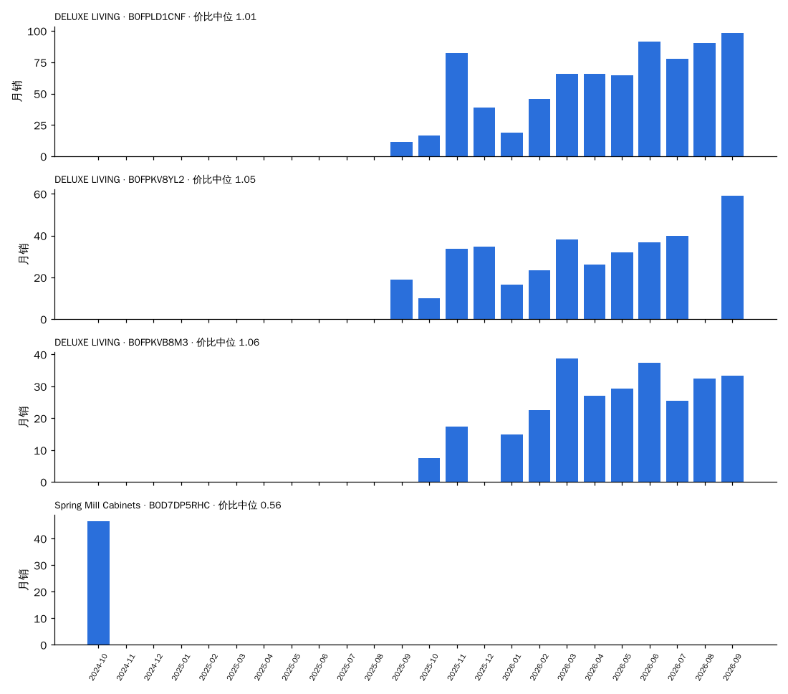
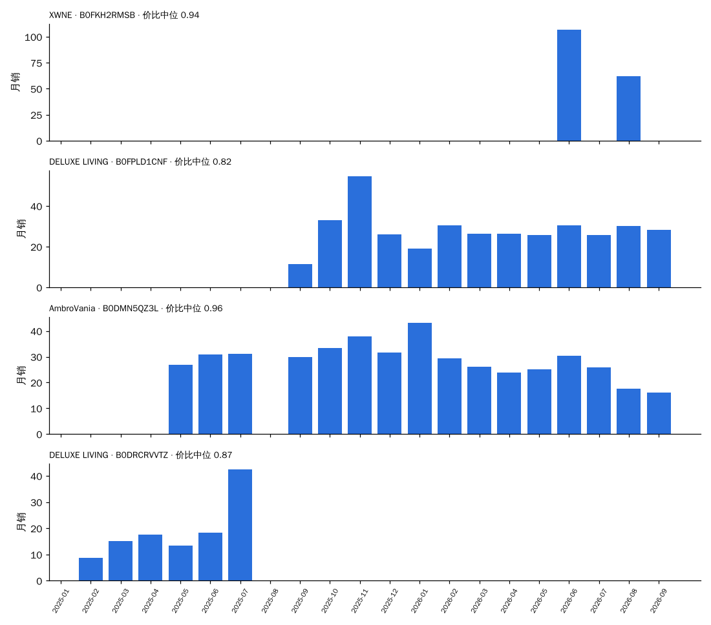
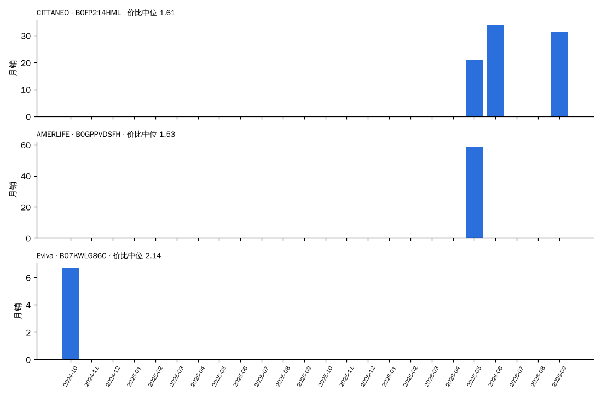

# 决策卡数据：岗石（按"同尺寸段 × 同拆装"分框）

> 由 `trial/决策卡.py`（CARD=岗石）生成，数据 2024-10 至 2026-09。每一项都只和**同一个框（尺寸段 × 拆装）里的其他台面材质**比：份额 = 岗石销量 ÷ 框内台面材质已知的销量；溢价 = 价格 ÷ 同月同框中位价；新品 = 上架 ≤ 6 个月。
> 早期 = 2024-10 至 2025-03；近期 = 2026-04 至 2026-09。"相对预测"= 0.824 × 份额斜率 + 0.857 × 新品占比差（系数来自 全链路验证 2.2 的同框回归），减去同框其他台面材质的加权平均：> 0 表示预计在这个框里份额比别的台面材质涨得多。

## 1. 所有出现过的框

| 框 | 框月销（近期） | 岗石月销 早期 → 近期 | 框内份额 早期 → 近期 | 近期在榜家族 | 岗石中位价 / 框中位价 | 溢价 | 评分 岗石 / 框 | 新品占比 岗石 / 框 | 相对预测 | 新家族（含岗石）做到 / 家族 | 框内其他新家族 做到 / 家族 |
| :--- | ---: | :--- | :--- | ---: | :--- | ---: | :--- | :--- | ---: | :--- | :--- |
| 48″ · 整装 | 464 | 61 → 263 | 24.8% → 56.7% | 13 | $1,020 / $1,019 | 1.03 | 4.53 / 4.56 | 5% / 11% | -0.09 | 1 / 1 | — |
| 60″ · 整装 | 365 | 4 → 178 | 1.8% → 48.9% | 15 | $1,230 / $1,387 | 0.86 | 4.58 / 4.57 | 17% / 12% | -0.05 | 1 / 1 | — |
| 36″ · 整装 | 353 | 99 → 110 | 49.8% → 31.2% | 12 | $740 / $749 | 1.00 | 4.54 / 4.46 | 6% / 9% | -0.21 | 1 / 1 | — |
| 30″ · 整装 | 333 | 50 → 104 | 32.4% → 31.2% | 10 | $637 / $650 | 0.92 | 4.46 / 4.46 | 0% / 11% | -0.19 | 1 / 1 | 1 / 1 |
| 24″ · 整装 | 384 | 59 → 99 | 18.7% → 25.8% | 5 | $588 / $350 | 1.00 | 4.57 / 4.41 | 0% / 15% | -0.32 | — | 2 / 3 |
| 30″ · 拆装 | 5,916 | 31 → 64 | 1.0% → 1.1% | 4 | $200 / $240 | 0.74 | 4.39 / 4.25 | 98% / 30% | +0.63 | 1 / 7 | 33 / 76 |
| 42″ · 整装 | 183 | 0 → 52 | 0.0% → 28.3% | 8 | $1,000 / $1,235 | 1.01 | 4.41 / 4.61 | 33% / 9% | -0.03 | 1 / 1 | — |
| 72″+ · 整装 | 170 | 0 → 45 | 0.0% → 26.4% | 4 | $1,662 / $1,700 | 1.03 | 4.57 / 4.66 | 24% / 6% | -0.20 | 1 / 1 | — |
| 18″ · 整装 | 227 | 0 → 26 | 0.0% → 11.5% | 2 | $462 / $210 | 1.95 | 4.30 / 4.45 | 0% / 12% | -0.08 | — | — |
| 60″ · 拆装 | 1,013 | 11 → 24 | 6.4% → 2.4% | 2 | $950 / $530 | 1.58 | 4.63 / 4.02 | 41% / 26% | +0.10 | — | 2 / 4 |
| 48″ · 拆装 | 1,275 | 33 → 20 | 4.0% → 1.6% | 4 | $640 / $490 | 1.28 | 4.32 / 4.12 | 13% / 23% | -0.14 | — | 3 / 8 |
| 36″ · 拆装 | 3,468 | 24 → 18 | 1.8% → 0.5% | 3 | $270 / $319 | 0.87 | 4.54 / 4.21 | 73% / 34% | +0.62 | 0 / 1 | 20 / 41 |
| 24″ · 拆装 | 3,887 | 5 → 11 | 0.1% → 0.3% | 1 | $252 / $200 | 1.06 | 4.20 / 4.29 | 0% / 18% | -0.29 | 1 / 2 | 15 / 46 |
| 72″+ · 拆装 | 59 | 2 → 6 | 10.4% → 10.1% | 1 | $1,175 / $700 | 1.19 | 4.74 / 4.44 | 0% / 0% | -0.81 | 0 / 1 | — |
| 18″ · 拆装 | 960 | 1 → 0 | 0.1% → 0.0% | 0 | $— / $170 | — | — / 4.20 | — / 7% | +— | — | 1 / 3 |
| 42″ · 拆装 | 171 | 50 → 0 | 19.4% → 0.0% | 0 | $— / $376 | — | — / 4.10 | — / 4% | +— | — | 3 / 7 |

## 2. 框：48″ · 整装

### 2.1 近期（2026-04 至 2026-09）框内各台面材质对比

| 台面材质 | 月销 | 份额 | 在榜家族 | 中位价 | 溢价 | 评分 | 新品占比 |
| :--- | ---: | ---: | ---: | ---: | ---: | ---: | ---: |
| **岗石** | 263 | 56.7% | 13 | $1,020 | 1.03 | 4.53 | 5% |
| 石英石 | 81 | 17.5% | 16 | $1,090 | 1.11 | 4.65 | 0% |
| 岩板 | 81 | 17.5% | 6 | $960 | 1.00 | 4.50 | 46% |
| 卡拉拉大理石 | 32 | 6.9% | 11 | $1,431 | 1.43 | 4.67 | 0% |
| 木板 | 7 | 1.4% | 1 | $300 | 0.30 | — | 0% |

### 2.2 按季度：岗石在这个框里怎么走过来

| 季度 | 岗石月销 | 框内份额 | 岗石中位价 | 溢价 | 评分 岗石 / 框 | 新品占比 岗石 / 框 | 在榜家族 |
| :--- | ---: | ---: | ---: | ---: | :--- | :--- | ---: |
| 2024Q4 | 48 | 21.0% | $728 | 0.58 | 3.80 / 4.48 | 0% / 0% | 2 |
| 2025Q1 | 74 | 28.2% | $760 | 0.60 | 3.99 / 4.38 | 0% / 0% | 3 |
| 2025Q2 | 114 | 36.9% | $799 | 0.67 | 4.15 / 4.43 | 0% / 0% | 3 |
| 2025Q3 | 119 | 33.2% | $803 | 0.76 | 4.56 / 4.64 | 0% / 0% | 7 |
| 2025Q4 | 181 | 44.0% | $1,099 | 0.90 | 4.72 / 4.69 | 3% / 1% | 9 |
| 2026Q1 | 163 | 39.4% | $1,000 | 1.00 | 4.67 / 4.66 | 8% / 7% | 8 |
| 2026Q2 | 280 | 59.3% | $1,020 | 1.05 | 4.55 / 4.54 | 10% / 19% | 11 |
| 2026Q3 | 246 | 54.0% | $1,000 | 1.03 | 4.51 / 4.58 | 0% / 3% | 10 |

### 2.3 代表产品（48″ · 整装，近期销量前 3 + 最早在榜的 1 个）

**DELUXE LIVING · B0FPLD1CNF**    [商品链接](https://www.amazon.com/dp/B0FX4F37XZ)  
48″ · 整装 · 台面 石材台面（岗石）· 元素 夏克式 · 主色 深木 · 上架 2025-10-28 · 首次在榜 2025-09

| 月 | 月销 | 价格 | 价比（÷ 同框中位） | 评分 | 小类排名 | 在榜子体 |
| :--- | ---: | ---: | ---: | ---: | ---: | ---: |
| 2025-09 | 12 | $1,050 | 0.87 | 4.5 | 262 | 1 |
| 2025-10 | 17 | $1,050 | 1.00 | 4.6 | 132 | 1 |
| 2025-11 | 82 | $1,100 | 0.90 | 4.8 | 18 | 3 |
| 2025-12 | 39 | $1,060 | 0.87 | 4.8 | 73 | 3 |
| 2026-01 | 19 | $1,040 | 0.98 | 4.6 | 91 | 2 |
| 2026-02 | 46 | $1,060 | 1.11 | 4.6 | 112 | 3 |
| 2026-03 | 66 | $980 | 1.02 | 4.5 | 24 | 5 |
| 2026-04 | 66 | $1,020 | 1.07 | 4.3 | 46 | 5 |
| 2026-05 | 64 | $1,020 | 1.03 | 4.4 | 36 | 5 |
| 2026-06 | 92 | $1,029 | 1.07 | 4.4 | 42 | 6 |
| 2026-07 | 78 | $1,019 | 1.06 | 4.4 | 34 | 6 |
| 2026-08 | 91 | $1,000 | 1.01 | 4.4 | 38 | 6 |
| 2026-09 | 99 | $990 | 0.99 | 4.4 | 16 | 7 |

**DELUXE LIVING · B0FPKV8YL2**    [商品链接](https://www.amazon.com/dp/B0DRCT463T)  
48″ · 整装 · 台面 石材台面（岗石）· 元素 搭叠式 · 主色 白 · 上架 2024-12-23 · 首次在榜 2025-09

| 月 | 月销 | 价格 | 价比（÷ 同框中位） | 评分 | 小类排名 | 在榜子体 |
| :--- | ---: | ---: | ---: | ---: | ---: | ---: |
| 2025-09 | 19 | $1,090 | 0.91 | 5.0 | 156 | 1 |
| 2025-10 | 10 | $1,210 | 1.16 | 4.6 | 60 | 1 |
| 2025-11 | 34 | $1,149 | 0.94 | 4.9 | 21 | 2 |
| 2025-12 | 35 | $1,149 | 0.94 | 4.6 | 83 | 2 |
| 2026-01 | 17 | $1,094 | 1.03 | 4.7 | 127 | 2 |
| 2026-02 | 23 | $1,090 | 1.14 | 4.8 | 84 | 3 |
| 2026-03 | 38 | $1,030 | 1.07 | 4.8 | 32 | 3 |
| 2026-04 | 26 | $1,090 | 1.15 | 4.8 | 59 | 3 |
| 2026-05 | 32 | $1,090 | 1.10 | 4.8 | 47 | 3 |
| 2026-06 | 37 | $1,071 | 1.12 | 4.8 | 59 | 2 |
| 2026-07 | 40 | $938 | 0.98 | 4.7 | 66 | 3 |
| 2026-09 | 59 | $1,030 | 1.03 | 4.7 | 61 | 5 |

**DELUXE LIVING · B0FPKVB8M3**    [商品链接](https://www.amazon.com/dp/B0GMXB3N7N)  
48″ · 整装 · 台面 石材台面（岗石）· 元素 夏克式 · 主色 蓝 · 上架 2026-02-13 · 首次在榜 2025-10

| 月 | 月销 | 价格 | 价比（÷ 同框中位） | 评分 | 小类排名 | 在榜子体 |
| :--- | ---: | ---: | ---: | ---: | ---: | ---: |
| 2025-10 | 8 | $1,110 | 1.06 | 4.9 | 227 | 1 |
| 2025-11 | 17 | $1,080 | 0.89 | 4.9 | 73 | 2 |
| 2026-01 | 15 | $1,060 | 1.00 | 4.8 | 414 | 3 |
| 2026-02 | 22 | $1,070 | 1.12 | 4.8 | 161 | 5 |
| 2026-03 | 39 | $935 | 0.97 | 4.8 | 40 | 5 |
| 2026-04 | 27 | $1,075 | 1.13 | 4.6 | 166 | 4 |
| 2026-05 | 29 | $1,060 | 1.07 | 4.6 | 93 | 5 |
| 2026-06 | 37 | $1,080 | 1.12 | 4.6 | 56 | 4 |
| 2026-07 | 25 | $1,080 | 1.12 | 4.6 | 31 | 4 |
| 2026-08 | 32 | $1,020 | 1.03 | 4.5 | 95 | 5 |
| 2026-09 | 33 | $1,060 | 1.06 | 4.5 | 48 | 5 |

**Spring Mill Cabinets · B0D7DP5RHC**    [商品链接](https://www.amazon.com/dp/B0BGT846G1)  
48″ · 整装 · 台面 石材台面（岗石）· 元素 夏克式 · 主色 白 · 上架 2022-09-28 · 首次在榜 2024-10

| 月 | 月销 | 价格 | 价比（÷ 同框中位） | 评分 | 小类排名 | 在榜子体 |
| :--- | ---: | ---: | ---: | ---: | ---: | ---: |
| 2024-10 | 46 | $708 | 0.56 | 3.8 | 66 | 4 |

### 2.4 新品方案打分（48″ · 整装，落地式、首月 ≥ 2 色 ≥ 4 子体；模型偏高约每 10 个 1 个）

前 4：中档 · 石材台面 · 主色原木 6.6；中档 · 石材台面 · 主色白 6.5；高档 · 石材台面 · 主色原木 6.2；中档 · 石材台面 · 主色深木 6.1。最低 2：低档 · 石材台面 · 主色灰 4.9；低档 · 石材台面 · 主色黑 4.6。

## 2. 框：60″ · 整装

### 2.1 近期（2026-04 至 2026-09）框内各台面材质对比

| 台面材质 | 月销 | 份额 | 在榜家族 | 中位价 | 溢价 | 评分 | 新品占比 |
| :--- | ---: | ---: | ---: | ---: | ---: | ---: | ---: |
| **岗石** | 178 | 48.9% | 15 | $1,230 | 0.86 | 4.58 | 17% |
| 石英石 | 95 | 26.1% | 16 | $1,640 | 1.04 | 4.62 | 15% |
| 卡拉拉大理石 | 87 | 23.9% | 14 | $1,439 | 0.96 | 4.49 | 0% |

### 2.2 按季度：岗石在这个框里怎么走过来

| 季度 | 岗石月销 | 框内份额 | 岗石中位价 | 溢价 | 评分 岗石 / 框 | 新品占比 岗石 / 框 | 在榜家族 |
| :--- | ---: | ---: | ---: | ---: | :--- | :--- | ---: |
| 2024Q4 | 0 | 0.0% | $— | — | — / 4.66 | — / 0% | 0 |
| 2025Q1 | 8 | 3.5% | $1,200 | 0.87 | 4.64 / 4.66 | 0% / 0% | 1 |
| 2025Q2 | 36 | 11.6% | $1,230 | 0.86 | 4.78 / 4.74 | 0% / 0% | 2 |
| 2025Q3 | 77 | 30.4% | $1,230 | 0.92 | 4.84 / 4.81 | 0% / 0% | 6 |
| 2025Q4 | 124 | 36.6% | $1,220 | 0.89 | 4.77 / 4.78 | 2% / 1% | 7 |
| 2026Q1 | 114 | 41.0% | $1,230 | 0.89 | 4.68 / 4.71 | 18% / 7% | 8 |
| 2026Q2 | 168 | 64.0% | $1,358 | 0.95 | 4.53 / 4.53 | 24% / 15% | 11 |
| 2026Q3 | 188 | 40.4% | $1,130 | 0.76 | 4.62 / 4.60 | 11% / 11% | 11 |

### 2.3 代表产品（60″ · 整装，近期销量前 3 + 最早在榜的 1 个）

**XWNE · B0FKH2RMSB**    [商品链接](https://www.amazon.com/dp/B0FKH2RMSB)  
60″ · 整装 · 台面 石材台面（岗石）· 元素 夏克式 · 主色 蓝 · 上架 2026-03-23 · 首次在榜 2026-06

| 月 | 月销 | 价格 | 价比（÷ 同框中位） | 评分 | 小类排名 | 在榜子体 |
| :--- | ---: | ---: | ---: | ---: | ---: | ---: |
| 2026-06 | 107 | $1,358 | 0.97 | 4.6 | 120 | 1 |
| 2026-08 | 62 | $1,358 | 0.91 | 4.6 | 158 | 1 |

**DELUXE LIVING · B0FPLD1CNF**    [商品链接](https://www.amazon.com/dp/B0DX74C46F)  
60″ · 整装 · 台面 石材台面（岗石）· 元素 夏克式 · 主色 未知 · 上架 2025-02-25 · 首次在榜 2025-09

| 月 | 月销 | 价格 | 价比（÷ 同框中位） | 评分 | 小类排名 | 在榜子体 |
| :--- | ---: | ---: | ---: | ---: | ---: | ---: |
| 2025-09 | 12 | $1,130 | 0.82 | 4.5 | 135 | 1 |
| 2025-10 | 33 | $1,180 | 0.86 | 4.2 | 101 | 2 |
| 2025-11 | 55 | $1,180 | 0.85 | 4.8 | 18 | 2 |
| 2025-12 | 26 | $1,180 | 0.92 | 4.8 | 73 | 2 |
| 2026-01 | 19 | $1,180 | 0.93 | 4.6 | 69 | 2 |
| 2026-02 | 31 | $1,180 | 0.79 | 4.6 | 112 | 2 |
| 2026-03 | 26 | $1,088 | 0.73 | 4.5 | 24 | 2 |
| 2026-04 | 26 | $1,180 | 0.84 | 4.3 | 46 | 2 |
| 2026-05 | 26 | $1,180 | 0.81 | 4.4 | 36 | 2 |
| 2026-06 | 30 | $1,180 | 0.84 | 4.3 | 42 | 2 |
| 2026-07 | 26 | $1,165 | 0.78 | 4.4 | 43 | 2 |
| 2026-08 | 30 | $1,175 | 0.79 | 4.4 | 38 | 2 |
| 2026-09 | 28 | $1,170 | 0.74 | 4.4 | 42 | 2 |

**AmbroVania · B0DMN5QZ3L**    [商品链接](https://www.amazon.com/dp/B0F9L7HY21)  
60″ · 整装 · 台面 石材台面（岗石）· 元素 竖棱 · 主色 深木 · 上架 2025-05-21 · 首次在榜 2025-05

| 月 | 月销 | 价格 | 价比（÷ 同框中位） | 评分 | 小类排名 | 在榜子体 |
| :--- | ---: | ---: | ---: | ---: | ---: | ---: |
| 2025-05 | 27 | $1,230 | 0.88 | 4.8 | 14 | 13 |
| 2025-06 | 31 | $1,230 | 0.86 | 4.8 | 13 | 18 |
| 2025-07 | 31 | $1,230 | 0.93 | 4.8 | 9 | 20 |
| 2025-09 | 30 | $1,230 | 0.89 | 4.7 | 26 | 18 |
| 2025-10 | 33 | $1,230 | 0.90 | 4.7 | 8 | 27 |
| 2025-11 | 38 | $1,230 | 0.89 | 4.7 | 25 | 27 |
| 2025-12 | 32 | $1,230 | 0.96 | 4.8 | 45 | 27 |
| 2026-01 | 43 | $1,230 | 0.97 | 4.8 | 18 | 26 |
| 2026-02 | 29 | $1,500 | 1.00 | 4.7 | 33 | 26 |
| 2026-03 | 26 | $1,500 | 1.00 | 4.7 | 57 | 28 |
| 2026-04 | 24 | $1,500 | 1.07 | 4.7 | 34 | 28 |
| 2026-05 | 25 | $1,500 | 1.03 | 4.7 | 46 | 28 |
| 2026-06 | 30 | $1,500 | 1.07 | 4.7 | 71 | 30 |
| 2026-07 | 26 | $1,500 | 1.00 | 4.7 | 93 | 30 |
| 2026-08 | 18 | $1,500 | 1.01 | 4.7 | 92 | 30 |
| 2026-09 | 16 | $1,500 | 0.95 | 4.7 | 277 | 30 |

**DELUXE LIVING · B0DRCRVVTZ**    [商品链接](https://www.amazon.com/dp/B0F1DHGM51)  
60″ · 整装 · 台面 石材台面（岗石）· 元素 搭叠式 · 主色 黑 · 上架 2025-03-12 · 首次在榜 2025-02

| 月 | 月销 | 价格 | 价比（÷ 同框中位） | 评分 | 小类排名 | 在榜子体 |
| :--- | ---: | ---: | ---: | ---: | ---: | ---: |
| 2025-02 | 9 | $1,199 | 0.87 | 5.0 | 422 | 4 |
| 2025-03 | 15 | $1,215 | 0.84 | 5.0 | 42 | 6 |
| 2025-04 | 18 | $1,215 | 0.86 | 4.7 | 40 | 6 |
| 2025-05 | 13 | $1,215 | 0.87 | 4.8 | 52 | 6 |
| 2025-06 | 18 | $1,215 | 0.85 | 4.8 | 30 | 6 |
| 2025-07 | 42 | $1,205 | 0.91 | 4.8 | 18 | 6 |

### 2.4 新品方案打分（60″ · 整装，落地式、首月 ≥ 2 色 ≥ 4 子体；模型偏高约每 10 个 1 个）

前 4：中档 · 石材台面 · 主色原木 6.8；中档 · 石材台面 · 主色白 6.7；高档 · 石材台面 · 主色原木 6.4；中档 · 石材台面 · 主色深木 6.3。最低 2：低档 · 石材台面 · 主色灰 5.2；低档 · 石材台面 · 主色黑 4.8。

## 2. 框：30″ · 拆装

### 2.1 近期（2026-04 至 2026-09）框内各台面材质对比

| 台面材质 | 月销 | 份额 | 在榜家族 | 中位价 | 溢价 | 评分 | 新品占比 |
| :--- | ---: | ---: | ---: | ---: | ---: | ---: | ---: |
| 陶瓷 | 4,129 | 69.8% | 190 | $240 | 0.89 | 4.29 | 33% |
| 木板 | 815 | 13.8% | 63 | $290 | 1.07 | 4.26 | 7% |
| 树脂 | 777 | 13.1% | 46 | $240 | 0.89 | 4.12 | 31% |
| 岩板 | 122 | 2.1% | 9 | $407 | 1.51 | 3.58 | 2% |
| **岗石** | 64 | 1.1% | 4 | $200 | 0.74 | 4.39 | 98% |
| 卡拉拉大理石 | 8 | 0.1% | 2 | $400 | 1.48 | 4.57 | 0% |

### 2.2 按季度：岗石在这个框里怎么走过来

| 季度 | 岗石月销 | 框内份额 | 岗石中位价 | 溢价 | 评分 岗石 / 框 | 新品占比 岗石 / 框 | 在榜家族 |
| :--- | ---: | ---: | ---: | ---: | :--- | :--- | ---: |
| 2024Q4 | 42 | 1.0% | $870 | 3.63 | 4.44 / 4.20 | 54% / 5% | 4 |
| 2025Q1 | 20 | 0.9% | $396 | 1.69 | 3.83 / 4.22 | 0% / 42% | 2 |
| 2025Q2 | 175 | 6.7% | $240 | 1.00 | 3.26 / 4.25 | 85% / 36% | 5 |
| 2025Q3 | 194 | 5.5% | $260 | 1.13 | 4.15 / 4.30 | 83% / 30% | 9 |
| 2025Q4 | 89 | 2.7% | $250 | 1.10 | 3.97 / 4.26 | 14% / 19% | 5 |
| 2026Q1 | 200 | 4.1% | $245 | 1.02 | 4.48 / 4.29 | 79% / 38% | 5 |
| 2026Q2 | 48 | 0.8% | $297 | 1.10 | 4.53 / 4.25 | 100% / 31% | 2 |
| 2026Q3 | 81 | 1.3% | $162 | 0.60 | 4.30 / 4.26 | 96% / 28% | 2 |

### 2.3 代表产品（30″ · 拆装，近期销量前 3 + 最早在榜的 1 个）

**IRONCK · B0H25WJWC1**    [商品链接](https://www.amazon.com/dp/B0H25WJWC1)  
30″ · 拆装 · 台面 石材台面（岗石）· 元素 农场风装饰饰条 · 主色 未知 · 上架 2026-05-22 · 首次在榜 2026-07

| 月 | 月销 | 价格 | 价比（÷ 同框中位） | 评分 | 小类排名 | 在榜子体 |
| :--- | ---: | ---: | ---: | ---: | ---: | ---: |
| 2026-07 | 65 | $162 | 0.60 | 5.0 | 86 | 1 |
| 2026-08 | 92 | $162 | 0.60 | 3.9 | 90 | 1 |
| 2026-09 | 76 | $200 | 0.74 | 4.2 | 196 | 1 |

**LIKIMIO · B0GBXF3T1H**    [商品链接](https://www.amazon.com/dp/B0GBXF3T1H)  
30″ · 拆装 · 台面 石材台面（岗石）· 元素 夏克式 · 主色 白 · 上架 2026-01-01 · 首次在榜 2026-05

| 月 | 月销 | 价格 | 价比（÷ 同框中位） | 评分 | 小类排名 | 在榜子体 |
| :--- | ---: | ---: | ---: | ---: | ---: | ---: |
| 2026-05 | 79 | $297 | 1.10 | 4.8 | 233 | 1 |

**LIKIMIO · B0GBY28TY6**    [商品链接](https://www.amazon.com/dp/B0GBY28TY6)  
30″ · 拆装 · 台面 石材台面（岗石）· 元素 夏克式+复古立柱 · 主色 白 · 上架 2026-01-09 · 首次在榜 2026-01

| 月 | 月销 | 价格 | 价比（÷ 同框中位） | 评分 | 小类排名 | 在榜子体 |
| :--- | ---: | ---: | ---: | ---: | ---: | ---: |
| 2026-01 | 57 | $243 | 1.02 | 5.0 | 75 | 1 |
| 2026-02 | 123 | $270 | 1.03 | 5.0 | 62 | 1 |
| 2026-03 | 102 | $245 | 0.91 | 4.0 | 197 | 1 |
| 2026-04 | 65 | $270 | 1.00 | 4.2 | 142 | 1 |

**Eviva · B07KWLG86C**    [商品链接](https://www.amazon.com/dp/B076ZPKPK9)  
30″ · 拆装 · 台面 石材台面（岗石）· 元素 夏克式 · 主色 深木 · 上架 2017-10-29 · 首次在榜 2024-10

| 月 | 月销 | 价格 | 价比（÷ 同框中位） | 评分 | 小类排名 | 在榜子体 |
| :--- | ---: | ---: | ---: | ---: | ---: | ---: |
| 2024-10 | 7 | $799 | 3.33 | 5.0 | 152 | 1 |

### 2.4 新品方案打分（30″ · 拆装，落地式、首月 ≥ 2 色 ≥ 4 子体；模型偏高约每 10 个 1 个）

前 4：中档 · 石材台面 · 主色原木 5.4；中档 · 石材台面 · 主色白 5.2；高档 · 石材台面 · 主色原木 4.9；中档 · 石材台面 · 主色深木 4.8。最低 2：低档 · 石材台面 · 主色灰 3.7；低档 · 石材台面 · 主色黑 3.3。

## 2. 框：60″ · 拆装

### 2.1 近期（2026-04 至 2026-09）框内各台面材质对比

| 台面材质 | 月销 | 份额 | 在榜家族 | 中位价 | 溢价 | 评分 | 新品占比 |
| :--- | ---: | ---: | ---: | ---: | ---: | ---: | ---: |
| 树脂 | 475 | 47.0% | 33 | $470 | 0.81 | 3.90 | 43% |
| 陶瓷 | 251 | 24.8% | 22 | $469 | 0.82 | 4.19 | 19% |
| 木板 | 231 | 22.8% | 16 | $590 | 1.03 | 3.99 | 0% |
| 卡拉拉大理石 | 26 | 2.6% | 2 | $550 | 0.93 | 4.14 | 0% |
| **岗石** | 24 | 2.4% | 2 | $950 | 1.58 | 4.63 | 41% |
| 岩板 | 5 | 0.5% | 3 | $900 | 1.50 | 4.70 | 23% |

### 2.2 按季度：岗石在这个框里怎么走过来

| 季度 | 岗石月销 | 框内份额 | 岗石中位价 | 溢价 | 评分 岗石 / 框 | 新品占比 岗石 / 框 | 在榜家族 |
| :--- | ---: | ---: | ---: | ---: | :--- | :--- | ---: |
| 2024Q4 | 21 | 12.1% | $1,686 | 2.00 | 3.17 / 4.58 | 0% / 0% | 3 |
| 2025Q1 | 0 | 0.0% | $— | — | — / 4.25 | — / 0% | 0 |
| 2025Q2 | 0 | 0.0% | $— | — | — / 4.38 | — / 7% | 0 |
| 2025Q3 | 0 | 0.0% | $— | — | — / 4.31 | — / 11% | 0 |
| 2025Q4 | 12 | 3.5% | $270 | 0.46 | 4.60 / 3.85 | 100% / 31% | 1 |
| 2026Q1 | 4 | 1.3% | $1,346 | 2.30 | 4.40 / 4.42 | 0% / 24% | 1 |
| 2026Q2 | 38 | 4.6% | $900 | 1.53 | 4.64 / 4.16 | 52% / 36% | 2 |
| 2026Q3 | 10 | 0.9% | $1,055 | 1.79 | 4.60 / 3.92 | 0% / 19% | 1 |

### 2.3 代表产品（60″ · 拆装，近期销量前 3 + 最早在榜的 1 个）

**CITTANEO · B0FP214HML**    [商品链接](https://www.amazon.com/dp/B0FN7P8848)  
60″ · 拆装 · 台面 石材台面（岗石）· 元素 竖棱 · 主色 原木 · 上架 2025-08-23 · 首次在榜 2026-05

| 月 | 月销 | 价格 | 价比（÷ 同框中位） | 评分 | 小类排名 | 在榜子体 |
| :--- | ---: | ---: | ---: | ---: | ---: | ---: |
| 2026-05 | 21 | $950 | 1.61 | 4.8 | 78 | 6 |
| 2026-06 | 34 | $950 | 1.58 | 4.8 | 151 | 12 |
| 2026-09 | 32 | $1,077 | 1.83 | 4.6 | 122 | 12 |

**AMERLIFE · B0GPPVDSFH**    [商品链接](https://www.amazon.com/dp/B0GPPVDSFH)  
60″ · 拆装 · 台面 石材台面（岗石）· 元素 夏克式+复古立柱 · 主色 原木 · 上架 2026-02-24 · 首次在榜 2026-05

| 月 | 月销 | 价格 | 价比（÷ 同框中位） | 评分 | 小类排名 | 在榜子体 |
| :--- | ---: | ---: | ---: | ---: | ---: | ---: |
| 2026-05 | 59 | $900 | 1.53 | 4.5 | 358 | 1 |

**Eviva · B07KWLG86C**    [商品链接](https://www.amazon.com/dp/B0DJV2PSX3)  
60″ · 拆装 · 台面 石材台面（岗石）· 元素 夏克式 · 主色 白 · 上架 2024-10-10 · 首次在榜 2024-10

| 月 | 月销 | 价格 | 价比（÷ 同框中位） | 评分 | 小类排名 | 在榜子体 |
| :--- | ---: | ---: | ---: | ---: | ---: | ---: |
| 2024-10 | 7 | $1,799 | 2.14 | 5.0 | 106 | 1 |

### 2.4 新品方案打分（60″ · 拆装，落地式、首月 ≥ 2 色 ≥ 4 子体；模型偏高约每 10 个 1 个）

前 4：中档 · 石材台面 · 主色原木 5.4；中档 · 石材台面 · 主色白 5.2；高档 · 石材台面 · 主色原木 4.9；中档 · 石材台面 · 主色深木 4.8。最低 2：低档 · 石材台面 · 主色灰 3.6；低档 · 石材台面 · 主色黑 3.3。

