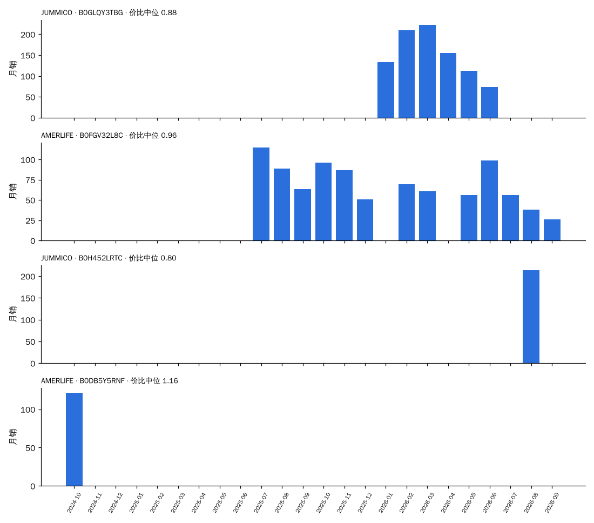
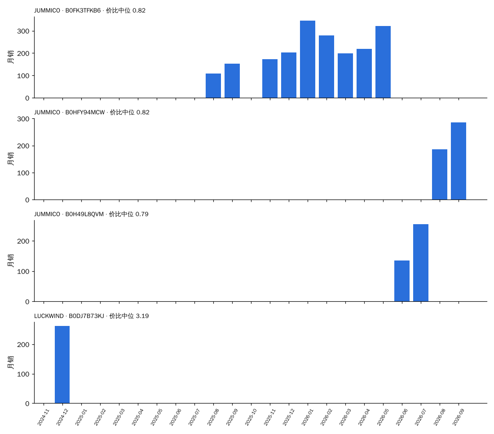

# 决策卡数据：树脂（按"同尺寸段 × 同拆装 × 同形态"分框）

> 由 `trial/决策卡.py`（CARD=树脂）生成，数据 2024-10 至 2026-09。每一项都只和**同一个框（尺寸段 × 拆装 × 形态）里的其他台面材质**比：份额 = 树脂销量 ÷ 框内台面材质已知的销量；溢价 = 价格 ÷ 同月同框中位价；新品 = 上架 ≤ 6 个月。
> 早期 = 2024-10 至 2025-03；近期 = 2026-04 至 2026-09。"相对预测"= 0.824 × 份额斜率 + 0.857 × 新品占比差（系数来自 全链路验证 2.2 的同框回归），减去同框其他台面材质的加权平均：> 0 表示预计在这个框里份额比别的台面材质涨得多。

## 1. 所有出现过的框

| 框 | 框月销（近期） | 树脂月销 早期 → 近期 | 框内份额 早期 → 近期 | 近期在榜家族 | 树脂中位价 / 框中位价 | 溢价 | 评分 树脂 / 框 | 新品占比 树脂 / 框 | 相对预测 | 新家族（含树脂）做到 / 家族 | 框内其他新家族 做到 / 家族 |
| :--- | ---: | :--- | :--- | ---: | :--- | ---: | :--- | :--- | ---: | :--- | :--- |
| 30″ · 拆装 · 落地式 | 4,752 | 215 → 549 | 8.3% → 11.5% | 37 | $250 / $249 | 0.86 | 4.09 / 4.27 | 43% / 33% | +0.05 | 4 / 5 | 26 / 60 |
| 60″ · 拆装 · 落地式 | 940 | 78 → 437 | 51.9% → 46.5% | 32 | $475 / $530 | 0.78 | 3.87 / 3.99 | 41% / 24% | +0.08 | 1 / 2 | 1 / 1 |
| 36″ · 拆装 · 落地式 | 2,908 | 90 → 437 | 8.3% → 15.0% | 32 | $330 / $320 | 1.03 | 4.31 / 4.22 | 51% / 38% | +0.02 | 6 / 8 | 13 / 25 |
| 48″ · 拆装 · 落地式 | 1,197 | 13 → 393 | 1.6% → 32.8% | 29 | $440 / $490 | 0.88 | 4.00 / 4.11 | 46% / 24% | +0.18 | 1 / 1 | 1 / 4 |
| 24″ · 拆装 · 落地式 | 2,731 | 54 → 364 | 2.0% → 13.3% | 12 | $190 / $215 | 0.79 | 4.15 / 4.28 | 0% / 14% | -0.11 | 1 / 4 | 9 / 30 |
| 18″ · 拆装 · 悬浮式 | 389 | 631 → 255 | 75.1% → 65.5% | 7 | $136 / $136 | 0.86 | 4.41 / 4.30 | 3% / 11% | +0.01 | — | — |
| 30″ · 拆装 · 悬浮式 | 1,164 | 28 → 228 | 4.6% → 19.6% | 9 | $230 / $230 | 0.90 | 4.21 / 4.21 | 3% / 16% | -0.10 | 1 / 1 | 3 / 16 |
| 24″ · 拆装 · 悬浮式 | 875 | 14 → 191 | 3.4% → 21.9% | 4 | $190 / $190 | 0.91 | 4.22 / 4.33 | 0% / 27% | -0.20 | 2 / 2 | 4 / 11 |
| 36″ · 拆装 · 悬浮式 | 534 | 62 → 173 | 24.1% → 32.3% | 8 | $269 / $270 | 1.00 | 4.22 / 4.23 | 3% / 12% | -0.02 | — | 1 / 9 |
| 42″ · 拆装 · 落地式 | 99 | 45 → 53 | 53.7% → 53.3% | 4 | $423 / $420 | 1.00 | 3.98 / 4.28 | 0% / 7% | -0.18 | 2 / 3 | 0 / 2 |
| 60″ · 拆装 · 悬浮式 | 73 | 2 → 38 | 12.4% → 52.2% | 3 | $450 / $450 | 0.79 | 4.25 / 4.39 | 69% / 56% | -0.64 | 0 / 1 | — |
| 18″ · 拆装 · 落地式 | 556 | 16 → 24 | 2.2% → 4.4% | 2 | $140 / $230 | 0.60 | 4.04 / 4.13 | 79% / 5% | -0.19 | — | 1 / 3 |
| 48″ · 拆装 · 悬浮式 | 78 | 4 → 15 | 15.3% → 18.9% | 3 | $500 / $480 | 1.02 | 4.48 / 4.34 | 0% / 4% | -0.46 | — | 1 / 3 |
| 18″ · 整装 · 悬浮式 | 107 | 22 → 14 | 9.3% → 13.4% | 1 | $247 / $190 | 1.08 | 4.66 / 4.54 | 0% / 26% | -1.11 | — | — |
| 42″ · 拆装 · 悬浮式 | 72 | 0 → 2 | 0.0% → 2.3% | 1 | $565 / $260 | 1.28 | 5.00 / 3.85 | 0% / 0% | -0.18 | — | 1 / 2 |
| 30″ · 整装 · 落地式 | 144 | 1 → 0 | 1.7% → 0.0% | 0 | $— / $650 | — | — / 4.46 | — / 2% | +— | — | — |
| 36″ · 整装 · 落地式 | 206 | 1 → 0 | 1.0% → 0.0% | 0 | $— / $998 | — | — / 4.67 | — / 3% | +— | — | — |
| 72″+ · 拆装 · 悬浮式 | 4 | 0 → 0 | 0.0% → 0.0% | 0 | $— / $999 | — | — / 5.00 | — / 0% | +— | — | 0 / 1 |

## 2. 框：30″ · 拆装 · 落地式

### 2.1 近期（2026-04 至 2026-09）框内各台面材质对比

| 台面材质 | 月销 | 份额 | 在榜家族 | 中位价 | 溢价 | 评分 | 新品占比 |
| :--- | ---: | ---: | ---: | ---: | ---: | ---: | ---: |
| 陶瓷 | 3,409 | 71.7% | 152 | $240 | 0.83 | 4.29 | 35% |
| 木板 | 703 | 14.8% | 54 | $290 | 1.01 | 4.29 | 8% |
| **树脂** | 549 | 11.5% | 37 | $250 | 0.86 | 4.09 | 43% |
| 岗石 | 64 | 1.4% | 4 | $200 | 0.69 | 4.39 | 98% |
| 岩板 | 18 | 0.4% | 3 | $350 | 1.22 | 4.46 | 0% |
| 卡拉拉大理石 | 8 | 0.2% | 2 | $400 | 1.40 | 4.57 | 0% |

### 2.2 按季度：树脂在这个框里怎么走过来

| 季度 | 树脂月销 | 框内份额 | 树脂中位价 | 溢价 | 评分 树脂 / 框 | 新品占比 树脂 / 框 | 在榜家族 |
| :--- | ---: | ---: | ---: | ---: | :--- | :--- | ---: |
| 2024Q4 | 297 | 8.7% | $290 | 1.16 | 4.02 / 4.14 | 0% / 4% | 5 |
| 2025Q1 | 132 | 7.5% | $250 | 1.04 | 4.13 / 4.17 | 6% / 44% | 5 |
| 2025Q2 | 207 | 10.0% | $260 | 1.04 | 4.29 / 4.18 | 16% / 42% | 7 |
| 2025Q3 | 188 | 6.8% | $270 | 1.12 | 4.16 / 4.26 | 11% / 31% | 7 |
| 2025Q4 | 169 | 7.0% | $270 | 1.13 | 4.28 / 4.26 | 10% / 13% | 9 |
| 2026Q1 | 339 | 9.4% | $236 | 0.90 | 3.98 / 4.28 | 61% / 40% | 10 |
| 2026Q2 | 533 | 12.0% | $270 | 0.93 | 4.20 / 4.23 | 58% / 36% | 18 |
| 2026Q3 | 564 | 11.2% | $240 | 0.83 | 3.98 / 4.30 | 28% / 30% | 24 |

### 2.3 代表产品（30″ · 拆装 · 落地式，近期销量前 3 + 最早在榜的 1 个）

**JUMMICO · B0GLQY3TBG**    [商品链接](https://www.amazon.com/dp/B0G6VG2VGH)  
30″ · 拆装 · 落地式 · 台面 树脂一体（树脂）· 元素 农场风装饰饰条 · 主色 黑 · 上架 2025-12-22 · 首次在榜 2026-01

| 月 | 月销 | 价格 | 价比（÷ 同框中位） | 评分 | 小类排名 | 在榜子体 |
| :--- | ---: | ---: | ---: | ---: | ---: | ---: |
| 2026-01 | 133 | $225 | 0.90 | 2.0 | 53 | 2 |
| 2026-02 | 209 | $250 | 0.93 | 4.3 | 27 | 3 |
| 2026-03 | 223 | $225 | 0.83 | 4.0 | 23 | 3 |
| 2026-04 | 155 | $250 | 0.86 | 3.8 | 48 | 3 |
| 2026-05 | 113 | $250 | 0.89 | 3.6 | 111 | 3 |
| 2026-06 | 74 | $230 | 0.79 | 3.6 | 170 | 1 |

**AMERLIFE · B0FGV32L8C**    [商品链接](https://www.amazon.com/dp/B0D1QHH3QW)  
30″ · 拆装 · 落地式 · 台面 树脂一体（树脂）· 元素 农场风装饰饰条 · 主色 灰 · 上架 2024-04-14 · 首次在榜 2025-07

| 月 | 月销 | 价格 | 价比（÷ 同框中位） | 评分 | 小类排名 | 在榜子体 |
| :--- | ---: | ---: | ---: | ---: | ---: | ---: |
| 2025-07 | 115 | $280 | 1.12 | 4.2 | 16 | 3 |
| 2025-08 | 89 | $320 | 1.30 | 4.2 | 24 | 3 |
| 2025-09 | 64 | $320 | 1.39 | 4.2 | 30 | 3 |
| 2025-10 | 96 | $320 | 1.33 | 4.2 | 28 | 3 |
| 2025-11 | 87 | $280 | 1.17 | 4.2 | 22 | 3 |
| 2025-12 | 51 | $300 | 1.20 | 4.2 | 108 | 3 |
| 2026-02 | 70 | $260 | 0.96 | 4.2 | 24 | 3 |
| 2026-03 | 61 | $255 | 0.94 | 4.3 | 58 | 3 |
| 2026-05 | 56 | $240 | 0.85 | 4.3 | 7 | 3 |
| 2026-06 | 99 | $240 | 0.83 | 4.3 | 11 | 3 |
| 2026-07 | 56 | $240 | 0.84 | 4.4 | 19 | 3 |
| 2026-08 | 38 | $240 | 0.83 | 4.3 | 25 | 3 |
| 2026-09 | 26 | $240 | 0.83 | 4.4 | 27 | 2 |

**JUMMICO · B0H452LRTC**    [商品链接](https://www.amazon.com/dp/B0H452LRTC)  
30″ · 拆装 · 落地式 · 台面 树脂一体（树脂）· 元素 农场风装饰饰条 · 主色 黑 · 上架 2026-06-06 · 首次在榜 2026-08

| 月 | 月销 | 价格 | 价比（÷ 同框中位） | 评分 | 小类排名 | 在榜子体 |
| :--- | ---: | ---: | ---: | ---: | ---: | ---: |
| 2026-08 | 214 | $230 | 0.80 | 4.0 | 62 | 1 |

**AMERLIFE · B0DB5Y5RNF**    [商品链接](https://www.amazon.com/dp/B0D8KQVKN6)  
30″ · 拆装 · 落地式 · 台面 树脂一体（树脂）· 元素 农场风装饰饰条 · 主色 白 · 上架 2024-07-01 · 首次在榜 2024-10

| 月 | 月销 | 价格 | 价比（÷ 同框中位） | 评分 | 小类排名 | 在榜子体 |
| :--- | ---: | ---: | ---: | ---: | ---: | ---: |
| 2024-10 | 122 | $290 | 1.16 | 4.2 | 9 | 1 |

### 2.4 新品方案打分（30″ · 拆装 · 落地式，首月 ≥ 2 色 ≥ 4 子体；模型偏高约每 10 个 1 个）

前 4：中档 · 树脂一体 · 主色原木 6.4；中档 · 树脂一体 · 主色白 6.2；高档 · 树脂一体 · 主色原木 5.9；中档 · 树脂一体 · 主色深木 5.8。最低 2：低档 · 树脂一体 · 主色灰 4.7；低档 · 树脂一体 · 主色黑 4.3。

## 2. 框：24″ · 拆装 · 落地式

### 2.1 近期（2026-04 至 2026-09）框内各台面材质对比

| 台面材质 | 月销 | 份额 | 在榜家族 | 中位价 | 溢价 | 评分 | 新品占比 |
| :--- | ---: | ---: | ---: | ---: | ---: | ---: | ---: |
| 陶瓷 | 1,901 | 69.6% | 96 | $209 | 0.86 | 4.29 | 20% |
| 木板 | 444 | 16.2% | 33 | $260 | 1.06 | 4.37 | 1% |
| **树脂** | 364 | 13.3% | 12 | $190 | 0.79 | 4.15 | 0% |
| 岗石 | 11 | 0.4% | 1 | $252 | 1.05 | 4.20 | 0% |
| 卡拉拉大理石 | 8 | 0.3% | 1 | $290 | 1.21 | 4.58 | 0% |

### 2.2 按季度：树脂在这个框里怎么走过来

| 季度 | 树脂月销 | 框内份额 | 树脂中位价 | 溢价 | 评分 树脂 / 框 | 新品占比 树脂 / 框 | 在榜家族 |
| :--- | ---: | ---: | ---: | ---: | :--- | :--- | ---: |
| 2024Q4 | 87 | 3.1% | $669 | 3.19 | 4.20 / 4.28 | 0% / 5% | 1 |
| 2025Q1 | 21 | 0.8% | $350 | 1.67 | 4.13 / 4.26 | 78% / 20% | 4 |
| 2025Q2 | 61 | 1.8% | $220 | 1.05 | 4.49 / 4.25 | 65% / 30% | 5 |
| 2025Q3 | 179 | 6.7% | $180 | 0.90 | 4.24 / 4.31 | 49% / 11% | 5 |
| 2025Q4 | 192 | 7.2% | $175 | 0.83 | 4.46 / 4.33 | 65% / 11% | 3 |
| 2026Q1 | 451 | 15.8% | $202 | 0.94 | 4.20 / 4.29 | 9% / 15% | 6 |
| 2026Q2 | 368 | 12.6% | $190 | 0.78 | 4.18 / 4.25 | 0% / 17% | 8 |
| 2026Q3 | 359 | 14.2% | $190 | 0.80 | 4.12 / 4.32 | 0% / 10% | 8 |

### 2.3 代表产品（24″ · 拆装 · 落地式，近期销量前 3 + 最早在榜的 1 个）

**JUMMICO · B0FK3TFKB6**    [商品链接](https://www.amazon.com/dp/B0FK3V5WMD)  
24″ · 拆装 · 落地式 · 台面 树脂一体（树脂）· 元素 农场风装饰饰条 · 主色 黑 · 上架 2025-07-28 · 首次在榜 2025-08

| 月 | 月销 | 价格 | 价比（÷ 同框中位） | 评分 | 小类排名 | 在榜子体 |
| :--- | ---: | ---: | ---: | ---: | ---: | ---: |
| 2025-08 | 108 | $180 | 0.90 | — | 10 | 2 |
| 2025-09 | 153 | $175 | 0.87 | 4.2 | 75 | 2 |
| 2025-11 | 172 | $170 | 0.81 | 4.7 | 16 | 2 |
| 2025-12 | 202 | $172 | 0.82 | 4.4 | 12 | 2 |
| 2026-01 | 346 | $182 | 0.91 | 4.5 | 5 | 2 |
| 2026-02 | 278 | $202 | 0.96 | 4.2 | 17 | 2 |
| 2026-03 | 199 | $195 | 0.81 | 4.3 | 39 | 2 |
| 2026-04 | 218 | $185 | 0.74 | 4.2 | 16 | 2 |
| 2026-05 | 322 | $187 | 0.77 | 4.2 | 2 | 2 |

**JUMMICO · B0HFY94MCW**    [商品链接](https://www.amazon.com/dp/B0FK3V5WMD)  
24″ · 拆装 · 落地式 · 台面 树脂一体（树脂）· 元素 农场风装饰饰条 · 主色 黑 · 上架 2025-07-28 · 首次在榜 2026-08

| 月 | 月销 | 价格 | 价比（÷ 同框中位） | 评分 | 小类排名 | 在榜子体 |
| :--- | ---: | ---: | ---: | ---: | ---: | ---: |
| 2026-08 | 186 | $190 | 0.79 | 4.1 | 14 | 3 |
| 2026-09 | 286 | $197 | 0.85 | 4.1 | 12 | 3 |

**JUMMICO · B0H49L8QVM**    [商品链接](https://www.amazon.com/dp/B0FK3V5WMD)  
24″ · 拆装 · 落地式 · 台面 树脂一体（树脂）· 元素 农场风装饰饰条 · 主色 黑 · 上架 2025-07-28 · 首次在榜 2026-06

| 月 | 月销 | 价格 | 价比（÷ 同框中位） | 评分 | 小类排名 | 在榜子体 |
| :--- | ---: | ---: | ---: | ---: | ---: | ---: |
| 2026-06 | 134 | $187 | 0.78 | 4.1 | 13 | 2 |
| 2026-07 | 255 | $190 | 0.79 | 4.0 | 15 | 1 |

**LUCKWIND · B0DJ7B73KJ**    [商品链接](https://www.amazon.com/dp/B0DG2WG3DV)  
24″ · 拆装 · 落地式 · 台面 树脂一体（树脂）· 元素 玻璃门 · 主色 白 · 上架 2024-05-25 · 首次在榜 2024-12

| 月 | 月销 | 价格 | 价比（÷ 同框中位） | 评分 | 小类排名 | 在榜子体 |
| :--- | ---: | ---: | ---: | ---: | ---: | ---: |
| 2024-12 | 262 | $669 | 3.19 | 4.2 | 11 | 1 |

### 2.4 新品方案打分（24″ · 拆装 · 落地式，首月 ≥ 2 色 ≥ 4 子体；模型偏高约每 10 个 1 个）

前 4：中档 · 树脂一体 · 主色原木 5.7；中档 · 树脂一体 · 主色白 5.6；高档 · 树脂一体 · 主色原木 5.2；中档 · 树脂一体 · 主色深木 5.1。最低 2：低档 · 树脂一体 · 主色灰 4.0；低档 · 树脂一体 · 主色黑 3.6。

