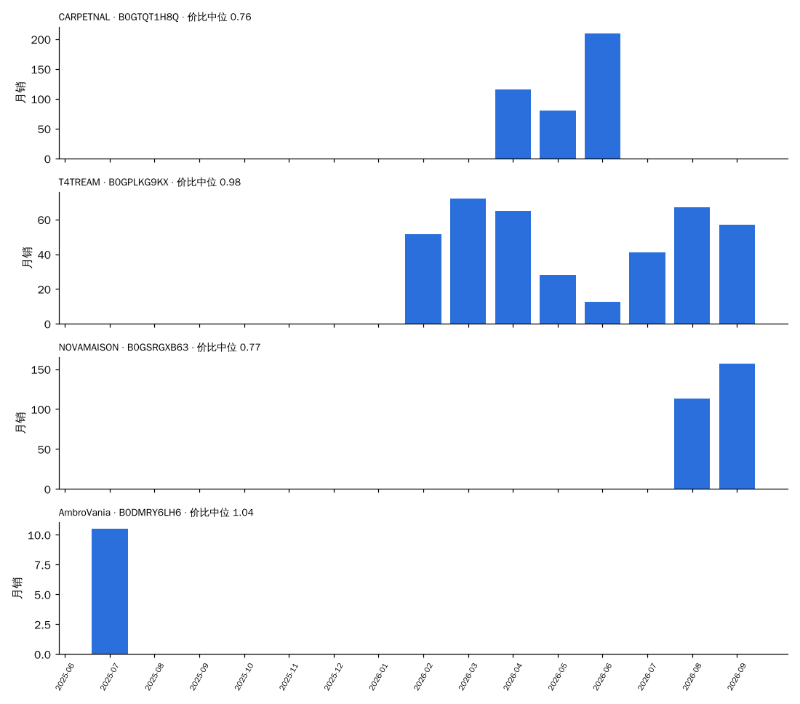
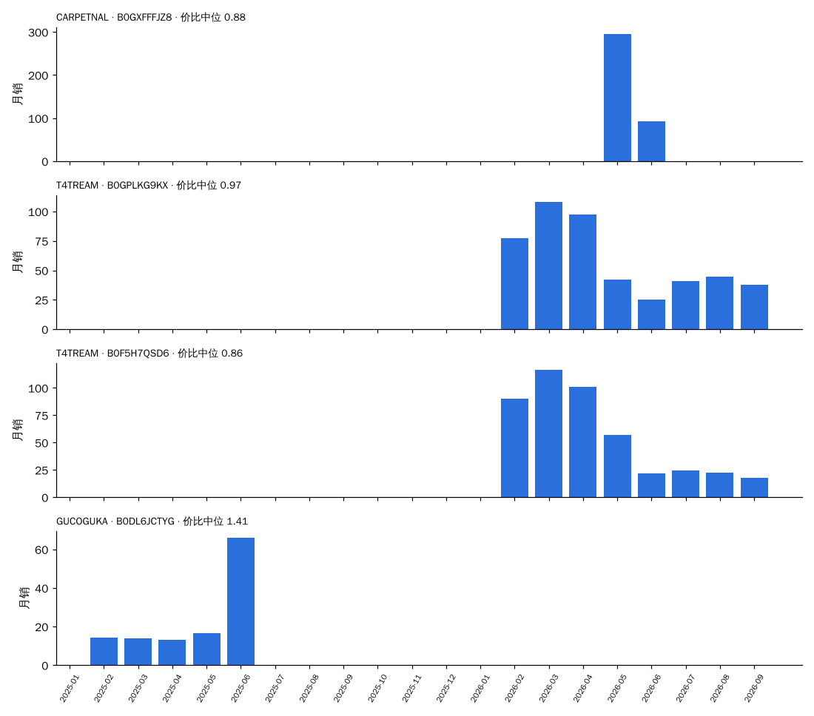

# 决策卡数据：竖棱（按"同尺寸段 × 同拆装 × 同形态"分框）

> 由 `trial/决策卡.py`（CARD=竖棱）生成，数据 2024-10 至 2026-09。每一项都只和**同一个框（尺寸段 × 拆装 × 形态）里的其他元素**比：份额 = 竖棱销量 ÷ 框内元素已知的销量；溢价 = 价格 ÷ 同月同框中位价；新品 = 上架 ≤ 6 个月。
> 早期 = 2024-10 至 2025-03；近期 = 2026-04 至 2026-09。"相对预测"= 0.824 × 份额斜率 + 0.857 × 新品占比差（系数来自 全链路验证 2.2 的同框回归），减去同框其他元素的加权平均：> 0 表示预计在这个框里份额比别的元素涨得多。

## 1. 所有出现过的框

| 框 | 框月销（近期） | 竖棱月销 早期 → 近期 | 框内份额 早期 → 近期 | 近期在榜家族 | 竖棱中位价 / 框中位价 | 溢价 | 评分 竖棱 / 框 | 新品占比 竖棱 / 框 | 相对预测 | 新家族（含竖棱）做到 / 家族 | 框内其他新家族 做到 / 家族 |
| :--- | ---: | :--- | :--- | ---: | :--- | ---: | :--- | :--- | ---: | :--- | :--- |
| 30″ · 拆装 · 落地式 | 6,153 | 168 → 779 | 3.3% → 12.7% | 35 | $270 / $250 | 0.94 | 4.28 / 4.27 | 56% / 27% | +0.14 | 7 / 10 | 35 / 75 |
| 30″ · 拆装 · 悬浮式 | 1,486 | 128 → 478 | 10.1% → 32.2% | 22 | $230 / $230 | 0.88 | 4.35 / 4.24 | 31% / 13% | +0.23 | 2 / 10 | 4 / 13 |
| 36″ · 拆装 · 落地式 | 3,824 | 19 → 404 | 0.7% → 10.6% | 28 | $330 / $320 | 1.03 | 4.30 / 4.22 | 65% / 33% | +0.23 | 2 / 5 | 19 / 39 |
| 60″ · 拆装 · 落地式 | 1,566 | 0 → 348 | 0.0% → 22.2% | 20 | $450 / $570 | 0.77 | 3.99 / 4.02 | 51% / 17% | +0.26 | 1 / 1 | 2 / 4 |
| 24″ · 拆装 · 悬浮式 | 1,060 | 146 → 299 | 14.9% → 28.2% | 18 | $180 / $190 | 0.90 | 4.43 / 4.32 | 48% / 23% | +0.45 | 8 / 14 | 2 / 7 |
| 48″ · 拆装 · 落地式 | 2,047 | 9 → 278 | 0.5% → 13.6% | 18 | $440 / $500 | 0.88 | 4.23 / 4.15 | 61% / 17% | +0.18 | 1 / 2 | 1 / 5 |
| 24″ · 拆装 · 落地式 | 3,703 | 218 → 262 | 5.0% → 7.1% | 14 | $234 / $210 | 0.97 | 4.24 / 4.28 | 11% / 13% | -0.15 | 1 / 5 | 18 / 47 |
| 18″ · 拆装 · 落地式 | 791 | 123 → 176 | 9.3% → 22.3% | 13 | $310 / $217 | 1.35 | 3.87 / 4.14 | 0% / 6% | +0.28 | — | 1 / 3 |
| 36″ · 拆装 · 悬浮式 | 726 | 44 → 117 | 6.4% → 16.1% | 8 | $269 / $270 | 1.00 | 4.25 / 4.26 | 18% / 9% | +0.25 | 1 / 4 | 0 / 7 |
| 24″ · 整装 · 悬浮式 | 272 | 51 → 92 | 42.4% → 33.7% | 4 | $220 / $400 | 0.38 | 4.12 / 4.37 | 0% / 18% | -0.12 | 1 / 1 | 1 / 2 |
| 30″ · 整装 · 悬浮式 | 226 | 46 → 91 | 58.2% → 40.3% | 4 | $230 / $600 | 0.35 | 4.22 / 4.46 | 0% / 15% | -0.15 | 1 / 1 | 1 / 1 |
| 18″ · 拆装 · 悬浮式 | 421 | 74 → 78 | 6.8% → 18.6% | 3 | $200 / $137 | 1.16 | 4.42 / 4.32 | 0% / 10% | -0.11 | — | — |
| 36″ · 整装 · 悬浮式 | 185 | 42 → 74 | 61.6% → 40.1% | 5 | $240 / $730 | 0.32 | 3.52 / 4.22 | 0% / 14% | -0.17 | 1 / 1 | — |
| 60″ · 拆装 · 悬浮式 | 143 | 0 → 53 | 0.0% → 37.3% | 4 | $450 / $570 | 0.79 | 4.47 / 4.32 | 74% / 28% | +0.29 | 0 / 1 | — |
| 72″+ · 拆装 · 落地式 | 151 | 0 → 40 | 0.0% → 26.5% | 6 | $700 / $1,000 | 0.90 | 4.46 / 4.33 | 0% / 0% | +0.57 | — | — |
| 42″ · 拆装 · 悬浮式 | 72 | 0 → 39 | 0.0% → 54.3% | 2 | $260 / $260 | 0.70 | 3.47 / 3.85 | 0% / 0% | -0.26 | — | 1 / 4 |
| 48″ · 整装 · 悬浮式 | 117 | 0 → 36 | 0.0% → 30.7% | 3 | $950 / $960 | 0.99 | 4.71 / 4.56 | 0% / 32% | -0.26 | — | — |
| 60″ · 整装 · 悬浮式 | 32 | 0 → 29 | 0.0% → 88.9% | 2 | $1,500 / $1,500 | 1.00 | 4.71 / 4.72 | 0% / 0% | -0.12 | — | — |
| 24″ · 整装 · 落地式 | 156 | 1 → 9 | 0.4% → 5.9% | 1 | $290 / $522 | 0.47 | — / 4.50 | 0% / 4% | +0.99 | — | — |
| 30″ · 整装 · 落地式 | 145 | 6 → 9 | 5.7% → 6.4% | 1 | $310 / $650 | 0.40 | 4.10 / 4.46 | 0% / 2% | +0.86 | — | — |
| 48″ · 拆装 · 悬浮式 | 170 | 0 → 4 | 0.0% → 2.3% | 1 | $530 / $480 | 1.10 | 5.00 / 4.33 | 0% / 2% | -0.44 | — | 1 / 3 |
| 36″ · 整装 · 落地式 | 212 | 1 → 0 | 0.9% → 0.0% | 0 | $— / $945 | — | — / 4.67 | — / 3% | +— | — | — |
| 72″+ · 拆装 · 悬浮式 | 4 | 0 → 0 | 0.0% → 0.0% | 0 | $— / $999 | — | — / 5.00 | — / 0% | +— | 0 / 1 | — |

## 2. 框：60″ · 拆装 · 落地式

### 2.1 近期（2026-04 至 2026-09）框内各元素对比

| 元素 | 月销 | 份额 | 在榜家族 | 中位价 | 溢价 | 评分 | 新品占比 |
| :--- | ---: | ---: | ---: | ---: | ---: | ---: | ---: |
| 农场风装饰饰条 | 646 | 41.3% | 25 | $560 | 0.91 | 3.97 | 0% |
| 夏克式 | 392 | 25.0% | 26 | $700 | 1.19 | 3.96 | 10% |
| **竖棱** | 348 | 22.2% | 20 | $450 | 0.77 | 3.99 | 51% |
| 夏克式+纹路 | 61 | 3.9% | 5 | $700 | 1.19 | 4.38 | 7% |
| 纯色+fluted | 23 | 1.5% | 3 | $620 | 1.05 | 4.50 | 34% |
| 纯色+竖棱 | 23 | 1.5% | 3 | $620 | 1.05 | 4.50 | 34% |
| 夏克式+复古立柱 | 19 | 1.2% | 3 | $900 | 1.53 | 4.19 | 52% |
| 自然木纹 | 18 | 1.1% | 4 | $486 | 0.85 | 4.47 | 90% |

### 2.2 按季度：竖棱在这个框里怎么走过来

| 季度 | 竖棱月销 | 框内份额 | 竖棱中位价 | 溢价 | 评分 竖棱 / 框 | 新品占比 竖棱 / 框 | 在榜家族 |
| :--- | ---: | ---: | ---: | ---: | :--- | :--- | ---: |
| 2024Q4 | 0 | 0.0% | $— | — | — / 3.67 | — / 0% | 0 |
| 2025Q1 | 0 | 0.0% | $— | — | — / 4.36 | — / 9% | 0 |
| 2025Q2 | 0 | 0.0% | $— | — | — / 4.25 | — / 5% | 0 |
| 2025Q3 | 51 | 8.1% | $900 | 1.15 | 4.70 / 4.15 | 38% / 4% | 5 |
| 2025Q4 | 18 | 1.9% | $850 | 1.52 | 4.70 / 4.02 | 0% / 19% | 1 |
| 2026Q1 | 66 | 6.6% | $570 | 0.97 | 4.59 / 4.28 | 62% / 21% | 3 |
| 2026Q2 | 271 | 23.6% | $450 | 0.76 | 4.19 / 4.15 | 76% / 22% | 10 |
| 2026Q3 | 425 | 21.4% | $450 | 0.78 | 3.86 / 3.95 | 34% / 15% | 14 |

### 2.3 代表产品（60″ · 拆装 · 落地式，近期销量前 3 + 最早在榜的 1 个）

**CARPETNAL · B0GTQT1H8Q**    [商品链接](https://www.amazon.com/dp/B0GTQD9DBG)  
60″ · 拆装 · 落地式 · 台面 树脂一体（树脂）· 元素 竖棱 · 主色 深木 · 上架 2026-03-25 · 首次在榜 2026-04

| 月 | 月销 | 价格 | 价比（÷ 同框中位） | 评分 | 小类排名 | 在榜子体 |
| :--- | ---: | ---: | ---: | ---: | ---: | ---: |
| 2026-04 | 116 | $450 | 0.77 | 4.3 | 2 | 3 |
| 2026-05 | 81 | $450 | 0.76 | 4.3 | 9 | 3 |
| 2026-06 | 210 | $450 | 0.68 | 3.9 | 18 | 1 |

**T4TREAM · B0GPLKG9KX**    [商品链接](https://www.amazon.com/dp/B0G423QGRT)  
60″ · 拆装 · 落地式 · 台面 陶瓷一体（陶瓷）· 元素 竖棱 · 主色 深木 · 上架 2026-02-17 · 首次在榜 2026-02

| 月 | 月销 | 价格 | 价比（÷ 同框中位） | 评分 | 小类排名 | 在榜子体 |
| :--- | ---: | ---: | ---: | ---: | ---: | ---: |
| 2026-02 | 52 | $570 | 0.97 | 5.0 | 8 | 2 |
| 2026-03 | 72 | $570 | 0.97 | 4.5 | 3 | 2 |
| 2026-04 | 65 | $570 | 0.97 | 4.4 | 24 | 2 |
| 2026-05 | 28 | $600 | 1.02 | 4.4 | 26 | 2 |
| 2026-06 | 13 | $600 | 0.91 | 4.4 | 258 | 1 |
| 2026-07 | 41 | $600 | 1.02 | 4.4 | 43 | 2 |
| 2026-08 | 67 | $570 | 0.99 | 4.3 | 8 | 3 |
| 2026-09 | 57 | $600 | 1.02 | 4.4 | 34 | 3 |

**NOVAMAISON · B0GSRGXB63**    [商品链接](https://www.amazon.com/dp/B0GSRGXB63)  
60″ · 拆装 · 落地式 · 台面 树脂一体（树脂）· 元素 竖棱 · 主色 原木 · 上架 2026-03-19 · 首次在榜 2026-08

| 月 | 月销 | 价格 | 价比（÷ 同框中位） | 评分 | 小类排名 | 在榜子体 |
| :--- | ---: | ---: | ---: | ---: | ---: | ---: |
| 2026-08 | 113 | $450 | 0.78 | 3.9 | 56 | 1 |
| 2026-09 | 157 | $450 | 0.76 | 3.9 | 230 | 1 |

**AmbroVania · B0DMRY6LH6**    [商品链接](https://www.amazon.com/dp/B0FH2GGSL3)  
60″ · 拆装 · 落地式 · 台面 石材台面（岩板）· 元素 竖棱 · 主色 黑 · 上架 2025-07-07 · 首次在榜 2025-07

| 月 | 月销 | 价格 | 价比（÷ 同框中位） | 评分 | 小类排名 | 在榜子体 |
| :--- | ---: | ---: | ---: | ---: | ---: | ---: |
| 2025-07 | 10 | $880 | 1.04 | — | 89 | 6 |

### 2.4 新品方案打分（60″ · 拆装 · 落地式，首月 ≥ 2 色 ≥ 4 子体；模型偏高约每 10 个 1 个）

前 4：中档 · 树脂一体 · 主色原木 6.6；中档 · 树脂一体 · 主色白 6.4；高档 · 树脂一体 · 主色原木 6.1；中档 · 树脂一体 · 主色深木 6.0。最低 2：低档 · 陶瓷一体 · 主色灰 3.1；低档 · 陶瓷一体 · 主色黑 2.8。

## 2. 框：48″ · 拆装 · 落地式

### 2.1 近期（2026-04 至 2026-09）框内各元素对比

| 元素 | 月销 | 份额 | 在榜家族 | 中位价 | 溢价 | 评分 | 新品占比 |
| :--- | ---: | ---: | ---: | ---: | ---: | ---: | ---: |
| 农场风装饰饰条 | 696 | 34.0% | 44 | $470 | 0.94 | 4.20 | 1% |
| 夏克式 | 609 | 29.7% | 40 | $560 | 1.12 | 4.13 | 10% |
| **竖棱** | 278 | 13.6% | 18 | $440 | 0.88 | 4.23 | 61% |
| 夏克式+纹路 | 119 | 5.8% | 4 | $570 | 1.14 | 4.18 | 0% |
| 横板条 | 105 | 5.1% | 6 | $500 | 1.00 | 4.23 | 0% |
| 自然木纹 | 73 | 3.6% | 8 | $420 | 0.84 | 3.90 | 58% |
| rustic | 36 | 1.8% | 1 | $440 | 0.88 | 2.00 | 100% |
| 纯色+fluted | 32 | 1.6% | 4 | $570 | 1.14 | 4.78 | 57% |

### 2.2 按季度：竖棱在这个框里怎么走过来

| 季度 | 竖棱月销 | 框内份额 | 竖棱中位价 | 溢价 | 评分 竖棱 / 框 | 新品占比 竖棱 / 框 | 在榜家族 |
| :--- | ---: | ---: | ---: | ---: | :--- | :--- | ---: |
| 2024Q4 | 0 | 0.0% | $— | — | — / 4.18 | — / 2% | 0 |
| 2025Q1 | 17 | 1.7% | $600 | 1.41 | 4.67 / 4.12 | 0% / 16% | 2 |
| 2025Q2 | 46 | 4.5% | $600 | 1.20 | 4.28 / 4.20 | 0% / 9% | 2 |
| 2025Q3 | 22 | 2.2% | $530 | 1.10 | 4.71 / 4.16 | 0% / 4% | 4 |
| 2025Q4 | 22 | 1.9% | $550 | 1.10 | 4.66 / 4.30 | 0% / 8% | 1 |
| 2026Q1 | 166 | 14.4% | $500 | 1.00 | 4.54 / 4.34 | 42% / 8% | 5 |
| 2026Q2 | 397 | 19.1% | $440 | 0.88 | 4.20 / 4.20 | 76% / 18% | 10 |
| 2026Q3 | 160 | 7.9% | $440 | 0.88 | 4.30 / 4.10 | 23% / 17% | 12 |

### 2.3 代表产品（48″ · 拆装 · 落地式，近期销量前 3 + 最早在榜的 1 个）

**CARPETNAL · B0GXFFFJZ8**    [商品链接](https://www.amazon.com/dp/B0GXFFFJZ8)  
48″ · 拆装 · 落地式 · 台面 树脂一体（树脂）· 元素 竖棱 · 主色 原木 · 上架 2026-04-27 · 首次在榜 2026-05

| 月 | 月销 | 价格 | 价比（÷ 同框中位） | 评分 | 小类排名 | 在榜子体 |
| :--- | ---: | ---: | ---: | ---: | ---: | ---: |
| 2026-05 | 296 | $440 | 0.88 | 3.8 | 11 | 1 |
| 2026-06 | 92 | $440 | 0.88 | 3.8 | 1,070 | 1 |

**T4TREAM · B0GPLKG9KX**    [商品链接](https://www.amazon.com/dp/B0G426MXF6)  
48″ · 拆装 · 落地式 · 台面 树脂一体（树脂）· 元素 竖棱 · 主色 原木 · 上架 2026-02-12 · 首次在榜 2026-02

| 月 | 月销 | 价格 | 价比（÷ 同框中位） | 评分 | 小类排名 | 在榜子体 |
| :--- | ---: | ---: | ---: | ---: | ---: | ---: |
| 2026-02 | 77 | $500 | 1.03 | 5.0 | 8 | 3 |
| 2026-03 | 108 | $500 | 1.00 | 4.4 | 3 | 3 |
| 2026-04 | 97 | $470 | 0.94 | 4.4 | 24 | 3 |
| 2026-05 | 42 | $470 | 0.94 | 4.4 | 67 | 3 |
| 2026-06 | 25 | $550 | 1.10 | 4.4 | 181 | 2 |
| 2026-07 | 41 | $500 | 1.00 | 4.4 | 49 | 2 |
| 2026-08 | 45 | $410 | 0.82 | 4.3 | 6 | 2 |
| 2026-09 | 38 | $450 | 0.90 | 4.4 | 34 | 2 |

**T4TREAM · B0F5H7QSD6**    [商品链接](https://www.amazon.com/dp/B0GQ6VG4RV)  
48″ · 拆装 · 落地式 · 台面 树脂一体（树脂）· 元素 竖棱 · 主色 原木 · 上架 2026-02-28 · 首次在榜 2026-02

| 月 | 月销 | 价格 | 价比（÷ 同框中位） | 评分 | 小类排名 | 在榜子体 |
| :--- | ---: | ---: | ---: | ---: | ---: | ---: |
| 2026-02 | 90 | $470 | 0.97 | 4.4 | — | 3 |
| 2026-03 | 117 | $470 | 0.94 | 4.4 | — | 3 |
| 2026-04 | 101 | $430 | 0.86 | 4.2 | 10 | 3 |
| 2026-05 | 57 | $430 | 0.86 | 4.2 | 75 | 3 |
| 2026-06 | 22 | $430 | 0.86 | 4.2 | 44 | 1 |
| 2026-07 | 24 | $347 | 0.69 | 4.3 | 23 | 1 |
| 2026-08 | 23 | $430 | 0.86 | 4.2 | 15 | 1 |
| 2026-09 | 18 | $430 | 0.86 | 4.2 | 71 | 1 |

**GUCOGUKA · B0DL6JCTYG**    [商品链接](https://www.amazon.com/dp/B0DY1YSS4Q)  
48″ · 拆装 · 落地式 · 台面 陶瓷一体（陶瓷）· 元素 竖棱 · 主色 黑 · 上架 2024-11-05 · 首次在榜 2025-02

| 月 | 月销 | 价格 | 价比（÷ 同框中位） | 评分 | 小类排名 | 在榜子体 |
| :--- | ---: | ---: | ---: | ---: | ---: | ---: |
| 2025-02 | 14 | $600 | 1.41 | 4.4 | 378 | 1 |
| 2025-03 | 14 | $600 | 1.41 | 4.4 | 197 | 1 |
| 2025-04 | 13 | $600 | 1.41 | 4.4 | 359 | 1 |
| 2025-05 | 16 | $600 | 1.29 | 3.8 | 192 | 1 |
| 2025-06 | 66 | $600 | 1.20 | 3.9 | 256 | 1 |

### 2.4 新品方案打分（48″ · 拆装 · 落地式，首月 ≥ 2 色 ≥ 4 子体；模型偏高约每 10 个 1 个）

前 4：中档 · 树脂一体 · 主色原木 6.4；中档 · 树脂一体 · 主色白 6.2；高档 · 树脂一体 · 主色原木 5.9；中档 · 树脂一体 · 主色深木 5.8。最低 2：低档 · 陶瓷一体 · 主色灰 3.0；低档 · 陶瓷一体 · 主色黑 2.7。

