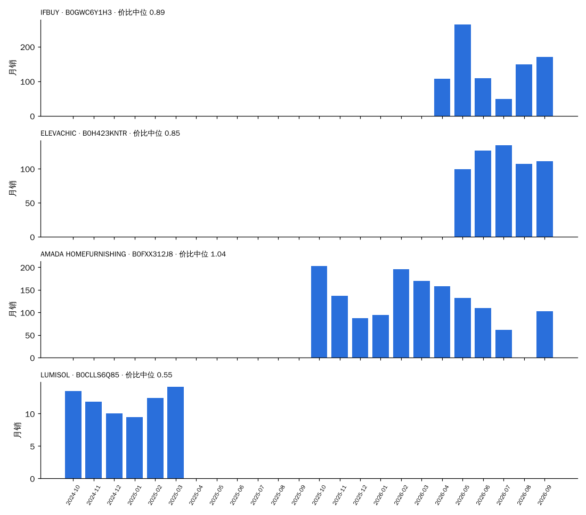
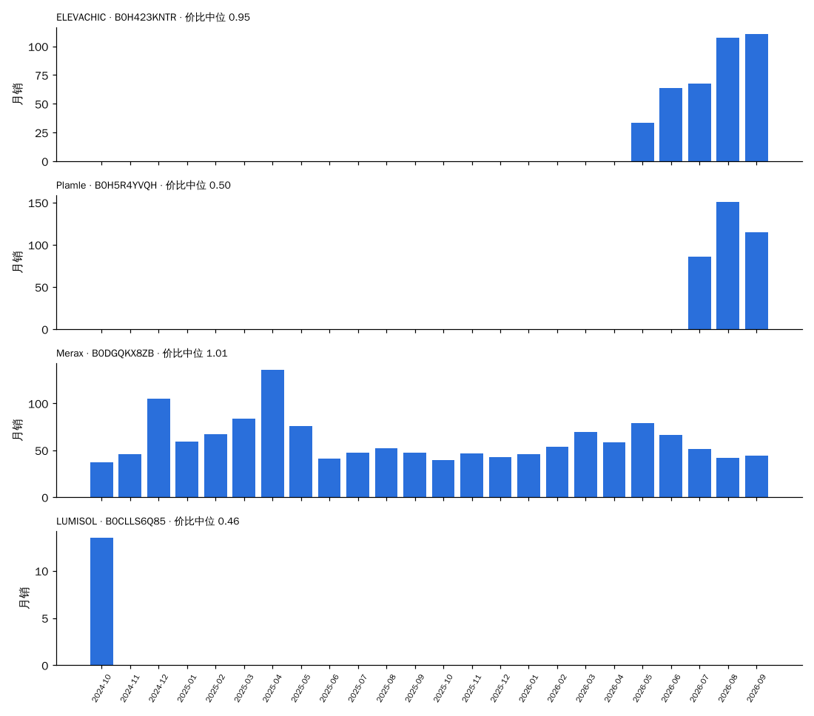
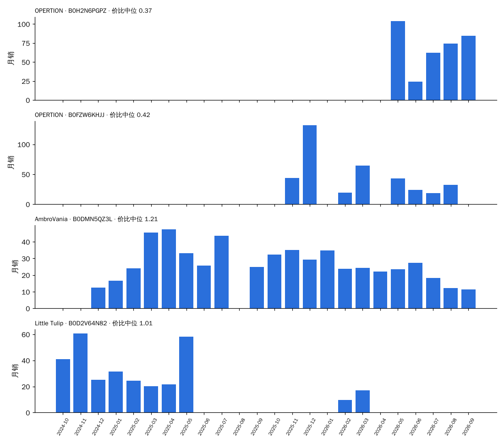
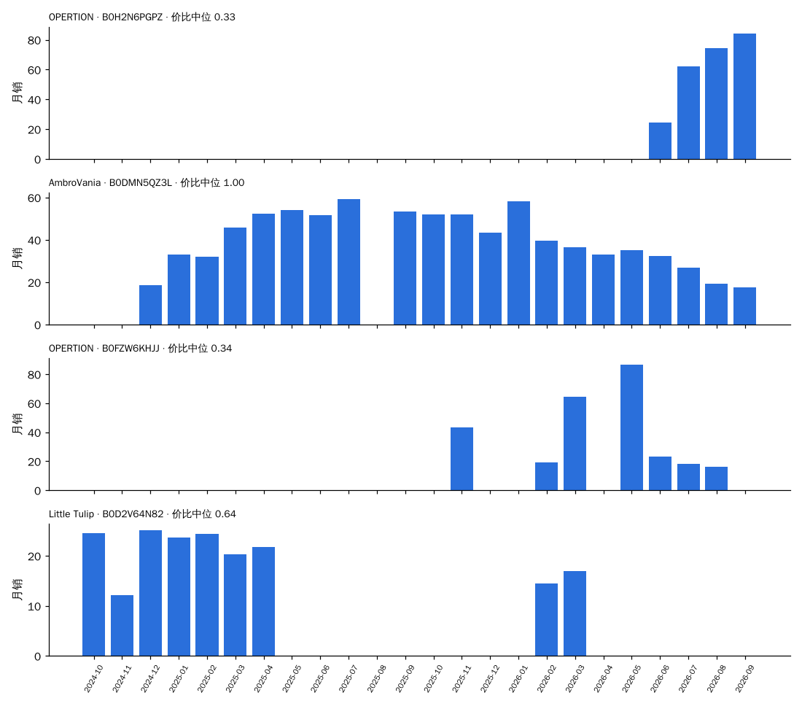

# 决策卡数据：竖棱（按"同尺寸段 × 同拆装"分框）

> 由 `trial/决策卡.py`（CARD=竖棱）生成，数据 2024-10 至 2026-09。每一项都只和**同一个框（尺寸段 × 拆装）里的其他元素**比：份额 = 竖棱销量 ÷ 框内元素已知的销量；溢价 = 价格 ÷ 同月同框中位价；新品 = 上架 ≤ 6 个月。
> 早期 = 2024-10 至 2025-03；近期 = 2026-04 至 2026-09。"相对预测"= 0.824 × 份额斜率 + 0.857 × 新品占比差（系数来自 全链路验证 2.2 的同框回归），减去同框其他元素的加权平均：> 0 表示预计在这个框里份额比别的元素涨得多。

## 1. 所有出现过的框

| 框 | 框月销（近期） | 竖棱月销 早期 → 近期 | 框内份额 早期 → 近期 | 近期在榜家族 | 竖棱中位价 / 框中位价 | 溢价 | 评分 竖棱 / 框 | 新品占比 竖棱 / 框 | 相对预测 | 新家族（含竖棱）做到 / 家族 | 框内其他新家族 做到 / 家族 |
| :--- | ---: | :--- | :--- | ---: | :--- | ---: | :--- | :--- | ---: | :--- | :--- |
| 30″ · 拆装 | 7,757 | 296 → 1,257 | 4.7% → 16.2% | 56 | $240 / $245 | 0.89 | 4.31 / 4.26 | 47% / 26% | +0.12 | 9 / 20 | 40 / 91 |
| 24″ · 拆装 | 6,557 | 364 → 721 | 6.2% → 11.0% | 38 | $200 / $190 | 0.87 | 4.31 / 4.26 | 41% / 16% | +0.33 | 9 / 19 | 22 / 57 |
| 36″ · 拆装 | 4,763 | 63 → 536 | 1.8% → 11.3% | 36 | $330 / $310 | 1.03 | 4.26 / 4.22 | 56% / 28% | +0.25 | 3 / 9 | 19 / 46 |
| 60″ · 拆装 | 1,708 | 0 → 401 | 0.0% → 23.5% | 22 | $450 / $570 | 0.77 | 4.05 / 4.05 | 54% / 18% | +0.25 | 1 / 2 | 2 / 4 |
| 48″ · 拆装 | 2,217 | 9 → 282 | 0.5% → 12.7% | 19 | $440 / $500 | 0.88 | 4.24 / 4.16 | 60% / 16% | +0.18 | 1 / 2 | 2 / 8 |
| 18″ · 拆装 | 1,227 | 197 → 255 | 7.9% → 20.7% | 15 | $260 / $170 | 1.20 | 4.04 / 4.21 | 0% / 8% | +0.12 | — | 1 / 3 |
| 24″ · 整装 | 428 | 53 → 101 | 11.5% → 23.5% | 4 | $220 / $470 | 0.38 | 4.12 / 4.42 | 0% / 13% | -0.01 | 1 / 1 | 1 / 2 |
| 30″ · 整装 | 371 | 52 → 100 | 28.8% → 27.0% | 4 | $230 / $637 | 0.34 | 4.22 / 4.46 | 0% / 10% | -0.04 | 1 / 1 | 1 / 1 |
| 36″ · 整装 | 397 | 43 → 74 | 19.2% → 18.6% | 5 | $240 / $749 | 0.32 | 3.52 / 4.46 | 0% / 8% | -0.21 | 1 / 1 | — |
| 72″+ · 拆装 | 154 | 0 → 40 | 0.0% → 25.9% | 6 | $700 / $1,000 | 0.90 | 4.46 / 4.34 | 0% / 0% | +0.59 | 0 / 1 | — |
| 42″ · 拆装 | 183 | 0 → 39 | 0.0% → 21.3% | 2 | $260 / $376 | 0.70 | 3.47 / 4.12 | 0% / 5% | -0.53 | — | 3 / 10 |
| 48″ · 整装 | 480 | 0 → 36 | 0.0% → 7.5% | 3 | $950 / $1,000 | 0.96 | 4.71 / 4.55 | 0% / 10% | -0.09 | — | 1 / 1 |
| 60″ · 整装 | 375 | 0 → 29 | 0.0% → 7.7% | 2 | $1,500 / $1,387 | 1.03 | 4.71 / 4.57 | 0% / 12% | -0.41 | — | 1 / 1 |

## 2. 框：30″ · 拆装

### 2.1 近期（2026-04 至 2026-09）框内各元素对比

| 元素 | 月销 | 份额 | 在榜家族 | 中位价 | 溢价 | 评分 | 新品占比 |
| :--- | ---: | ---: | ---: | ---: | ---: | ---: | ---: |
| 夏克式 | 1,921 | 24.8% | 79 | $240 | 0.89 | 4.24 | 33% |
| 农场风装饰饰条 | 1,881 | 24.3% | 69 | $230 | 0.85 | 4.26 | 9% |
| **竖棱** | 1,257 | 16.2% | 56 | $240 | 0.89 | 4.31 | 47% |
| 夏克式+复古立柱 | 477 | 6.2% | 28 | $280 | 1.04 | 4.33 | 18% |
| 纯色 | 430 | 5.5% | 21 | $242 | 0.90 | 4.35 | 15% |
| 自然木纹 | 413 | 5.3% | 22 | $270 | 1.00 | 4.14 | 35% |
| 木条格栅 | 293 | 3.8% | 10 | $220 | 0.81 | 4.17 | 3% |
| 夏克式+纹路 | 293 | 3.8% | 18 | $320 | 1.19 | 4.24 | 42% |

### 2.2 按季度：竖棱在这个框里怎么走过来

| 季度 | 竖棱月销 | 框内份额 | 竖棱中位价 | 溢价 | 评分 竖棱 / 框 | 新品占比 竖棱 / 框 | 在榜家族 |
| :--- | ---: | ---: | ---: | ---: | :--- | :--- | ---: |
| 2024Q4 | 300 | 3.9% | $290 | 1.17 | 4.17 / 4.11 | 21% / 7% | 13 |
| 2025Q1 | 292 | 5.9% | $300 | 1.25 | 3.95 / 4.23 | 52% / 41% | 14 |
| 2025Q2 | 516 | 9.7% | $240 | 1.00 | 4.02 / 4.17 | 66% / 29% | 16 |
| 2025Q3 | 711 | 10.8% | $230 | 1.02 | 4.48 / 4.20 | 84% / 27% | 25 |
| 2025Q4 | 775 | 12.6% | $250 | 1.09 | 4.10 / 4.21 | 50% / 23% | 23 |
| 2026Q1 | 1,083 | 15.3% | $272 | 1.03 | 4.22 / 4.27 | 36% / 31% | 26 |
| 2026Q2 | 1,511 | 19.3% | $250 | 0.93 | 4.35 / 4.26 | 46% / 27% | 36 |
| 2026Q3 | 1,003 | 13.1% | $240 | 0.89 | 4.25 / 4.27 | 48% / 25% | 31 |

### 2.3 代表产品（30″ · 拆装，近期销量前 3 + 最早在榜的 1 个）

**IFBUY · B0GWC6Y1H3**    [商品链接](https://www.amazon.com/dp/B0GWCKD158)  
30″ · 拆装 · 台面 陶瓷一体（陶瓷）· 元素 竖棱 · 主色 白 · 上架 2026-04-15 · 首次在榜 2026-04

| 月 | 月销 | 价格 | 价比（÷ 同框中位） | 评分 | 小类排名 | 在榜子体 |
| :--- | ---: | ---: | ---: | ---: | ---: | ---: |
| 2026-04 | 108 | $240 | 0.89 | 5.0 | 42 | 4 |
| 2026-05 | 265 | $240 | 0.89 | 5.0 | 6 | 4 |
| 2026-06 | 109 | $240 | 0.89 | 4.4 | 350 | 4 |
| 2026-07 | 49 | $240 | 0.89 | 4.4 | 95 | 3 |
| 2026-08 | 149 | $228 | 0.84 | 4.7 | 40 | 4 |
| 2026-09 | 171 | $240 | 0.89 | 4.7 | 69 | 4 |

**ELEVACHIC · B0H423KNTR**    [商品链接](https://www.amazon.com/dp/B0G47NXDTZ)  
30″ · 拆装 · 台面 陶瓷一体（陶瓷）· 元素 竖棱 · 主色 黑 · 上架 2025-11-27 · 首次在榜 2026-05

| 月 | 月销 | 价格 | 价比（÷ 同框中位） | 评分 | 小类排名 | 在榜子体 |
| :--- | ---: | ---: | ---: | ---: | ---: | ---: |
| 2026-05 | 100 | $196 | 0.73 | 4.6 | 87 | 3 |
| 2026-06 | 127 | $230 | 0.85 | 4.5 | 30 | 4 |
| 2026-07 | 135 | $230 | 0.85 | 4.6 | 30 | 4 |
| 2026-08 | 108 | $230 | 0.85 | 4.2 | 43 | 4 |
| 2026-09 | 111 | $190 | 0.70 | 4.1 | 7 | 4 |

**AMADA HOMEFURNISHING · B0FXX312J8**    [商品链接](https://www.amazon.com/dp/B0FM4BLTN7)  
30″ · 拆装 · 台面 台面未知·陶瓷盆（信息不足）· 元素 竖棱 · 主色 原木 · 上架 2025-08-11 · 首次在榜 2025-10

| 月 | 月销 | 价格 | 价比（÷ 同框中位） | 评分 | 小类排名 | 在榜子体 |
| :--- | ---: | ---: | ---: | ---: | ---: | ---: |
| 2025-10 | 203 | $245 | 1.07 | 4.3 | 18 | 2 |
| 2025-11 | 137 | $282 | 1.24 | 4.5 | 89 | 2 |
| 2025-12 | 87 | $282 | 1.18 | 4.5 | 88 | 2 |
| 2026-01 | 95 | $282 | 1.18 | 4.4 | 92 | 2 |
| 2026-02 | 196 | $280 | 1.07 | 4.5 | 43 | 2 |
| 2026-03 | 170 | $246 | 0.91 | 4.5 | 83 | 2 |
| 2026-04 | 158 | $280 | 1.04 | 4.5 | 48 | 2 |
| 2026-05 | 132 | $260 | 0.96 | 4.6 | 71 | 2 |
| 2026-06 | 110 | $242 | 0.90 | 4.4 | 81 | 2 |
| 2026-07 | 62 | $211 | 0.78 | 4.4 | 83 | 2 |
| 2026-09 | 103 | $240 | 0.89 | 4.4 | 102 | 3 |

**LUMISOL · B0CLLS6Q85**    [商品链接](https://www.amazon.com/dp/B0CLLSWHXJ)  
30″ · 拆装 · 台面 台面未知·陶瓷盆（信息不足）· 元素 竖棱 · 主色 深木 · 上架 2023-10-22 · 首次在榜 2024-10

| 月 | 月销 | 价格 | 价比（÷ 同框中位） | 评分 | 小类排名 | 在榜子体 |
| :--- | ---: | ---: | ---: | ---: | ---: | ---: |
| 2024-10 | 14 | $126 | 0.53 | 4.2 | 49 | 1 |
| 2024-11 | 12 | $133 | 0.53 | 4.3 | 89 | 1 |
| 2024-12 | 10 | $133 | 0.57 | 4.0 | 356 | 1 |
| 2025-01 | 9 | $133 | 0.57 | 4.0 | 24 | 1 |
| 2025-02 | 12 | $136 | 0.58 | 4.1 | 61 | 1 |
| 2025-03 | 14 | $116 | 0.48 | 4.1 | 69 | 1 |

### 2.4 新品方案打分（30″ · 拆装，落地式、首月 ≥ 2 色 ≥ 4 子体；模型偏高约每 10 个 1 个）

前 4：中档 · 树脂一体 · 主色原木 6.6；中档 · 树脂一体 · 主色白 6.4；高档 · 树脂一体 · 主色原木 6.1；中档 · 树脂一体 · 主色深木 6.0。最低 2：低档 · 陶瓷一体 · 主色灰 3.1；低档 · 陶瓷一体 · 主色黑 2.8。

## 2. 框：24″ · 拆装

### 2.1 近期（2026-04 至 2026-09）框内各元素对比

| 元素 | 月销 | 份额 | 在榜家族 | 中位价 | 溢价 | 评分 | 新品占比 |
| :--- | ---: | ---: | ---: | ---: | ---: | ---: | ---: |
| 夏克式 | 1,901 | 29.0% | 64 | $170 | 0.74 | 4.26 | 12% |
| 农场风装饰饰条 | 1,357 | 20.7% | 49 | $197 | 0.88 | 4.21 | 5% |
| **竖棱** | 721 | 11.0% | 38 | $200 | 0.87 | 4.31 | 41% |
| 搭叠式 | 716 | 10.9% | 13 | $70 | 0.31 | 4.06 | 8% |
| 纯色 | 372 | 5.7% | 17 | $190 | 0.79 | 4.39 | 17% |
| 自然木纹 | 276 | 4.2% | 15 | $190 | 0.83 | 4.38 | 19% |
| 现代线条纹理 | 254 | 3.9% | 14 | $180 | 0.81 | 4.50 | 24% |
| 夏克式+复古立柱 | 223 | 3.4% | 15 | $252 | 1.10 | 4.48 | 33% |

### 2.2 按季度：竖棱在这个框里怎么走过来

| 季度 | 竖棱月销 | 框内份额 | 竖棱中位价 | 溢价 | 评分 竖棱 / 框 | 新品占比 竖棱 / 框 | 在榜家族 |
| :--- | ---: | ---: | ---: | ---: | :--- | :--- | ---: |
| 2024Q4 | 386 | 6.2% | $220 | 1.05 | 4.28 / 4.20 | 0% / 4% | 12 |
| 2025Q1 | 341 | 6.1% | $210 | 1.01 | 4.26 / 4.25 | 41% / 26% | 13 |
| 2025Q2 | 785 | 12.6% | $215 | 1.03 | 3.78 / 4.19 | 73% / 28% | 18 |
| 2025Q3 | 427 | 7.6% | $200 | 1.00 | 4.23 / 4.26 | 48% / 13% | 17 |
| 2025Q4 | 596 | 9.4% | $180 | 0.90 | 4.24 / 4.31 | 63% / 19% | 18 |
| 2026Q1 | 664 | 9.7% | $215 | 1.02 | 4.15 / 4.27 | 45% / 15% | 25 |
| 2026Q2 | 570 | 8.8% | $230 | 0.98 | 4.31 / 4.24 | 22% / 16% | 24 |
| 2026Q3 | 873 | 13.2% | $190 | 0.86 | 4.32 / 4.27 | 54% / 15% | 26 |

### 2.3 代表产品（24″ · 拆装，近期销量前 3 + 最早在榜的 1 个）

**ELEVACHIC · B0H423KNTR**    [商品链接](https://www.amazon.com/dp/B0H2V7G41J)  
24″ · 拆装 · 台面 陶瓷一体（陶瓷）· 元素 竖棱 · 主色 黑 · 上架 2026-06-01 · 首次在榜 2026-05

| 月 | 月销 | 价格 | 价比（÷ 同框中位） | 评分 | 小类排名 | 在榜子体 |
| :--- | ---: | ---: | ---: | ---: | ---: | ---: |
| 2026-05 | 33 | $230 | 0.98 | 4.6 | 87 | 1 |
| 2026-06 | 63 | $225 | 0.95 | 4.5 | 35 | 2 |
| 2026-07 | 67 | $225 | 0.98 | 5.0 | 41 | 2 |
| 2026-08 | 108 | $210 | 0.91 | 3.9 | 43 | 4 |
| 2026-09 | 111 | $189 | 0.90 | 4.2 | 7 | 4 |

**Plamle · B0H5R4YVQH**    [商品链接](https://www.amazon.com/dp/B0H5R6BDFR)  
24″ · 拆装 · 台面 未知（信息不足）· 元素 竖棱 · 主色 白 · 上架 2026-06-30 · 首次在榜 2026-07

| 月 | 月销 | 价格 | 价比（÷ 同框中位） | 评分 | 小类排名 | 在榜子体 |
| :--- | ---: | ---: | ---: | ---: | ---: | ---: |
| 2026-07 | 86 | $104 | 0.45 | 4.8 | 29 | 1 |
| 2026-08 | 151 | $116 | 0.50 | 4.8 | 89 | 1 |
| 2026-09 | 115 | $116 | 0.55 | 4.9 | 213 | 1 |

**Merax · B0DGQKX8ZB**    [商品链接](https://www.amazon.com/dp/B0DJX7SWK8)  
24″ · 拆装 · 台面 台面未知·陶瓷盆（信息不足）· 元素 竖棱 · 主色 黑 · 上架 2024-10-11 · 首次在榜 2024-10

| 月 | 月销 | 价格 | 价比（÷ 同框中位） | 评分 | 小类排名 | 在榜子体 |
| :--- | ---: | ---: | ---: | ---: | ---: | ---: |
| 2024-10 | 37 | $280 | 1.33 | — | 132 | 6 |
| 2024-11 | 46 | $246 | 1.23 | 5.0 | 39 | 6 |
| 2024-12 | 105 | $280 | 1.33 | 3.8 | 143 | 1 |
| 2025-01 | 59 | $210 | 1.01 | 3.5 | 25 | 6 |
| 2025-02 | 67 | $210 | 1.01 | 4.1 | 19 | 8 |
| 2025-03 | 84 | $213 | 1.01 | 3.8 | 10 | 9 |
| 2025-04 | 136 | $210 | 1.00 | 4.0 | 34 | 9 |
| 2025-05 | 76 | $211 | 1.06 | 4.0 | 21 | 8 |
| 2025-06 | 41 | $211 | 1.01 | 4.1 | 54 | 8 |
| 2025-07 | 47 | $211 | 1.06 | 4.2 | 21 | 8 |
| 2025-08 | 52 | $213 | 1.07 | 4.1 | 11 | 9 |
| 2025-09 | 47 | $211 | 1.06 | 4.0 | 31 | 8 |
| 2025-10 | 40 | $204 | 1.02 | 3.9 | 28 | 8 |
| 2025-11 | 46 | $208 | 1.04 | 4.0 | 67 | 8 |
| 2025-12 | 43 | $199 | 0.99 | 3.9 | 22 | 8 |
| 2026-01 | 46 | $210 | 1.05 | 4.0 | 58 | 8 |
| 2026-02 | 54 | $219 | 1.04 | 4.0 | 39 | 10 |
| 2026-03 | 70 | $215 | 0.98 | 4.0 | 43 | 10 |
| 2026-04 | 59 | $222 | 0.93 | 4.0 | 47 | 10 |
| 2026-05 | 79 | $215 | 0.91 | 4.1 | 12 | 10 |
| 2026-06 | 67 | $186 | 0.78 | 4.1 | 39 | 8 |
| 2026-07 | 51 | $186 | 0.81 | 4.1 | 67 | 8 |
| 2026-08 | 42 | $221 | 0.96 | 4.0 | 68 | 8 |
| 2026-09 | 44 | $185 | 0.88 | 4.1 | 47 | 8 |

**LUMISOL · B0CLLS6Q85**    [商品链接](https://www.amazon.com/dp/B0CJ5BMKT8)  
24″ · 拆装 · 台面 陶瓷一体（陶瓷）· 元素 竖棱 · 主色 白 · 上架 2023-09-14 · 首次在榜 2024-10

| 月 | 月销 | 价格 | 价比（÷ 同框中位） | 评分 | 小类排名 | 在榜子体 |
| :--- | ---: | ---: | ---: | ---: | ---: | ---: |
| 2024-10 | 14 | $96 | 0.46 | 4.2 | 319 | 1 |

### 2.4 新品方案打分（24″ · 拆装，落地式、首月 ≥ 2 色 ≥ 4 子体；模型偏高约每 10 个 1 个）

前 4：中档 · 树脂一体 · 主色原木 5.9；中档 · 树脂一体 · 主色白 5.8；高档 · 树脂一体 · 主色原木 5.4；中档 · 树脂一体 · 主色深木 5.4。最低 2：低档 · 陶瓷一体 · 主色灰 2.6；低档 · 陶瓷一体 · 主色黑 2.3。

## 2. 框：24″ · 整装

### 2.1 近期（2026-04 至 2026-09）框内各元素对比

| 元素 | 月销 | 份额 | 在榜家族 | 中位价 | 溢价 | 评分 | 新品占比 |
| :--- | ---: | ---: | ---: | ---: | ---: | ---: | ---: |
| **竖棱** | 101 | 23.5% | 4 | $220 | 0.38 | 4.12 | 0% |
| 纯色 | 88 | 20.6% | 6 | $320 | 0.55 | 4.43 | 21% |
| 夏克式+复古立柱 | 67 | 15.7% | 2 | $624 | 1.06 | 4.62 | 0% |
| 纯色+竖棱 | 66 | 15.4% | 5 | $596 | 1.02 | 4.75 | 36% |
| 自然木纹 | 58 | 13.6% | 6 | $268 | 0.46 | 4.21 | 13% |
| 夏克式 | 33 | 7.8% | 4 | $300 | 0.51 | 4.69 | 19% |
| rustic | 14 | 3.3% | 1 | $506 | 0.86 | 3.93 | 0% |

### 2.2 按季度：竖棱在这个框里怎么走过来

| 季度 | 竖棱月销 | 框内份额 | 竖棱中位价 | 溢价 | 评分 竖棱 / 框 | 新品占比 竖棱 / 框 | 在榜家族 |
| :--- | ---: | ---: | ---: | ---: | :--- | :--- | ---: |
| 2024Q4 | 49 | 9.3% | $390 | 1.08 | 4.48 / 4.50 | 8% / 1% | 3 |
| 2025Q1 | 56 | 14.4% | $484 | 1.24 | 4.77 / 4.56 | 51% / 7% | 3 |
| 2025Q2 | 62 | 20.3% | $484 | 1.16 | 4.42 / 4.50 | 0% / 0% | 2 |
| 2025Q3 | 78 | 19.5% | $520 | 1.07 | 4.82 / 4.53 | 31% / 6% | 3 |
| 2025Q4 | 117 | 24.3% | $484 | 1.21 | 4.68 / 4.55 | 50% / 12% | 3 |
| 2026Q1 | 74 | 20.8% | $469 | 0.97 | 4.41 / 4.61 | 38% / 17% | 4 |
| 2026Q2 | 97 | 20.6% | $220 | 0.38 | 4.08 / 4.47 | 0% / 16% | 4 |
| 2026Q3 | 105 | 27.2% | $220 | 0.37 | 4.17 / 4.35 | 0% / 10% | 3 |

### 2.3 代表产品（24″ · 整装，近期销量前 3 + 最早在榜的 1 个）

**OPERTION · B0H2N6PGPZ**    [商品链接](https://www.amazon.com/dp/B0FZVBPW6F)  
24″ · 整装 · 台面 木板台面（木板）· 元素 竖棱 · 主色 原木 · 上架 2025-11-06 · 首次在榜 2026-05

| 月 | 月销 | 价格 | 价比（÷ 同框中位） | 评分 | 小类排名 | 在榜子体 |
| :--- | ---: | ---: | ---: | ---: | ---: | ---: |
| 2026-05 | 104 | $220 | 0.38 | 3.8 | 317 | 1 |
| 2026-06 | 24 | $190 | 0.32 | 4.2 | 189 | 2 |
| 2026-07 | 62 | $220 | 0.37 | 4.2 | 23 | 4 |
| 2026-08 | 74 | $220 | 0.38 | 4.1 | 26 | 4 |
| 2026-09 | 84 | $220 | 0.37 | 4.2 | 23 | 4 |

**OPERTION · B0FZW6KHJJ**    [商品链接](https://www.amazon.com/dp/B0FZVH4ZRL)  
24″ · 整装 · 台面 木板台面（木板）· 元素 竖棱 · 主色 原木 · 上架 2025-11-06 · 首次在榜 2025-11

| 月 | 月销 | 价格 | 价比（÷ 同框中位） | 评分 | 小类排名 | 在榜子体 |
| :--- | ---: | ---: | ---: | ---: | ---: | ---: |
| 2025-11 | 44 | $185 | 0.46 | 3.5 | 98 | 1 |
| 2025-12 | 132 | $210 | 0.55 | 5.0 | 54 | 2 |
| 2026-02 | 19 | $220 | 0.47 | 3.6 | 57 | 1 |
| 2026-03 | 64 | $220 | 0.45 | 3.9 | 40 | 1 |
| 2026-05 | 43 | $190 | 0.32 | 3.6 | 77 | 1 |
| 2026-06 | 24 | $220 | 0.38 | 3.5 | 127 | 1 |
| 2026-07 | 18 | $220 | 0.37 | 3.6 | 362 | 1 |
| 2026-08 | 32 | $205 | 0.35 | 3.8 | 199 | 2 |

**AmbroVania · B0DMN5QZ3L**    [商品链接](https://www.amazon.com/dp/B0DJVKFX75)  
24″ · 整装 · 台面 石材台面（岗石）· 元素 竖棱 · 主色 原木 · 上架 2024-10-10 · 首次在榜 2024-12

| 月 | 月销 | 价格 | 价比（÷ 同框中位） | 评分 | 小类排名 | 在榜子体 |
| :--- | ---: | ---: | ---: | ---: | ---: | ---: |
| 2024-12 | 12 | $484 | 1.73 | 5.0 | 538 | 2 |
| 2025-01 | 17 | $484 | 1.66 | 5.0 | 146 | 2 |
| 2025-02 | 24 | $484 | 1.24 | 5.0 | 24 | 3 |
| 2025-03 | 46 | $484 | 1.45 | 4.9 | 10 | 9 |
| 2025-04 | 48 | $484 | 1.37 | 4.7 | 22 | 10 |
| 2025-05 | 33 | $484 | 1.18 | 4.8 | 12 | 16 |
| 2025-06 | 26 | $484 | 1.16 | 4.8 | 15 | 15 |
| 2025-07 | 44 | $484 | 1.00 | 4.8 | 6 | 28 |
| 2025-09 | 25 | $484 | 1.67 | 4.7 | 19 | 15 |
| 2025-10 | 32 | $484 | 1.27 | 4.7 | 8 | 26 |
| 2025-11 | 35 | $484 | 1.21 | 4.7 | 25 | 25 |
| 2025-12 | 29 | $484 | 1.27 | 4.8 | 33 | 25 |
| 2026-01 | 35 | $484 | 1.15 | 4.8 | 13 | 21 |
| 2026-02 | 24 | $584 | 1.25 | 4.7 | 33 | 21 |
| 2026-03 | 24 | $584 | 1.21 | 4.7 | 57 | 26 |
| 2026-04 | 22 | $584 | 1.00 | 4.7 | 34 | 26 |
| 2026-05 | 23 | $584 | 1.00 | 4.7 | 45 | 26 |
| 2026-06 | 27 | $584 | 1.00 | 4.7 | 71 | 27 |
| 2026-07 | 18 | $584 | 0.98 | 4.7 | 72 | 21 |
| 2026-08 | 12 | $584 | 1.00 | 4.7 | 172 | 21 |
| 2026-09 | 11 | $584 | 0.99 | 4.7 | 385 | 21 |

**Little Tulip · B0D2V64N82**    [商品链接](https://www.amazon.com/dp/B0D6Z4DFHD)  
24″ · 整装 · 台面 石材台面（岗石）· 元素 竖棱 · 主色 原木 · 上架 2024-06-12 · 首次在榜 2024-10

| 月 | 月销 | 价格 | 价比（÷ 同框中位） | 评分 | 小类排名 | 在榜子体 |
| :--- | ---: | ---: | ---: | ---: | ---: | ---: |
| 2024-10 | 41 | $349 | 1.03 | 4.3 | 98 | 5 |
| 2024-11 | 61 | $390 | 1.00 | 4.5 | 45 | 5 |
| 2024-12 | 25 | $339 | 1.21 | 4.6 | 30 | 3 |
| 2025-01 | 32 | $331 | 1.14 | 4.6 | 26 | 4 |
| 2025-02 | 24 | $339 | 0.87 | 4.6 | 417 | 3 |
| 2025-03 | 20 | $339 | 1.01 | 4.4 | 84 | 3 |
| 2025-04 | 22 | $359 | 1.01 | 4.3 | 511 | 3 |
| 2025-05 | 58 | $400 | 0.98 | 3.8 | 577 | 1 |
| 2026-02 | 10 | $285 | 0.61 | 4.7 | 308 | 2 |
| 2026-03 | 17 | $230 | 0.48 | 4.7 | 179 | 3 |

### 2.4 新品方案打分（24″ · 整装，落地式、首月 ≥ 2 色 ≥ 4 子体；模型偏高约每 10 个 1 个）

前 4：中档 · 树脂一体 · 主色原木 7.3；中档 · 树脂一体 · 主色白 7.2；高档 · 树脂一体 · 主色原木 6.9；中档 · 树脂一体 · 主色深木 6.8。最低 2：低档 · 陶瓷一体 · 主色灰 3.9；低档 · 陶瓷一体 · 主色黑 3.5。

## 2. 框：30″ · 整装

### 2.1 近期（2026-04 至 2026-09）框内各元素对比

| 元素 | 月销 | 份额 | 在榜家族 | 中位价 | 溢价 | 评分 | 新品占比 |
| :--- | ---: | ---: | ---: | ---: | ---: | ---: | ---: |
| **竖棱** | 100 | 27.0% | 4 | $230 | 0.34 | 4.22 | 0% |
| 夏克式 | 80 | 21.5% | 12 | $680 | 0.99 | 4.51 | 4% |
| 纯色+竖棱 | 79 | 21.2% | 5 | $700 | 1.01 | 4.79 | 30% |
| 纯色 | 34 | 9.2% | 3 | $570 | 0.83 | 4.53 | 0% |
| 自然木纹 | 24 | 6.5% | 3 | $270 | 0.40 | 4.16 | 41% |
| 搭叠式 | 22 | 6.0% | 2 | $650 | 0.99 | 4.74 | 0% |
| rustic | 17 | 4.5% | 1 | $552 | 0.82 | 3.95 | 0% |
| 夏克式+复古立柱 | 15 | 4.1% | 2 | $702 | 1.03 | 4.43 | 0% |

### 2.2 按季度：竖棱在这个框里怎么走过来

| 季度 | 竖棱月销 | 框内份额 | 竖棱中位价 | 溢价 | 评分 竖棱 / 框 | 新品占比 竖棱 / 框 | 在榜家族 |
| :--- | ---: | ---: | ---: | ---: | :--- | :--- | ---: |
| 2024Q4 | 38 | 23.8% | $399 | 0.63 | 4.55 / 4.49 | 16% / 4% | 3 |
| 2025Q1 | 65 | 32.8% | $496 | 0.77 | 4.83 / 4.72 | 57% / 19% | 3 |
| 2025Q2 | 60 | 28.3% | $537 | 1.00 | 4.74 / 4.69 | 0% / 0% | 2 |
| 2025Q3 | 103 | 24.5% | $587 | 1.09 | 4.81 / 4.58 | 23% / 6% | 4 |
| 2025Q4 | 90 | 20.1% | $537 | 1.00 | 4.62 / 4.58 | 16% / 3% | 3 |
| 2026Q1 | 99 | 31.6% | $537 | 0.94 | 4.48 / 4.51 | 28% / 13% | 4 |
| 2026Q2 | 94 | 27.6% | $600 | 0.89 | 4.25 / 4.52 | 0% / 13% | 4 |
| 2026Q3 | 106 | 26.5% | $230 | 0.33 | 4.18 / 4.40 | 0% / 8% | 3 |

### 2.3 代表产品（30″ · 整装，近期销量前 3 + 最早在榜的 1 个）

**OPERTION · B0H2N6PGPZ**    [商品链接](https://www.amazon.com/dp/B0H7KF1FLY)  
30″ · 整装 · 台面 木板台面（木板）· 元素 竖棱 · 主色 深木 · 上架 2026-07-06 · 首次在榜 2026-06

| 月 | 月销 | 价格 | 价比（÷ 同框中位） | 评分 | 小类排名 | 在榜子体 |
| :--- | ---: | ---: | ---: | ---: | ---: | ---: |
| 2026-06 | 24 | $185 | 0.28 | 4.2 | 187 | 2 |
| 2026-07 | 62 | $230 | 0.33 | 4.1 | 24 | 4 |
| 2026-08 | 74 | $230 | 0.33 | 4.1 | 26 | 4 |
| 2026-09 | 84 | $230 | 0.33 | 4.1 | 24 | 4 |

**AmbroVania · B0DMN5QZ3L**    [商品链接](https://www.amazon.com/dp/B0DTPP3QRX)  
30″ · 整装 · 台面 石材台面（岗石）· 元素 竖棱 · 主色 深木 · 上架 2025-01-21 · 首次在榜 2024-12

| 月 | 月销 | 价格 | 价比（÷ 同框中位） | 评分 | 小类排名 | 在榜子体 |
| :--- | ---: | ---: | ---: | ---: | ---: | ---: |
| 2024-12 | 19 | $537 | 0.60 | 5.0 | 544 | 3 |
| 2025-01 | 33 | $537 | 0.60 | 5.0 | 51 | 4 |
| 2025-02 | 32 | $537 | 0.85 | 5.0 | 44 | 4 |
| 2025-03 | 46 | $537 | 0.99 | 4.9 | 16 | 9 |
| 2025-04 | 52 | $537 | 1.00 | 4.7 | 22 | 11 |
| 2025-05 | 54 | $537 | 1.00 | 4.8 | 12 | 26 |
| 2025-06 | 52 | $537 | 1.00 | 4.8 | 13 | 30 |
| 2025-07 | 59 | $537 | 1.00 | 4.8 | 6 | 38 |
| 2025-09 | 53 | $537 | 1.00 | 4.7 | 18 | 32 |
| 2025-10 | 52 | $537 | 1.00 | 4.7 | 8 | 42 |
| 2025-11 | 52 | $537 | 1.00 | 4.7 | 25 | 37 |
| 2025-12 | 43 | $537 | 1.00 | 4.8 | 35 | 37 |
| 2026-01 | 58 | $537 | 1.07 | 4.8 | 13 | 35 |
| 2026-02 | 40 | $637 | 1.19 | 4.7 | 33 | 35 |
| 2026-03 | 37 | $637 | 1.00 | 4.7 | 57 | 39 |
| 2026-04 | 33 | $637 | 0.97 | 4.7 | 34 | 39 |
| 2026-05 | 35 | $637 | 0.94 | 4.7 | 45 | 39 |
| 2026-06 | 32 | $637 | 0.95 | 4.7 | 71 | 32 |
| 2026-07 | 27 | $637 | 0.92 | 4.7 | 93 | 31 |
| 2026-08 | 19 | $637 | 0.92 | 4.7 | 92 | 33 |
| 2026-09 | 18 | $637 | 0.92 | 4.7 | 385 | 33 |

**OPERTION · B0FZW6KHJJ**    [商品链接](https://www.amazon.com/dp/B0FZVH4ZRL)  
30″ · 整装 · 台面 木板台面（木板）· 元素 竖棱 · 主色 原木 · 上架 2025-11-06 · 首次在榜 2025-11

| 月 | 月销 | 价格 | 价比（÷ 同框中位） | 评分 | 小类排名 | 在榜子体 |
| :--- | ---: | ---: | ---: | ---: | ---: | ---: |
| 2025-11 | 44 | $195 | 0.36 | 3.5 | 99 | 1 |
| 2026-02 | 19 | $230 | 0.43 | 3.6 | 57 | 1 |
| 2026-03 | 64 | $230 | 0.36 | 3.8 | 40 | 1 |
| 2026-05 | 87 | $215 | 0.32 | 3.7 | 72 | 2 |
| 2026-06 | 24 | $230 | 0.34 | 3.4 | 131 | 1 |
| 2026-07 | 18 | $230 | 0.33 | 3.6 | 224 | 1 |
| 2026-08 | 16 | $230 | 0.33 | 3.8 | 330 | 1 |

**Little Tulip · B0D2V64N82**    [商品链接](https://www.amazon.com/dp/B0D1KB3DHF)  
30″ · 整装 · 台面 石材台面（岗石）· 元素 竖棱 · 主色 深木 · 上架 2024-04-11 · 首次在榜 2024-10

| 月 | 月销 | 价格 | 价比（÷ 同框中位） | 评分 | 小类排名 | 在榜子体 |
| :--- | ---: | ---: | ---: | ---: | ---: | ---: |
| 2024-10 | 25 | $399 | 0.93 | 4.3 | 152 | 3 |
| 2024-11 | 12 | $399 | 0.44 | 4.4 | 45 | 1 |
| 2024-12 | 25 | $399 | 0.44 | 4.6 | 30 | 3 |
| 2025-01 | 24 | $399 | 0.44 | 4.7 | 26 | 3 |
| 2025-02 | 24 | $399 | 0.63 | 4.6 | 417 | 3 |
| 2025-03 | 20 | $399 | 0.73 | 4.6 | 84 | 3 |
| 2025-04 | 22 | $399 | 0.74 | 4.6 | 511 | 3 |
| 2026-02 | 14 | $400 | 0.74 | 4.7 | 308 | 3 |
| 2026-03 | 17 | $410 | 0.64 | 4.7 | 174 | 3 |

### 2.4 新品方案打分（30″ · 整装，落地式、首月 ≥ 2 色 ≥ 4 子体；模型偏高约每 10 个 1 个）

前 4：中档 · 树脂一体 · 主色原木 7.8；中档 · 树脂一体 · 主色白 7.7；高档 · 树脂一体 · 主色原木 7.5；中档 · 树脂一体 · 主色深木 7.4。最低 2：低档 · 陶瓷一体 · 主色灰 4.6；低档 · 陶瓷一体 · 主色黑 4.2。

