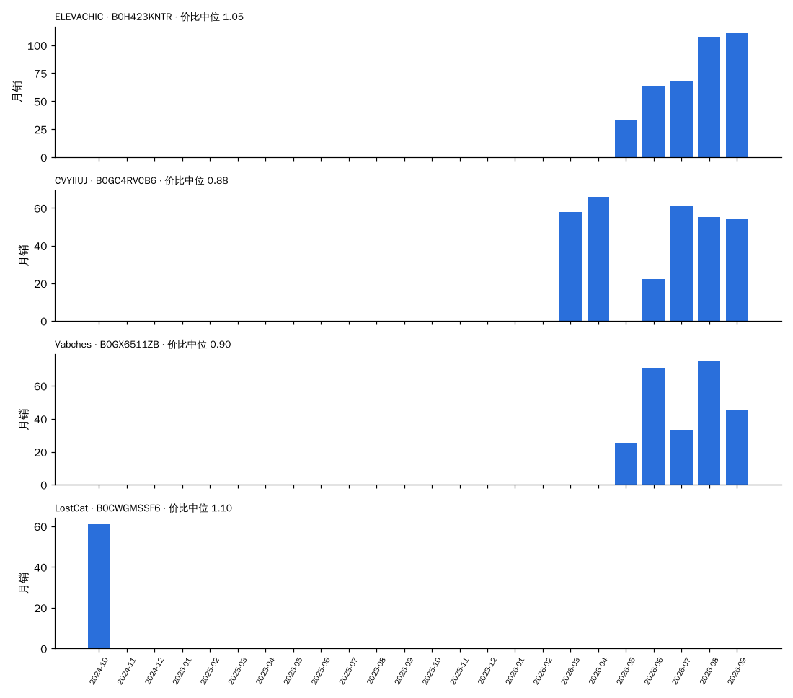
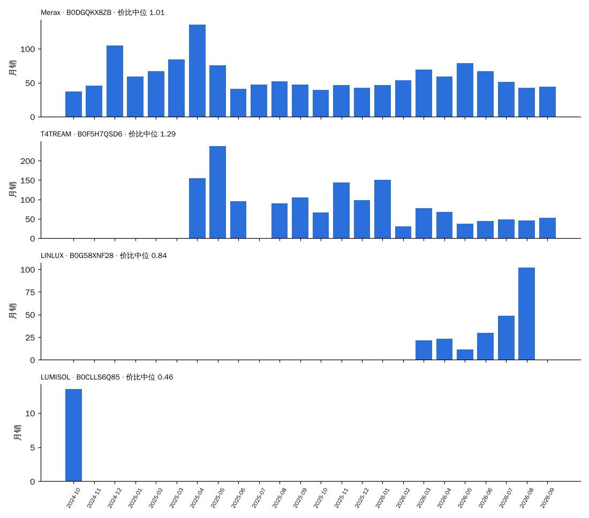
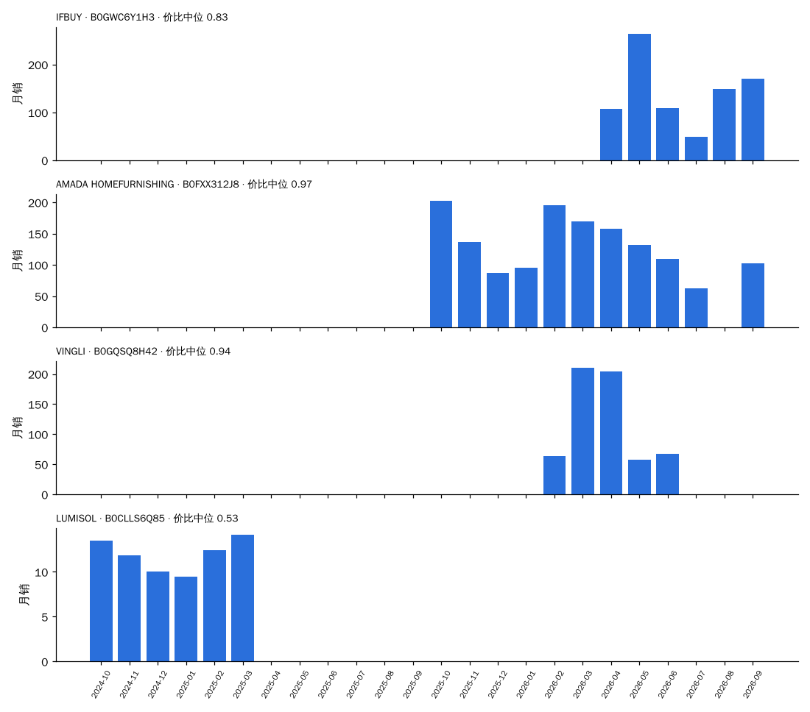
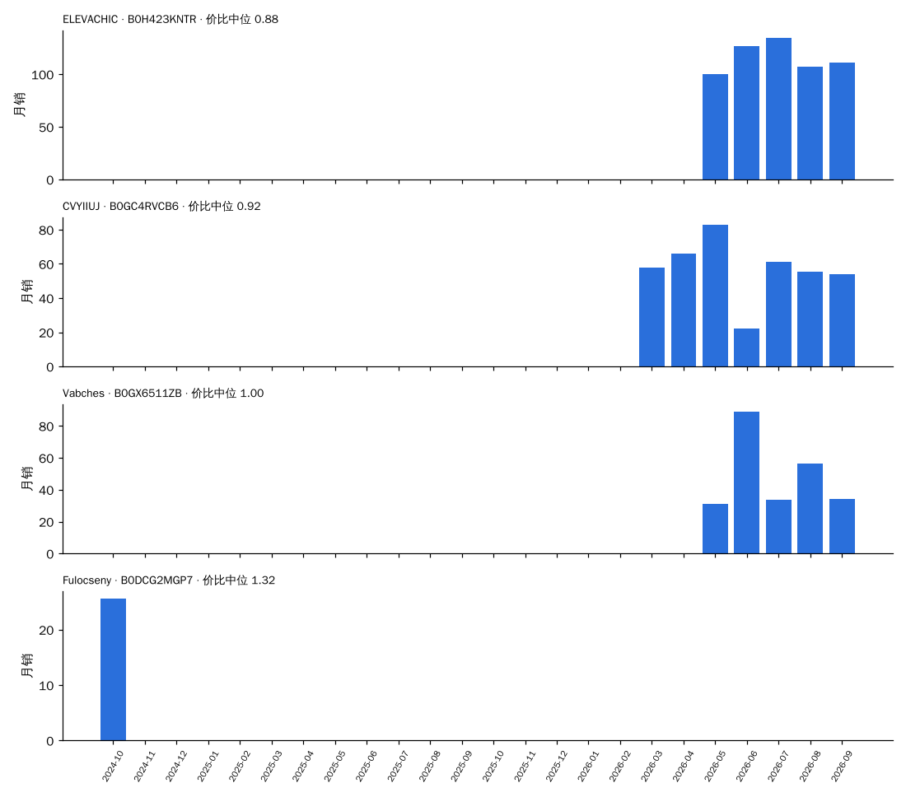

# 决策卡数据：竖棱（按"同尺寸段 × 同拆装 × 同形态"分框）

> 由 `trial/决策卡.py`（CARD=竖棱）生成，数据 2024-10 至 2026-09。每一项都只和**同一个框（尺寸段 × 拆装 × 形态）里的其他元素**比：份额 = 竖棱销量 ÷ 框内元素已知的销量；溢价 = 价格 ÷ 同月同框中位价；新品 = 上架 ≤ 6 个月。
> 早期 = 2024-10 至 2025-03；近期 = 2026-04 至 2026-09。"相对预测"= 0.824 × 份额斜率 + 0.857 × 新品占比差（系数来自 全链路验证 2.2 的同框回归），减去同框其他元素的加权平均：> 0 表示预计在这个框里份额比别的元素涨得多。

## 1. 所有出现过的框

| 框 | 框月销（近期） | 竖棱月销 早期 → 近期 | 框内份额 早期 → 近期 | 近期在榜家族 | 竖棱中位价 / 框中位价 | 溢价 | 评分 竖棱 / 框 | 新品占比 竖棱 / 框 | 相对预测 | 新家族（含竖棱）做到 / 家族 | 框内其他新家族 做到 / 家族 |
| :--- | ---: | :--- | :--- | ---: | :--- | ---: | :--- | :--- | ---: | :--- | :--- |
| 30″ · 拆装 · 落地式 | 6,153 | 168 → 779 | 3.3% → 12.7% | 35 | $270 / $250 | 0.94 | 4.28 / 4.27 | 56% / 27% | +0.14 | 7 / 10 | 35 / 75 |
| 30″ · 拆装 · 悬浮式 | 1,486 | 128 → 478 | 10.1% → 32.2% | 22 | $230 / $230 | 0.88 | 4.35 / 4.24 | 31% / 13% | +0.23 | 2 / 10 | 4 / 13 |
| 36″ · 拆装 · 落地式 | 3,824 | 19 → 404 | 0.7% → 10.6% | 28 | $330 / $320 | 1.03 | 4.30 / 4.22 | 65% / 33% | +0.23 | 2 / 5 | 19 / 39 |
| 60″ · 拆装 · 落地式 | 1,566 | 0 → 348 | 0.0% → 22.2% | 20 | $450 / $570 | 0.77 | 3.99 / 4.02 | 51% / 17% | +0.26 | 1 / 1 | 2 / 4 |
| 24″ · 拆装 · 悬浮式 | 1,060 | 146 → 299 | 14.9% → 28.2% | 18 | $180 / $190 | 0.90 | 4.43 / 4.32 | 48% / 23% | +0.45 | 8 / 14 | 2 / 7 |
| 48″ · 拆装 · 落地式 | 2,047 | 9 → 278 | 0.5% → 13.6% | 18 | $440 / $500 | 0.88 | 4.23 / 4.15 | 61% / 17% | +0.18 | 1 / 2 | 1 / 5 |
| 24″ · 拆装 · 落地式 | 3,703 | 218 → 262 | 5.0% → 7.1% | 14 | $234 / $210 | 0.97 | 4.24 / 4.28 | 11% / 13% | -0.15 | 1 / 5 | 18 / 47 |
| 18″ · 拆装 · 落地式 | 791 | 123 → 176 | 9.3% → 22.3% | 13 | $310 / $217 | 1.35 | 3.87 / 4.14 | 0% / 6% | +0.28 | — | 1 / 3 |
| 36″ · 拆装 · 悬浮式 | 726 | 44 → 117 | 6.4% → 16.1% | 8 | $269 / $270 | 1.00 | 4.25 / 4.26 | 18% / 9% | +0.25 | 1 / 4 | 0 / 7 |
| 24″ · 整装 · 悬浮式 | 272 | 51 → 92 | 42.4% → 33.7% | 4 | $220 / $400 | 0.38 | 4.12 / 4.37 | 0% / 18% | -0.12 | 1 / 1 | 1 / 2 |
| 30″ · 整装 · 悬浮式 | 226 | 46 → 91 | 58.2% → 40.3% | 4 | $230 / $600 | 0.35 | 4.22 / 4.46 | 0% / 15% | -0.15 | 1 / 1 | 1 / 1 |
| 18″ · 拆装 · 悬浮式 | 421 | 74 → 78 | 6.8% → 18.6% | 3 | $200 / $137 | 1.16 | 4.42 / 4.32 | 0% / 10% | -0.11 | — | — |
| 36″ · 整装 · 悬浮式 | 185 | 42 → 74 | 61.6% → 40.1% | 5 | $240 / $730 | 0.32 | 3.52 / 4.22 | 0% / 14% | -0.17 | 1 / 1 | — |
| 60″ · 拆装 · 悬浮式 | 143 | 0 → 53 | 0.0% → 37.3% | 4 | $450 / $570 | 0.79 | 4.47 / 4.32 | 74% / 28% | +0.29 | 0 / 1 | — |
| 72″+ · 拆装 · 落地式 | 151 | 0 → 40 | 0.0% → 26.5% | 6 | $700 / $1,000 | 0.90 | 4.46 / 4.33 | 0% / 0% | +0.57 | — | — |
| 42″ · 拆装 · 悬浮式 | 72 | 0 → 39 | 0.0% → 54.3% | 2 | $260 / $260 | 0.70 | 3.47 / 3.85 | 0% / 0% | -0.26 | — | 1 / 4 |
| 48″ · 整装 · 悬浮式 | 117 | 0 → 36 | 0.0% → 30.7% | 3 | $950 / $960 | 0.99 | 4.71 / 4.56 | 0% / 32% | -0.26 | — | — |
| 60″ · 整装 · 悬浮式 | 32 | 0 → 29 | 0.0% → 88.9% | 2 | $1,500 / $1,500 | 1.00 | 4.71 / 4.72 | 0% / 0% | -0.12 | — | — |
| 24″ · 整装 · 落地式 | 156 | 1 → 9 | 0.4% → 5.9% | 1 | $290 / $522 | 0.47 | — / 4.50 | 0% / 4% | +0.99 | — | — |
| 30″ · 整装 · 落地式 | 145 | 6 → 9 | 5.7% → 6.4% | 1 | $310 / $650 | 0.40 | 4.10 / 4.46 | 0% / 2% | +0.86 | — | — |
| 48″ · 拆装 · 悬浮式 | 170 | 0 → 4 | 0.0% → 2.3% | 1 | $530 / $480 | 1.10 | 5.00 / 4.33 | 0% / 2% | -0.44 | — | 1 / 3 |
| 36″ · 整装 · 落地式 | 212 | 1 → 0 | 0.9% → 0.0% | 0 | $— / $945 | — | — / 4.67 | — / 3% | +— | — | — |
| 72″+ · 拆装 · 悬浮式 | 4 | 0 → 0 | 0.0% → 0.0% | 0 | $— / $999 | — | — / 5.00 | — / 0% | +— | 0 / 1 | — |

## 2. 框：24″ · 拆装 · 悬浮式

### 2.1 近期（2026-04 至 2026-09）框内各元素对比

| 元素 | 月销 | 份额 | 在榜家族 | 中位价 | 溢价 | 评分 | 新品占比 |
| :--- | ---: | ---: | ---: | ---: | ---: | ---: | ---: |
| **竖棱** | 299 | 28.2% | 18 | $180 | 0.90 | 4.43 | 48% |
| 木条格栅 | 221 | 20.8% | 8 | $199 | 0.95 | 4.19 | 3% |
| 现代线条纹理 | 193 | 18.2% | 13 | $190 | 0.91 | 4.34 | 8% |
| 农场风装饰饰条 | 113 | 10.7% | 4 | $196 | 0.89 | 4.10 | 32% |
| 纯色 | 105 | 9.9% | 8 | $171 | 0.83 | 4.43 | 43% |
| 自然木纹 | 64 | 6.0% | 8 | $160 | 0.73 | 4.45 | 0% |
| 夏克式 | 37 | 3.5% | 2 | $250 | 1.09 | 4.18 | 0% |
| 横板条 | 22 | 2.0% | 2 | $210 | 1.00 | 4.30 | 0% |

### 2.2 按季度：竖棱在这个框里怎么走过来

| 季度 | 竖棱月销 | 框内份额 | 竖棱中位价 | 溢价 | 评分 竖棱 / 框 | 新品占比 竖棱 / 框 | 在榜家族 |
| :--- | ---: | ---: | ---: | ---: | :--- | :--- | ---: |
| 2024Q4 | 142 | 16.1% | $200 | 0.95 | 4.40 / 4.19 | 0% / 2% | 6 |
| 2025Q1 | 150 | 14.0% | $200 | 0.95 | 4.47 / 4.33 | 69% / 25% | 8 |
| 2025Q2 | 348 | 32.5% | $180 | 0.88 | 4.00 / 4.21 | 74% / 31% | 13 |
| 2025Q3 | 229 | 20.3% | $180 | 0.95 | 4.15 / 4.11 | 49% / 16% | 11 |
| 2025Q4 | 424 | 27.2% | $180 | 0.90 | 4.23 / 4.22 | 88% / 32% | 15 |
| 2026Q1 | 249 | 23.9% | $180 | 0.90 | 4.09 / 4.25 | 68% / 24% | 14 |
| 2026Q2 | 208 | 19.7% | $190 | 0.92 | 4.35 / 4.28 | 40% / 25% | 12 |
| 2026Q3 | 391 | 36.8% | $180 | 0.90 | 4.47 / 4.35 | 53% / 22% | 11 |

### 2.3 代表产品（24″ · 拆装 · 悬浮式，近期销量前 3 + 最早在榜的 1 个）

**ELEVACHIC · B0H423KNTR**    [商品链接](https://www.amazon.com/dp/B0H2V7G41J)  
24″ · 拆装 · 悬浮式 · 台面 陶瓷一体（陶瓷）· 元素 竖棱 · 主色 黑 · 上架 2026-06-01 · 首次在榜 2026-05

| 月 | 月销 | 价格 | 价比（÷ 同框中位） | 评分 | 小类排名 | 在榜子体 |
| :--- | ---: | ---: | ---: | ---: | ---: | ---: |
| 2026-05 | 33 | $230 | 1.12 | 4.6 | 87 | 1 |
| 2026-06 | 63 | $225 | 1.02 | 4.5 | 35 | 2 |
| 2026-07 | 67 | $225 | 1.12 | 5.0 | 41 | 2 |
| 2026-08 | 108 | $210 | 1.05 | 3.9 | 43 | 4 |
| 2026-09 | 111 | $189 | 0.95 | 4.2 | 7 | 4 |

**CVYIIUJ · B0GC4RVCB6**    [商品链接](https://www.amazon.com/dp/B0FWBHV1TQ)  
24″ · 拆装 · 悬浮式 · 台面 树脂一体（树脂）· 元素 竖棱 · 主色 原木 · 上架 2025-10-15 · 首次在榜 2026-03

| 月 | 月销 | 价格 | 价比（÷ 同框中位） | 评分 | 小类排名 | 在榜子体 |
| :--- | ---: | ---: | ---: | ---: | ---: | ---: |
| 2026-03 | 58 | $180 | 0.86 | 4.0 | 13 | 1 |
| 2026-04 | 66 | $190 | 0.83 | 4.0 | 62 | 1 |
| 2026-06 | 22 | $180 | 0.82 | 4.1 | 56 | 1 |
| 2026-07 | 61 | $180 | 0.90 | 4.2 | 25 | 1 |
| 2026-08 | 55 | $180 | 0.90 | 4.2 | 46 | 1 |
| 2026-09 | 54 | $180 | 0.90 | 4.2 | 92 | 1 |

**Vabches · B0GX6511ZB**    [商品链接](https://www.amazon.com/dp/B0GX61SC8Y)  
24″ · 拆装 · 悬浮式 · 台面 陶瓷一体（陶瓷）· 元素 竖棱 · 主色 白 · 上架 2026-04-17 · 首次在榜 2026-05

| 月 | 月销 | 价格 | 价比（÷ 同框中位） | 评分 | 小类排名 | 在榜子体 |
| :--- | ---: | ---: | ---: | ---: | ---: | ---: |
| 2026-05 | 25 | $190 | 0.92 | 5.0 | 159 | 4 |
| 2026-06 | 71 | $190 | 0.86 | 5.0 | 83 | 4 |
| 2026-07 | 33 | $190 | 0.95 | 5.0 | 107 | 3 |
| 2026-08 | 75 | $171 | 0.85 | 4.3 | 43 | 4 |
| 2026-09 | 46 | $180 | 0.90 | 4.3 | 155 | 4 |

**LostCat · B0CWGMSSF6**    [商品链接](https://www.amazon.com/dp/B0CWGMSSF6)  
24″ · 拆装 · 悬浮式 · 台面 陶瓷一体（陶瓷）· 元素 竖棱 · 主色 白 · 上架 2024-02-25 · 首次在榜 2024-10

| 月 | 月销 | 价格 | 价比（÷ 同框中位） | 评分 | 小类排名 | 在榜子体 |
| :--- | ---: | ---: | ---: | ---: | ---: | ---: |
| 2024-10 | 61 | $230 | 1.10 | 4.6 | 46 | 1 |

### 2.4 新品方案打分（24″ · 拆装 · 悬浮式，首月 ≥ 2 色 ≥ 4 子体；模型偏高约每 10 个 1 个）

前 4：中档 · 树脂一体 · 主色原木 5.2；中档 · 树脂一体 · 主色白 5.1；高档 · 树脂一体 · 主色原木 4.7；中档 · 树脂一体 · 主色深木 4.6。最低 2：低档 · 陶瓷一体 · 主色灰 2.1；低档 · 陶瓷一体 · 主色黑 1.8。

## 2. 框：24″ · 拆装 · 落地式

### 2.1 近期（2026-04 至 2026-09）框内各元素对比

| 元素 | 月销 | 份额 | 在榜家族 | 中位价 | 溢价 | 评分 | 新品占比 |
| :--- | ---: | ---: | ---: | ---: | ---: | ---: | ---: |
| 夏克式 | 1,198 | 32.3% | 49 | $197 | 0.82 | 4.30 | 10% |
| 农场风装饰饰条 | 1,162 | 31.4% | 45 | $200 | 0.84 | 4.23 | 3% |
| **竖棱** | 262 | 7.1% | 14 | $234 | 0.97 | 4.24 | 11% |
| 夏克式+复古立柱 | 222 | 6.0% | 15 | $252 | 1.06 | 4.48 | 33% |
| 自然木纹 | 212 | 5.7% | 7 | $216 | 0.88 | 4.36 | 25% |
| 玻璃门 | 174 | 4.7% | 6 | $260 | 1.08 | 4.20 | 9% |
| 夏克式+纹路 | 154 | 4.2% | 14 | $290 | 1.21 | 3.99 | 28% |
| 纯色 | 86 | 2.3% | 6 | $206 | 0.84 | 4.29 | 21% |

### 2.2 按季度：竖棱在这个框里怎么走过来

| 季度 | 竖棱月销 | 框内份额 | 竖棱中位价 | 溢价 | 评分 竖棱 / 框 | 新品占比 竖棱 / 框 | 在榜家族 |
| :--- | ---: | ---: | ---: | ---: | :--- | :--- | ---: |
| 2024Q4 | 244 | 5.2% | $240 | 1.14 | 4.21 / 4.20 | 0% / 6% | 6 |
| 2025Q1 | 191 | 4.9% | $210 | 1.01 | 4.10 / 4.24 | 19% / 28% | 6 |
| 2025Q2 | 437 | 9.4% | $270 | 1.29 | 3.64 / 4.19 | 72% / 29% | 6 |
| 2025Q3 | 198 | 5.1% | $230 | 1.15 | 4.33 / 4.29 | 45% / 12% | 7 |
| 2025Q4 | 172 | 4.4% | $229 | 1.09 | 4.27 / 4.32 | 0% / 13% | 4 |
| 2026Q1 | 360 | 9.0% | $229 | 0.99 | 4.14 / 4.31 | 21% / 16% | 10 |
| 2026Q2 | 313 | 8.0% | $250 | 1.00 | 4.22 / 4.26 | 14% / 17% | 11 |
| 2026Q3 | 211 | 6.0% | $216 | 0.92 | 4.26 / 4.31 | 7% / 9% | 9 |

### 2.3 代表产品（24″ · 拆装 · 落地式，近期销量前 3 + 最早在榜的 1 个）

**Merax · B0DGQKX8ZB**    [商品链接](https://www.amazon.com/dp/B0DJX7SWK8)  
24″ · 拆装 · 落地式 · 台面 台面未知·陶瓷盆（信息不足）· 元素 竖棱 · 主色 黑 · 上架 2024-10-11 · 首次在榜 2024-10

| 月 | 月销 | 价格 | 价比（÷ 同框中位） | 评分 | 小类排名 | 在榜子体 |
| :--- | ---: | ---: | ---: | ---: | ---: | ---: |
| 2024-10 | 37 | $280 | 1.33 | — | 132 | 6 |
| 2024-11 | 46 | $246 | 1.23 | 5.0 | 39 | 6 |
| 2024-12 | 105 | $280 | 1.33 | 3.8 | 143 | 1 |
| 2025-01 | 59 | $210 | 1.00 | 3.5 | 25 | 6 |
| 2025-02 | 67 | $210 | 1.02 | 4.1 | 19 | 8 |
| 2025-03 | 84 | $213 | 1.01 | 3.8 | 10 | 9 |
| 2025-04 | 136 | $210 | 1.00 | 4.0 | 34 | 9 |
| 2025-05 | 76 | $211 | 1.06 | 4.0 | 21 | 8 |
| 2025-06 | 41 | $211 | 1.01 | 4.1 | 54 | 8 |
| 2025-07 | 47 | $211 | 1.06 | 4.2 | 21 | 8 |
| 2025-08 | 52 | $213 | 1.07 | 4.1 | 11 | 9 |
| 2025-09 | 47 | $211 | 1.06 | 4.0 | 31 | 8 |
| 2025-10 | 40 | $204 | 0.97 | 3.9 | 28 | 8 |
| 2025-11 | 46 | $208 | 0.99 | 4.0 | 67 | 8 |
| 2025-12 | 43 | $199 | 0.95 | 3.9 | 22 | 8 |
| 2026-01 | 46 | $210 | 1.05 | 4.0 | 58 | 8 |
| 2026-02 | 54 | $219 | 1.04 | 4.0 | 39 | 10 |
| 2026-03 | 70 | $215 | 0.90 | 4.0 | 43 | 10 |
| 2026-04 | 59 | $222 | 0.89 | 4.0 | 47 | 10 |
| 2026-05 | 79 | $215 | 0.88 | 4.1 | 12 | 10 |
| 2026-06 | 67 | $186 | 0.77 | 4.1 | 39 | 8 |
| 2026-07 | 51 | $186 | 0.77 | 4.1 | 67 | 8 |
| 2026-08 | 42 | $221 | 0.92 | 4.0 | 68 | 8 |
| 2026-09 | 44 | $185 | 0.80 | 4.1 | 47 | 8 |

**T4TREAM · B0F5H7QSD6**    [商品链接](https://www.amazon.com/dp/B0F1YPDT14)  
24″ · 拆装 · 落地式 · 台面 陶瓷一体（陶瓷）· 元素 竖棱 · 主色 深木 · 上架 2025-03-18 · 首次在榜 2025-04

| 月 | 月销 | 价格 | 价比（÷ 同框中位） | 评分 | 小类排名 | 在榜子体 |
| :--- | ---: | ---: | ---: | ---: | ---: | ---: |
| 2025-04 | 155 | $270 | 1.29 | 4.8 | 5 | 2 |
| 2025-05 | 238 | $320 | 1.60 | 4.8 | 20 | 6 |
| 2025-06 | 95 | $270 | 1.29 | 4.6 | 148 | 5 |
| 2025-08 | 90 | $270 | 1.35 | 4.5 | 99 | 3 |
| 2025-09 | 105 | $295 | 1.48 | 4.5 | 3 | 2 |
| 2025-10 | 66 | $270 | 1.29 | 4.4 | 15 | 1 |
| 2025-11 | 144 | $229 | 1.09 | 4.4 | 1 | 2 |
| 2025-12 | 99 | $270 | 1.29 | 4.4 | 10 | 2 |
| 2026-01 | 151 | $270 | 1.35 | 4.4 | 4 | 2 |
| 2026-02 | 30 | $270 | 1.29 | 4.4 | — | 1 |
| 2026-03 | 78 | $250 | 1.04 | 4.4 | — | 2 |
| 2026-04 | 68 | $270 | 1.08 | 4.2 | — | 2 |
| 2026-05 | 38 | $270 | 1.10 | 4.2 | — | 2 |
| 2026-06 | 44 | $270 | 1.13 | 4.2 | 18 | 2 |
| 2026-07 | 48 | $198 | 0.83 | 4.3 | 22 | 2 |
| 2026-08 | 46 | $220 | 0.92 | 4.2 | 34 | 2 |
| 2026-09 | 52 | $220 | 0.95 | 4.2 | 45 | 3 |

**LINLUX · B0G58XNF28**    [商品链接](https://www.amazon.com/dp/B0G58XNF28)  
24″ · 拆装 · 落地式 · 台面 陶瓷一体（陶瓷）· 元素 竖棱 · 主色 未知 · 上架 2025-12-08 · 首次在榜 2026-03

| 月 | 月销 | 价格 | 价比（÷ 同框中位） | 评分 | 小类排名 | 在榜子体 |
| :--- | ---: | ---: | ---: | ---: | ---: | ---: |
| 2026-03 | 22 | $230 | 0.96 | 4.7 | 201 | 1 |
| 2026-04 | 23 | $208 | 0.83 | 4.7 | 264 | 1 |
| 2026-05 | 12 | $210 | 0.86 | 4.5 | 212 | 1 |
| 2026-06 | 30 | $210 | 0.88 | 4.6 | 65 | 1 |
| 2026-07 | 48 | $198 | 0.83 | 4.6 | 96 | 1 |
| 2026-08 | 102 | $198 | 0.83 | 4.6 | 110 | 1 |

**LUMISOL · B0CLLS6Q85**    [商品链接](https://www.amazon.com/dp/B0CJ5BMKT8)  
24″ · 拆装 · 落地式 · 台面 陶瓷一体（陶瓷）· 元素 竖棱 · 主色 白 · 上架 2023-09-14 · 首次在榜 2024-10

| 月 | 月销 | 价格 | 价比（÷ 同框中位） | 评分 | 小类排名 | 在榜子体 |
| :--- | ---: | ---: | ---: | ---: | ---: | ---: |
| 2024-10 | 14 | $96 | 0.46 | 4.2 | 319 | 1 |

### 2.4 新品方案打分（24″ · 拆装 · 落地式，首月 ≥ 2 色 ≥ 4 子体；模型偏高约每 10 个 1 个）

前 4：中档 · 树脂一体 · 主色原木 5.9；中档 · 树脂一体 · 主色白 5.8；高档 · 树脂一体 · 主色原木 5.4；中档 · 树脂一体 · 主色深木 5.4。最低 2：低档 · 陶瓷一体 · 主色灰 2.6；低档 · 陶瓷一体 · 主色黑 2.3。

## 2. 框：30″ · 拆装 · 落地式

### 2.1 近期（2026-04 至 2026-09）框内各元素对比

| 元素 | 月销 | 份额 | 在榜家族 | 中位价 | 溢价 | 评分 | 新品占比 |
| :--- | ---: | ---: | ---: | ---: | ---: | ---: | ---: |
| 农场风装饰饰条 | 1,881 | 30.6% | 69 | $230 | 0.80 | 4.26 | 9% |
| 夏克式 | 1,851 | 30.1% | 76 | $240 | 0.83 | 4.23 | 33% |
| **竖棱** | 779 | 12.7% | 35 | $270 | 0.94 | 4.28 | 56% |
| 夏克式+复古立柱 | 474 | 7.7% | 28 | $280 | 0.97 | 4.34 | 18% |
| 自然木纹 | 261 | 4.2% | 12 | $252 | 0.89 | 4.40 | 55% |
| 夏克式+拱门 | 238 | 3.9% | 13 | $290 | 1.00 | 4.30 | 26% |
| 夏克式+纹路 | 205 | 3.3% | 14 | $365 | 1.26 | 4.27 | 17% |
| 搭叠式 | 130 | 2.1% | 3 | $250 | 0.86 | 4.09 | 38% |

### 2.2 按季度：竖棱在这个框里怎么走过来

| 季度 | 竖棱月销 | 框内份额 | 竖棱中位价 | 溢价 | 评分 竖棱 / 框 | 新品占比 竖棱 / 框 | 在榜家族 |
| :--- | ---: | ---: | ---: | ---: | :--- | :--- | ---: |
| 2024Q4 | 176 | 2.8% | $300 | 1.20 | 4.13 / 4.07 | 10% / 6% | 8 |
| 2025Q1 | 160 | 4.2% | $280 | 1.17 | 3.92 / 4.20 | 37% / 45% | 8 |
| 2025Q2 | 391 | 9.7% | $240 | 0.96 | 4.06 / 4.13 | 70% / 32% | 9 |
| 2025Q3 | 330 | 6.3% | $280 | 1.14 | 4.43 / 4.17 | 71% / 26% | 12 |
| 2025Q4 | 441 | 9.6% | $272 | 1.13 | 4.26 / 4.20 | 37% / 20% | 8 |
| 2026Q1 | 646 | 12.1% | $290 | 1.11 | 4.13 / 4.27 | 36% / 33% | 13 |
| 2026Q2 | 947 | 15.5% | $279 | 0.97 | 4.30 / 4.25 | 57% / 29% | 20 |
| 2026Q3 | 611 | 9.8% | $264 | 0.92 | 4.26 / 4.29 | 55% / 26% | 21 |

### 2.3 代表产品（30″ · 拆装 · 落地式，近期销量前 3 + 最早在榜的 1 个）

**IFBUY · B0GWC6Y1H3**    [商品链接](https://www.amazon.com/dp/B0GWCKD158)  
30″ · 拆装 · 落地式 · 台面 陶瓷一体（陶瓷）· 元素 竖棱 · 主色 白 · 上架 2026-04-15 · 首次在榜 2026-04

| 月 | 月销 | 价格 | 价比（÷ 同框中位） | 评分 | 小类排名 | 在榜子体 |
| :--- | ---: | ---: | ---: | ---: | ---: | ---: |
| 2026-04 | 108 | $240 | 0.83 | 5.0 | 42 | 4 |
| 2026-05 | 265 | $240 | 0.85 | 5.0 | 6 | 4 |
| 2026-06 | 109 | $240 | 0.83 | 4.4 | 350 | 4 |
| 2026-07 | 49 | $240 | 0.84 | 4.4 | 95 | 3 |
| 2026-08 | 149 | $228 | 0.79 | 4.7 | 40 | 4 |
| 2026-09 | 171 | $240 | 0.83 | 4.7 | 69 | 4 |

**AMADA HOMEFURNISHING · B0FXX312J8**    [商品链接](https://www.amazon.com/dp/B0FM4BLTN7)  
30″ · 拆装 · 落地式 · 台面 台面未知·陶瓷盆（信息不足）· 元素 竖棱 · 主色 原木 · 上架 2025-08-11 · 首次在榜 2025-10

| 月 | 月销 | 价格 | 价比（÷ 同框中位） | 评分 | 小类排名 | 在榜子体 |
| :--- | ---: | ---: | ---: | ---: | ---: | ---: |
| 2025-10 | 203 | $245 | 1.02 | 4.3 | 18 | 2 |
| 2025-11 | 137 | $282 | 1.18 | 4.5 | 89 | 2 |
| 2025-12 | 87 | $282 | 1.13 | 4.5 | 88 | 2 |
| 2026-01 | 95 | $282 | 1.13 | 4.4 | 92 | 2 |
| 2026-02 | 196 | $280 | 1.04 | 4.5 | 43 | 2 |
| 2026-03 | 170 | $246 | 0.91 | 4.5 | 83 | 2 |
| 2026-04 | 158 | $280 | 0.97 | 4.5 | 48 | 2 |
| 2026-05 | 132 | $260 | 0.93 | 4.6 | 71 | 2 |
| 2026-06 | 110 | $242 | 0.83 | 4.4 | 81 | 2 |
| 2026-07 | 62 | $211 | 0.74 | 4.4 | 83 | 2 |
| 2026-09 | 103 | $240 | 0.83 | 4.4 | 102 | 3 |

**VINGLI · B0GQSQ8H42**    [商品链接](https://www.amazon.com/dp/B0GMQVHTV3)  
30″ · 拆装 · 落地式 · 台面 陶瓷一体（陶瓷）· 元素 竖棱 · 主色 白 · 上架 2026-02-27 · 首次在榜 2026-02

| 月 | 月销 | 价格 | 价比（÷ 同框中位） | 评分 | 小类排名 | 在榜子体 |
| :--- | ---: | ---: | ---: | ---: | ---: | ---: |
| 2026-02 | 64 | $290 | 1.07 | 4.2 | 8 | 5 |
| 2026-03 | 211 | $246 | 0.91 | 4.2 | 2 | 5 |
| 2026-04 | 204 | $290 | 1.00 | 4.2 | 3 | 5 |
| 2026-05 | 57 | $265 | 0.94 | 4.2 | 62 | 4 |
| 2026-06 | 68 | $265 | 0.91 | 4.2 | 34 | 6 |

**LUMISOL · B0CLLS6Q85**    [商品链接](https://www.amazon.com/dp/B0CLLSWHXJ)  
30″ · 拆装 · 落地式 · 台面 台面未知·陶瓷盆（信息不足）· 元素 竖棱 · 主色 深木 · 上架 2023-10-22 · 首次在榜 2024-10

| 月 | 月销 | 价格 | 价比（÷ 同框中位） | 评分 | 小类排名 | 在榜子体 |
| :--- | ---: | ---: | ---: | ---: | ---: | ---: |
| 2024-10 | 14 | $126 | 0.50 | 4.2 | 49 | 1 |
| 2024-11 | 12 | $133 | 0.52 | 4.3 | 89 | 1 |
| 2024-12 | 10 | $133 | 0.55 | 4.0 | 356 | 1 |
| 2025-01 | 9 | $133 | 0.55 | 4.0 | 24 | 1 |
| 2025-02 | 12 | $136 | 0.57 | 4.1 | 61 | 1 |
| 2025-03 | 14 | $116 | 0.46 | 4.1 | 69 | 1 |

### 2.4 新品方案打分（30″ · 拆装 · 落地式，首月 ≥ 2 色 ≥ 4 子体；模型偏高约每 10 个 1 个）

前 4：中档 · 树脂一体 · 主色原木 6.6；中档 · 树脂一体 · 主色白 6.4；高档 · 树脂一体 · 主色原木 6.1；中档 · 树脂一体 · 主色深木 6.0。最低 2：低档 · 陶瓷一体 · 主色灰 3.1；低档 · 陶瓷一体 · 主色黑 2.8。

## 2. 框：30″ · 拆装 · 悬浮式

### 2.1 近期（2026-04 至 2026-09）框内各元素对比

| 元素 | 月销 | 份额 | 在榜家族 | 中位价 | 溢价 | 评分 | 新品占比 |
| :--- | ---: | ---: | ---: | ---: | ---: | ---: | ---: |
| **竖棱** | 478 | 32.2% | 22 | $230 | 0.88 | 4.35 | 31% |
| 纯色 | 363 | 24.5% | 17 | $210 | 0.82 | 4.33 | 8% |
| 木条格栅 | 218 | 14.7% | 10 | $260 | 1.00 | 4.20 | 4% |
| 现代线条纹理 | 201 | 13.5% | 12 | $230 | 0.88 | 4.31 | 4% |
| 自然木纹 | 152 | 10.3% | 10 | $400 | 1.54 | 3.69 | 0% |
| 夏克式 | 39 | 2.7% | 2 | $220 | 0.86 | 4.31 | 0% |
| 横板条 | 31 | 2.1% | 2 | $260 | 1.04 | 4.31 | 0% |

### 2.2 按季度：竖棱在这个框里怎么走过来

| 季度 | 竖棱月销 | 框内份额 | 竖棱中位价 | 溢价 | 评分 竖棱 / 框 | 新品占比 竖棱 / 框 | 在榜家族 |
| :--- | ---: | ---: | ---: | ---: | :--- | :--- | ---: |
| 2024Q4 | 125 | 8.8% | $260 | 1.18 | 4.22 / 4.31 | 36% / 8% | 5 |
| 2025Q1 | 132 | 11.7% | $305 | 1.39 | 4.01 / 4.30 | 70% / 27% | 7 |
| 2025Q2 | 125 | 10.0% | $289 | 1.31 | 3.89 / 4.30 | 52% / 19% | 7 |
| 2025Q3 | 381 | 28.4% | $220 | 1.10 | 4.52 / 4.32 | 95% / 32% | 14 |
| 2025Q4 | 334 | 21.9% | $220 | 1.05 | 3.88 / 4.22 | 67% / 34% | 15 |
| 2026Q1 | 437 | 25.5% | $220 | 0.94 | 4.34 / 4.30 | 36% / 24% | 13 |
| 2026Q2 | 564 | 34.4% | $230 | 0.88 | 4.42 / 4.31 | 27% / 14% | 17 |
| 2026Q3 | 392 | 29.4% | $230 | 0.92 | 4.24 / 4.16 | 37% / 12% | 10 |

### 2.3 代表产品（30″ · 拆装 · 悬浮式，近期销量前 3 + 最早在榜的 1 个）

**ELEVACHIC · B0H423KNTR**    [商品链接](https://www.amazon.com/dp/B0G47NXDTZ)  
30″ · 拆装 · 悬浮式 · 台面 陶瓷一体（陶瓷）· 元素 竖棱 · 主色 黑 · 上架 2025-11-27 · 首次在榜 2026-05

| 月 | 月销 | 价格 | 价比（÷ 同框中位） | 评分 | 小类排名 | 在榜子体 |
| :--- | ---: | ---: | ---: | ---: | ---: | ---: |
| 2026-05 | 100 | $196 | 0.77 | 4.6 | 87 | 3 |
| 2026-06 | 127 | $230 | 0.88 | 4.5 | 30 | 4 |
| 2026-07 | 135 | $230 | 0.92 | 4.6 | 30 | 4 |
| 2026-08 | 108 | $230 | 0.88 | 4.2 | 43 | 4 |
| 2026-09 | 111 | $190 | 0.79 | 4.1 | 7 | 4 |

**CVYIIUJ · B0GC4RVCB6**    [商品链接](https://www.amazon.com/dp/B0FWBPBRFR)  
30″ · 拆装 · 悬浮式 · 台面 树脂一体（树脂）· 元素 竖棱 · 主色 原木 · 上架 2025-10-15 · 首次在榜 2026-03

| 月 | 月销 | 价格 | 价比（÷ 同框中位） | 评分 | 小类排名 | 在榜子体 |
| :--- | ---: | ---: | ---: | ---: | ---: | ---: |
| 2026-03 | 58 | $240 | 0.94 | 4.0 | 13 | 1 |
| 2026-04 | 66 | $240 | 0.92 | 4.0 | 62 | 1 |
| 2026-05 | 83 | $210 | 0.82 | 4.0 | 70 | 3 |
| 2026-06 | 22 | $230 | 0.88 | 4.1 | 56 | 1 |
| 2026-07 | 61 | $230 | 0.92 | 4.2 | 25 | 1 |
| 2026-08 | 55 | $230 | 0.88 | 4.2 | 47 | 1 |
| 2026-09 | 54 | $230 | 0.96 | 4.3 | 131 | 1 |

**Vabches · B0GX6511ZB**    [商品链接](https://www.amazon.com/dp/B0GX5XR3SY)  
30″ · 拆装 · 悬浮式 · 台面 陶瓷一体（陶瓷）· 元素 竖棱 · 主色 黑 · 上架 2026-04-21 · 首次在榜 2026-05

| 月 | 月销 | 价格 | 价比（÷ 同框中位） | 评分 | 小类排名 | 在榜子体 |
| :--- | ---: | ---: | ---: | ---: | ---: | ---: |
| 2026-05 | 31 | $260 | 1.02 | 5.0 | 159 | 5 |
| 2026-06 | 89 | $260 | 1.00 | 5.0 | 83 | 5 |
| 2026-07 | 33 | $234 | 0.94 | 5.0 | 46 | 3 |
| 2026-08 | 57 | $234 | 0.90 | 4.3 | 43 | 3 |
| 2026-09 | 34 | $260 | 1.08 | 4.4 | 484 | 3 |

**Fulocseny · B0DCG2MGP7**    [商品链接](https://www.amazon.com/dp/B0DCG74LT2)  
30″ · 拆装 · 悬浮式 · 台面 陶瓷一体（陶瓷）· 元素 竖棱 · 主色 黑 · 上架 2024-08-06 · 首次在榜 2024-10

| 月 | 月销 | 价格 | 价比（÷ 同框中位） | 评分 | 小类排名 | 在榜子体 |
| :--- | ---: | ---: | ---: | ---: | ---: | ---: |
| 2024-10 | 26 | $290 | 1.32 | 5.0 | 84 | 4 |

### 2.4 新品方案打分（30″ · 拆装 · 悬浮式，首月 ≥ 2 色 ≥ 4 子体；模型偏高约每 10 个 1 个）

前 4：中档 · 树脂一体 · 主色原木 5.9；中档 · 树脂一体 · 主色白 5.8；高档 · 树脂一体 · 主色原木 5.4；中档 · 树脂一体 · 主色深木 5.3。最低 2：低档 · 陶瓷一体 · 主色灰 2.6；低档 · 陶瓷一体 · 主色黑 2.3。

