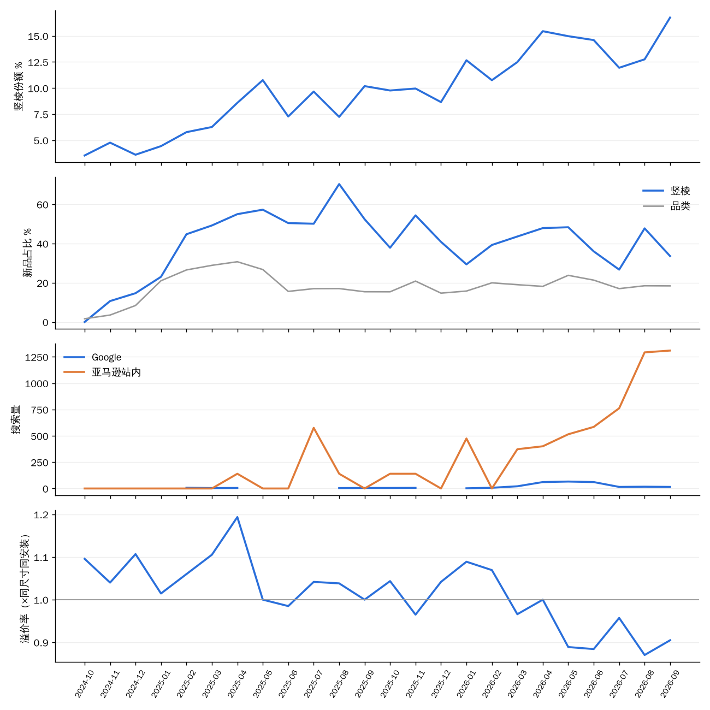

# 案例：竖棱（fluted / reeded）起来之前，有哪些信号

> 由 `trial/案例_竖棱.py` 生成。份额 = 竖棱家族销量 ÷ 有元素标签的销量（一个家族可有多个元素）。新品占比 = 竖棱销量里上架 ≤ 6 个月家族的比例。把握 / 分级 = 第九版站在当月（只用之前的数据）给的评分，看立项后第 6–10 个月。

## 读图结论（2026-11-03）

1. **最早的信号是"新品先起来"。**
   - 2025-02 起，竖棱销量里新上架家族占 45%–57%，品类整体只有 27%–31%。
   - 同期竖棱份额从 3.5%（2024-10）涨到 10.8%（2025-05），之后继续涨到 16.8%（2026-09）。
   - 第九版站在 2025-07 就给了 A 档（把握 80%）。之后大多数月份是 A，个别月份是 B（把握 60%–69%）。
2. **溢价率先高后低，提示进入价格战。**
   - 起量初期，竖棱比同尺寸、同安装方式的中位价贵 4%–19%（2024-10 至 2025-04）。
   - 2026-03 起降到 0.87–0.97，比同类便宜，说明竖棱已变成大路货，进来的人在拼价格。
   - 用法：溢价率还 > 1 时进场，能卖出价格；< 1 时再进，要准备好成本优势。
3. **搜索是确认信号，不是领先信号。**
   - 亚马逊站内搜索 2026-03 起才持续上涨，到 2026-09 约 1,310；Google 在 2026-04 至 06 冲高。
   - 两者都晚于份额上涨约一年。多数月份为 0 或缺数，是词表覆盖的问题。
4. **新品做到的机会在下降。**
   - 2024-10 至 2025-07 上架的竖棱新家族：25 个里做到 14 个，每 10 个约 5.6。
   - 2025-08 至 2026-04 上架的：33 个里做到 13 个，每 10 个约 3.9。
   - 份额还在涨，但进来的人也多了。
5. **按立项到上架约 8 个月算：**
   - 站在 2025-07 看到信号就立项，约 2026-03 上架。那时份额仍在涨（12.5% → 16.8%），但溢价率已跌破 1、新品做到率下降。
   - 机会卡上要同时给"份额还会涨多少"和"进去的人做到的比例、能卖什么价"。

## 逐月时间线

| 月 | 竖棱份额（当月） | 溢价率（同尺寸同安装方式） | 新品占比（竖棱 / 品类） | Google 搜索 | 亚马逊搜索 | 当月新上架竖棱家族（之后做到） | 站在当月：近 6 个月份额 | 份额每月变化 | 新品占比高出品类 | 第九版把握 / 分级 |
| :--- | ---: | ---: | :--- | ---: | ---: | :--- | ---: | ---: | ---: | :--- |
| 2024-10 | 3.5% | 1.10 | 0% / 2% | — | 0 | 3（2） | — | — | — | — |
| 2024-11 | 4.8% | 1.04 | 11% / 4% | — | 0 | — | — | — | — | — |
| 2024-12 | 3.6% | 1.11 | 15% / 8% | — | 0 | 1（0） | — | — | — | — |
| 2025-01 | 4.4% | 1.01 | 23% / 21% | — | 0 | 3（2） | — | — | — | — |
| 2025-02 | 5.8% | 1.06 | 45% / 27% | 7 | 0 | — | — | — | — | — |
| 2025-03 | 6.3% | 1.11 | 49% / 29% | 4 | 0 | 5（2） | — | — | — | — |
| 2025-04 | 8.6% | 1.19 | 55% / 31% | 5 | 140 | 3（3） | — | — | — | — |
| 2025-05 | 10.8% | 1.00 | 57% / 27% | — | 0 | 1（1） | — | — | — | — |
| 2025-06 | 7.3% | 0.98 | 50% / 16% | — | 0 | 5（2） | — | — | — | — |
| 2025-07 | 9.7% | 1.04 | 50% / 17% | — | 576 | 4（2） | 7.3% | +14.0% | +25% | 80% / A |
| 2025-08 | 7.2% | 1.04 | 70% / 17% | 4 | 140 | 1（1） | 8.1% | +9.6% | +28% | 68% / B |
| 2025-09 | 10.2% | 1.00 | 52% / 15% | 5 | 0 | 3（1） | 8.3% | +1.9% | +33% | 60% / B |
| 2025-10 | 9.8% | 1.04 | 38% / 15% | 5 | 140 | 2（2） | 9.0% | -0.1% | +35% | 81% / A |
| 2025-11 | 10.0% | 0.96 | 54% / 21% | 6 | 140 | 4（1） | 9.2% | +0.7% | +34% | 83% / A |
| 2025-12 | 8.7% | 1.04 | 41% / 15% | — | 0 | 2（1） | 9.1% | +5.6% | +35% | 83% / A |
| 2026-01 | 12.7% | 1.09 | 29% / 16% | 2 | 475 | 4（1） | 9.3% | +1.0% | +33% | 69% / B |
| 2026-02 | 10.8% | 1.07 | 39% / 20% | 7 | 0 | 3（0） | 9.7% | +6.8% | +29% | 74% / A |
| 2026-03 | 12.5% | 0.97 | 44% / 19% | 21 | 373 | 7（3） | 10.3% | +2.6% | +25% | 72% / A |
| 2026-04 | 15.4% | 1.00 | 48% / 18% | 61 | 401 | 7（3） | 10.7% | +5.4% | +23% | 84% / A |
| 2026-05 | 15.0% | 0.89 | 48% / 24% | 66 | 515 | — | 11.5% | +9.3% | +25% | 84% / A |
| 2026-06 | 14.6% | 0.88 | 36% / 21% | 61 | 585 | — | 12.4% | +10.4% | +24% | 83% / A |
| 2026-07 | 11.9% | 0.96 | 27% / 17% | 15 | 762 | — | 13.5% | +5.6% | +21% | 77% / A |
| 2026-08 | 12.8% | 0.87 | 48% / 18% | 17 | 1,293 | — | 13.4% | +2.8% | +21% | 70% / B |
| 2026-09 | 16.8% | 0.90 | 34% / 18% | 15 | 1,310 | — | 13.7% | -1.9% | +22% | 65% / B |
| 2026-10 | — | — | — / — | 7 | — | — | 14.4% | -0.8% | +21% | 64% / B |

## 代表家族（2026-04 至 2026-09 竖棱销量前 8）

| 主图 | 家族 | 品牌 | 尺寸 · 台面 | 中位价 | 上架日期 | 近 6 个月月均销 |
| :--- | :--- | :--- | :--- | ---: | :--- | ---: |
|  | [B0GPLKG9KX](https://www.amazon.com/dp/B0G423QGRT) | T4TREAM | 60″ · 陶瓷一体 | $470 | 2026-02-17 | 224 |
|  | [B0F5H7QSD6](https://www.amazon.com/dp/B0F1YPDT14) | T4TREAM | 24″ · 陶瓷一体 | $330 | 2025-03-29 | 196 |
|  | [B0H423KNTR](https://www.amazon.com/dp/B0F9PS3DLW) | ELEVACHIC | 30″ · 陶瓷一体 | $200 | 2025-05-29 | 160 |
|  | [B0GTQT1H8Q](https://www.amazon.com/dp/B0GTP9HCCX) | CARPETNAL | 30″ · 树脂一体 | $330 | 2026-03-25 | 155 |
|  | [B0DGQKX8ZB](https://www.amazon.com/dp/B0DBLTJ8LJ) | Merax | 18″ · 陶瓷一体 | $229 | 2024-08-28 | 147 |
|  | [B0GC4RVCB6](https://www.amazon.com/dp/B0FWBFZ5TX) | CVYIIUJ | 36″ · 树脂一体 | $230 | 2025-10-21 | 143 |
|  | [B0GWC6Y1H3](https://www.amazon.com/dp/B0GWCDX37B) | IFBUY | 30″ · 陶瓷一体 | $240 | 2026-04-13 | 142 |
|  | [B0DMN5QZ3L](https://www.amazon.com/dp/B0FPMD3161) | AmbroVania | 60″ · 石材台面 | $740 | 2025-09-19 | 120 |
